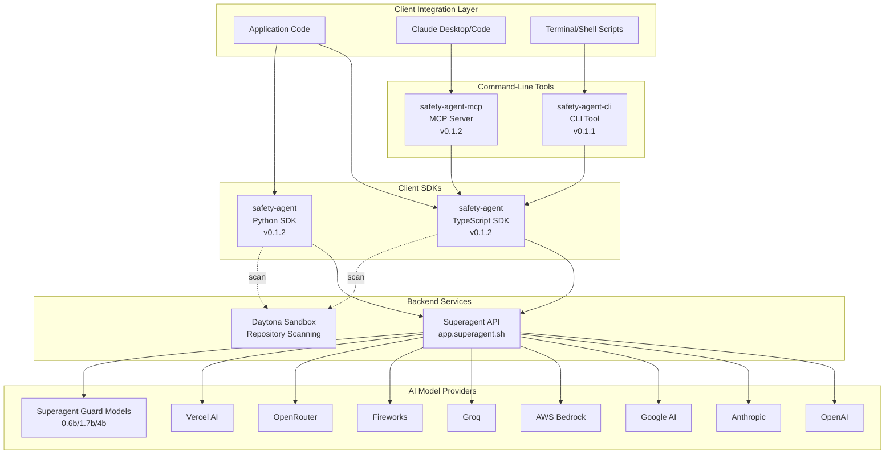
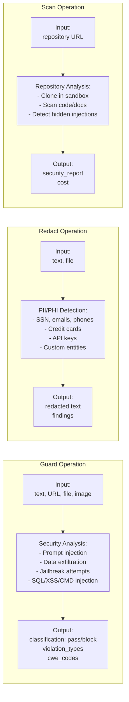
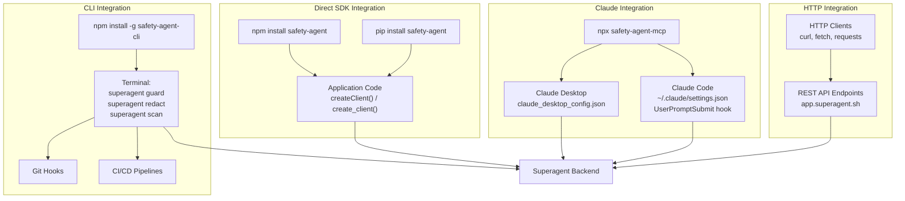
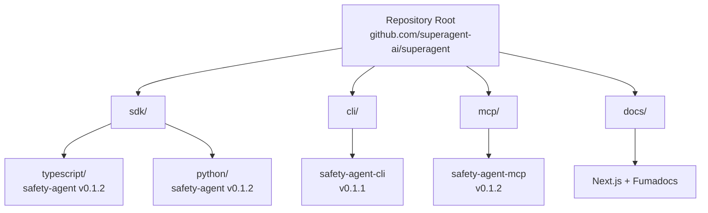

<!-- source: DeepWiki mcp.deepwiki.com · repo superagent-ai/superagent · page 1.2 Architecture Overview · fetched 2026-10-26 -->

# Architecture Overview

<details>
<summary>Relevant source files</summary>

The following files were used as context for generating this wiki page:

- [CHANGELOG.md](CHANGELOG.md)
- [README.md](README.md)
- [docs/app/[[...slug]]/layout.tsx](docs/app/[[...slug]]/layout.tsx)
- [docs/content/docs/meta.json](docs/content/docs/meta.json)
- [docs/mdx-components.tsx](docs/mdx-components.tsx)
- [docs/next.config.mjs](docs/next.config.mjs)
- [sdk/python/pyproject.toml](sdk/python/pyproject.toml)
- [sdk/typescript/package.json](sdk/typescript/package.json)
- [sdk/typescript/src/index.ts](sdk/typescript/src/index.ts)

</details>


This document provides a high-level overview of Superagent's architecture, showing how the SDKs, CLI, MCP server, REST API, and backend services work together to provide AI agent security and privacy capabilities.

For detailed information about the core operations, see [Core Concepts](#1.1). For SDK usage, see [SDK Reference](#2).

## System Overview

Superagent provides AI agent security through a multi-tier architecture consisting of client SDKs, command-line tools, a backend API, and specialized AI model providers. The system supports three core operations: Guard (security analysis), Redact (PII/PHI removal), and Scan (repository analysis).

### High-Level System Architecture



Sources:
- [README.md:1-188]()
- [sdk/typescript/package.json:1-52]()
- [sdk/python/pyproject.toml:1-51]()

## System Components

### Client SDKs

Superagent provides TypeScript and Python SDKs that share identical version numbers (0.1.2) and API surfaces. Both SDKs provide the same three operations: `guard()`, `redact()`, and `scan()`.

| SDK | Package Name | Version | Installation |
|-----|--------------|---------|--------------|
| TypeScript | `safety-agent` | 0.1.2 | `npm install safety-agent` |
| Python | `safety-agent` | 0.1.2 | `pip install safety-agent` |

**TypeScript Client Creation:**
```typescript
import { createClient } from "safety-agent";
const client = createClient();
```

**Python Client Creation:**
```python
from safety_agent import create_client
client = create_client()
```

Sources:
- [sdk/typescript/package.json:1-52]()
- [sdk/python/pyproject.toml:1-51]()
- [sdk/typescript/src/index.ts:1-55]()

### Command-Line Tools

#### CLI Tool

The `safety-agent-cli` package (version 0.1.1) provides terminal access to all three core operations.

**Commands:**
- `superagent guard` - Analyze input for security threats
- `superagent redact` - Remove PII/PHI from text
- `superagent scan` - Scan repositories for AI attacks

The CLI is built on top of the TypeScript SDK and accepts input via stdin or command-line flags.

Sources:
- [README.md:150-158]()

#### MCP Server

The `safety-agent-mcp` package (version 0.1.2) implements the Model Context Protocol, enabling integration with Claude Desktop and Claude Code. It exposes three MCP tools:
- `superagent_guard`
- `superagent_redact`
- `superagent_scan`

Sources:
- [README.md:150-158]()

### Multi-Language SDK Architecture

Both SDKs maintain parallel architecture with identical functionality:

```mermaid
graph TB
    subgraph "TypeScript SDK - safety-agent"
        TS_CLIENT["SafetyClient class"]
        TS_CREATE["createClient() factory"]
        TS_GUARD["guard() method"]
        TS_REDACT["redact() method"]
        TS_SCAN["scan() method"]
        TS_PROCESS["processInput() utility"]
        TS_PROVIDERS["Provider abstraction<br/>parseModel()<br/>getProvider()"]
        TS_TYPES["Type definitions<br/>GuardInput<br/>RedactOptions<br/>ScanOptions"]
    end
    
    subgraph "Python SDK - safety_agent"
        PY_CLIENT["SafetyClient class"]
        PY_CREATE["create_client() factory"]
        PY_GUARD["guard() method"]
        PY_REDACT["redact() method"]
        PY_SCAN["scan() method"]
        PY_PROCESS["Input processing"]
        PY_PROVIDERS["Provider abstraction"]
        PY_TYPES["Type definitions<br/>GuardInput<br/>RedactOptions<br/>ScanOptions"]
    end
    
    subgraph "Shared Concepts"
        API_KEY["SUPERAGENT_API_KEY<br/>environment variable"]
        MODEL_FORMAT["Model format:<br/>provider/model"]
        DAYTONA_KEY["DAYTONA_API_KEY<br/>for scan operations"]
    end
    
    TS_CREATE --> TS_CLIENT
    TS_CLIENT --> TS_GUARD
    TS_CLIENT --> TS_REDACT
    TS_CLIENT --> TS_SCAN
    TS_CLIENT --> TS_PROCESS
    TS_CLIENT --> TS_PROVIDERS
    TS_CLIENT --> TS_TYPES
    
    PY_CREATE --> PY_CLIENT
    PY_CLIENT --> PY_GUARD
    PY_CLIENT --> PY_REDACT
    PY_CLIENT --> PY_SCAN
    PY_CLIENT --> PY_PROCESS
    PY_CLIENT --> PY_PROVIDERS
    PY_CLIENT --> PY_TYPES
    
    TS_CLIENT -.uses.-> API_KEY
    TS_CLIENT -.uses.-> MODEL_FORMAT
    TS_CLIENT -.uses.-> DAYTONA_KEY
    
    PY_CLIENT -.uses.-> API_KEY
    PY_CLIENT -.uses.-> MODEL_FORMAT
    PY_CLIENT -.uses.-> DAYTONA_KEY
```



Sources:
- [sdk/typescript/src/index.ts:1-55]()
- [sdk/python/pyproject.toml:1-51]()
- [sdk/typescript/package.json:1-52]()

### Backend Services

#### Superagent API

The backend API at `app.superagent.sh` serves as the central gateway for all SDK and CLI requests. It handles:

- Authentication via `SUPERAGENT_API_KEY`
- Request routing to AI model providers
- Response formatting with usage statistics

#### Daytona Sandbox

The Daytona sandbox service provides isolated environments for repository scanning operations. When `scan()` is called, the SDK communicates directly with Daytona using the `DAYTONA_API_KEY` to:

1. Clone the target repository in an isolated environment
2. Analyze code, comments, and documentation for hidden threats
3. Generate a security report

Sources:
- [sdk/typescript/package.json:48]()
- [sdk/python/pyproject.toml:25]()
- [README.md:92-113]()

## Core Operations and Data Flow

Superagent provides three core operations, each designed for specific security and privacy use cases:

### Core Operations Overview



### Processing Pipeline

The `processInput()` utility in the TypeScript SDK and equivalent Python logic handle multiple input types:

**Supported Input Types:**
- **Text strings** - Direct text input
- **URLs** - Fetches and processes PDFs from URLs
- **Files/Blobs** - Binary file uploads (PDFs, images)
- **Images** - Processed via vision models when `isVisionModel()` returns true

**Text Chunking:**
For large inputs, the system chunks text into segments (default 8000 characters) and processes them in parallel with OR logic aggregation.

Sources:
- [sdk/typescript/src/index.ts:32]()
- [README.md:28-113]()

## Model Provider Configuration

The SDKs support multiple AI model providers through a unified abstraction. The `parseModel()` function and `getProvider()` utility parse model strings in the format `provider/model`.

### Supported Providers

| Provider | Format | Example Models | Required API Key |
|----------|--------|----------------|------------------|
| OpenAI | `openai/model` | `openai/gpt-4o`, `openai/gpt-4o-mini` | `OPENAI_API_KEY` |
| Anthropic | `anthropic/model` | `anthropic/claude-sonnet-4`, `anthropic/claude-opus-4` | `ANTHROPIC_API_KEY` |
| Google | `google/model` | `google/gemini-pro` | `GOOGLE_API_KEY` |
| AWS Bedrock | `bedrock/model` | `bedrock/anthropic.claude-v2` | AWS credentials |
| Groq | `groq/model` | `groq/llama-3.1-70b` | `GROQ_API_KEY` |
| Fireworks | `fireworks/model` | `fireworks/llama-v3p1-70b` | `FIREWORKS_API_KEY` |
| OpenRouter | `openrouter/model` | `openrouter/anthropic/claude-3.5-sonnet` | `OPENROUTER_API_KEY` |
| Vercel AI | `vercel/model` | `vercel/gpt-4o` | Vercel AI configuration |
| Superagent | `superagent/model` | `superagent/guard-4b` | N/A (open-weight) |

### Vision Model Support

The `isVisionModel()` utility identifies models with vision capabilities, enabling Guard operations on images:

**Vision-capable models:**
- `openai/gpt-4o`
- `openai/gpt-4o-mini`
- `anthropic/claude-sonnet-4`
- `google/gemini-pro-vision`

Sources:
- [sdk/typescript/src/index.ts:35-40]()
- [README.md:161-165]()

## Integration Pathways

Superagent provides four primary integration pathways for different use cases:

### Integration Pathways Diagram



### Integration Details

**1. Direct SDK Integration**
- Install via `npm install safety-agent` (TypeScript) or `pip install safety-agent` (Python)
- Use `createClient()` or `create_client()` to instantiate a client
- Call `guard()`, `redact()`, or `scan()` methods directly in application code

**2. CLI Integration**
- Install globally via `npm install -g safety-agent-cli`
- Run commands from terminal: `superagent guard`, `superagent redact`, `superagent scan`
- Integrate into Git hooks, shell scripts, and CI/CD pipelines
- Accepts JSON via stdin or file paths via flags

**3. Claude Integration**
- **MCP Server**: Configure in `claude_desktop_config.json` for Claude Desktop
- **UserPromptSubmit Hook**: Configure in `~/.claude/settings.json` for Claude Code
- Enables automatic security checks on every prompt

**4. HTTP Integration**
- Direct REST API calls to `app.superagent.sh` endpoints
- Language-agnostic integration via HTTP clients
- Requires API key authentication

Sources:
- [README.md:128-158]()

## Open-Weight Guard Models

Superagent provides open-weight Guard models for on-premise deployment, eliminating the need for API calls and ensuring data never leaves your environment.

### Available Models

| Model | Parameters | Use Case | Latency |
|-------|------------|----------|---------|
| `superagent-guard-0.6b` | 600M | Fast inference, edge deployment | ~50ms |
| `superagent-guard-1.7b` | 1.7B | Balanced speed and accuracy | ~75ms |
| `superagent-guard-4b` | 4B | Maximum accuracy | ~100ms |

### GGUF Versions for CPU Inference

For CPU-based deployment, GGUF quantized versions are available:
- `superagent-guard-0.6b-gguf`
- `superagent-guard-1.7b-gguf`
- `superagent-guard-4b-gguf`

All models are available on [HuggingFace](https://huggingface.co/superagent-ai).

Sources:
- [README.md:166-177]()

## Development Infrastructure

### Documentation Site

The documentation site is built with Next.js and Fumadocs, providing comprehensive guides and API references.

**Technology Stack:**
- **Framework**: Next.js with Fumadocs
- **Content**: MDX files in `docs/content/docs/`
- **API Reference**: OpenAPI documentation via `fumadocs-openapi`
- **Components**: Custom MDX components including Mermaid diagram support

**Key Files:**
- [docs/next.config.mjs:1-34]() - Next.js configuration
- [docs/app/[[...slug]]/layout.tsx:1-62]() - Documentation layout
- [docs/mdx-components.tsx:1-72]() - MDX component definitions

Sources:
- [docs/next.config.mjs:1-34]()
- [docs/mdx-components.tsx:1-72]()
- [docs/app/[[...slug]]/layout.tsx:1-62]()

### Continuous Integration

GitHub Actions CI pipeline runs automated tests for all packages:

**Test Jobs:**
- `test-node`: Tests TypeScript SDK, CLI, and MCP Server
- `test-python`: Tests Python SDK

**Build Process:**
- TypeScript packages: `tsc` compiler
- Python packages: `hatchling` build backend

Sources:
- [sdk/typescript/package.json:18-23]()
- [sdk/python/pyproject.toml:33-35]()

## Repository Structure

The codebase is organized as a monorepo with separate packages for SDKs, tools, and documentation:



### Key Directories

| Directory | Package Name | Version | Purpose |
|-----------|--------------|---------|---------|
| `sdk/typescript/` | `safety-agent` | 0.1.2 | TypeScript SDK with `createClient()`, `SafetyClient` |
| `sdk/python/` | `safety-agent` | 0.1.2 | Python SDK with `create_client()`, `SafetyClient` |
| `cli/` | `safety-agent-cli` | 0.1.1 | CLI tool built on TypeScript SDK |
| `mcp/` | `safety-agent-mcp` | 0.1.2 | MCP server built on TypeScript SDK |
| `docs/` | N/A | N/A | Documentation site with MDX content |

Sources:
- [sdk/typescript/package.json:1-52]()
- [sdk/python/pyproject.toml:1-51]()
- [README.md:150-158]()

## API Endpoints

Superagent exposes three primary REST API endpoints for Guard, Redact, and Verify operations:

| Endpoint | Method | Purpose | Input Formats |
|----------|--------|---------|---------------|
| `/api/guard` | POST | Security threat detection | Text, URL, PDF file |
| `/api/redact` | POST | PII/PHI removal | Text, PDF file |
| `/api/verify` | POST | Claim verification | Text with source materials |

### Endpoint Details

#### POST /api/guard

Analyzes inputs for security threats including prompt injection, data exfiltration, and jailbreak attempts.

**Request formats:**
- JSON: `{text: string, system_prompt?: string}`
- JSON: `{url: string, system_prompt?: string}`
- JSON: `{file: string (base64), system_prompt?: string}`
- Multipart: `file` field with PDF, optional `system_prompt`

**Response:** JSON with `{classification: "pass"|"block", violation_types: [], cwe_codes: [], reasoning: ""}`

#### POST /api/redact

Removes sensitive information (PII, PHI, secrets) from text or documents.

**Request formats:**
- JSON: `{text: string, entities?: string[], rewrite?: boolean}`
- Multipart: `file` field with PDF, optional `entities`, `format`, `rewrite`

**Response:** JSON with redacted text, or PDF binary (if `format=pdf`)

#### POST /api/verify

Verifies claims in text against provided source materials.

**Request format:**
- JSON: `{text: string, sources: [{name: string, content: string, url?: string}]}`

**Response:** JSON with array of verified claims, each with verdict, evidence, sources, and reasoning

Sources:
- [docs/openapi.json:26-600]()

## Summary

Superagent's architecture consists of several key components working together to provide a comprehensive framework for building AI assistants:

1. **API Layer**: A FastAPI application that serves as the gateway for all interactions
2. **Agent System**: The core component that creates and executes AI agents using LLMs
3. **Tool System**: Provides agents with capabilities to interact with external services
4. **Vector Store System**: Enables semantic search and retrieval over stored data
5. **Workflow System**: Orchestrates sequences of agents to perform complex tasks

These components interact with external services like LLM providers, vector databases, memory systems, and monitoring tools to provide a powerful and flexible platform for building AI-powered applications.

The modular design allows for easy extension and customization, making Superagent suitable for a wide range of use cases from simple chatbots to complex AI assistants with advanced capabilities.

---

