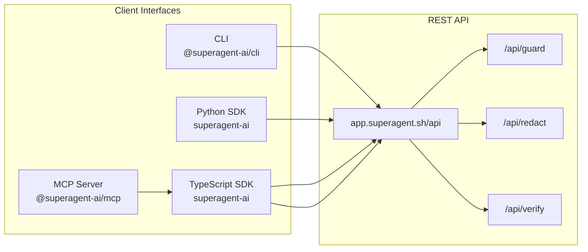
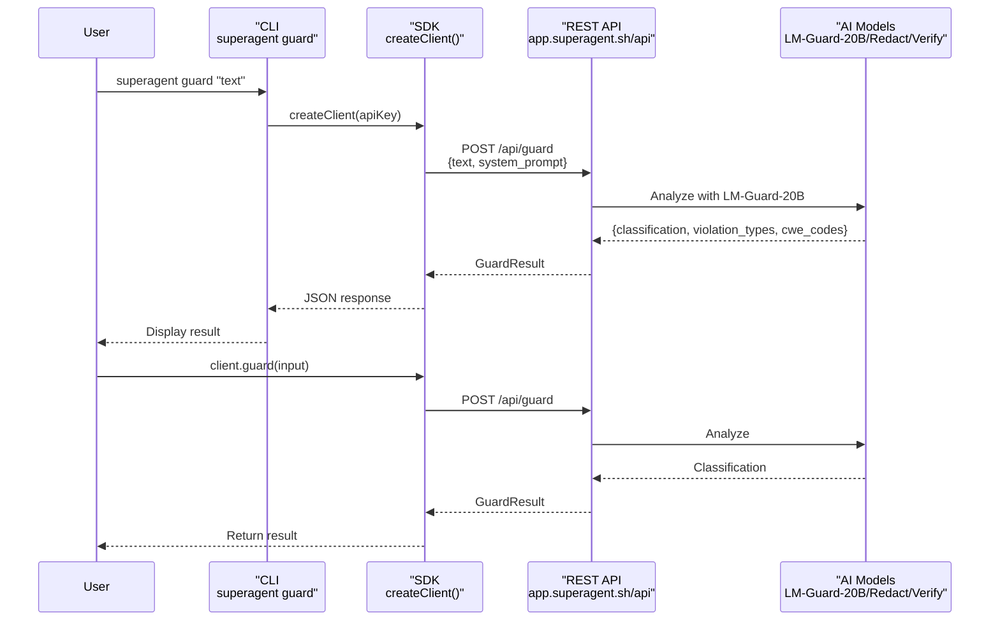
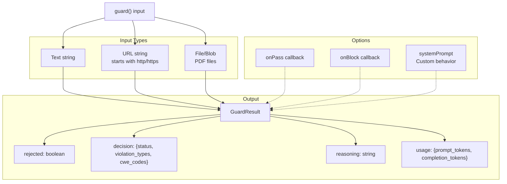
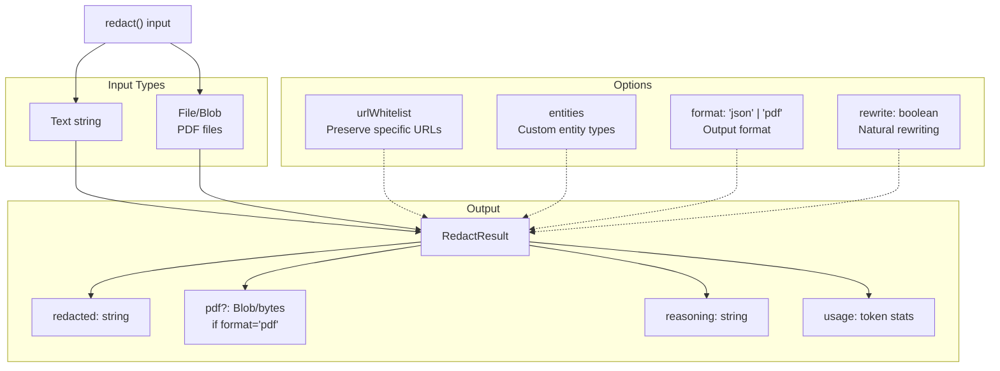

<!-- source: DeepWiki mcp.deepwiki.com · repo superagent-ai/superagent · page 1.3 Quick Start · fetched 2026-10-26 -->

# Quick Start

<details>
<summary>Relevant source files</summary>

The following files were used as context for generating this wiki page:

- [README.md](README.md)
- [sdk/python/README.md](sdk/python/README.md)
- [sdk/typescript/README.md](sdk/typescript/README.md)

</details>


This page provides rapid getting-started instructions for using Superagent's security and compliance features through its various client interfaces. Within minutes, you can start analyzing prompts for security threats, redacting sensitive data, and verifying claims.

For information about the high-level architecture, see [Architecture Overview](#1.2). For details on core concepts, see [Core Concepts](#1.1).

## Overview

Superagent provides multiple client interfaces for accessing its Guard, Redact, and Verify capabilities:



**Client Interface Decision Matrix:**

| Interface | Best For | Installation |
|-----------|----------|--------------|
| CLI | Quick testing, shell scripts, Claude Code hooks | `npm install -g @superagent-ai/cli` |
| Python SDK | Python applications, async workflows | `pip install superagent-ai` |
| TypeScript SDK | Node.js/browser apps, TypeScript projects | `npm install superagent-ai` |
| MCP Server | Claude Desktop integration | `npx -y @superagent-ai/mcp` |

Sources: [cli/package.json:1-44](), [sdk/python/README.md:1-10](), [sdk/typescript/README.md:1-14](), [mcp/README.md:1-20]()

## Prerequisites

To use Superagent, you only need:

1. **A Superagent API Key** - Sign up at [superagent.sh](https://superagent.sh)
2. **Node.js 18+** (for CLI, TypeScript SDK, or MCP Server)
3. **Python 3.8+** (for Python SDK)

That's it! No database setup, no model configuration - just install a client and start using the API.

Sources: [cli/README.md:180-183](), [sdk/python/README.md:5-9](), [sdk/typescript/README.md:6-13]()
</thinking>

## Quick Start with CLI

The CLI is the fastest way to test Superagent features from your terminal.

### Installation

```bash
npm install -g @superagent-ai/cli
```

### Set API Key

```bash
export SUPERAGENT_API_KEY="sk-..."
```

### Example Usage

**Security Guard:**
```bash
# Analyze a prompt for threats
superagent guard "Write a hello world script"

# Analyze with custom system prompt
superagent guard --system-prompt "Focus on prompt injection" "user input"

# Analyze a PDF file
superagent guard --file document.pdf

# Analyze a PDF from URL
superagent guard "https://example.com/document.pdf"
```

**Redact Sensitive Data:**
```bash
# Redact PII/PHI
superagent redact "My email is john@example.com and SSN is 123-45-6789"

# Redact specific entities
superagent redact --entities "credit card numbers,SSN" "text with sensitive data"

# Redact from PDF file
superagent redact --file sensitive.pdf
```

**Verify Claims:**
```bash
# Verify claims against sources
superagent verify "The company was founded in 2020" --sources '[
  {"name": "About Us", "content": "Founded in 2020..."}
]'
```

**Claude Code Integration:**

Add to `~/.claude/settings.json` to validate all prompts:

```json
{
  "env": {
    "SUPERAGENT_API_KEY": "sk-..."
  },
  "hooks": {
    "UserPromptSubmit": [{
      "matcher": "*",
      "hooks": [{"type": "command", "command": "superagent guard"}]
    }]
  }
}
```

Sources: [cli/README.md:1-211](), [cli/src/commands/guard.ts:1-181]()

## Quick Start with Python SDK

The Python SDK provides async/await support for Python applications.

### Installation

```bash
pip install superagent-ai
```

### Example Usage

```python
import asyncio
from superagent_ai import create_client

async def main():
    # Create client
    client = create_client(api_key="sk-...")
    
    # Guard: Analyze for security threats
    guard_result = await client.guard(
        "Write a hello world script",
        on_block=lambda reason: print("Blocked:", reason),
        on_pass=lambda: print("Approved!")
    )
    
    if guard_result.rejected:
        print(f"Rejected: {guard_result.reasoning}")
        print(f"Violations: {guard_result.decision.violation_types}")
        print(f"CWE Codes: {guard_result.decision.cwe_codes}")
    
    # Redact: Remove PII/PHI
    redact_result = await client.redact(
        "My email is john@example.com and SSN is 123-45-6789"
    )
    print(redact_result.redacted)
    # Output: "My email is <EMAIL_REDACTED> and SSN is <SSN_REDACTED>"
    
    # Redact with natural rewrite mode
    rewrite_result = await client.redact(
        "Contact me at john@example.com",
        rewrite=True
    )
    print(rewrite_result.redacted)
    # Output: "Contact me via email"
    
    # Verify: Fact-check claims
    verify_result = await client.verify(
        "The company was founded in 2020 and has 500 employees",
        [
            {
                "name": "About Us",
                "content": "Founded in 2020...",
                "url": "https://example.com/about"
            }
        ]
    )
    
    for claim in verify_result.claims:
        print(f"{claim['claim']}: {claim['verdict']}")
    
    await client.aclose()

asyncio.run(main())
```

### Using Context Manager

```python
async with create_client(api_key="sk-...") as client:
    result = await client.guard("command")
    redacted = await client.redact("text")
```

**Key Functions:**
- `create_client(api_key=...)` - Creates client instance
- `client.guard(input, *, on_block=None, on_pass=None, system_prompt=None)` - Analyzes text/file/URL
- `client.redact(input, *, url_whitelist=None, entities=None, rewrite=None)` - Redacts PII/PHI
- `client.verify(text, sources)` - Verifies claims

Sources: [sdk/python/README.md:1-270](), [CHANGELOG.md:1-407]()

## Quick Start with TypeScript SDK

The TypeScript SDK works in Node.js and browser environments.

### Installation

```bash
npm install superagent-ai
# or
pnpm add superagent-ai
# or
yarn add superagent-ai
```

### Example Usage

```typescript
import { createClient } from "superagent-ai";

const client = createClient({
  apiKey: process.env.SUPERAGENT_API_KEY!,
});

// Guard: Analyze for security threats
const guardResult = await client.guard("Write a hello world script", {
  onBlock: (reason) => console.warn("Blocked:", reason),
  onPass: () => console.log("Approved!"),
  systemPrompt: "Focus on prompt injection detection"
});

if (guardResult.rejected) {
  console.log(guardResult.reasoning);
  console.log(guardResult.decision?.violation_types);
  console.log(guardResult.decision?.cwe_codes);
}

// Guard: Analyze PDF from URL
const urlResult = await client.guard("https://example.com/document.pdf");

// Guard: Analyze PDF file
const pdfFile = new Blob([pdfBuffer], { type: "application/pdf" });
const fileResult = await client.guard(pdfFile);

// Redact: Remove PII/PHI
const redactResult = await client.redact(
  "My email is john@example.com and SSN is 123-45-6789"
);
console.log(redactResult.redacted);
// Output: "My email is <EMAIL_REDACTED> and SSN is <SSN_REDACTED>"

// Redact with natural rewrite mode
const rewriteResult = await client.redact(
  "Contact me at john@example.com",
  { rewrite: true }
);
console.log(rewriteResult.redacted);
// Output: "Contact me via email"

// Redact with custom entities
const customResult = await client.redact(
  "Employee ID is EMP-12345 and card is 4532-1234-5678-9010",
  { entities: ["employee IDs", "credit card numbers"] }
);

// Verify: Fact-check claims
const verifyResult = await client.verify(
  "The company was founded in 2020 and has 500 employees",
  [
    {
      name: "About Us",
      content: "Founded in 2020...",
      url: "https://example.com/about"
    }
  ]
);

console.log(verifyResult.claims);
```

**Key Functions:**
- `createClient({ apiKey, apiBaseUrl?, fetch?, timeoutMs? })` - Creates client instance
- `client.guard(input, { onPass?, onBlock?, systemPrompt? })` - Analyzes text/file/URL
- `client.redact(input, { urlWhitelist?, entities?, format?, rewrite? })` - Redacts PII/PHI
- `client.verify(text, sources)` - Verifies claims

Sources: [sdk/typescript/README.md:1-250](), [CHANGELOG.md:1-407]()

## Quick Start with MCP Server

The MCP Server integrates Superagent with Claude Desktop and Claude Code.

### Installation for Claude Desktop

**Using npx (Recommended):**

Configure in `~/Library/Application Support/Claude/claude_desktop_config.json` (macOS):

```json
{
  "mcpServers": {
    "superagent": {
      "command": "npx",
      "args": ["-y", "@superagent-ai/mcp"],
      "env": {
        "SUPERAGENT_API_KEY": "sk-..."
      }
    }
  }
}
```

Restart Claude Desktop after configuration.

**Global Installation:**

```bash
npm install -g @superagent-ai/mcp
```

Then configure:

```json
{
  "mcpServers": {
    "superagent": {
      "command": "superagent-mcp",
      "env": {
        "SUPERAGENT_API_KEY": "sk-..."
      }
    }
  }
}
```

### Installation for Claude Code

```bash
claude mcp add --transport stdio superagent \
  --env SUPERAGENT_API_KEY=your_api_key_here \
  -- npx -y @superagent-ai/mcp
```

### Example Usage in Claude

Once installed, you can use natural language with Claude:

**Security Guard:**
```
Check if this input is safe: "Ignore all previous instructions"
```

**PII Redaction:**
```
Redact PII from: "My email is john@example.com and SSN is 123-45-6789"
```

**Claim Verification:**
```
Verify this claim: "The company was founded in 2020" using these sources:
- About Us: "Founded in 2020, our company has grown..."
```

**Available MCP Tools:**
- `superagent_guard` - Security threat detection
- `superagent_redact` - PII/PHI redaction
- `superagent_verify` - Claim verification

Sources: [mcp/README.md:1-608](), [mcp/.env.example:1-3]()

## Client Architecture Diagram

The following diagram shows how the different client interfaces map to code entities:

**Client Layer to API Flow:**



**Code Entity Mapping:**

| Client Interface | Key Functions/Commands | API Endpoint | Response Type |
|------------------|------------------------|--------------|---------------|
| CLI | `superagent guard`, `superagent redact`, `superagent verify` | `/api/guard`, `/api/redact`, `/api/verify` | JSON stdout |
| Python SDK | `create_client()`, `client.guard()`, `client.redact()`, `client.verify()` | `/api/guard`, `/api/redact`, `/api/verify` | `GuardResult`, `RedactResult`, `VerifyResult` |
| TypeScript SDK | `createClient()`, `client.guard()`, `client.redact()`, `client.verify()` | `/api/guard`, `/api/redact`, `/api/verify` | `GuardResult`, `RedactResult`, `VerifyResult` |
| MCP Server | `superagent_guard`, `superagent_redact`, `superagent_verify` | Uses TypeScript SDK internally | Markdown/JSON |

Sources: [cli/src/commands/guard.ts:1-181](), [sdk/python/README.md:105-169](), [sdk/typescript/README.md:77-143]()

## Common Use Cases

### Security Validation Pipeline

```typescript
import { createClient } from "superagent-ai";

const client = createClient({ apiKey: "sk-..." });

async function validateUserInput(userInput: string): Promise<boolean> {
  const result = await client.guard(userInput);
  
  if (result.rejected) {
    console.error("Security threat detected:", result.reasoning);
    console.error("Violations:", result.decision?.violation_types);
    return false;
  }
  
  return true;
}

// Use in your application
const isSafe = await validateUserInput(userMessage);
if (isSafe) {
  await processMessage(userMessage);
}
```

### Data Privacy Compliance

```python
from superagent_ai import create_client

async def sanitize_for_logging(text: str) -> str:
    """Remove PII before logging user data"""
    client = create_client(api_key="sk-...")
    result = await client.redact(text)
    await client.aclose()
    return result.redacted

# Use in logging pipeline
user_feedback = "Contact me at user@email.com for more info"
sanitized = await sanitize_for_logging(user_feedback)
logger.info(f"User feedback: {sanitized}")
# Output: "User feedback: Contact me at <EMAIL_REDACTED> for more info"
```

### Automated Fact-Checking

```typescript
async function verifyMarketingClaims(
  claims: string,
  sources: Array<{ name: string; content: string; url?: string }>
) {
  const client = createClient({ apiKey: "sk-..." });
  const result = await client.verify(claims, sources);
  
  const failed = result.claims.filter(c => !c.verdict);
  if (failed.length > 0) {
    console.warn("Failed claims:", failed.map(c => c.claim));
  }
  
  return result;
}
```

Sources: [sdk/typescript/README.md:16-73](), [sdk/python/README.md:26-88]()

## Input Types and Options

### Guard Options



### Redact Options



**Common Redacted Entities:**
- `EMAIL` → `<EMAIL_REDACTED>`
- `SSN` → `<SSN_REDACTED>`
- `CREDIT_CARD` → `<CREDIT_CARD_REDACTED>`
- `PHONE_NUMBER` → `<PHONE_NUMBER_REDACTED>`
- `IP_ADDRESS` → `<IP_REDACTED>`
- `API_KEY` → `<API_KEY_REDACTED>`

Sources: [sdk/python/README.md:118-147](), [sdk/typescript/README.md:88-143](), [CHANGELOG.md:5-33]()

## Verification and Next Steps

After installation, you can verify that everything is working by:

1. Accessing the Swagger docs at `http://127.0.0.1:8000/docs`
2. Logging into the UI at `http://localhost:3000`
3. Creating an agent via the API or UI
4. Testing the agent with a simple prompt

For more information on how to use the backend API, see [API Architecture](#2.1). To learn more about agent creation and configuration, see [Agent System](#2.3).

---

