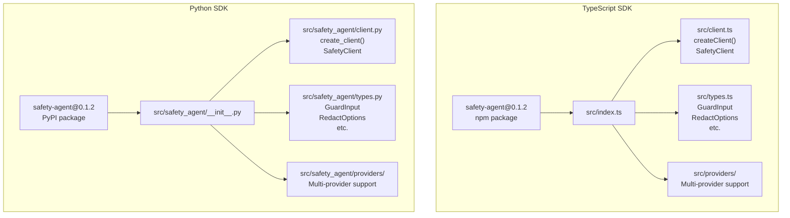
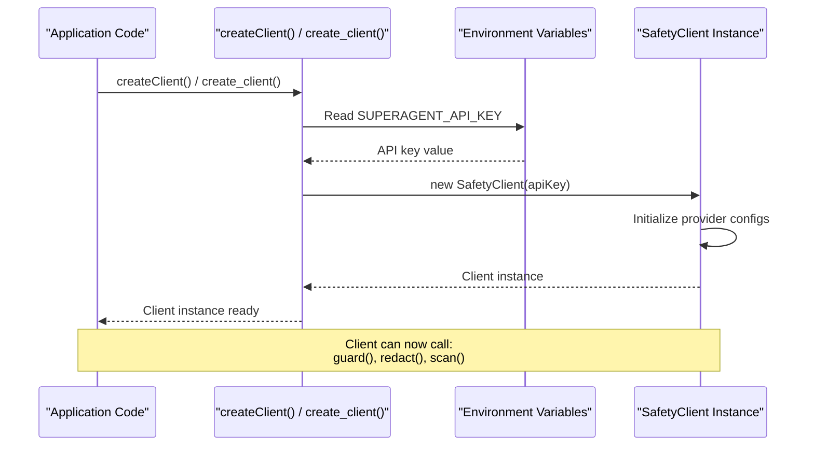
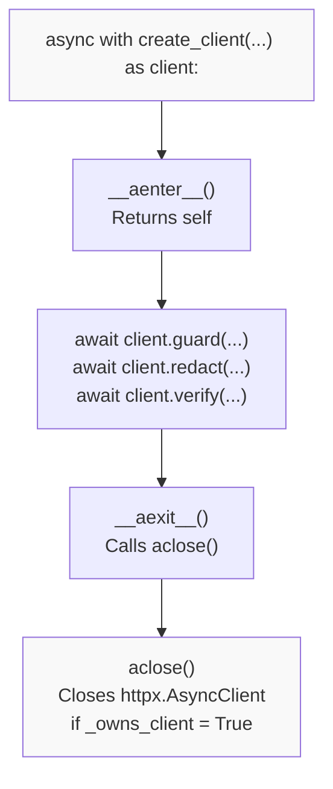
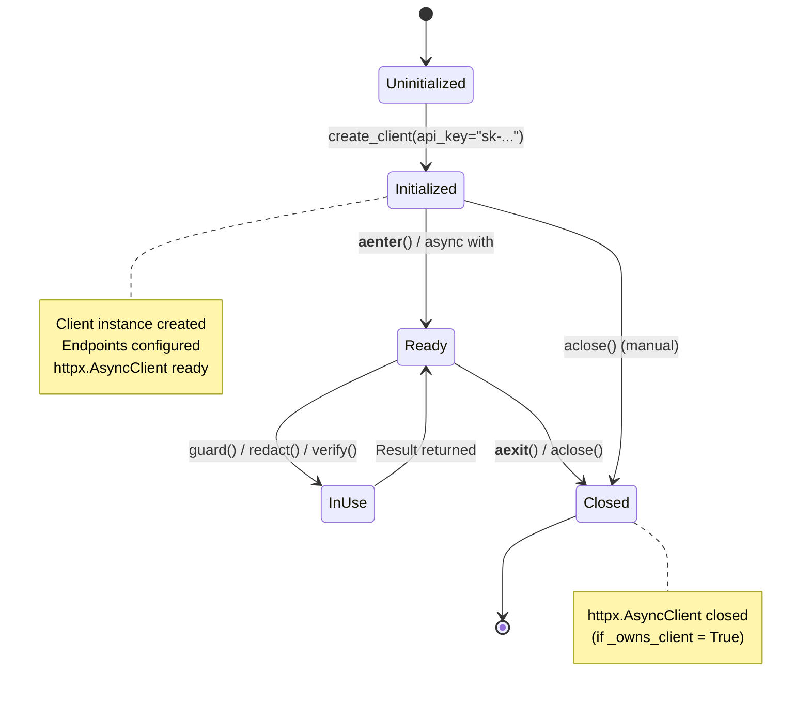

<!-- source: DeepWiki mcp.deepwiki.com · repo superagent-ai/superagent · page 2.1 Installation & Setup · fetched 2026-10-26 -->

# Installation & Setup

<details>
<summary>Relevant source files</summary>

The following files were used as context for generating this wiki page:

- [.github/workflows/ci.yml](.github/workflows/ci.yml)
- [CHANGELOG.md](CHANGELOG.md)
- [sdk/python/README.md](sdk/python/README.md)
- [sdk/python/pyproject.toml](sdk/python/pyproject.toml)
- [sdk/python/src/safety_agent/__init__.py](sdk/python/src/safety_agent/__init__.py)
- [sdk/python/tests/test_scan.py](sdk/python/tests/test_scan.py)
- [sdk/typescript/README.md](sdk/typescript/README.md)
- [sdk/typescript/package.json](sdk/typescript/package.json)
- [sdk/typescript/src/index.ts](sdk/typescript/src/index.ts)

</details>


This page covers installation and configuration for both the TypeScript and Python SDKs. Both SDKs share the same version (0.1.2) and provide identical functionality for Guard, Redact, and Scan operations.

## Package Installation

Both SDKs are distributed under the package name `safety-agent` via npm and PyPI respectively.

### TypeScript SDK

Install via npm:

```bash
npm install safety-agent
```

**Requirements:**
- Node.js >= 18.0.0
- Dependencies: `@daytonaio/sdk`, `ipaddr.js`, `unpdf`

**Package Details:**

| Property | Value |
|----------|-------|
| Package Name | `safety-agent` |
| Version | `0.1.2` |
| Registry | npm |
| Module Type | ESM (type: "module") |

Sources: [sdk/typescript/package.json:1-52]()

### Python SDK

Install via pip or uv:

```bash
# Using pip
pip install safety-agent

# Using uv (recommended)
uv add safety-agent
```

**Requirements:**
- Python >= 3.10
- Dependencies: `httpx>=0.27.0`, `pypdf>=5.0.0`, `daytona-sdk>=0.129.0`

**Supported Python Versions:**

| Version | Status |
|---------|--------|
| 3.10    | ✓ Supported |
| 3.11    | ✓ Supported |
| 3.12    | ✓ Supported |
| 3.13    | ✓ Supported |

Sources: [sdk/python/pyproject.toml:1-51](), [sdk/python/README.md:6-15]()

### Package Architecture

Both SDKs export a main client factory function and comprehensive type definitions:



Sources: [sdk/typescript/src/index.ts:1-55](), [sdk/python/src/safety_agent/__init__.py:1-52]()

## Environment Variables

Before using the SDKs, configure your environment with the necessary API keys.

### Required Variables

**SUPERAGENT_API_KEY**: Required for all operations to track usage and access Superagent-hosted models.

1. Sign up at [superagent.sh](https://superagent.sh)
2. Create an API key from your dashboard
3. Set the environment variable:

```bash
export SUPERAGENT_API_KEY=your-api-key-here
```

Sources: [sdk/typescript/README.md:12-16](), [sdk/python/README.md:18-23]()

### Provider API Keys

Different AI model providers require their own API keys. Configure only the providers you plan to use:

| Provider | Environment Variable | Required For |
|----------|---------------------|--------------|
| OpenAI | `OPENAI_API_KEY` | `openai/*` models |
| Anthropic | `ANTHROPIC_API_KEY` | `anthropic/*` models |
| Google | `GOOGLE_API_KEY` | `google/*` models |
| AWS Bedrock | `AWS_BEDROCK_API_KEY`<br/>`AWS_BEDROCK_REGION` | `bedrock/*` models |
| Groq | `GROQ_API_KEY` | `groq/*` models |
| Fireworks | `FIREWORKS_API_KEY` | `fireworks/*` models |
| OpenRouter | `OPENROUTER_API_KEY` | `openrouter/*` models |
| Vercel AI Gateway | `AI_GATEWAY_API_KEY` | `vercel/*` models |

**Example configuration:**

```bash
export SUPERAGENT_API_KEY=your-superagent-key
export OPENAI_API_KEY=your-openai-key
export ANTHROPIC_API_KEY=your-anthropic-key
```

Sources: [sdk/typescript/README.md:54-70](), [sdk/python/README.md:112-124](), [.github/workflows/ci.yml:40-51]()

### Scan Operation Variables

**DAYTONA_API_KEY**: Required only for repository scanning via `scan()` method.

```bash
export DAYTONA_API_KEY=your-daytona-key
```

Sources: [sdk/python/tests/test_scan.py:20-22](), [.github/workflows/ci.yml:51]()

## Client Initialization

Both SDKs provide factory functions that return configured client instances. The client reads API keys from environment variables by default.

### TypeScript Client

The `createClient()` function creates a `SafetyClient` instance:

```typescript
import { createClient } from "safety-agent";

// Reads SUPERAGENT_API_KEY from environment
const client = createClient();

// Or provide API key explicitly
const client = createClient({
  apiKey: "your-api-key"
});
```

**Configuration Options:**

| Option | Type | Default | Description |
|--------|------|---------|-------------|
| `apiKey` | `string` | `process.env.SUPERAGENT_API_KEY` | API key for usage tracking |

Sources: [sdk/typescript/README.md:20-36](), [sdk/typescript/src/index.ts:7]()

### Python Client

The `create_client()` function creates a `SafetyClient` instance:

```python
from safety_agent import create_client

# Reads SUPERAGENT_API_KEY from environment
client = create_client()

# Or provide API key explicitly
client = create_client(api_key="your-api-key")
```

**Configuration Options:**

The Python client is async and should be used with `async/await`:

```python
import asyncio
from safety_agent import create_client

async def main():
    client = create_client()
    result = await client.guard(input="text to analyze")
    print(result.classification)

asyncio.run(main())
```

Sources: [sdk/python/README.md:27-45](), [sdk/python/src/safety_agent/__init__.py:6]()

### Client Initialization Flow



Sources: [sdk/typescript/src/index.ts:7](), [sdk/python/src/safety_agent/__init__.py:6]()

## API Key Configuration

The API key can be provided directly to `create_client()` or loaded from environment variables in your application code.

### Direct Configuration

```python
from superagent_ai import create_client

client = create_client(
    api_key="sk-your-actual-api-key-here",
)
```

### Environment Variable Pattern

```python
import os
from superagent_ai import create_client

# Load from environment
api_key = os.environ.get("SUPERAGENT_API_KEY")

if not api_key:
    raise ValueError("SUPERAGENT_API_KEY environment variable must be set")

client = create_client(api_key=api_key)
```

The SDK will raise `GuardError` if `api_key` is empty or not provided ([sdk/python/src/superagent_ai/client.py:189-190]()).

Sources: [sdk/python/src/superagent_ai/client.py:189-190](), [sdk/python/README.md:28-42]()

## Async Context Manager Usage

The `Client` class implements the async context manager protocol via `__aenter__` and `__aexit__` methods ([sdk/python/src/superagent_ai/client.py:201-205]()). This enables automatic resource cleanup with `async with`.

### Context Manager Implementation



### Usage Example

```python
import asyncio
from superagent_ai import create_client

async def main() -> None:
    # Client automatically closed after context exits
    async with create_client(api_key="sk-...") as client:
        result = await client.guard("command to analyze")
        redacted = await client.redact("text with PII")
        
    # client.aclose() called automatically here

asyncio.run(main())
```

### Manual Cleanup

If not using a context manager, you must manually call `aclose()`:

```python
async def main() -> None:
    client = create_client(api_key="sk-...")
    
    try:
        result = await client.guard("command")
    finally:
        await client.aclose()  # Must call explicitly
```

The `aclose()` method suppresses certain `RuntimeError` exceptions related to transport cleanup when using uvloop ([sdk/python/src/superagent_ai/client.py:207-216]()).

Sources: [sdk/python/src/superagent_ai/client.py:201-216](), [sdk/python/README.md:90-102]()

## Advanced Configuration

### Custom HTTP Client

You can provide a custom `httpx.AsyncClient` instance to control HTTP behavior, connection pooling, or add custom middleware:

```python
import httpx
from superagent_ai import create_client

# Create custom client with specific configuration
custom_client = httpx.AsyncClient(
    timeout=httpx.Timeout(30.0, connect=5.0),
    limits=httpx.Limits(max_connections=100),
    headers={"User-Agent": "MyApp/1.0"},
)

# Pass to create_client
client = create_client(
    api_key="sk-...",
    client=custom_client,
)

# Note: You are responsible for closing custom_client
await client.aclose()  # Does NOT close custom_client
await custom_client.aclose()  # You must close it yourself
```

When a custom client is provided, `_owns_client` is set to `False` ([sdk/python/src/superagent_ai/client.py:199]()), which prevents `aclose()` from closing the client.

### Timeout Configuration

```python
from superagent_ai import create_client

# Set custom timeout (in seconds)
client = create_client(
    api_key="sk-...",
    timeout=30.0,  # 30 second timeout for all requests
)
```

The timeout is passed to `httpx.AsyncClient` if no custom client is provided ([sdk/python/src/superagent_ai/client.py:198]()).

### Base URL Configuration

For development or self-hosted deployments:

```python
from superagent_ai import create_client

client = create_client(
    api_key="sk-...",
    api_base_url="http://localhost:8000/api",  # Custom base URL
)
```

If `api_base_url` is empty or not provided, it defaults to `"https://app.superagent.sh/api"` ([sdk/python/src/superagent_ai/client.py:187-188]()).

Sources: [sdk/python/src/superagent_ai/client.py:178-199]()

## Error Handling

The SDK raises `GuardError` for configuration errors and request failures:

```python
from superagent_ai import GuardError, create_client

try:
    client = create_client(api_key="")  # Empty API key
except GuardError as e:
    print(f"Configuration error: {e}")
    # Output: "Configuration error: api_key must be provided"

try:
    client = create_client(api_key="sk-...")
    result = await client.guard("test")
except GuardError as e:
    print(f"Request error: {e}")
    # Possible errors:
    # - "Failed to reach guard endpoint: ..."
    # - "Guard request failed with status 401: ..."
```

`GuardError` is a `RuntimeError` subclass defined at [sdk/python/src/superagent_ai/client.py:12-13]().

Sources: [sdk/python/src/superagent_ai/client.py:12-13](), [sdk/python/src/superagent_ai/client.py:189-190](), [sdk/python/src/superagent_ai/client.py:288-294]()

## Client Lifecycle Summary



Sources: [sdk/python/src/superagent_ai/client.py:178-216](), [sdk/python/src/superagent_ai/client.py:527-548]()

---

