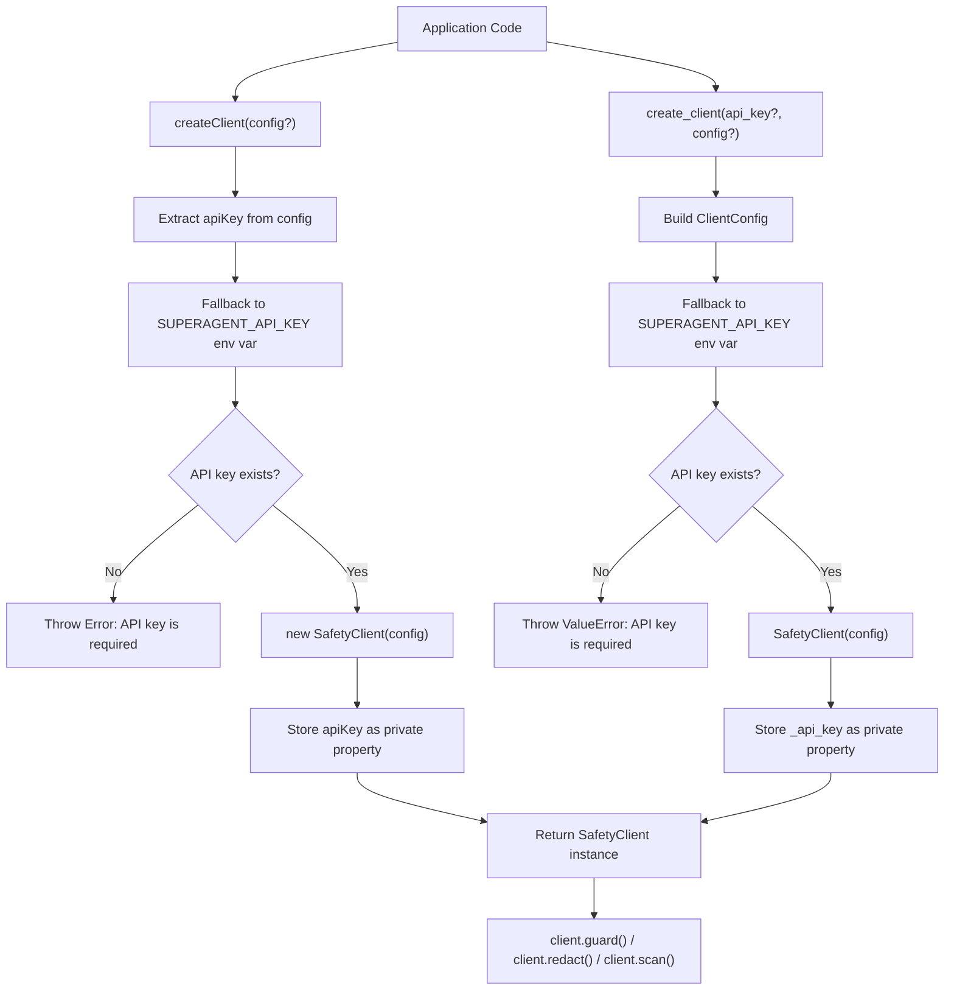
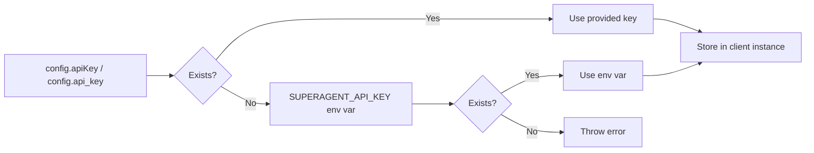
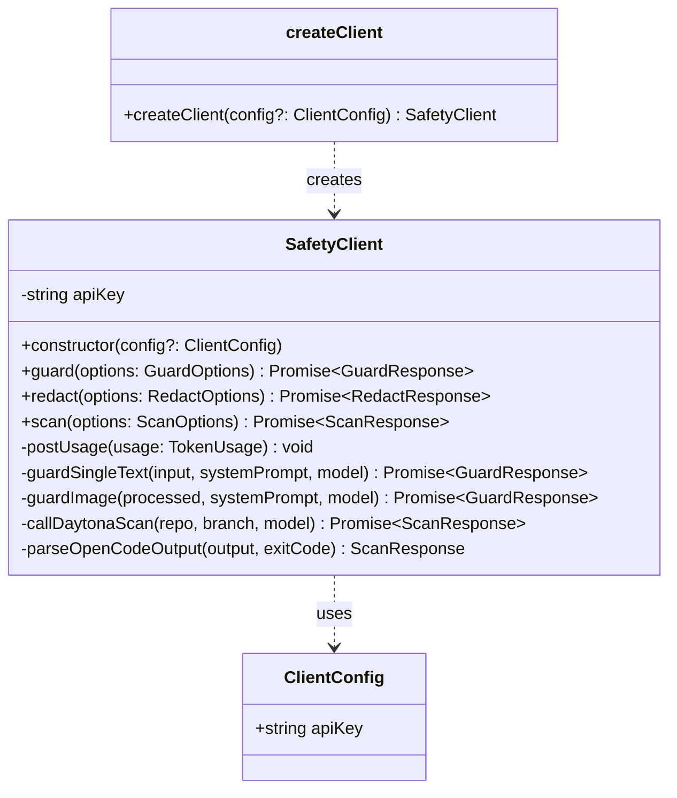
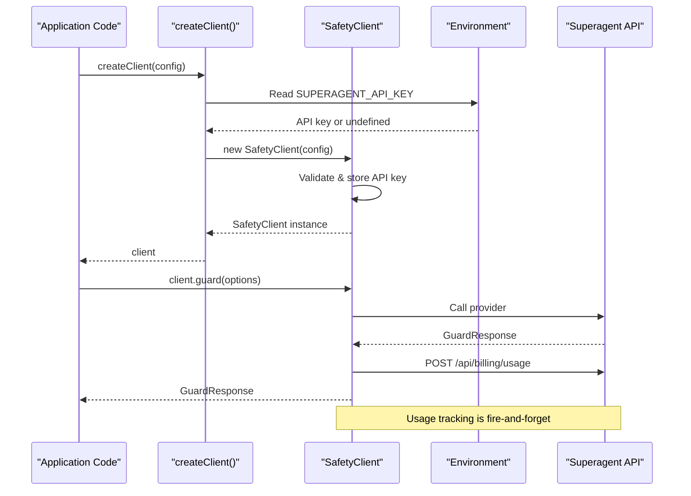

<!-- source: DeepWiki mcp.deepwiki.com · repo superagent-ai/superagent · page 2.2 Client Creation · fetched 2026-10-26 -->

# Client Creation

<details>
<summary>Relevant source files</summary>

The following files were used as context for generating this wiki page:

- [sdk/python/README.md](sdk/python/README.md)
- [sdk/python/src/safety_agent/client.py](sdk/python/src/safety_agent/client.py)
- [sdk/python/src/safety_agent/types.py](sdk/python/src/safety_agent/types.py)
- [sdk/typescript/README.md](sdk/typescript/README.md)
- [sdk/typescript/src/client.ts](sdk/typescript/src/client.ts)
- [sdk/typescript/src/types.ts](sdk/typescript/src/types.ts)

</details>


This page documents the creation and initialization of the Safety Agent client in both TypeScript and Python SDKs. The client is the main entry point for all safety operations (guard, redact, scan) and manages API key authentication and usage tracking.

For information about installing the SDKs and setting up environment variables, see [Installation & Setup](#2.1). For information about the available operations, see [Guard Operation](#2.3), [Redact Operation](#2.4), and [Scan Operation](#2.5).

## Overview

Both SDKs provide a factory function that creates and initializes a `SafetyClient` instance:

| Language | Factory Function | Client Class | Config Type |
|----------|-----------------|--------------|-------------|
| TypeScript | `createClient()` | `SafetyClient` | `ClientConfig` |
| Python | `create_client()` | `SafetyClient` | `ClientConfig` |

The client handles:
- API key validation and storage
- Authentication with the Superagent API
- Usage tracking via fire-and-forget HTTP requests
- Providing methods for guard, redact, and scan operations

## Client Creation Flow



**Sources:**
- [sdk/typescript/src/client.ts:858-860]()
- [sdk/typescript/src/client.ts:414-425]()
- [sdk/python/src/safety_agent/client.py:688-705]()
- [sdk/python/src/safety_agent/client.py:190-210]()

## Configuration Structure

### TypeScript

The `ClientConfig` interface is minimal, containing only the API key:

```typescript
interface ClientConfig {
  apiKey?: string;
}
```

**Sources:**
- [sdk/typescript/src/types.ts:4-7]()

### Python

The `ClientConfig` dataclass mirrors the TypeScript structure:

```python
@dataclass
class ClientConfig:
    api_key: str | None = None
```

**Sources:**
- [sdk/python/src/safety_agent/types.py:14-20]()

## API Key Resolution

Both SDKs follow the same resolution strategy for determining the API key:



**Sources:**
- [sdk/typescript/src/client.ts:418-424]()
- [sdk/python/src/safety_agent/client.py:197-208]()

## Usage Examples

### TypeScript

**Basic Creation (using environment variable):**

```typescript
import { createClient } from "safety-agent";

const client = createClient();
```

**Explicit API Key:**

```typescript
import { createClient } from "safety-agent";

const client = createClient({
  apiKey: "your-api-key"
});
```

**Sources:**
- [sdk/typescript/README.md:21-23]()
- [sdk/typescript/README.md:132-136]()

### Python

**Basic Creation (using environment variable):**

```python
from safety_agent import create_client

client = create_client()
```

**Explicit API Key:**

```python
from safety_agent import create_client

client = create_client(api_key="your-api-key")
```

**Using ClientConfig:**

```python
from safety_agent import create_client, ClientConfig

config = ClientConfig(api_key="your-api-key")
client = create_client(config=config)
```

**Sources:**
- [sdk/python/README.md:27-30]()
- [sdk/python/src/safety_agent/client.py:688-705]()

## SafetyClient Class Structure



**Sources:**
- [sdk/typescript/src/client.ts:414-851]()
- [sdk/python/src/safety_agent/client.py:184-685]()

## Implementation Details

### Constructor Behavior

Both SDKs implement the same validation logic in the constructor:

**TypeScript:**
```typescript
constructor(config?: ClientConfig) {
  const apiKey = config?.apiKey ?? process.env.SUPERAGENT_API_KEY;
  if (!apiKey) {
    throw new Error(
      "API key is required. Provide via createClient({ apiKey }) or SUPERAGENT_API_KEY env var"
    );
  }
  this.apiKey = apiKey;
}
```

**Python:**
```python
def __init__(self, config: ClientConfig | None = None):
    api_key = None
    if config:
        api_key = config.api_key

    if not api_key:
        api_key = os.environ.get("SUPERAGENT_API_KEY")

    if not api_key:
        raise ValueError(
            "API key is required. Provide via create_client(api_key=...) "
            "or SUPERAGENT_API_KEY env var"
        )

    self._api_key = api_key
```

**Sources:**
- [sdk/typescript/src/client.ts:417-425]()
- [sdk/python/src/safety_agent/client.py:190-210]()

### Usage Tracking

The client includes a private method that posts usage metrics to the Superagent dashboard. This is called automatically after each operation completes:

**TypeScript:**
```typescript
private postUsage(usage: TokenUsage): void {
  fetch("https://superagent.sh/api/billing/usage", {
    method: "POST",
    headers: {
      "Content-Type": "application/json",
      "x-api-key": this.apiKey,
    },
    body: JSON.stringify({ token_count: usage.totalTokens }),
  }).catch(() => {}); // Fire and forget - ignore errors
}
```

**Python:**
```python
def _post_usage(self, usage: TokenUsage) -> None:
    try:
        httpx.post(
            "https://superagent.sh/api/billing/usage",
            headers={
                "Content-Type": "application/json",
                "x-api-key": self._api_key,
            },
            json={"token_count": usage.total_tokens},
            timeout=5.0,
        )
    except Exception:
        pass  # Fire and forget - ignore errors
```

The fire-and-forget pattern ensures that usage tracking failures do not impact application functionality.

**Sources:**
- [sdk/typescript/src/client.ts:430-439]()
- [sdk/python/src/safety_agent/client.py:212-225]()

## Error Messages

Both SDKs provide identical error messages for missing API keys:

| Scenario | Error Message |
|----------|---------------|
| Missing API key | `API key is required. Provide via createClient({ apiKey }) or SUPERAGENT_API_KEY env var` (TypeScript)<br>`API key is required. Provide via create_client(api_key=...) or SUPERAGENT_API_KEY env var` (Python) |

**Sources:**
- [sdk/typescript/src/client.ts:420-422]()
- [sdk/python/src/safety_agent/client.py:205-208]()

## Factory Function vs Direct Instantiation

While both SDKs allow direct instantiation of `SafetyClient`, the recommended approach is to use the factory function:

### TypeScript

**Recommended:**
```typescript
import { createClient } from "safety-agent";
const client = createClient({ apiKey: "your-key" });
```

**Also valid:**
```typescript
import { SafetyClient } from "safety-agent";
const client = new SafetyClient({ apiKey: "your-key" });
```

### Python

**Recommended:**
```python
from safety_agent import create_client
client = create_client(api_key="your-key")
```

**Also valid:**
```python
from safety_agent import SafetyClient, ClientConfig
client = SafetyClient(ClientConfig(api_key="your-key"))
```

The factory function provides a cleaner API and may include additional initialization logic in future versions.

**Sources:**
- [sdk/typescript/src/client.ts:858-860]()
- [sdk/python/src/safety_agent/client.py:688-705]()

## Client Lifecycle



**Sources:**
- [sdk/typescript/src/client.ts:414-860]()
- [sdk/python/src/safety_agent/client.py:184-705]()

## Related Configuration

After creating a client, the following operations are available:

| Operation | Purpose | See Section |
|-----------|---------|-------------|
| `guard()` | Classify input as safe/unsafe | [Guard Operation](#2.3) |
| `redact()` | Remove sensitive information | [Redact Operation](#2.4) |
| `scan()` | Scan repositories for threats | [Scan Operation](#2.5) |

The client also requires model provider configuration, which is covered in [Model Provider Configuration](#2.6).

---

