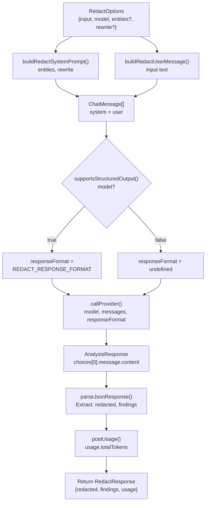
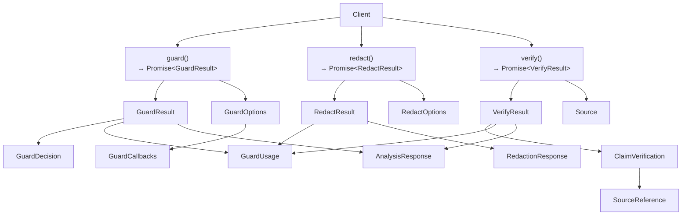

<!-- source: DeepWiki mcp.deepwiki.com · repo superagent-ai/superagent · page 2.4 Redact Operation · fetched 2026-10-26 -->

# Redact Operation

<details>
<summary>Relevant source files</summary>

The following files were used as context for generating this wiki page:

- [sdk/python/README.md](sdk/python/README.md)
- [sdk/python/src/safety_agent/client.py](sdk/python/src/safety_agent/client.py)
- [sdk/python/src/safety_agent/types.py](sdk/python/src/safety_agent/types.py)
- [sdk/typescript/README.md](sdk/typescript/README.md)
- [sdk/typescript/src/client.ts](sdk/typescript/src/client.ts)
- [sdk/typescript/src/types.ts](sdk/typescript/src/types.ts)

</details>


The `redact()` method sanitizes text by removing or rewriting personally identifiable information (PII), protected health information (PHI), and other sensitive data. It supports both placeholder-based redaction (default) and contextual rewriting for more natural text flow.

This page provides a complete reference for the redact operation in both TypeScript and Python SDKs. For client initialization, see page 2.2. For provider configuration, see page 2.6.

## Overview

The redact operation analyzes input text using a language model to identify and remove sensitive information. It supports:

- **Default entity types**: Email addresses, phone numbers, SSNs, credit card numbers, names, addresses, dates of birth, medical record numbers, IP addresses, account numbers, API keys, and secrets
- **Custom entity types**: Natural language descriptions of any entity type to redact
- **Two redaction modes**: Placeholder mode (default) or contextual rewriting
- **Structured output**: Returns both redacted text and findings describing what was removed

**Sources:** [sdk/typescript/README.md:275-333](), [sdk/python/README.md:84-97]()

## Method Signatures

### TypeScript

```typescript
async redact(options: RedactOptions): Promise<RedactResponse>
```

**Sources:** [sdk/typescript/src/client.ts:650]()

### Python

```python
async def redact(
    input: str | None = None,
    *,
    model: str | None = None,
    entities: list[str] | None = None,
    rewrite: bool = False,
    **kwargs: Any,
) -> RedactResponse
```

**Sources:** [sdk/python/src/safety_agent/client.py:444-453]()

## Options and Parameters

### TypeScript: RedactOptions

```typescript
interface RedactOptions {
  input: string;
  model: SupportedModel;
  entities?: string[];
  rewrite?: boolean;
}
```

**Sources:** [sdk/typescript/src/types.ts:847-856]()

| Property | Type | Required | Default | Description |
|----------|------|----------|---------|-------------|
| `input` | `string` | Yes | - | The text to redact |
| `model` | `SupportedModel` | Yes | - | Model in `provider/model` format (e.g., `openai/gpt-4o-mini`) |
| `entities` | `string[]` | No | Default PII entities | Custom entity types to redact (natural language descriptions) |
| `rewrite` | `boolean` | No | `false` | When `true`, rewrites text contextually instead of using placeholders |

### Python: RedactOptions

```python
@dataclass
class RedactOptions:
    input: str
    model: SupportedModel
    entities: list[str] | None = None
    rewrite: bool = False
```

**Sources:** [sdk/python/src/safety_agent/types.py:149-164]()

| Property | Type | Required | Default | Description |
|----------|------|----------|---------|-------------|
| `input` | `str` | Yes | - | The text to redact |
| `model` | `SupportedModel` | Yes | - | Model in `provider/model` format |
| `entities` | `list[str] \| None` | No | `None` | Custom entity types to redact |
| `rewrite` | `bool` | No | `False` | Enable contextual rewriting mode |

### Input Parameter

The `input` parameter accepts plain text strings. The redact operation does not support file uploads or URLs (unlike the guard operation).

**Sources:** [sdk/typescript/README.md:283](), [sdk/python/src/safety_agent/client.py:458]()

### Model Parameter

The `model` parameter specifies which language model to use for redaction. It must be provided in `provider/model` format. Any text-capable model from supported providers can be used. See page 2.6 for the complete list of supported providers and models.

Example models:
- `openai/gpt-4o-mini`
- `anthropic/claude-3-5-sonnet-20241022`
- `google/gemini-2.0-flash`

**Sources:** [sdk/typescript/README.md:284](), [sdk/python/README.md:90]()

### Entities Parameter

The `entities` parameter allows custom entity type definitions in natural language. When not provided, a default set of PII/PHI entities is used.

#### Default Entities

When `entities` is not specified, the system redacts:

- Email addresses
- Phone numbers
- Social Security Numbers (SSNs)
- Credit card numbers
- Names (person names)
- Addresses (physical addresses)
- Dates of birth
- Medical record numbers
- IP addresses
- Account numbers
- API keys and secrets

**Sources:** [sdk/typescript/README.md:285]()

#### Custom Entities

You can override the default entities by providing a custom list. Each entity should be described in natural language:

```typescript
// TypeScript
const result = await client.redact({
  input: "Contact john@example.com or call 555-123-4567",
  model: "openai/gpt-4o-mini",
  entities: ["email addresses"]  // Only redact emails, keep phone numbers
});
```

```python
# Python
result = await client.redact(
    input="Contact john@example.com or call 555-123-4567",
    model="openai/gpt-4o-mini",
    entities=["email addresses"]  # Only redact emails
)
```

**Sources:** [sdk/typescript/README.md:322-332](), [sdk/python/src/safety_agent/types.py:159]()

### Rewrite Parameter

The `rewrite` parameter controls the redaction mode:

- **`false` (default)**: Placeholder mode - replaces sensitive data with `<ENTITY_TYPE_REDACTED>` placeholders
- **`true`**: Rewrite mode - contextually rewrites sentences to remove sensitive information while maintaining natural flow

**Sources:** [sdk/typescript/src/types.ts:855](), [sdk/python/src/safety_agent/types.py:163]()

## Response Format

### TypeScript: RedactResponse

```typescript
interface RedactResponse extends RedactResult {
  usage: TokenUsage;
}

interface RedactResult {
  redacted: string;
  findings: string[];
}

interface TokenUsage {
  promptTokens: number;
  completionTokens: number;
  totalTokens: number;
}
```

**Sources:** [sdk/typescript/src/types.ts:893-896](), [sdk/typescript/src/types.ts:873-880](), [sdk/typescript/src/types.ts:941-945]()

| Field | Type | Description |
|-------|------|-------------|
| `redacted` | `string` | The sanitized text with redactions applied |
| `findings` | `string[]` | Descriptions of what was redacted (e.g., "Email address", "SSN") |
| `usage` | `TokenUsage` | Token usage information from the model |

### Python: RedactResponse

```python
@dataclass
class RedactResponse:
    redacted: str
    findings: list[str]
    usage: TokenUsage

@dataclass
class TokenUsage:
    prompt_tokens: int
    completion_tokens: int
    total_tokens: int
```

**Sources:** [sdk/python/src/safety_agent/types.py:217-228](), [sdk/python/src/safety_agent/types.py:183-189]()

| Field | Type | Description |
|-------|------|-------------|
| `redacted` | `str` | The sanitized text with redactions applied |
| `findings` | `list[str]` | Descriptions of what was redacted |
| `usage` | `TokenUsage` | Token usage information |

## Redaction Processing Flow

**TypeScript and Python Redaction Flow**



**Sources:** [sdk/typescript/src/client.ts:650-683](), [sdk/python/src/safety_agent/client.py:444-514]()

### Implementation Details

1. **System Prompt Building**: The `buildRedactSystemPrompt()` function constructs a system prompt based on the `entities` and `rewrite` parameters. When entities are not provided, it uses default PII/PHI entity types.

2. **User Message Building**: The `buildRedactUserMessage()` function wraps the input text in a structured format for the model.

3. **Structured Output**: When the selected model supports structured output (determined by `supportsStructuredOutput()`), the SDK uses `REDACT_RESPONSE_FORMAT` to enforce JSON schema compliance.

4. **Response Parsing**: The `parseJsonResponse()` function handles both direct JSON and markdown-wrapped JSON responses, extracting `redacted` text and `findings` array.

5. **Usage Tracking**: Both SDKs post usage metrics to the Superagent dashboard via `postUsage()` for billing and analytics.

**Sources:** [sdk/typescript/src/client.ts:653-664](), [sdk/python/src/safety_agent/client.py:484-495]()

## Redaction Modes

### Placeholder Mode (Default)

In placeholder mode (`rewrite: false`), sensitive data is replaced with descriptive placeholders in the format `<ENTITY_TYPE_REDACTED>`.

**TypeScript Example:**

```typescript
const result = await client.redact({
  input: "My email is john@example.com and SSN is 123-45-6789",
  model: "openai/gpt-4o-mini"
});

console.log(result.redacted);
// "My email is <EMAIL_REDACTED> and SSN is <SSN_REDACTED>"

console.log(result.findings);
// ["Email address", "Social Security Number"]
```

**Python Example:**

```python
result = await client.redact(
    input="My email is john@example.com and SSN is 123-45-6789",
    model="openai/gpt-4o-mini"
)

print(result.redacted)
# "My email is <EMAIL_REDACTED> and SSN is <SSN_REDACTED>"

print(result.findings)
# ["Email address", "Social Security Number"]
```

**Sources:** [sdk/typescript/README.md:296-306](), [sdk/python/README.md:86-97]()

### Rewrite Mode

In rewrite mode (`rewrite: true`), the text is contextually rewritten to remove sensitive information while maintaining natural language flow.

**TypeScript Example:**

```typescript
const result = await client.redact({
  input: "My email is john@example.com and SSN is 123-45-6789",
  model: "openai/gpt-4o-mini",
  rewrite: true
});

console.log(result.redacted);
// "My email is on file and my social security number has been provided"
```

**Python Example:**

```python
result = await client.redact(
    input="My email is john@example.com and SSN is 123-45-6789",
    model="openai/gpt-4o-mini",
    rewrite=True
)

print(result.redacted)
# "My email is on file and my social security number has been provided"
```

**Sources:** [sdk/typescript/README.md:308-319](), [sdk/python/src/safety_agent/types.py:163]()

## Custom Entity Configuration

Custom entities allow you to define specific types of information to redact beyond the default PII/PHI set. Entity types are described in natural language.

**TypeScript Example:**

```typescript
const result = await client.redact({
  input: "Contact john@example.com or call 555-123-4567",
  model: "openai/gpt-4o-mini",
  entities: ["email addresses"]  // Only redact emails, keep phone numbers
});

console.log(result.redacted);
// "Contact <EMAIL_REDACTED> or call 555-123-4567"
```

**Python Example:**

```python
result = await client.redact(
    input="Contact john@example.com or call 555-123-4567",
    model="openai/gpt-4o-mini",
    entities=["email addresses"]  # Only redact emails
)

print(result.redacted)
# "Contact <EMAIL_REDACTED> or call 555-123-4567"
```

You can specify any entity types in natural language:

```typescript
// TypeScript
const result = await client.redact({
  input: "Project Nightingale is located at Building 7. Cost: $2.5M.",
  model: "openai/gpt-4o-mini",
  entities: [
    "project code names",
    "building numbers",
    "financial amounts"
  ]
});
```

```python
# Python
result = await client.redact(
    input="Project Nightingale is located at Building 7. Cost: $2.5M.",
    model="openai/gpt-4o-mini",
    entities=[
        "project code names",
        "building numbers",
        "financial amounts"
    ]
)
```

**Sources:** [sdk/typescript/README.md:322-332](), [sdk/python/src/safety_agent/types.py:159]()

## Error Handling

All three methods throw `GuardError` for failures:

```typescript
export class GuardError extends Error {
  constructor(message: string) {
    super(message);
    this.name = "GuardError";
  }
}
```

**Sources:** [sdk/typescript/src/index.ts:201-206]()

Common error scenarios:

| Error Type | Condition | Method |
|------------|-----------|--------|
| Invalid input | Empty or wrong type | All methods |
| Missing fetch | No global fetch available | All methods |
| Timeout | Request exceeds `timeoutMs` | All methods |
| HTTP error | Non-2xx status code | All methods |
| Network error | Connection failure | All methods |
| Invalid sources | Empty array or missing fields | `verify()` only |

**Sources:** [sdk/typescript/src/index.ts:208-216](), [sdk/typescript/src/index.ts:401-408](), [sdk/typescript/src/index.ts:414-418](), [sdk/typescript/src/index.ts:540-557](), [sdk/typescript/src/index.ts:651-667]()

## Type Hierarchy



**Sources:** [sdk/typescript/src/index.ts:11-199]()

---

