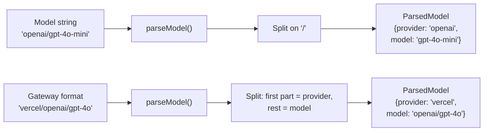
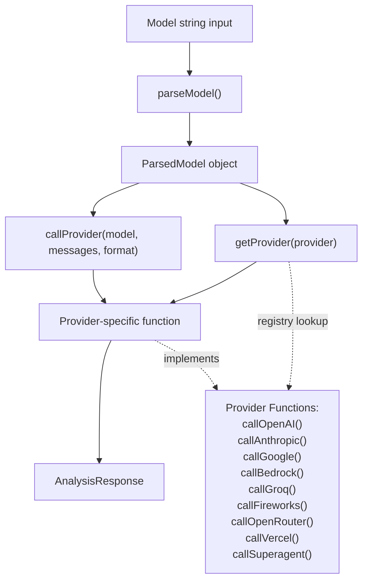
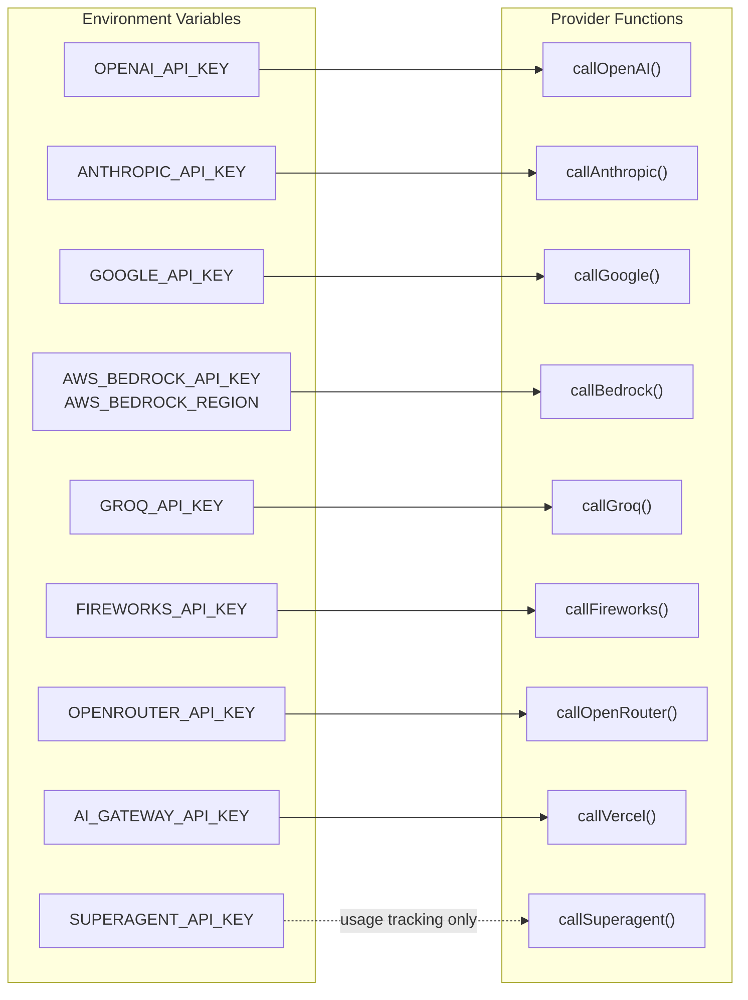
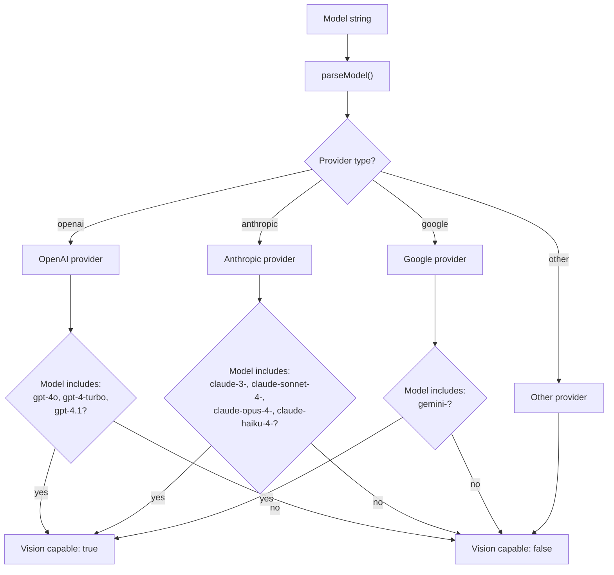
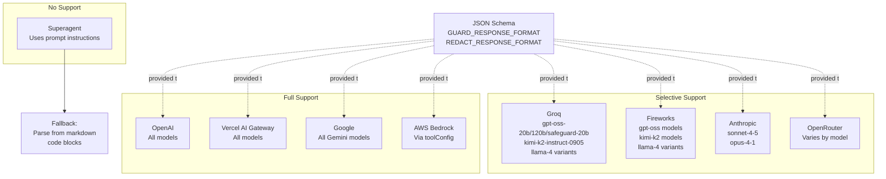

<!-- source: DeepWiki mcp.deepwiki.com · repo superagent-ai/superagent · page 2.6 Model Provider Configuration · fetched 2026-10-26 -->

# Model Provider Configuration

<details>
<summary>Relevant source files</summary>

The following files were used as context for generating this wiki page:

- [CHANGELOG.md](CHANGELOG.md)
- [sdk/python/README.md](sdk/python/README.md)
- [sdk/python/pyproject.toml](sdk/python/pyproject.toml)
- [sdk/python/src/safety_agent/client.py](sdk/python/src/safety_agent/client.py)
- [sdk/python/src/safety_agent/types.py](sdk/python/src/safety_agent/types.py)
- [sdk/typescript/README.md](sdk/typescript/README.md)
- [sdk/typescript/package.json](sdk/typescript/package.json)
- [sdk/typescript/src/client.ts](sdk/typescript/src/client.ts)
- [sdk/typescript/src/index.ts](sdk/typescript/src/index.ts)
- [sdk/typescript/src/types.ts](sdk/typescript/src/types.ts)

</details>


This document describes how the Superagent SDKs abstract multiple AI model providers through a unified interface. It covers the `provider/model` format specification, the provider registry, supported providers and their API key requirements, vision model capabilities, and structured output support across different providers.

For information about using guard, redact, or scan operations with specific models, see [Guard Operation](#2.3), [Redact Operation](#2.4), and [Scan Operation](#2.5).

## Model Format Specification

The SDKs use a standardized format to identify models across all providers:

```
provider/model
```

Examples:
- `openai/gpt-4o-mini`
- `anthropic/claude-3-5-sonnet-20241022`
- `google/gemini-2.0-flash`
- `superagent/guard-1.7b`

For providers accessed through gateways (OpenRouter, Vercel), the format extends to include the underlying provider:

```
gateway/provider/model
```

Examples:
- `openrouter/openai/gpt-4o`
- `vercel/anthropic/claude-3.5-sonnet`

**Model Format Parsing Flow**



Sources: [sdk/typescript/src/providers/index.ts](), [sdk/python/src/safety_agent/providers.py](), [sdk/typescript/src/types.ts:968-971](), [sdk/python/src/safety_agent/types.py:258-264]()

### Type Definitions

**TypeScript:**
- `SupportedModel` type: Union of all supported model identifiers [sdk/typescript/src/types.ts:777-786]()
- `ParsedModel` interface: Contains `provider` and `model` fields [sdk/typescript/src/types.ts:968-971]()

**Python:**
- `SupportedModel` type: String type alias [sdk/python/src/safety_agent/types.py:28]()
- `ParsedModel` dataclass: Contains `provider` and `model` fields [sdk/python/src/safety_agent/types.py:258-264]()

## Provider Registry

**Provider Selection Architecture**



Sources: [sdk/typescript/src/providers/index.ts](), [sdk/python/src/safety_agent/providers.py]()

### TypeScript Provider Registry

The `providers` object maps provider names to implementation functions:

[sdk/typescript/src/providers/index.ts]()

Each provider function signature:
```typescript
(model: string, messages: ChatMessage[], responseFormat?: ResponseFormat) => Promise<AnalysisResponse>
```

### Python Provider Registry

The `PROVIDERS` dictionary maps provider names to implementation functions:

[sdk/python/src/safety_agent/providers.py]()

Each provider function signature:
```python
async def provider_fn(model: str, messages: list[ChatMessage], response_format: ResponseFormat | None) -> AnalysisResponse
```

## Supported Providers

| Provider | Model Format | Required Environment Variables | Notes |
|----------|-------------|-------------------------------|-------|
| **Superagent** | `superagent/{model}` | None | Default for guard operations. Open-weight models available. |
| **OpenAI** | `openai/{model}` | `OPENAI_API_KEY` | Supports all standard OpenAI models including GPT-4, GPT-5, o1, o3 series |
| **Anthropic** | `anthropic/{model}` | `ANTHROPIC_API_KEY` | Supports Claude 3, 3.5, 3.7, 4 series |
| **Google** | `google/{model}` | `GOOGLE_API_KEY` | Supports Gemini 1.5, 2.0, 2.5, 3 series via generateContent API |
| **AWS Bedrock** | `bedrock/{model}` | `AWS_BEDROCK_API_KEY`<br/>`AWS_BEDROCK_REGION` (optional) | Supports cross-region inference profiles with `us.` or `eu.` prefix |
| **Groq** | `groq/{model}` | `GROQ_API_KEY` | High-performance inference with OpenAI-compatible API |
| **Fireworks** | `fireworks/{model}` | `FIREWORKS_API_KEY` | Full model path format: `fireworks/accounts/fireworks/models/{model}` |
| **OpenRouter** | `openrouter/{provider}/{model}` | `OPENROUTER_API_KEY` | Unified gateway for 300+ models from various providers |
| **Vercel AI Gateway** | `vercel/{provider}/{model}` | `AI_GATEWAY_API_KEY` | Routes requests through Vercel's unified AI gateway |

Sources: [sdk/typescript/README.md:54-70](), [sdk/python/README.md:99-124](), [sdk/typescript/src/types.ts:10-786]()

### Default Guard Model

When no model is specified for `guard()` operations, the SDK uses:
- TypeScript: `superagent/guard-0.6b` [sdk/typescript/src/providers/index.ts]()
- Python: `superagent/guard-1.7b` [sdk/python/src/safety_agent/providers.py]()

These models require no API keys and run on Superagent's infrastructure.

## API Key Configuration

**Environment Variable to Provider Mapping**



Sources: [sdk/typescript/src/providers/](), [sdk/python/src/safety_agent/providers.py]()

### API Key Lookup

Each provider function retrieves its API key from environment variables:

**TypeScript:**
```typescript
const apiKey = process.env.PROVIDER_API_KEY;
if (!apiKey) {
  throw new Error("PROVIDER_API_KEY environment variable is required");
}
```

**Python:**
```python
api_key = os.environ.get("PROVIDER_API_KEY")
if not api_key:
    raise ValueError("PROVIDER_API_KEY environment variable is required")
```

The `SUPERAGENT_API_KEY` is used for usage tracking across all providers and is configured at client initialization [sdk/typescript/src/client.ts:418-424](), [sdk/python/src/safety_agent/client.py:190-210]().

## Vision Model Support

Vision models can analyze images in addition to text. The SDK automatically detects image inputs and routes them to vision-capable models.

### Vision-Capable Providers

| Provider | Vision Models | Input Formats |
|----------|--------------|---------------|
| **OpenAI** | `gpt-4o`, `gpt-4o-mini`, `gpt-4-turbo`, `gpt-4.1` | URLs, Blob/File, base64 |
| **Anthropic** | `claude-3-*`, `claude-sonnet-4-*`, `claude-opus-4-*`, `claude-haiku-4-*` | URLs, Blob/File, base64 |
| **Google** | `gemini-*` (all Gemini models) | URLs, Blob/File, base64 |

Other providers (Groq, Fireworks, OpenRouter, Vercel, Bedrock) currently support text-only analysis.

Sources: [sdk/typescript/README.md:108-115](), [sdk/python/README.md:66-81]()

### Vision Model Detection

The `isVisionModel()` function checks if a model supports image analysis:

**TypeScript Implementation:** [sdk/typescript/src/utils/input-processor.ts]()

**Python Implementation:** [sdk/python/src/safety_agent/utils/input_processor.py]()

**Vision Model Detection Logic**



Sources: [sdk/typescript/src/utils/input-processor.ts](), [sdk/python/src/safety_agent/utils/input_processor.py]()

### Multimodal Content Format

For vision models, the SDK constructs multimodal messages using the `MultimodalContentPart` type:

**TypeScript:** [sdk/typescript/src/types.ts:801-803]()
```typescript
type MultimodalContentPart =
  | { type: "text"; text: string }
  | { type: "image_url"; image_url: { url: string } };
```

**Python:** [sdk/python/src/safety_agent/types.py:49-69]()
```python
class ImageContentPart(TypedDict):
    type: Literal["image_url"]
    image_url: ImageUrl
```

Images are encoded as data URLs with base64 content [sdk/typescript/src/client.ts:517-523](), [sdk/python/src/safety_agent/client.py:297-299]().

## Structured Output Support

Structured output forces the model to respond with valid JSON conforming to a schema. This feature varies significantly by provider and model.

### Structured Output by Provider

**Provider Structured Output Support Matrix**



Sources: [sdk/typescript/src/client.ts:114-408](), [sdk/python/src/safety_agent/client.py:130-182]()

### Implementation: supportsStructuredOutput()

The `supportsStructuredOutput()` function determines if structured output should be used for a given model:

**TypeScript:** [sdk/typescript/src/client.ts:114-408]()

**Python:** [sdk/python/src/safety_agent/client.py:130-182]()

Key logic branches:
1. **OpenAI**: Always returns `true`
2. **Vercel/Google/Bedrock**: Always returns `true`
3. **Groq/Fireworks**: Check specific model names
4. **Anthropic**: Only `sonnet-4-5` and `opus-4-1`
5. **OpenRouter**: Complex per-model checks based on underlying provider

### Response Format Schemas

The SDKs define JSON schemas for guard and redact operations:

**TypeScript:**
- `GUARD_RESPONSE_FORMAT` [sdk/typescript/src/schemas.ts]()
- `REDACT_RESPONSE_FORMAT` [sdk/typescript/src/schemas.ts]()

**Python:**
- `GUARD_RESPONSE_FORMAT` [sdk/python/src/safety_agent/schemas.py]()
- `REDACT_RESPONSE_FORMAT` [sdk/python/src/safety_agent/schemas.py]()

These schemas are passed to the provider via the `responseFormat` parameter when structured output is supported [sdk/typescript/src/client.ts:468-470](), [sdk/python/src/safety_agent/client.py:252-254]().

### Fallback: JSON Parsing

When structured output is not supported, the SDK falls back to parsing JSON from the text response:

**TypeScript:** [sdk/typescript/src/client.ts:95-109]()
```typescript
function parseJsonResponse<T>(content: string): T {
  // Try direct JSON parse
  // If that fails, extract from markdown code block
  const match = trimmed.match(/```(?:json)?\s*([\s\S]*?)```/);
}
```

**Python:** [sdk/python/src/safety_agent/client.py:107-128]()
```python
def _parse_json_response(content: str) -> dict[str, Any]:
    # Try direct parse
    # Extract from markdown code block if needed
    match = re.search(r"```(?:json)?\s*([\s\S]*?)```", trimmed)
```

Sources: [sdk/typescript/src/client.ts:95-109](), [sdk/python/src/safety_agent/client.py:107-128]()

## Provider Implementation Flow

**Complete Request Flow from Client to Provider**

```mermaid
graph TB
    Client["SafetyClient.guard()/.redact()"]
    BuildMessages["Build ChatMessage array"]
    DetermineFormat{supportsStructuredOutput()?}
    
    WithFormat["Include response_format<br/>in request"]
    WithoutFormat["No response_format<br/>(use prompt hints)"]
    
    CallProvider["callProvider(model, messages, format)"]
    ParseModel["parseModel(model)"]
    GetProvider["getProvider(provider)"]
    ProviderFn["Provider-specific function"]
    
    HTTPRequest["HTTP request to provider API"]
    RawResponse["Raw JSON response"]
    
    NormalizeResponse["Normalize to AnalysisResponse"]
    ParseJSON{Structured output?}
    DirectParse["Parse JSON directly<br/>from response.content"]
    ExtractJSON["Extract JSON from<br/>markdown code block"]
    
    FinalResponse["GuardResponse / RedactResponse"]
    
    Client --> BuildMessages
    BuildMessages --> DetermineFormat
    
    DetermineFormat -->|true| WithFormat
    DetermineFormat -->|false| WithoutFormat
    
    WithFormat --> CallProvider
    WithoutFormat --> CallProvider
    
    CallProvider --> ParseModel
    ParseModel --> GetProvider
    GetProvider --> ProviderFn
    
    ProviderFn --> HTTPRequest
    HTTPRequest --> RawResponse
    RawResponse --> NormalizeResponse
    
    NormalizeResponse --> ParseJSON
    ParseJSON -->|yes| DirectParse
    ParseJSON -->|no| ExtractJSON
    
    DirectParse --> FinalResponse
    ExtractJSON --> FinalResponse
```

Sources: [sdk/typescript/src/client.ts](), [sdk/python/src/safety_agent/client.py](), [sdk/typescript/src/providers/index.ts](), [sdk/python/src/safety_agent/providers.py]()

### Unified Response Format

All provider functions return an `AnalysisResponse` object with normalized fields:

**TypeScript:** [sdk/typescript/src/types.ts:949-963]()
```typescript
interface AnalysisResponse {
  usage: TokenUsage;
  id: string;
  choices: Array<{
    index?: number;
    message: { role: string; content: string; ... };
    finish_reason?: string;
  }>;
}
```

**Python:** [sdk/python/src/safety_agent/types.py:235-251]()
```python
@dataclass
class AnalysisResponse:
    id: str
    usage: TokenUsage
    choices: list[AnalysisResponseChoice]
```

This normalization allows the client to handle all providers uniformly [sdk/typescript/src/client.ts:471-489](), [sdk/python/src/safety_agent/client.py:255-274]().

## Usage Tracking

All operations post token usage to Superagent's dashboard for billing purposes, regardless of which provider is used. This requires the `SUPERAGENT_API_KEY`:

**TypeScript:** [sdk/typescript/src/client.ts:430-439]()
```typescript
private postUsage(usage: TokenUsage): void {
  fetch("https://superagent.sh/api/billing/usage", {
    method: "POST",
    headers: { "x-api-key": this.apiKey },
    body: JSON.stringify({ token_count: usage.totalTokens }),
  }).catch(() => {}); // Fire and forget
}
```

**Python:** [sdk/python/src/safety_agent/client.py:212-226]()
```python
def _post_usage(self, usage: TokenUsage) -> None:
    httpx.post(
        "https://superagent.sh/api/billing/usage",
        headers={"x-api-key": self._api_key},
        json={"token_count": usage.total_tokens},
    )
```

Usage is tracked after each successful operation [sdk/typescript/src/client.ts:587](), [sdk/python/src/safety_agent/client.py:389]().

Sources: [sdk/typescript/src/client.ts:430-439](), [sdk/python/src/safety_agent/client.py:212-226]()

---

