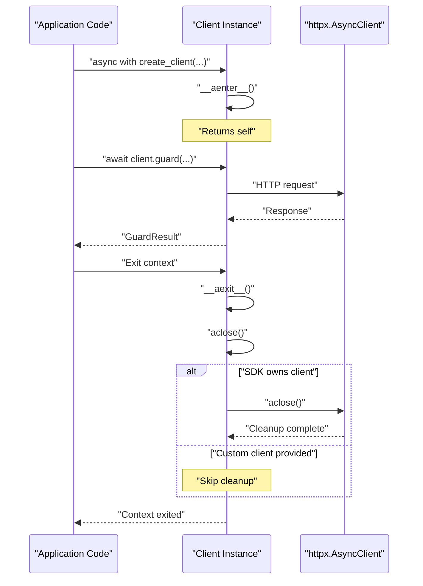
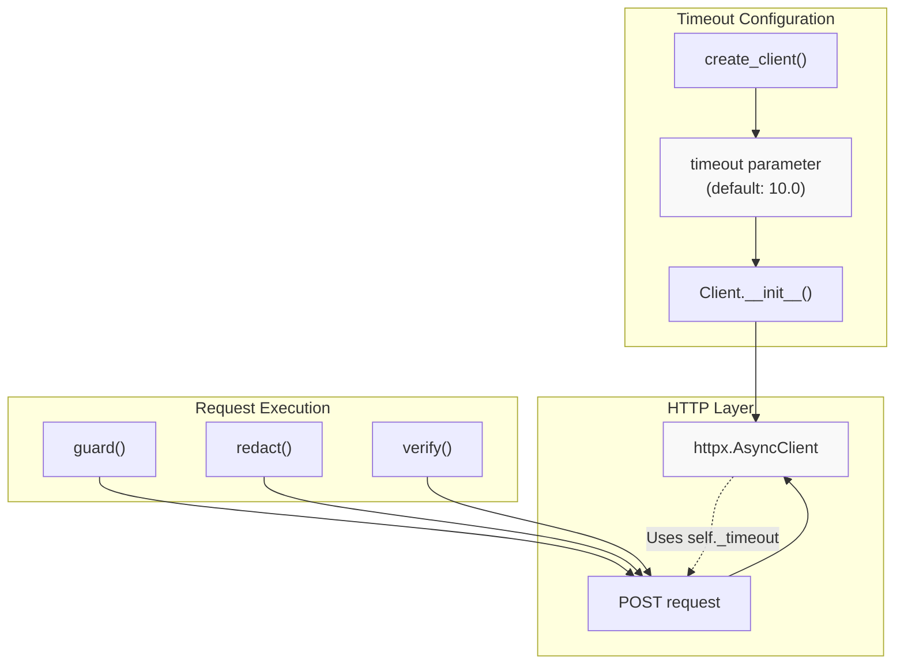
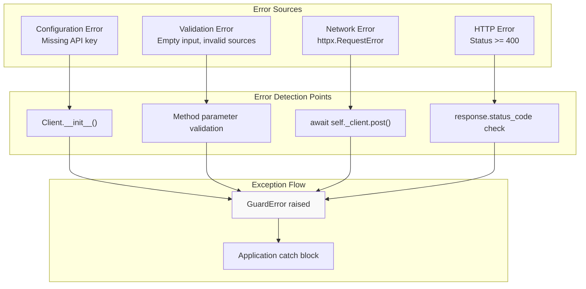
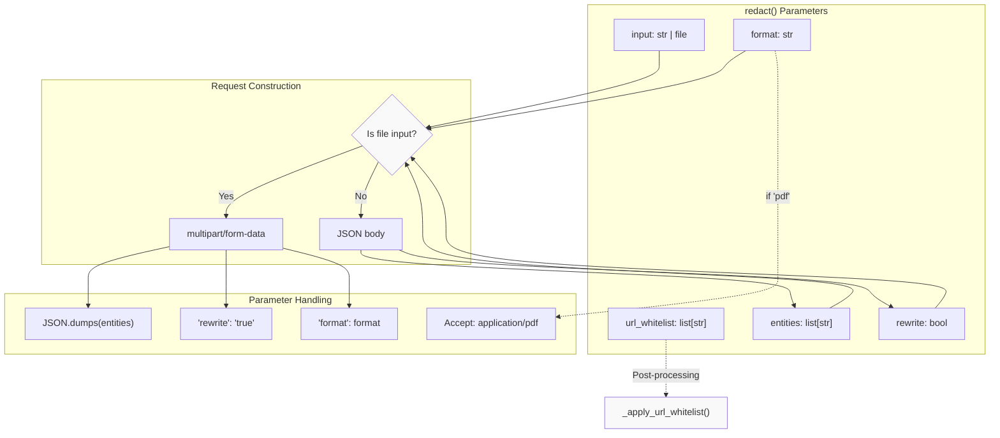
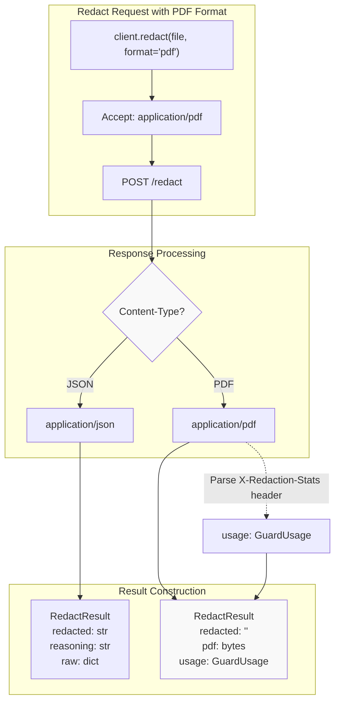
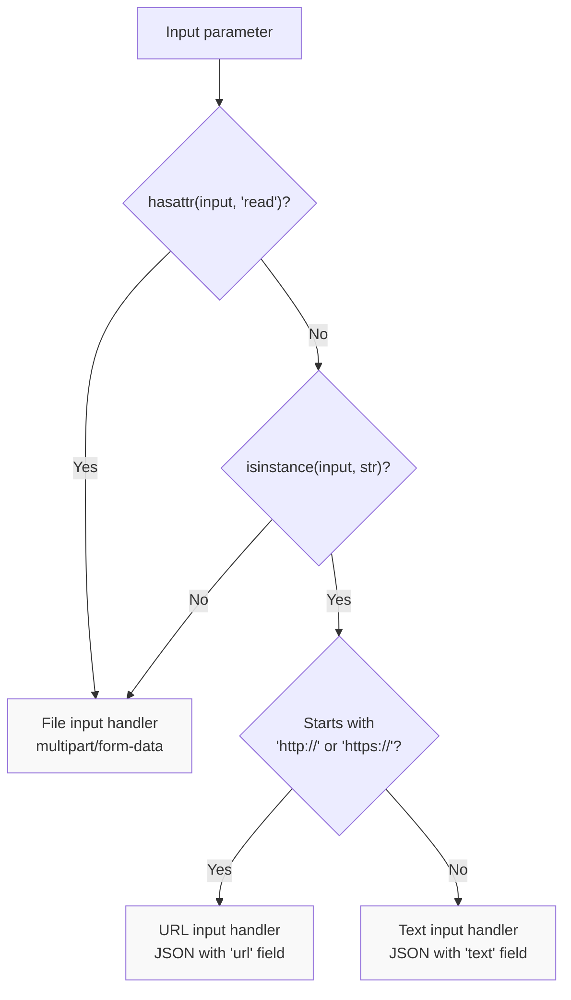

<!-- source: DeepWiki mcp.deepwiki.com · repo superagent-ai/superagent · page 2.7 Advanced Usage · fetched 2026-10-26 -->

# Advanced Usage

<details>
<summary>Relevant source files</summary>

The following files were used as context for generating this wiki page:

- [sdk/python/README.md](sdk/python/README.md)
- [sdk/python/src/safety_agent/client.py](sdk/python/src/safety_agent/client.py)
- [sdk/python/src/safety_agent/types.py](sdk/python/src/safety_agent/types.py)
- [sdk/typescript/README.md](sdk/typescript/README.md)
- [sdk/typescript/src/client.ts](sdk/typescript/src/client.ts)
- [sdk/typescript/src/types.ts](sdk/typescript/src/types.ts)
- [sdk/typescript/tests/fireworks/guard.test.ts](sdk/typescript/tests/fireworks/guard.test.ts)
- [sdk/typescript/tests/google/guard.test.ts](sdk/typescript/tests/google/guard.test.ts)
- [sdk/typescript/tests/groq/guard.test.ts](sdk/typescript/tests/groq/guard.test.ts)
- [sdk/typescript/tests/openai/guard.test.ts](sdk/typescript/tests/openai/guard.test.ts)
- [sdk/typescript/tests/openrouter/guard.test.ts](sdk/typescript/tests/openrouter/guard.test.ts)
- [sdk/typescript/tests/vercel/guard.test.ts](sdk/typescript/tests/vercel/guard.test.ts)

</details>


This page covers advanced features available in both the TypeScript and Python SDKs, including automatic text chunking, parallel processing with OR logic aggregation, vision model support for images, PDF document analysis, and custom system prompts. For basic client setup and method usage, see pages 2.1-2.5.

## Custom HTTP Client Configuration

The Python SDK uses `httpx.AsyncClient` internally for HTTP communication. You can provide a custom configured client to control connection pooling, retries, proxies, and other HTTP behavior.

### Providing a Custom Client

The `create_client()` function accepts an optional `client` parameter that allows you to pass a pre-configured `httpx.AsyncClient` instance:

```python
import httpx
from superagent_ai import create_client

# Create a custom httpx client with specific configuration
custom_client = httpx.AsyncClient(
    timeout=30.0,  # Custom timeout
    limits=httpx.Limits(max_keepalive_connections=5, max_connections=10),
    proxies="http://proxy.example.com:8080",
    follow_redirects=True,
)

# Pass the custom client to create_client
client = create_client(
    api_key="your-api-key",
    client=custom_client
)
```

When you provide a custom client, the SDK does not manage its lifecycle—you are responsible for closing it. The internal `_owns_client` flag [sdk/python/src/superagent_ai/client.py:199]() tracks whether the SDK created the client.

**Sources:** [sdk/python/src/superagent_ai/client.py:178-199](), [sdk/python/src/superagent_ai/client.py:527-548]()

### Client Lifecycle Management

The SDK provides async context manager support for automatic resource cleanup:



**Diagram: Async Context Manager Lifecycle**

The `__aexit__` method calls `aclose()` [sdk/python/src/superagent_ai/client.py:204-205](), which only closes the HTTP client if the SDK created it [sdk/python/src/superagent_ai/client.py:208-216]():

| Scenario | `_owns_client` | Behavior |
|----------|----------------|----------|
| Default (no custom client) | `True` | SDK closes `httpx.AsyncClient` on exit |
| Custom client provided | `False` | Application responsible for cleanup |

The cleanup logic includes error suppression for known `httpx`/`uvloop` cleanup race conditions [sdk/python/src/superagent_ai/client.py:212-216]().

**Sources:** [sdk/python/src/superagent_ai/client.py:201-216]()

## Timeout Configuration

### Setting Request Timeout

The SDK provides timeout control at both client initialization and per-request levels:

```python
# Set default timeout for all requests
client = create_client(
    api_key="your-api-key",
    timeout=30.0  # 30 second timeout
)

# Or pass None to disable timeout
client = create_client(
    api_key="your-api-key",
    timeout=None  # No timeout
)
```

The `timeout` parameter is stored as `_timeout` [sdk/python/src/superagent_ai/client.py:197]() and applied to all HTTP requests:



**Diagram: Timeout Flow Through SDK Layers**

When the timeout is reached, `httpx` raises a `httpx.RequestError`, which the SDK catches and wraps in a `GuardError` [sdk/python/src/superagent_ai/client.py:288-289]().

**Sources:** [sdk/python/src/superagent_ai/client.py:185](), [sdk/python/src/superagent_ai/client.py:197-198](), [sdk/python/src/superagent_ai/client.py:256](), [sdk/python/src/superagent_ai/client.py:271](), [sdk/python/src/superagent_ai/client.py:286]()

## Error Handling

### GuardError Exception Class

All SDK errors are raised as `GuardError` exceptions, defined at [sdk/python/src/superagent_ai/client.py:12-13]():

```python
class GuardError(RuntimeError):
    """Raised when the guard request fails or is misconfigured."""
```

This single exception type simplifies error handling—you can catch all SDK-related errors with one exception handler.

### Error Scenarios

The following table maps error conditions to their detection points in the code:

| Error Condition | Detection Point | Error Message Pattern |
|----------------|-----------------|----------------------|
| Missing API key | Client initialization | `"api_key must be provided"` |
| Empty text input | Method validation | `"input must be a non-empty string"` |
| Network/timeout | HTTP request | `"Failed to reach {endpoint} endpoint: {error}"` |
| HTTP 4xx/5xx | Response validation | `"{Method} request failed with status {code}: {text}"` |
| Invalid verify text | `verify()` validation | `"text must be a non-empty string"` |
| Empty sources | `verify()` validation | `"sources must be a non-empty list"` |
| Invalid source structure | `verify()` validation | `"Each source must have a 'content' field"` |

### Error Handling Patterns



**Diagram: Error Detection and Propagation Flow**

Example comprehensive error handling:

```python
from superagent_ai import create_client, GuardError

try:
    client = create_client(api_key="your-api-key")
    result = await client.guard("input text")
except GuardError as e:
    # Handle all SDK errors uniformly
    if "Failed to reach" in str(e):
        # Network/timeout error
        print(f"Network error: {e}")
    elif "status" in str(e):
        # HTTP error response
        print(f"API error: {e}")
    elif "must be provided" in str(e):
        # Configuration error
        print(f"Configuration error: {e}")
    else:
        # Validation error
        print(f"Validation error: {e}")
```

**Sources:** [sdk/python/src/superagent_ai/client.py:12-13](), [sdk/python/src/superagent_ai/client.py:190](), [sdk/python/src/superagent_ai/client.py:235](), [sdk/python/src/superagent_ai/client.py:288-294](), [sdk/python/src/superagent_ai/client.py:388-394](), [sdk/python/src/superagent_ai/client.py:472-487](), [sdk/python/src/superagent_ai/client.py:504-510]()

## URL Whitelisting Implementation

The Python SDK implements client-side URL whitelisting for the `redact()` method. This allows you to preserve specific trusted URLs while redacting others.

### URL Whitelist Mechanism

```mermaid
graph LR
    subgraph "Input Processing"
        OriginalText["Original text with URLs"]
        RedactRequest["POST /redact"]
        APIResponse["API redacted response"]
    end
    
    subgraph "Client-Side Filtering"
        WhitelistParam["url_whitelist parameter"]
        ApplyWhitelist["_apply_url_whitelist()"]
        URLPattern["Regex: r'https?://[^\\s<>\"']+' "]
        ReplaceLogic["replace_url() function"]
    end
    
    subgraph "Output"
        FinalResult["RedactResult with<br/>selectively preserved URLs"]
    end
    
    OriginalText --> RedactRequest
    RedactRequest --> APIResponse
    
    WhitelistParam --> ApplyWhitelist
    APIResponse --> ApplyWhitelist
    ApplyWhitelist --> URLPattern
    URLPattern --> ReplaceLogic
    
    ReplaceLogic -->|"Match whitelist?"| Decision{" "}
    Decision -->|"Yes"| KeepURL["Keep original URL"]
    Decision -->|"No"| RedactURL["Replace with '<URL_REDACTED>'"]
    
    KeepURL --> FinalResult
    RedactURL --> FinalResult
    
    style Decision fill:#f9f9f9
    style FinalResult fill:#f9f9f9
```

**Diagram: Client-Side URL Whitelisting Process**

The `_apply_url_whitelist()` method [sdk/python/src/superagent_ai/client.py:438-452]() implements a post-processing filter:

1. Extract all URLs from the redacted response using regex pattern `r'https?://[^\s<>"']+'`
2. For each URL, check if it starts with any whitelisted prefix
3. Keep whitelisted URLs unchanged, replace others with `<URL_REDACTED>`

### Usage Examples

```python
# Single whitelisted domain
result = await client.redact(
    "Visit https://github.com/user/repo and https://private.com/secret",
    url_whitelist=["https://github.com"]
)
# Result: "Visit https://github.com/user/repo and <URL_REDACTED>"

# Multiple whitelisted domains
result = await client.redact(
    "Check https://github.com/repo, https://docs.python.org/guide, and https://secret.internal/data",
    url_whitelist=["https://github.com", "https://docs.python.org"]
)
# Result preserves both github.com and docs.python.org URLs
```

### Implementation Details

The whitelist uses **prefix matching** [sdk/python/src/superagent_ai/client.py:448](). A URL is preserved if it starts with any whitelist entry:

| Whitelist Entry | URL | Preserved? |
|----------------|-----|------------|
| `"https://github.com"` | `"https://github.com/user/repo"` | ✓ Yes |
| `"https://github.com"` | `"https://github.io/page"` | ✗ No |
| `"https://docs.python.org"` | `"https://docs.python.org/3/library"` | ✓ Yes |

**Important:** URL whitelisting only applies to text input [sdk/python/src/superagent_ai/client.py:427-428](). File inputs bypass the whitelist filter since the API handles file redaction differently.

**Sources:** [sdk/python/src/superagent_ai/client.py:325](), [sdk/python/src/superagent_ai/client.py:427-428](), [sdk/python/src/superagent_ai/client.py:438-452](), [sdk/python/tests/test_guard.py:142-212]()

## Advanced Method Parameters

### Guard Method Advanced Options

The `guard()` method supports the `system_prompt` parameter for contextual security analysis:

```python
result = await client.guard(
    "Process this sensitive operation",
    system_prompt="This is a financial application handling transactions. Detect any attempts to manipulate account balances or bypass authentication.",
    on_block=lambda reason: print(f"Blocked: {reason}")
)
```

The system prompt is included in the request body [sdk/python/src/superagent_ai/client.py:244]() for text/file inputs or as a JSON field [sdk/python/src/superagent_ai/client.py:262]() for URL inputs.

### Redact Method Advanced Options

The `redact()` method supports multiple advanced parameters:



**Diagram: Advanced Redact Parameters Processing**

| Parameter | Type | Purpose | Code Reference |
|-----------|------|---------|----------------|
| `entities` | `list[str]` | Custom entity types to redact | [sdk/python/src/superagent_ai/client.py:326]() |
| `format` | `str` | Output format (`"pdf"`) | [sdk/python/src/superagent_ai/client.py:327]() |
| `rewrite` | `bool` | Enable rewrite mode for redaction | [sdk/python/src/superagent_ai/client.py:328]() |
| `url_whitelist` | `list[str]` | URLs to preserve (client-side) | [sdk/python/src/superagent_ai/client.py:325]() |

**Entity Customization Example:**

```python
# Redact only email addresses, preserve phone numbers
result = await client.redact(
    "Contact: john@example.com or 555-1234. SSN: 123-45-6789",
    entities=["email addresses"]
)
# Email redacted, phone and SSN preserved

# Redact multiple entity types
result = await client.redact(
    text,
    entities=["email addresses", "phone numbers", "credit card numbers"]
)
```

The `entities` parameter is serialized as JSON for file uploads [sdk/python/src/superagent_ai/client.py:346]() or passed directly in the JSON body for text [sdk/python/src/superagent_ai/client.py:373]().

**Sources:** [sdk/python/src/superagent_ai/client.py:321-436](), [sdk/python/tests/test_guard.py:215-258]()

## Response Handling Patterns

### PDF Response Handling

The SDK handles PDF responses differently depending on the endpoint:

**Guard Endpoint:**
- Always returns JSON [sdk/python/src/superagent_ai/client.py:296-297]()
- PDF content is analyzed, not returned

**Redact Endpoint:**
- Can return PDF binary when `format="pdf"` [sdk/python/src/superagent_ai/client.py:397-417]()
- Sets `Accept: application/pdf` header [sdk/python/src/superagent_ai/client.py:358]()
- Returns PDF in `RedactResult.pdf` field [sdk/python/src/superagent_ai/client.py:416]()
- Usage stats in `X-Redaction-Stats` header [sdk/python/src/superagent_ai/client.py:404-409]()



**Diagram: PDF Response Handling in Redact Method**

### Decision and Reasoning Extraction

The SDK supports both new and legacy API response formats [sdk/python/src/superagent_ai/client.py:115-151]():

```python
def _parse_decision(content: Optional[Union[GuardMessageContent, str]]) -> Optional[GuardDecision]:
    """
    Handles two formats:
    1. New API: content is already a dict with classification/status
    2. Legacy API: content is a JSON string that needs parsing
    """
```

The reasoning field similarly supports dual field names [sdk/python/src/superagent_ai/client.py:301](), [sdk/python/src/superagent_ai/client.py:424]():
- New API: `message.reasoning`
- Legacy API: `message.reasoning_content`

**Sources:** [sdk/python/src/superagent_ai/client.py:115-151](), [sdk/python/src/superagent_ai/client.py:296-319](), [sdk/python/src/superagent_ai/client.py:397-436]()

## Input Type Detection

The SDK automatically detects input types to determine the appropriate request format:



**Diagram: Input Type Detection Logic**

Detection occurs in both `guard()` and `redact()` methods:

**Guard Method:** [sdk/python/src/superagent_ai/client.py:227-232]()
```python
is_file = hasattr(input, 'read') or not isinstance(input, str)
is_url = isinstance(input, str) and (
    input.startswith("http://") or input.startswith("https://")
)
```

**Redact Method:** [sdk/python/src/superagent_ai/client.py:331]()
```python
is_file = hasattr(input, 'read') or not isinstance(input, str)
```

This automatic detection enables the same method signature to handle multiple input types without explicit type parameters.

**Sources:** [sdk/python/src/superagent_ai/client.py:227-287](), [sdk/python/src/superagent_ai/client.py:331-387](), [sdk/python/tests/test_guard.py:65-84]()

---

