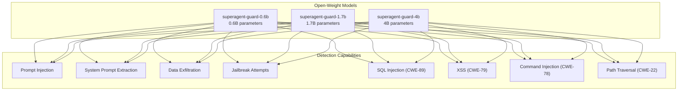
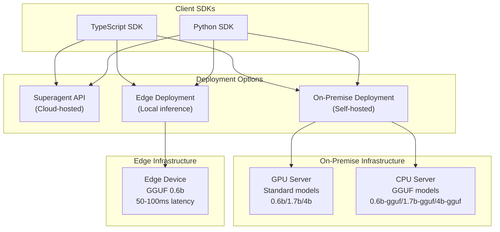
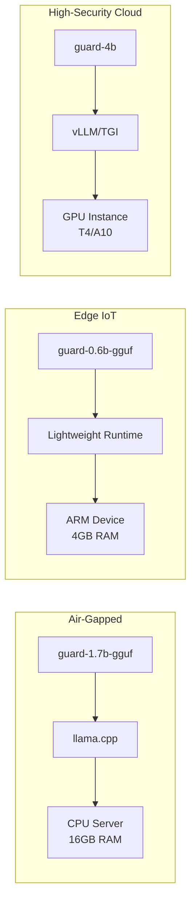
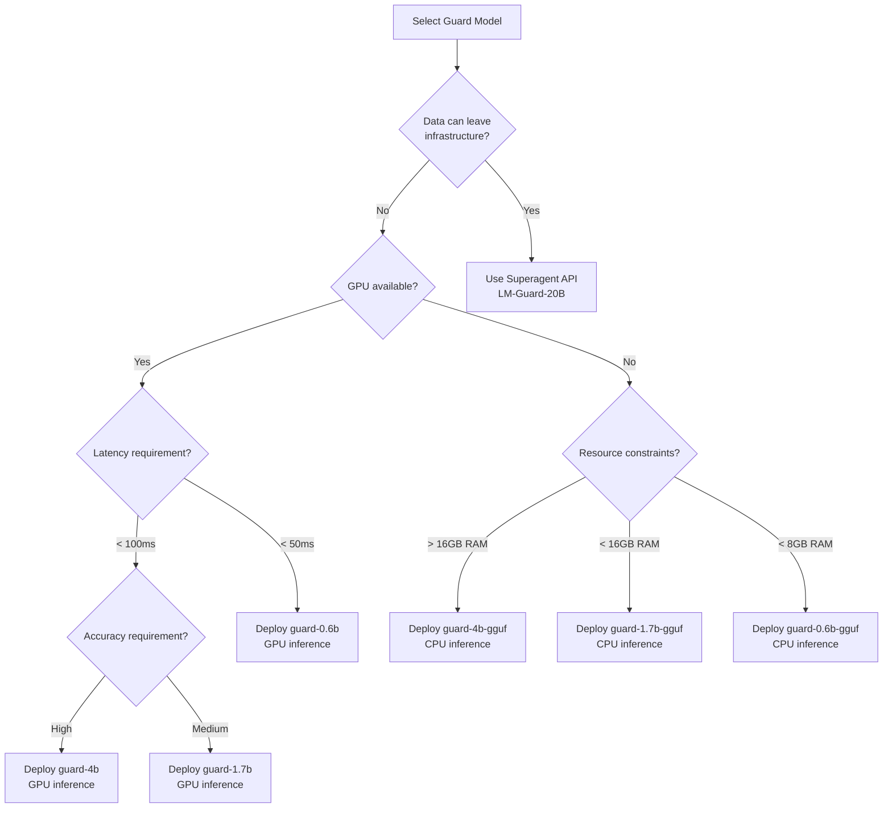
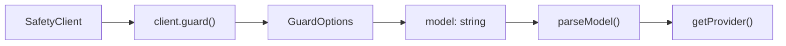

<!-- source: DeepWiki mcp.deepwiki.com · repo superagent-ai/superagent · page 2.8 Open-Weight Models · fetched 2026-10-26 -->

# Open-Weight Models

<details>
<summary>Relevant source files</summary>

The following files were used as context for generating this wiki page:

- [CHANGELOG.md](CHANGELOG.md)
- [README.md](README.md)
- [sdk/python/pyproject.toml](sdk/python/pyproject.toml)
- [sdk/typescript/package.json](sdk/typescript/package.json)
- [sdk/typescript/src/index.ts](sdk/typescript/src/index.ts)

</details>


This page documents the open-weight guard models available for on-premise deployment. These models allow you to run the Guard operation on your own infrastructure without making API calls to external services, ensuring data privacy and low-latency inference.

For information about using cloud-hosted models through the Superagent API, see [Model Provider Configuration](#2.6). For the Guard operation itself, see [Guard Operation](#2.3).

## Purpose and Scope

The Superagent SDK provides three open-weight models specifically trained for security analysis and prompt injection detection. These models range from 0.6B to 4B parameters and can be deployed on CPU or GPU infrastructure. This page covers model characteristics, deployment formats, SDK integration, and selection criteria.

## Available Models

The following open-weight models are available on HuggingFace under the `superagent-ai` organization:

| Model | Parameters | Primary Use Case | Deployment Target | HuggingFace Repository |
|-------|------------|------------------|-------------------|------------------------|
| `superagent-guard-0.6b` | 0.6B | Fast inference, edge deployment | Edge devices, low-latency apps | `superagent-ai/superagent-guard-0.6b` |
| `superagent-guard-1.7b` | 1.7B | Balanced speed and accuracy | Standard server infrastructure | `superagent-ai/superagent-guard-1.7b` |
| `superagent-guard-4b` | 4B | Maximum accuracy | High-security environments | `superagent-ai/superagent-guard-4b` |

All models detect the same threat categories as the API-based guard operation: prompt injection, system prompt extraction, data exfiltration, jailbreak attempts, SQL injection (CWE-89), XSS (CWE-79), command injection (CWE-78), and path traversal (CWE-22).

**Sources:** [README.md:166-176]()

## Model Architecture



All three models support the same detection capabilities with varying accuracy and performance characteristics. Larger models provide higher accuracy at the cost of increased inference time and resource requirements.

**Sources:** [README.md:166-176]()

## Model Formats

### Standard Format

The standard model format is optimized for GPU inference and provides the best accuracy-to-speed ratio when deployed on CUDA-enabled hardware. These models are available as standard PyTorch checkpoints on HuggingFace.

### GGUF Format for CPU Inference

Each model is also available in GGUF (GPT-Generated Unified Format) for efficient CPU-based inference. GGUF models are quantized versions that significantly reduce memory footprint and enable deployment on CPU-only infrastructure.

| Model | Standard Repository | GGUF Repository |
|-------|---------------------|-----------------|
| 0.6B | `superagent-ai/superagent-guard-0.6b` | `superagent-ai/superagent-guard-0.6b-gguf` |
| 1.7B | `superagent-ai/superagent-guard-1.7b` | `superagent-ai/superagent-guard-1.7b-gguf` |
| 4B | `superagent-ai/superagent-guard-4b` | `superagent-ai/superagent-guard-4b-gguf` |

GGUF models enable deployment in resource-constrained environments such as:
- CPU-only servers
- Edge devices without GPU support
- Docker containers with limited GPU access
- Air-gapped environments with custom inference engines

**Sources:** [README.md:176]()

## Deployment Architecture



The SDK supports all three deployment models through the `model` parameter in guard operations. Cloud-hosted models use the `provider/model` format (e.g., `openai/gpt-4o`), while self-hosted models can be accessed by configuring a custom inference endpoint.

**Sources:** [README.md:159-164]()

## Using Open-Weight Models in the SDK

While the SDK primarily routes guard requests through the Superagent API, you can deploy open-weight models locally and configure the SDK to use your custom inference endpoint. The models follow the same input/output schema as the API-based guard operation.

### Model Specification

When using the SDK with the Superagent API, you can specify guard models using the `model` parameter:

**TypeScript:**
```typescript
import { createClient } from "safety-agent";

const client = createClient();

const result = await client.guard({
  input: userMessage,
  model: "superagent/guard-0.6b"  // Specify open-weight model
});
```

**Python:**
```python
from safety_agent import create_client

client = create_client()

result = await client.guard(
    input=user_message,
    model="superagent/guard-0.6b"  # Specify open-weight model
)
```

**Sources:** [sdk/typescript/src/index.ts:1-55](), [README.md:34-61]()

### Custom Deployment Integration

For fully on-premise deployments, you would:

1. Deploy the HuggingFace model on your infrastructure using frameworks like vLLM, TGI, or llama.cpp (for GGUF)
2. Configure the SDK to point to your inference endpoint
3. Ensure your deployment returns responses matching the guard response schema

The guard response schema is exported from the SDK for reference:

**TypeScript:**
```typescript
import { GUARD_RESPONSE_FORMAT } from "safety-agent";
```

**Sources:** [sdk/typescript/src/index.ts:43]()

## Deployment Scenarios

### Scenario 1: Air-Gapped Environment

Organizations with air-gapped security requirements can deploy GGUF models on CPU-only infrastructure without internet connectivity.

**Configuration:**
- Model: `superagent-guard-1.7b-gguf`
- Infrastructure: CPU server with 16GB RAM
- Inference Engine: llama.cpp
- Expected Latency: 100-200ms per request

### Scenario 2: Edge IoT Deployment

Edge devices with limited compute can run the smallest model for real-time prompt validation.

**Configuration:**
- Model: `superagent-guard-0.6b-gguf`
- Infrastructure: ARM-based edge device
- Inference Engine: Lightweight GGUF runtime
- Expected Latency: 50-100ms per request

### Scenario 3: High-Security Cloud

Organizations requiring data sovereignty can deploy GPU-accelerated models in their private cloud.

**Configuration:**
- Model: `superagent-guard-4b`
- Infrastructure: GPU instance (NVIDIA T4 or better)
- Inference Engine: vLLM or TGI
- Expected Latency: 30-50ms per request



**Sources:** [README.md:166-176]()

## Performance Characteristics

### Latency Comparison

| Deployment Type | Model | Infrastructure | Typical Latency |
|----------------|-------|----------------|-----------------|
| Cloud API | LM-Guard-20B | Superagent infrastructure | 200-400ms |
| On-premise GPU | guard-4b | NVIDIA T4 | 30-50ms |
| On-premise GPU | guard-1.7b | NVIDIA T4 | 20-40ms |
| On-premise GPU | guard-0.6b | NVIDIA T4 | 15-30ms |
| On-premise CPU | guard-4b-gguf | 32-core CPU | 150-300ms |
| On-premise CPU | guard-1.7b-gguf | 16-core CPU | 100-200ms |
| On-premise CPU | guard-0.6b-gguf | 8-core CPU | 50-100ms |
| Edge Device | guard-0.6b-gguf | ARM CPU | 50-150ms |

Latencies are approximate and vary based on input length, hardware specifications, and system load.

### Resource Requirements

| Model | Format | GPU VRAM | CPU RAM | Disk Space |
|-------|--------|----------|---------|------------|
| guard-0.6b | Standard | 2GB | - | 2.5GB |
| guard-0.6b | GGUF | - | 4GB | 600MB |
| guard-1.7b | Standard | 4GB | - | 6GB |
| guard-1.7b | GGUF | - | 8GB | 1.7GB |
| guard-4b | Standard | 8GB | - | 14GB |
| guard-4b | GGUF | - | 16GB | 4GB |

**Sources:** [README.md:159-176]()

## Model Selection Guide



### Selection Criteria

**Use `superagent-guard-0.6b` when:**
- Deploying on edge devices or resource-constrained environments
- Latency requirements are critical (< 50ms)
- Inference volume is very high
- Basic prompt injection detection is sufficient

**Use `superagent-guard-1.7b` when:**
- Balanced performance and accuracy are needed
- Standard server infrastructure is available
- Moderate latency requirements (< 100ms)
- General-purpose security validation

**Use `superagent-guard-4b` when:**
- Maximum detection accuracy is required
- High-security environments with strict compliance needs
- GPU infrastructure is available
- False negatives must be minimized

**Use GGUF versions when:**
- No GPU hardware is available
- Deploying in air-gapped or regulated environments
- CPU-only inference is required
- Using inference engines like llama.cpp or GGML

**Sources:** [README.md:166-176]()

## Integration with SDK Client

The `SafetyClient` class supports model specification through the `GuardOptions` interface. When using open-weight models via the API, the model string follows the `provider/model` format.



The model parser and provider abstraction are defined in the providers module, which handles routing to the appropriate inference backend based on the model specification.

**Sources:** [sdk/typescript/src/index.ts:32-40]()

## HuggingFace Repository Structure

All open-weight models are hosted on HuggingFace under the `superagent-ai` organization:

| Repository | URL |
|------------|-----|
| 0.6B Standard | https://huggingface.co/superagent-ai/superagent-guard-0.6b |
| 0.6B GGUF | https://huggingface.co/superagent-ai/superagent-guard-0.6b-gguf |
| 1.7B Standard | https://huggingface.co/superagent-ai/superagent-guard-1.7b |
| 1.7B GGUF | https://huggingface.co/superagent-ai/superagent-guard-1.7b-gguf |
| 4B Standard | https://huggingface.co/superagent-ai/superagent-guard-4b |
| 4B GGUF | https://huggingface.co/superagent-ai/superagent-guard-4b-gguf |

Each repository contains:
- Model weights and configuration files
- Tokenizer files
- Model card with usage instructions
- Licensing information (MIT)
- Evaluation metrics and benchmarks

**Sources:** [README.md:172-176](), [README.md:15]()

## Response Schema Compatibility

Open-weight models deployed locally must return responses matching the guard response schema exported by the SDK. The schema defines the structure for classification results, violation types, CWE codes, and token usage.

**TypeScript:**
The schema is available as `GUARD_RESPONSE_FORMAT` which can be used to validate custom deployment outputs:

```typescript
import { GUARD_RESPONSE_FORMAT } from "safety-agent";
```

The response format defines fields including:
- `classification`: `"pass"` or `"block"`
- `violation_types`: Array of detected violation categories
- `cwe_codes`: Array of applicable CWE identifiers
- `usage`: Token usage statistics

**Sources:** [sdk/typescript/src/index.ts:43]()

## Benefits of On-Premise Deployment

| Benefit | Description |
|---------|-------------|
| **Data Privacy** | Input data never leaves your infrastructure, ensuring compliance with data sovereignty regulations |
| **Low Latency** | GPU-based deployment achieves 15-50ms inference time vs 200-400ms for API calls |
| **Cost Control** | Fixed infrastructure costs vs per-request API pricing for high-volume scenarios |
| **Air-Gapped Support** | Models can run without internet connectivity in secure environments |
| **Customization** | Full control over model quantization, batching, and optimization strategies |
| **Compliance** | Meet regulatory requirements (HIPAA, GDPR, SOC2) by keeping all processing internal |

**Sources:** [README.md:159-168]()

---

