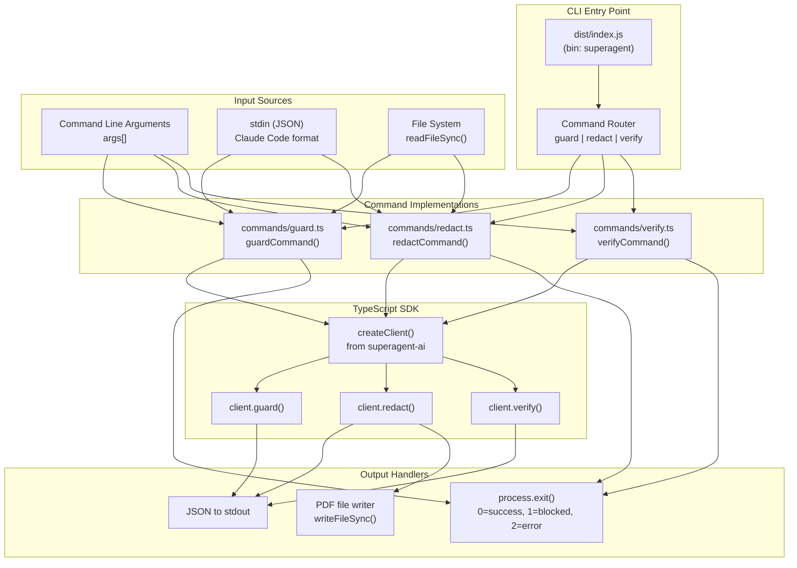
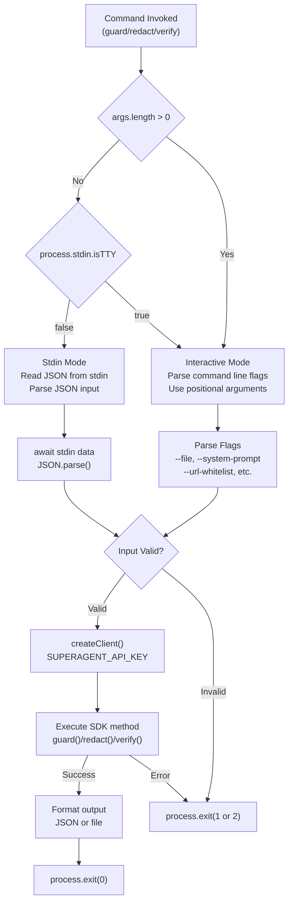
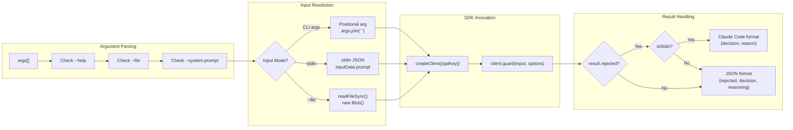
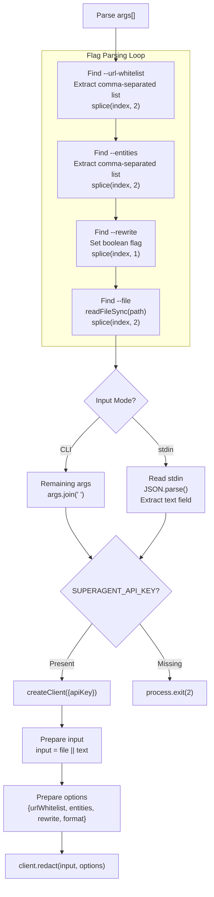
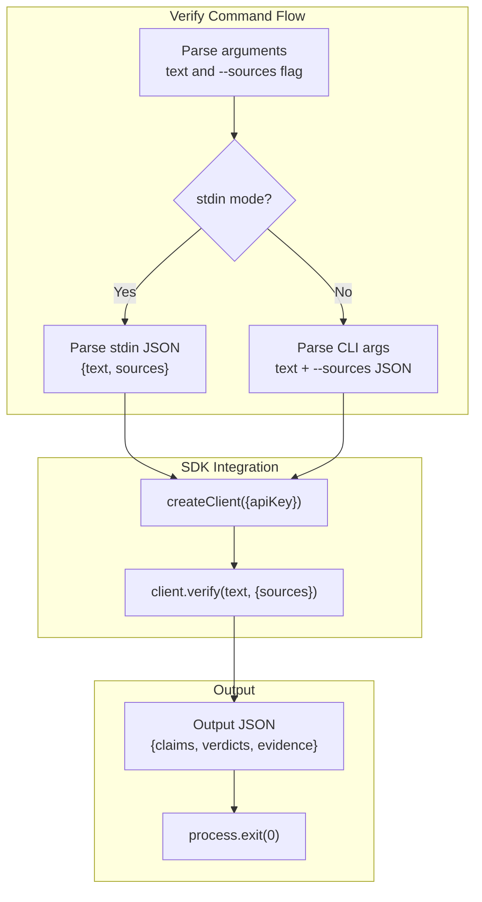

<!-- source: DeepWiki mcp.deepwiki.com · repo superagent-ai/superagent · page 3 Command-Line Interface · fetched 2026-10-26 -->

# Command-Line Interface

<details>
<summary>Relevant source files</summary>

The following files were used as context for generating this wiki page:

- [cli/README.md](cli/README.md)
- [cli/package-lock.json](cli/package-lock.json)
- [cli/package.json](cli/package.json)
- [cli/src/commands/guard.ts](cli/src/commands/guard.ts)
- [cli/src/commands/scan.ts](cli/src/commands/scan.ts)
- [cli/src/index.ts](cli/src/index.ts)
- [cli/tests/scan.test.ts](cli/tests/scan.test.ts)
- [mcp/README.md](mcp/README.md)

</details>


The Command-Line Interface (CLI) provides terminal access to Superagent's Guard, Redact, and Verify operations. It is distributed as the `@superagent-ai/cli` npm package and serves two primary use cases: interactive terminal usage for developers and automated integration as a Claude Code hook for prompt validation.

For SDK-based programmatic integration, see [Python SDK](#4) and [TypeScript SDK](#5). For MCP-based integration with Claude Desktop, see [MCP Server](#6).

**Sources:** [cli/package.json:1-44](), [cli/README.md:1-215]()

## Architecture and Design

The CLI is implemented as a thin wrapper around the TypeScript SDK (`superagent-ai`). It provides a command-line interface to the same underlying API client used by the SDK, with additional functionality for file I/O, option parsing, and Claude Code hook integration.



**Diagram: CLI Architecture - Command Flow from Entry Point to SDK**

The CLI distinguishes between two input modes:
1. **Interactive mode**: Arguments passed directly via command line (`superagent guard "text"`)
2. **Stdin mode**: JSON input from stdin, used for Claude Code hook integration

**Sources:** [cli/package.json:6-9](), [cli/src/commands/guard.ts:1-181](), [cli/src/commands/redact.ts:1-225]()

## Package Configuration

The CLI is packaged as `@superagent-ai/cli` and defines a binary entry point:

| Property | Value | Description |
|----------|-------|-------------|
| Package name | `@superagent-ai/cli` | npm package identifier |
| Version | `0.0.16` | Current release version |
| Binary command | `superagent` | Global command after installation |
| Binary path | `./dist/index.js` | Entry point script |
| Main dependencies | `superagent-ai: ^0.0.20` | TypeScript SDK |
| Node.js requirement | `>=18` | Minimum Node.js version |

**Sources:** [cli/package.json:1-44]()

## Input Mode Detection

All CLI commands implement dual input mode support. The mode is determined by checking command-line arguments and TTY status:



**Diagram: Input Mode Detection and Processing Flow**

**Sources:** [cli/src/commands/guard.ts:66-96](), [cli/src/commands/redact.ts:78-147]()

## Guard Command Implementation

The `guard` command analyzes text, PDF files, or PDF URLs for security threats. It is implemented in [cli/src/commands/guard.ts:27-181]().

### Command Signature and Options

```
superagent guard [options] <prompt|url>
echo '{"prompt": "text", "system_prompt": "..."}' | superagent guard
```

| Option | Type | Description | Example |
|--------|------|-------------|---------|
| `<prompt\|url>` | Positional | Text prompt or PDF URL to analyze | `"user input"` or `"https://example.com/doc.pdf"` |
| `--file <path>` | String | Path to local PDF file | `--file document.pdf` |
| `--system-prompt <text>` | String | Custom system prompt for guard behavior | `--system-prompt "Focus on injection"` |
| `--help`, `-h` | Boolean | Show help message | `--help` |

**Sources:** [cli/src/commands/guard.ts:4-25](), [cli/README.md:13-61]()

### Input Processing Flow



**Diagram: Guard Command Input Processing and Output Formatting**

**Sources:** [cli/src/commands/guard.ts:27-181]()

### Claude Code Hook Integration

When invoked via stdin (detected by `!process.stdin.isTTY`), the guard command operates in Claude Code hook mode. It expects JSON input with a `prompt` field and returns a specialized response format:

**Input format** ([cli/src/commands/guard.ts:74-96]()):
```json
{
  "prompt": "user command text",
  "system_prompt": "optional customization"
}
```

**Output format when blocked** ([cli/src/commands/guard.ts:139-148]()):
```json
{
  "decision": "block",
  "reason": "🛡️ Superagent Guard blocked this prompt: reasoning text. Violations: [...]. CWE: [...]",
  "hookSpecificOutput": {
    "hookEventName": "UserPromptSubmit",
    "additionalContext": "Blocked by Superagent Guard - reasoning"
  }
}
```

When not blocked, the command produces no stdout output in stdin mode ([cli/src/commands/guard.ts:159-169]()).

**Sources:** [cli/src/commands/guard.ts:72-96,129-169](), [cli/README.md:149-173]()

### File and URL Support

The guard command supports three input types ([cli/src/commands/guard.ts:34-52,119-126]()):

1. **Text input**: Direct prompt as positional argument
2. **PDF file**: Using `--file` flag, reads file via `readFileSync()` and creates a `Blob`
3. **PDF URL**: URL string starting with `http://` or `https://` (auto-detected by SDK)

All inputs are passed to `client.guard()` as the first parameter, with the SDK determining the input type.

**Sources:** [cli/src/commands/guard.ts:34-52,119-126](), [CHANGELOG.md:38-41,156-173]()

### System Prompt Customization

The `--system-prompt` flag allows customization of guard behavior ([cli/src/commands/guard.ts:54-64]()):

```bash
superagent guard --system-prompt "Focus on detecting prompt injection attempts" "user input"
```

The system prompt can also be provided via stdin JSON as `system_prompt` field ([cli/src/commands/guard.ts:84-87]()).

**Sources:** [cli/src/commands/guard.ts:54-64,84-87](), [CHANGELOG.md:19-32]()

## Redact Command Implementation

The `redact` command removes sensitive data from text or PDF files. It is implemented in [cli/src/commands/redact.ts:4-225]().

### Command Signature and Options

```
superagent redact [options] <text>
echo '{"text": "..."}' | superagent redact [options]
```

| Option | Type | Description | Default |
|--------|------|-------------|---------|
| `<text>` | Positional | Text to redact | Required |
| `--file <path>` | String | Path to PDF file to redact | None |
| `--url-whitelist <urls>` | String | Comma-separated URL prefixes to preserve | None |
| `--entities <entities>` | String | Comma-separated custom entity types to redact | None |
| `--rewrite` | Boolean | Naturally rewrite content instead of placeholders | `false` |

**Sources:** [cli/src/commands/redact.ts:4-76](), [cli/README.md:63-138]()

### Option Parsing Pattern

The redact command demonstrates a consistent option parsing pattern used across all commands:



**Diagram: Redact Command Option Parsing and Preparation**

**Sources:** [cli/src/commands/redact.ts:5-76]()

### URL Whitelisting

The `--url-whitelist` flag preserves specific URL prefixes during redaction ([cli/src/commands/redact.ts:5-22]()):

```bash
superagent redact --url-whitelist "https://github.com,https://docs.example.com" "Visit https://github.com/user/repo and https://secret.com/data"
```

The whitelist is parsed as comma-separated values and passed to the SDK's `urlWhitelist` option.

**Sources:** [cli/src/commands/redact.ts:5-22,164](), [cli/README.md:98-110]()

### Custom Entity Redaction

The `--entities` flag specifies natural language descriptions of entities to redact ([cli/src/commands/redact.ts:24-41]()):

```bash
superagent redact --entities "credit card numbers,employee IDs" "Card: 4532-1234-5678-9010, ID: EMP-12345"
```

Entities are parsed as comma-separated values and passed to the SDK's `entities` option ([cli/src/commands/redact.ts:165]()).

**Sources:** [cli/src/commands/redact.ts:24-41,165](), [cli/README.md:84-96](), [CHANGELOG.md:295-312]()

### Rewrite Mode

The `--rewrite` flag enables natural rewriting instead of placeholder-based redaction ([cli/src/commands/redact.ts:43-51]()):

```bash
superagent redact --rewrite "Contact me at john@example.com"
# Output: "Contact me via email" instead of "Contact me at <EMAIL_REDACTED>"
```

In stdin mode, the `rewrite` flag can be included in the JSON input ([cli/src/commands/redact.ts:98-100]()).

**Sources:** [cli/src/commands/redact.ts:43-51,98-100,166](), [CHANGELOG.md:9-12]()

### PDF File Redaction

When the `--file` flag is provided with a PDF path, the command:

1. Reads the file using `readFileSync()` ([cli/src/commands/redact.ts:62-64]())
2. Creates a `Blob` with `type: "application/pdf"` ([cli/src/commands/redact.ts:64]())
3. Sets `format: "pdf"` to request PDF output ([cli/src/commands/redact.ts:65]())
4. Passes the file as the first parameter to `client.redact()` ([cli/src/commands/redact.ts:162]())

**Output handling** ([cli/src/commands/redact.ts:171-207]()):
- If `result.pdf` is present (PDF Blob returned), it saves the file to disk
- Output filename format: `{original_name}_redacted_{timestamp}.pdf`
- Outputs JSON with message, reasoning, and usage statistics

**Sources:** [cli/src/commands/redact.ts:53-76,162-207](), [CHANGELOG.md:186-204]()

## Verify Command Implementation

The `verify` command performs claim verification against source materials. Based on the changelog and documentation patterns, it follows the same implementation structure as guard and redact commands.

### Expected Implementation Structure



**Diagram: Verify Command Expected Flow**

According to the changelog, the verify command was added in version 0.0.16 ([CHANGELOG.md:68-79]()) and accepts:
- Text to verify (positional argument or stdin)
- Sources via `--sources` flag in JSON format
- Returns detailed claim-by-claim verification results with verdicts, evidence, reasoning, and source references

**Sources:** [CHANGELOG.md:68-93]()

## Error Handling and Exit Codes

All CLI commands follow a consistent exit code pattern:

| Exit Code | Meaning | Example Scenario |
|-----------|---------|------------------|
| `0` | Success | Command completed successfully |
| `1` | Rejection/Block | Guard command blocked a malicious prompt (CLI mode) |
| `2` | Error | API key missing, invalid input, API error, or I/O error |

**Error scenarios handled**:

1. **Missing API key** ([cli/src/commands/guard.ts:109-112](), [cli/src/commands/redact.ts:150-153]()):
   ```
   ❌ ERROR: SUPERAGENT_API_KEY environment variable not set
   ```

2. **File read errors** ([cli/src/commands/guard.ts:44-47](), [cli/src/commands/redact.ts:68-71]()):
   ```
   ❌ ERROR: Failed to read file: [error message]
   ```

3. **JSON parse errors in stdin mode** ([cli/src/commands/guard.ts:93-96](), [cli/src/commands/redact.ts:106-109]()):
   ```
   ❌ ERROR: Failed to parse JSON from stdin
   ```

4. **API call failures** ([cli/src/commands/guard.ts:172-180](), [cli/src/commands/redact.ts:221-224]()):
   ```
   ⚠️ Guard check failed: [error message]
   ⚠️ Redact failed: [error message]
   ```

**Special behavior in Claude Code hook mode** ([cli/src/commands/guard.ts:172-179]()): If an API error occurs during stdin mode, the command prints an error message, allows the prompt to proceed, and exits with code 0 (to avoid blocking Claude functionality).

**Sources:** [cli/src/commands/guard.ts:109-112,172-180](), [cli/src/commands/redact.ts:150-153,221-224]()

## Client Initialization

All commands initialize the SDK client identically using the `SUPERAGENT_API_KEY` environment variable:

```typescript
const client = createClient({
  apiKey: process.env.SUPERAGENT_API_KEY,
});
```

This pattern appears in:
- [cli/src/commands/guard.ts:115-117]()
- [cli/src/commands/redact.ts:156-158]()

The `createClient()` function is imported from the `superagent-ai` package ([cli/src/commands/guard.ts:1](), [cli/src/commands/redact.ts:1]()), establishing the dependency relationship between CLI and SDK.

**Sources:** [cli/src/commands/guard.ts:1,115-117](), [cli/src/commands/redact.ts:1,156-158]()

## Output Formatting

### JSON Output Structure

**Guard command output** (CLI mode) ([cli/src/commands/guard.ts:151-167]()):
```json
{
  "rejected": false,
  "decision": {
    "status": "pass" | "block",
    "violation_types": ["..."],
    "cwe_codes": ["..."]
  },
  "reasoning": "..."
}
```

**Redact command output** ([cli/src/commands/redact.ts:210-217]()):
```json
{
  "redacted": "redacted text with placeholders",
  "reasoning": "explanation of redactions",
  "usage": {
    "prompt_tokens": 25,
    "completion_tokens": 12,
    "total_tokens": 37
  }
}
```

**PDF redaction output** ([cli/src/commands/redact.ts:195-205]()):
```json
{
  "message": "Redacted PDF saved to filename_redacted_timestamp.pdf",
  "reasoning": "...",
  "usage": {...}
}
```

All commands output JSON to stdout for easy parsing and integration with other tools.

**Sources:** [cli/src/commands/guard.ts:151-167](), [cli/src/commands/redact.ts:195-217]()

## Build and Distribution

The CLI is built using TypeScript and distributed as an npm package:

**Build configuration** ([cli/package.json:14-18]()):
- `build`: Compiles TypeScript to JavaScript using `tsc`
- `dev`: Watch mode for development (`tsc --watch`)
- `prepublishOnly`: Ensures build runs before publishing

**Distribution files** ([cli/package.json:10-13]()):
- `dist/`: Compiled JavaScript
- `README.md`: Package documentation

**Binary registration** ([cli/package.json:7-9]()): The package defines a `bin` field mapping the `superagent` command to `dist/index.js`, enabling global installation via `npm install -g @superagent-ai/cli`.

**Sources:** [cli/package.json:7-18]()

---

