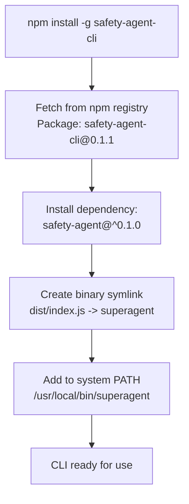
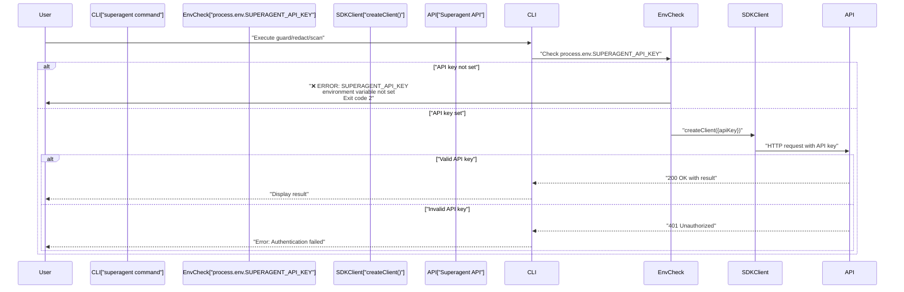
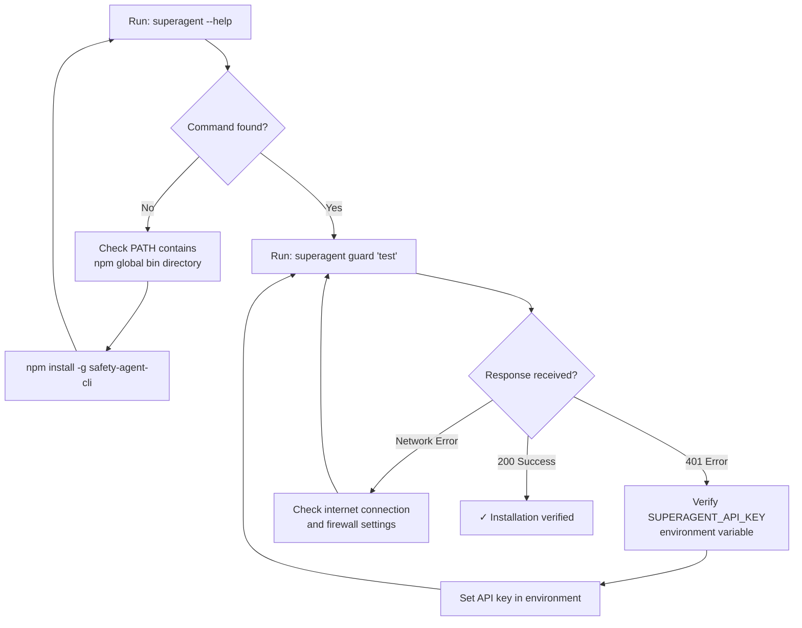
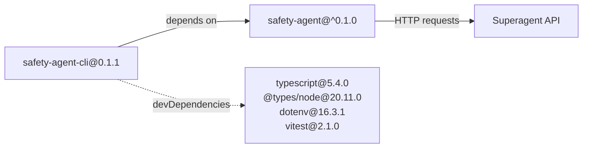

<!-- source: DeepWiki mcp.deepwiki.com · repo superagent-ai/superagent · page 3.1 CLI Installation · fetched 2026-10-26 -->

# CLI Installation

<details>
<summary>Relevant source files</summary>

The following files were used as context for generating this wiki page:

- [cli/README.md](cli/README.md)
- [cli/package-lock.json](cli/package-lock.json)
- [cli/package.json](cli/package.json)
- [cli/src/commands/guard.ts](cli/src/commands/guard.ts)
- [mcp/README.md](mcp/README.md)

</details>


This page covers the installation, configuration, and verification of the `safety-agent-cli` package. The CLI provides terminal access to Superagent's Guard, Redact, and Scan operations through the `superagent` command-line tool.

For usage instructions on the individual commands, see [Guard Command](#3.2), [Redact Command](#3.3), and [Scan Command](#3.4). For programmatic access to the same functionality, see [SDK Reference](#2).

---

## Prerequisites

The CLI requires Node.js version 18 or higher to run. This requirement is enforced by the `engines` field in the package manifest.

| Requirement | Version | Purpose |
|------------|---------|---------|
| Node.js | ≥18.0.0 | JavaScript runtime for CLI execution |
| npm | Bundled with Node.js | Package manager for installation |

**Sources:** [cli/package.json:41-43]()

---

## Installation via npm

### Global Installation

The CLI is distributed through npm as `safety-agent-cli`. Install it globally to make the `superagent` command available system-wide:

```bash
npm install -g safety-agent-cli
```

This installs version `0.1.1` (current stable release) and creates an executable binary named `superagent` as defined in the `bin` field at [cli/package.json:7-9]().

**Installation Flow Diagram:**



**Sources:** [cli/package.json:1-47](), [cli/README.md:5-9]()

### Package Structure

The installed package includes the following components:

| Component | Location | Purpose |
|-----------|----------|---------|
| Main entry point | `dist/index.js` | CLI executable with shebang |
| Binary command | `superagent` | Command-line interface name |
| TypeScript SDK | `safety-agent@^0.1.0` | Underlying API client library |

The CLI is built on top of the TypeScript SDK (`safety-agent`) and acts as a thin command-line wrapper around SDK methods like `createClient()`, `client.guard()`, `client.redact()`, and `client.scan()`.

**Sources:** [cli/package.json:6-9](), [cli/package.json:44-46]()

---

## API Key Configuration

The CLI requires a Superagent API key to authenticate with the backend services.

### Setting the Environment Variable

Configure your API key using the `SUPERAGENT_API_KEY` environment variable:

```bash
export SUPERAGENT_API_KEY="your_api_key_here"
```

To make this permanent, add it to your shell profile:

```bash
# For bash
echo 'export SUPERAGENT_API_KEY="your_api_key_here"' >> ~/.bashrc
source ~/.bashrc

# For zsh
echo 'export SUPERAGENT_API_KEY="your_api_key_here"' >> ~/.zshrc
source ~/.zshrc
```

**API Key Validation Flow:**



The API key check is performed at [cli/src/commands/guard.ts:109-112](). If the environment variable is not set, the CLI exits with error code 2 and displays the message: `❌ ERROR: SUPERAGENT_API_KEY environment variable not set`.

**Sources:** [cli/README.md:179-183](), [cli/src/commands/guard.ts:109-112]()

### Obtaining an API Key

API keys can be obtained from the Superagent web application at `https://app.superagent.sh`. For details on authentication and configuration, see [Installation & Setup](#2.1).

---

## Verification

### Verifying Installation

Confirm the CLI is installed correctly by checking the help output:

```bash
superagent --help
```

This should display usage information for the CLI. If the command is not found, ensure that:

1. The global npm bin directory is in your `PATH`
2. The installation completed without errors
3. You have proper permissions for the installation directory

### Testing Basic Functionality

Run a simple guard command to verify end-to-end functionality:

```bash
superagent guard "Write a hello world script"
```

Expected output (based on the guard command implementation):

```json
{
  "classification": "pass",
  "violation_types": [],
  "cwe_codes": [],
  "usage": {
    "prompt_tokens": 15,
    "completion_tokens": 8,
    "total_tokens": 23
  }
}
```

If this succeeds with a `"classification": "pass"` response, the CLI is properly installed and configured.

**Verification Decision Tree:**



**Sources:** [cli/README.md:139-148](), [cli/README.md:12-30](), [cli/src/commands/guard.ts:123-170]()

---

## Command Availability

After installation, the following commands become available:

| Command | Purpose | Documentation |
|---------|---------|---------------|
| `superagent guard` | Security threat analysis | [Guard Command](#3.2) |
| `superagent redact` | PII/PHI redaction | [Redact Command](#3.3) |
| `superagent scan` | Repository security scanning | [Scan Command](#3.4) |

Each command supports a `--help` flag for detailed usage information as implemented in the command files at [cli/src/commands/guard.ts:4-25]().

**Sources:** [cli/README.md:11-147](), [cli/src/commands/guard.ts:4-25]()

---

## Troubleshooting

### Command Not Found

If `superagent` command is not found after installation:

1. **Check npm global bin directory:**
   ```bash
   npm bin -g
   ```
   Ensure this directory is in your `PATH`.

2. **Verify installation:**
   ```bash
   npm list -g @superagent-ai/cli
   ```
   Should show `@superagent-ai/cli@0.0.16` or later.

3. **Reinstall with verbose logging:**
   ```bash
   npm install -g @superagent-ai/cli --verbose
   ```

### Permission Errors

If you encounter `EACCES` errors during installation:

```bash
# Option 1: Use sudo (not recommended for security reasons)
sudo npm install -g safety-agent-cli

# Option 2: Configure npm to use a different directory (recommended)
mkdir ~/.npm-global
npm config set prefix '~/.npm-global'
echo 'export PATH=~/.npm-global/bin:$PATH' >> ~/.bashrc
source ~/.bashrc
npm install -g safety-agent-cli
```

### API Key Issues

If you receive `❌ ERROR: SUPERAGENT_API_KEY environment variable not set`:

1. Verify the variable is set in your current shell:
   ```bash
   echo $SUPERAGENT_API_KEY
   ```

2. If empty, set it for the current session:
   ```bash
   export SUPERAGENT_API_KEY="your_key"
   ```

3. For persistence, add to your shell profile as described in [API Key Configuration](#api-key-configuration).

**Sources:** [cli/src/commands/guard.ts:109-112]()

---

## Dependencies

The CLI has minimal external dependencies:

**CLI Dependency Architecture:**



### Runtime Dependencies

- **safety-agent** (^0.1.0): The TypeScript SDK providing `createClient()`, `guard()`, `redact()`, and `scan()` methods that the CLI wraps. The CLI imports `createClient` from this package at [cli/src/commands/guard.ts:1]().

### Development Dependencies

These are only required for building from source:

- **typescript** (^5.4.0): Compiles TypeScript source to JavaScript in `dist/`
- **@types/node** (^20.11.0): TypeScript type definitions for Node.js APIs
- **dotenv** (^16.3.1): Load environment variables from `.env` files during development
- **vitest** (^2.1.0): Test runner for unit tests

**Sources:** [cli/package.json:35-46](), [cli/src/commands/guard.ts:1]()

---

## Version History

The CLI follows semantic versioning. Recent releases:

| Version | Date | Notable Changes |
|---------|------|-----------------|
| 0.0.16 | 2025-12-08 | Added `rewrite` mode to redact command |
| 0.0.15 | - | Breaking: Changed input parameter signatures |
| 0.0.11 | - | Added verify command for claim verification |
| 0.0.10 | - | Breaking: Changed method signatures for guard/redact |
| 0.0.9 | - | Added `--file` flag for PDF redaction |
| 0.0.8 | - | Added `--entities` flag for custom redaction |
| 0.0.7 | - | Added separate `redact` command |

For complete changelog, see [CHANGELOG.md:1-408]().

**Sources:** [CHANGELOG.md:1-408](), [cli/package.json:3]()

---

