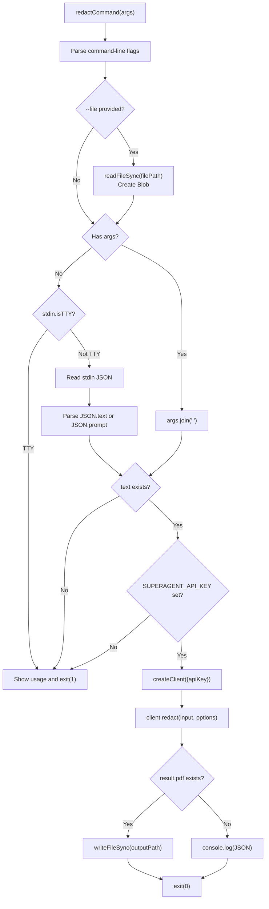
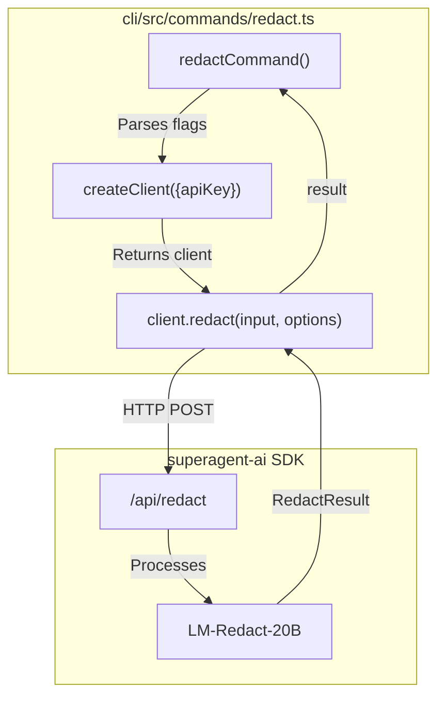
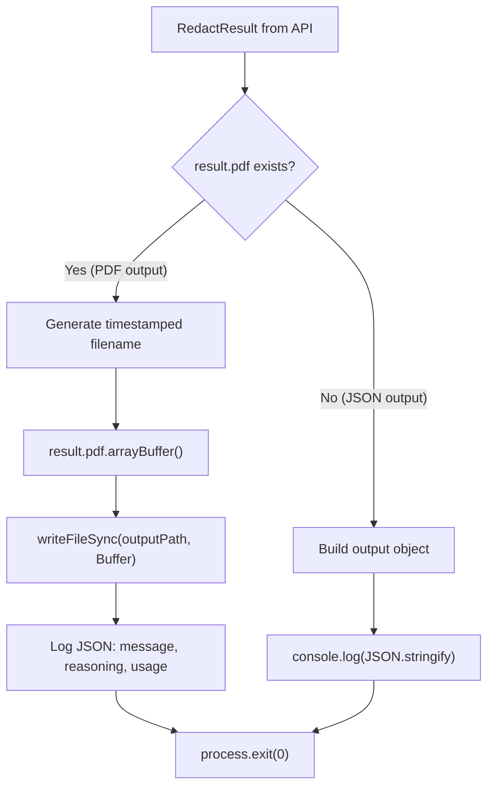

<!-- source: DeepWiki mcp.deepwiki.com · repo superagent-ai/superagent · page 3.3 Redact Command · fetched 2026-10-26 -->

# Redact Command

<details>
<summary>Relevant source files</summary>

The following files were used as context for generating this wiki page:

- [cli/README.md](cli/README.md)
- [cli/src/commands/redact.ts](cli/src/commands/redact.ts)
- [mcp/README.md](mcp/README.md)

</details>


The `redact` command removes sensitive data from text or PDF files using Superagent's PII/PHI redaction API. It supports custom entity types, URL whitelisting, natural rewriting, and PDF file processing.

For general CLI installation and configuration, see [CLI Installation](#3.1). For security analysis instead of redaction, see [Guard Command](#3.2). For programmatic redaction access, see [TypeScript Client Methods](#5.2) or [Python Client Methods](#4.2).

## Command Syntax

```bash
superagent redact [options] <text>
echo '{"text": "..."}' | superagent redact [options]
```

The command accepts input either as a command-line argument or via stdin as JSON. It requires the `SUPERAGENT_API_KEY` environment variable to be set.

**Sources:** [cli/src/commands/redact.ts:1-226](), [cli/README.md:63-138]()

## Command-Line Options

| Option | Value | Description |
|--------|-------|-------------|
| `--url-whitelist` | Comma-separated URLs | URL prefixes to preserve during redaction |
| `--entities` | Comma-separated types | Custom entity types to redact (natural language) |
| `--rewrite` | None (flag) | Naturally rewrite content instead of using placeholders |
| `--file` | File path | Path to PDF file to redact |

All options are optional and can be combined. When `--file` is provided, the output format automatically switches to PDF.

**Sources:** [cli/src/commands/redact.ts:5-76](), [cli/README.md:84-138]()

## Input Processing Flow



**Sources:** [cli/src/commands/redact.ts:4-226]()

## Flag Parsing Implementation

The command uses index-based parsing to extract flags and their values from the `args` array. Each flag is processed sequentially and removed from the array after extraction.

```mermaid
flowchart LR
    Args["args: string[]"]
    FindUrlWhitelist["args.indexOf('--url-whitelist')"]
    SplitUrls["whitelistValue.split(',')"]
    RemoveUrlFlag["args.splice(index, 2)"]
    FindEntities["args.indexOf('--entities')"]
    SplitEntities["entitiesValue.split(',')"]
    RemoveEntitiesFlag["args.splice(index, 2)"]
    FindRewrite["args.indexOf('--rewrite')"]
    RemoveRewriteFlag["args.splice(index, 1)"]
    FindFile["args.indexOf('--file')"]
    ReadFileBlob["readFileSync(filePath)<br/>new Blob([buffer])"]
    RemoveFileFlag["args.splice(index, 2)"]
    RemainingArgs["args.join(' ') as text"]
    
    Args --> FindUrlWhitelist
    FindUrlWhitelist -->|Found| SplitUrls
    SplitUrls --> RemoveUrlFlag
    RemoveUrlFlag --> FindEntities
    FindUrlWhitelist -->|Not found| FindEntities
    FindEntities -->|Found| SplitEntities
    SplitEntities --> RemoveEntitiesFlag
    RemoveEntitiesFlag --> FindRewrite
    FindEntities -->|Not found| FindRewrite
    FindRewrite -->|Found| RemoveRewriteFlag
    RemoveRewriteFlag --> FindFile
    FindRewrite -->|Not found| FindFile
    FindFile -->|Found| ReadFileBlob
    ReadFileBlob --> RemoveFileFlag
    RemoveFileFlag --> RemainingArgs
    FindFile -->|Not found| RemainingArgs
```



**Sources:** [cli/src/commands/redact.ts:5-76]()

## SDK Integration

The command delegates to the TypeScript SDK after parsing flags and input:



The command constructs the input and options from parsed flags:

- `input` = `file || text` - Either Blob or string [cli/src/commands/redact.ts:162]()
- `options.urlWhitelist` - Array of URL prefixes [cli/src/commands/redact.ts:164]()
- `options.entities` - Array of entity type strings [cli/src/commands/redact.ts:165]()
- `options.rewrite` - Boolean flag [cli/src/commands/redact.ts:166]()
- `options.format` - `"pdf"` when file provided, undefined otherwise [cli/src/commands/redact.ts:167]()

**Sources:** [cli/src/commands/redact.ts:155-169]()

## Output Handling



### PDF Output Filename Format

When `--file` is provided, the output filename follows the pattern:

```
{original_filename}_redacted_{timestamp}.{extension}
```

Example: `document_redacted_2025-12-08_14-30-45.pdf`

The timestamp is generated with: `new Date().toISOString().replace(/[:.]/g, "-").split("T").join("_").slice(0, -5)` [cli/src/commands/redact.ts:176-181]()

### JSON Output Structure

```json
{
  "redacted": "Text with <REDACTED> placeholders or naturally rewritten",
  "reasoning": "Explanation of what was redacted",
  "usage": {
    "prompt_tokens": 25,
    "completion_tokens": 12,
    "total_tokens": 37
  }
}
```

If `result.redacted_pdf` exists (base64-encoded PDF), it's noted but truncated in display [cli/src/commands/redact.ts:214-216]()

**Sources:** [cli/src/commands/redact.ts:170-225]()

## Usage Examples

### Basic Text Redaction

```bash
superagent redact "My email is john@example.com and SSN is 123-45-6789"
```

Output:
```json
{
  "redacted": "My email is <REDACTED_EMAIL> and SSN is <REDACTED_SSN>",
  "reasoning": "Redacted email and SSN"
}
```

### Custom Entity Redaction

```bash
superagent redact --entities "credit card numbers,employee IDs" \
  "My card is 4532-1234-5678-9010 and ID is EMP-12345"
```

The `--entities` flag accepts natural language descriptions. The API interprets these descriptions to identify matching patterns [cli/src/commands/redact.ts:24-41]()

### Natural Rewriting

```bash
superagent redact --rewrite "Contact me at john@example.com or call 555-1234"
```

Instead of placeholders like `<REDACTED_EMAIL>`, the `--rewrite` flag causes the API to naturally rewrite the text:

```json
{
  "redacted": "Contact me via email or phone",
  "reasoning": "Naturally rewrote content to remove PII"
}
```

**Sources:** [CHANGELOG.md:5-13](), [cli/src/commands/redact.ts:43-51]()

### URL Whitelisting

```bash
superagent redact --url-whitelist "https://github.com" \
  "Visit https://github.com/user/repo and https://secret.com/data"
```

Output:
```json
{
  "redacted": "Visit https://github.com/user/repo and <URL_REDACTED>",
  "reasoning": "Preserved whitelisted URLs"
}
```

The whitelist accepts comma-separated URL prefixes [cli/src/commands/redact.ts:5-22]()

### PDF File Redaction

```bash
superagent redact --file sensitive-document.pdf "Redact PII from this"
```

When `--file` is provided:
1. The file is read as a Blob [cli/src/commands/redact.ts:63-65]()
2. `format` is automatically set to `"pdf"` [cli/src/commands/redact.ts:65]()
3. The redacted PDF is saved with a timestamped filename [cli/src/commands/redact.ts:172-206]()

Output:
```json
{
  "message": "Redacted PDF saved to document_redacted_2025-12-08_14-30-45.pdf",
  "reasoning": "Redacted email addresses and phone numbers from PDF",
  "usage": {...}
}
```

### Combining Multiple Options

```bash
superagent redact --file document.pdf \
  --entities "SSN,credit card numbers" \
  --rewrite \
  "Analyze and redact"
```

All flags can be combined. The order doesn't matter as they're parsed independently [cli/src/commands/redact.ts:5-76]()

**Sources:** [cli/README.md:84-138](), [cli/src/commands/redact.ts:1-226]()

## Stdin JSON Input

The command supports JSON input from stdin for programmatic integration:

```bash
echo '{"text": "My email is john@example.com"}' | superagent redact
```

The JSON object supports these fields:
- `text` - Required. Text to redact
- `prompt` - Legacy alias for `text` (still supported) [cli/src/commands/redact.ts:95]()
- `rewrite` - Optional boolean to enable natural rewriting [cli/src/commands/redact.ts:98-100]()

Command-line flags still work with stdin input:

```bash
echo '{"text": "Contact: john@example.com"}' | \
  superagent redact --entities "emails" --rewrite
```

**Sources:** [cli/src/commands/redact.ts:84-109](), [CHANGELOG.md:183-200]()

## Error Handling

The command performs validation at multiple stages:

| Exit Code | Condition | Location |
|-----------|-----------|----------|
| 1 | Missing required arguments | [cli/src/commands/redact.ts:145]() |
| 1 | `--url-whitelist` without value | [cli/src/commands/redact.ts:18-21]() |
| 1 | `--entities` without value | [cli/src/commands/redact.ts:36-40]() |
| 1 | `--file` without path | [cli/src/commands/redact.ts:73-75]() |
| 1 | Failed to read file | [cli/src/commands/redact.ts:68-71]() |
| 2 | Missing `SUPERAGENT_API_KEY` | [cli/src/commands/redact.ts:150-153]() |
| 2 | Failed to parse stdin JSON | [cli/src/commands/redact.ts:106-109]() |
| 2 | No text in stdin JSON | [cli/src/commands/redact.ts:102-105]() |
| 2 | API call failed | [cli/src/commands/redact.ts:221-224]() |
| 0 | Success | [cli/src/commands/redact.ts:206](), [cli/src/commands/redact.ts:220]() |

Error messages are prefixed with `❌ ERROR:` for clarity [cli/src/commands/redact.ts:18]()

**Sources:** [cli/src/commands/redact.ts:1-226]()

## Help Text

When invoked without arguments or with invalid flags, the command displays usage information:

```
Usage: superagent redact [--url-whitelist <url1,url2>] [--entities <entity1,entity2>] [--rewrite] [--file <path>] <text>
   or: echo '{"text": "..."}' | superagent redact [--url-whitelist <url1,url2>] [--entities <entity1,entity2>] [--rewrite]

Options:
  --url-whitelist <urls>    Comma-separated list of URL prefixes to not redact
  --entities <entities>     Comma-separated list of entity types to redact
  --rewrite                 Naturally rewrite content instead of using placeholders
  --file <path>            Path to PDF file to redact

Examples:
  superagent redact "My email is john@example.com"
  superagent redact --entities "emails,phones" "Contact: john@example.com, 555-1234"
  superagent redact --rewrite "Contact me at john@example.com"
  superagent redact --file document.pdf "Analyze this document"
```

**Sources:** [cli/src/commands/redact.ts:115-146]()

## Version History

Key changes to the `redact` command:

| Version | Change | CHANGELOG Reference |
|---------|--------|-------------------|
| 0.0.16 | Added `--rewrite` flag for natural rewriting | [CHANGELOG.md:5-13]() |
| 0.0.9 | Added `--file` flag for PDF redaction | [CHANGELOG.md:180-204]() |
| 0.0.9 | Changed stdin parameter from `prompt` to `text` | [CHANGELOG.md:183-186]() |
| 0.0.8 | Added `--entities` flag for custom entity types | [CHANGELOG.md:293-299]() |
| 0.0.7 | Initial `redact` command released | [CHANGELOG.md:314-319]() |
| 0.0.7 | Added `--url-whitelist` option | [CHANGELOG.md:318]() |

**Sources:** [CHANGELOG.md:5-367](), [cli/package.json:3]()

---

