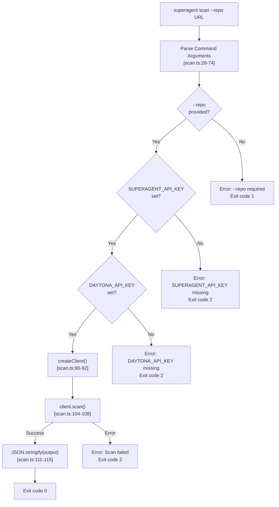
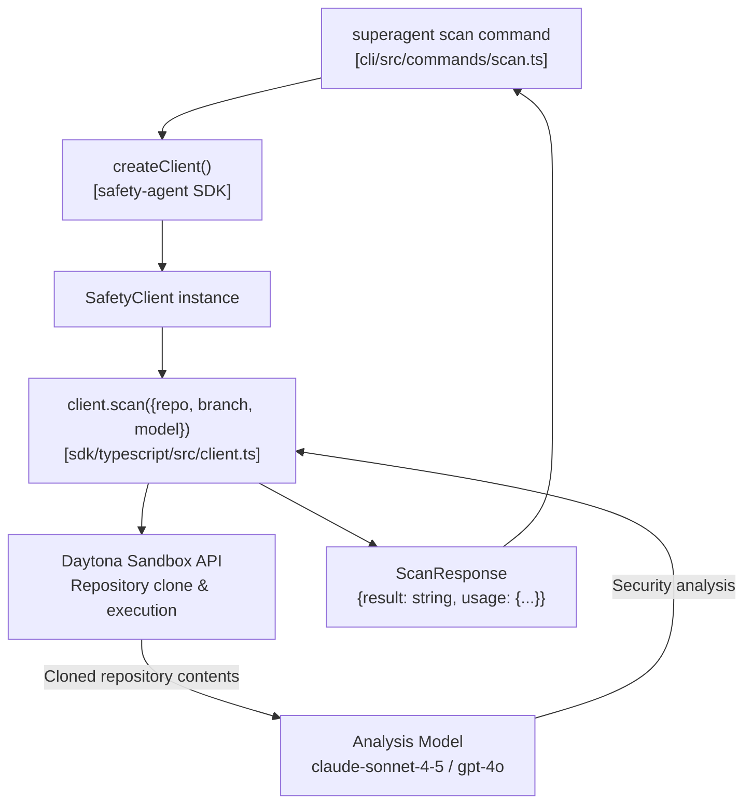
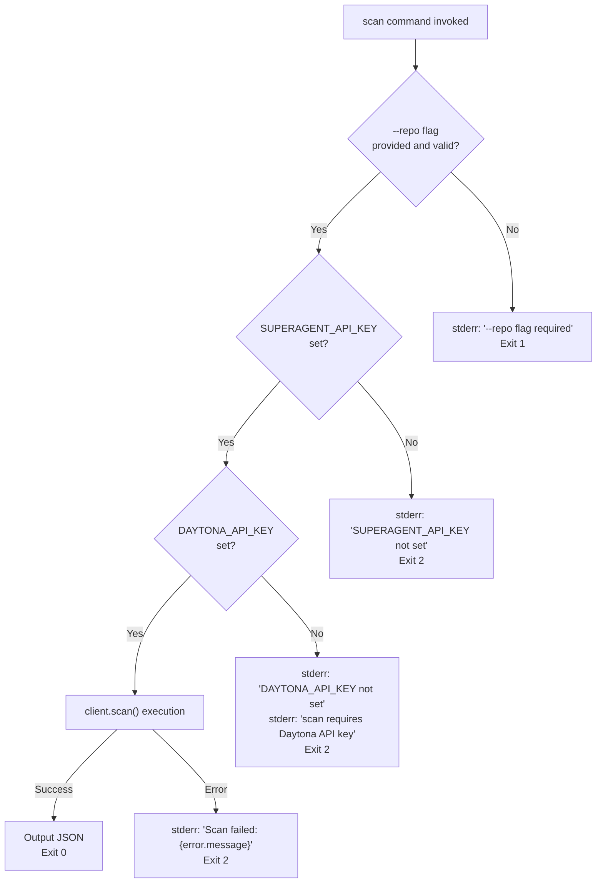

<!-- source: DeepWiki mcp.deepwiki.com · repo superagent-ai/superagent · page 3.4 Scan Command · fetched 2026-10-26 -->

# Scan Command

<details>
<summary>Relevant source files</summary>

The following files were used as context for generating this wiki page:

- [cli/README.md](cli/README.md)
- [cli/src/commands/scan.ts](cli/src/commands/scan.ts)
- [cli/src/index.ts](cli/src/index.ts)
- [cli/tests/scan.test.ts](cli/tests/scan.test.ts)
- [mcp/README.md](mcp/README.md)

</details>


This document describes the `superagent scan` command, which analyzes Git repositories for AI agent-targeted attacks such as repository poisoning, hidden prompt injections in code comments and documentation, and malicious instructions designed to manipulate AI agents. The scan command is part of the CLI tool and uses the Daytona sandbox service to safely clone and analyze repositories.

For information about the SDK scan operation, see [Scan Operation](#2.5). For general CLI installation and setup, see [CLI Installation](#3.1).

## Overview

The scan command clones a Git repository into a secure Daytona sandbox environment and uses a large language model to analyze the codebase for AI-specific security threats. Unlike traditional static analysis tools that focus on code vulnerabilities, this command specifically detects attacks designed to compromise AI agents that read or interact with the repository.

The command is implemented in [cli/src/commands/scan.ts]() and invokes the TypeScript SDK's `scan()` method from the safety-agent package.

**Sources:** [cli/src/commands/scan.ts:1-122](), [cli/README.md:1-15]()

## Command Syntax

```bash
superagent scan --repo <url> [options]
```

### Required Flags

| Flag | Description | Example |
|------|-------------|---------|
| `--repo <url>` | Repository URL to scan | `--repo https://github.com/user/repo` |

### Optional Flags

| Flag | Description | Default | Example |
|------|-------------|---------|---------|
| `--branch <ref>` | Branch, tag, or commit to checkout | Default branch | `--branch main` |
| `--model <id>` | Model to use for analysis | `anthropic/claude-sonnet-4-5` | `--model openai/gpt-4o` |
| `--help`, `-h` | Show help message | - | `--help` |

**Sources:** [cli/src/commands/scan.ts:3-26](), [cli/src/commands/scan.ts:28-74]()

## Environment Variables

The scan command requires two environment variables:

| Variable | Required | Purpose |
|----------|----------|---------|
| `SUPERAGENT_API_KEY` | Yes | Authentication for Superagent API |
| `DAYTONA_API_KEY` | Yes | Authentication for Daytona sandbox service |

If either variable is missing, the command exits with status code 2 and displays an error message.

**Sources:** [cli/src/commands/scan.ts:75-87](), [cli/tests/scan.test.ts:4-7]()

## Command Execution Flow



**Sources:** [cli/src/commands/scan.ts:28-122]()

## Integration with SDK and Daytona



**Sources:** [cli/src/commands/scan.ts:90-108](), [cli/tests/scan.test.ts:10-29]()

## Output Format

The scan command outputs a JSON object to stdout with the following structure:

```typescript
{
  "result": string,    // Detailed security analysis report
  "usage": {
    "inputTokens": number,
    "outputTokens": number,
    "reasoningTokens": number,
    "cost": number
  }
}
```

### Response Fields

| Field | Type | Description |
|-------|------|-------------|
| `result` | `string` | Complete security analysis report in markdown or structured format |
| `usage.inputTokens` | `number` | Number of tokens in the input (repository contents) |
| `usage.outputTokens` | `number` | Number of tokens in the output (analysis report) |
| `usage.reasoningTokens` | `number` | Number of reasoning tokens used by the model |
| `usage.cost` | `number` | Estimated cost in USD for the scan operation |

The `result` field contains a comprehensive security report that may include:
- Repository poisoning attempts
- Hidden prompt injections in comments or documentation
- Malicious instructions targeting AI agents
- Data exfiltration patterns
- CWE code references for identified vulnerabilities

**Sources:** [cli/src/commands/scan.ts:111-115](), [cli/tests/scan.test.ts:12-29]()

## Examples

### Basic Repository Scan

Scan a repository using default settings:

```bash
superagent scan --repo https://github.com/user/repo
```

Output:
```json
{
  "result": "## Security Analysis Report\n\n### Summary\nNo security threats detected...",
  "usage": {
    "inputTokens": 12450,
    "outputTokens": 580,
    "reasoningTokens": 0,
    "cost": 0.0234
  }
}
```

### Scan Specific Branch

Scan a specific branch or tag:

```bash
superagent scan --repo https://github.com/user/repo --branch develop
```

### Custom Model

Use a different analysis model:

```bash
superagent scan --repo https://github.com/user/repo --model openai/gpt-4o
```

### Full Options

Combine all options:

```bash
superagent scan \
  --repo https://github.com/user/repo \
  --branch feature/new-auth \
  --model anthropic/claude-sonnet-4-5
```

**Sources:** [cli/src/commands/scan.ts:18-25]()

## Exit Codes

The scan command uses the following exit codes:

| Code | Meaning | Condition |
|------|---------|-----------|
| 0 | Success | Scan completed successfully |
| 1 | Usage error | Missing required `--repo` flag or invalid flag value |
| 2 | Runtime error | Missing environment variables or scan execution failure |

Exit code 0 is returned even if security threats are detected in the repository. The exit code only indicates whether the scan command itself executed successfully.

**Sources:** [cli/src/commands/scan.ts:32-50](), [cli/src/commands/scan.ts:76-87](), [cli/src/commands/scan.ts:116-121]()

## Stderr Output

The command writes progress messages to stderr before outputting the final JSON result to stdout. This allows the JSON output to be cleanly piped to other tools:

```bash
superagent scan --repo https://github.com/user/repo > results.json
```

Stderr messages include:
- Repository URL being scanned
- Branch name (if specified)
- Model name (if specified)
- Error messages for missing credentials or scan failures

**Sources:** [cli/src/commands/scan.ts:94-101](), [cli/src/commands/scan.ts:119-120]()

## CI/CD Integration

The scan command is designed for integration into continuous integration pipelines. See [CI/CD Integration](#6.3) for complete examples using GitHub Actions and other CI/CD systems.

Example GitHub Actions workflow snippet:

```yaml
- name: Scan repository for AI threats
  env:
    SUPERAGENT_API_KEY: ${{ secrets.SUPERAGENT_API_KEY }}
    DAYTONA_API_KEY: ${{ secrets.DAYTONA_API_KEY }}
  run: |
    npm install -g safety-agent-cli
    superagent scan --repo ${{ github.repository }} --branch ${{ github.ref }}
```

**Sources:** [cli/src/commands/scan.ts:1-122]()

## Daytona Sandbox Requirement

The scan operation requires a Daytona API key because it clones the repository into a secure sandbox environment for analysis. This provides:

1. **Isolation**: Repository contents are analyzed in a controlled environment
2. **Security**: Potentially malicious code cannot affect the host system
3. **Consistency**: Reproducible analysis environment across scans

Without a valid `DAYTONA_API_KEY`, the command exits immediately with an error message explaining the requirement.

**Sources:** [cli/src/commands/scan.ts:81-87](), [cli/tests/scan.test.ts:4-7]()

## Timeout Considerations

Repository scans can be long-running operations, especially for large codebases. The test suite configures a 300-second (5-minute) timeout for scan operations. When integrating the scan command into automated workflows, ensure adequate timeout values are configured.

**Sources:** [cli/tests/scan.test.ts:12]()

## Error Handling

The scan command handles several error scenarios:



### Common Error Messages

| Error Message | Cause | Solution |
|---------------|-------|----------|
| `--repo flag is required` | Missing `--repo` flag | Add `--repo https://github.com/user/repo` |
| `--repo flag requires a URL` | Invalid `--repo` value | Provide a valid repository URL after `--repo` |
| `--branch flag requires a value` | Invalid `--branch` value | Provide a branch name after `--branch` |
| `--model flag requires a value` | Invalid `--model` value | Provide a model ID after `--model` |
| `SUPERAGENT_API_KEY environment variable not set` | Missing API key | Set `SUPERAGENT_API_KEY` environment variable |
| `DAYTONA_API_KEY environment variable not set` | Missing Daytona key | Set `DAYTONA_API_KEY` environment variable |
| `Scan failed: {message}` | SDK or API error | Check error message details and verify credentials |

**Sources:** [cli/src/commands/scan.ts:36-73](), [cli/src/commands/scan.ts:76-87](), [cli/src/commands/scan.ts:118-121]()

## Help Command

Display detailed help information:

```bash
superagent scan --help
```

Output:
```
Usage: superagent scan --repo <url> [options]

Scan a repository for AI agent-targeted attacks like repo poisoning and prompt injection

Options:
  --help              Show this help message
  --repo <url>        Repository URL to scan (required)
  --branch <ref>      Branch, tag, or commit to checkout
  --model <id>        Model to use (default: anthropic/claude-sonnet-4-5)

Examples:
  superagent scan --repo https://github.com/user/repo
  superagent scan --repo https://github.com/user/repo --branch main
  superagent scan --repo https://github.com/user/repo --model openai/gpt-4o
```

**Sources:** [cli/src/commands/scan.ts:3-26]()

---

