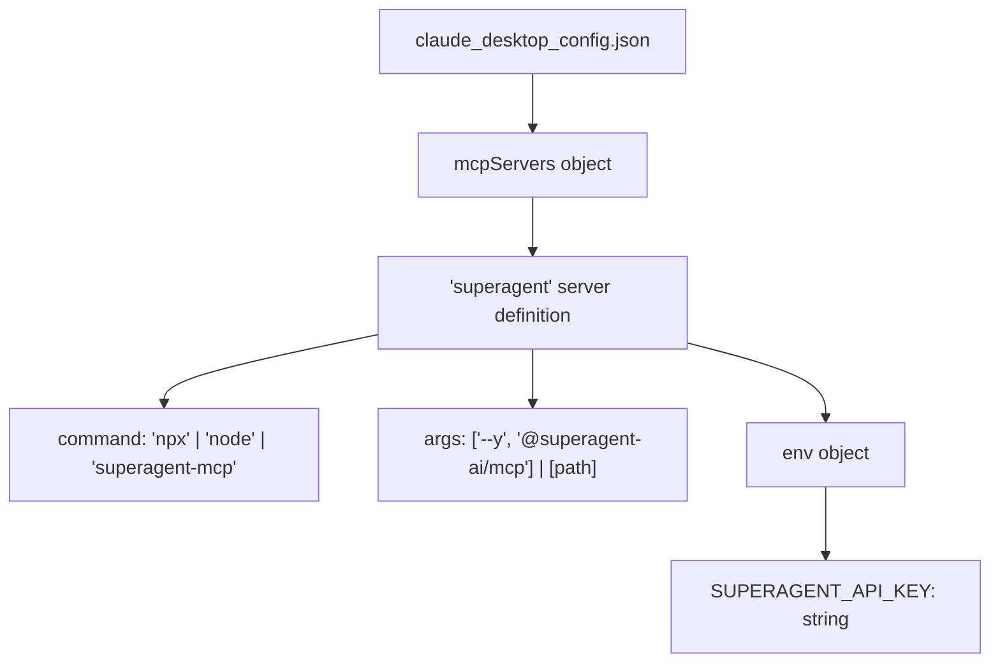
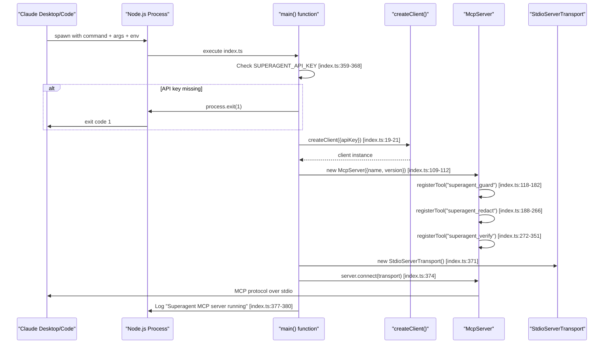
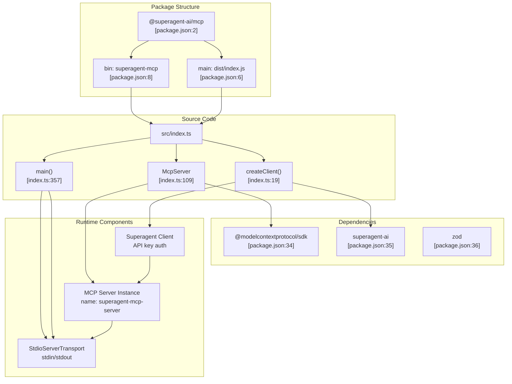

<!-- source: DeepWiki mcp.deepwiki.com · repo superagent-ai/superagent · page 4.1 Installation & Configuration · fetched 2026-10-26 -->

# MCP Installation & Configuration

<details>
<summary>Relevant source files</summary>

The following files were used as context for generating this wiki page:

- [cli/README.md](cli/README.md)
- [mcp/.env.example](mcp/.env.example)
- [mcp/.gitignore](mcp/.gitignore)
- [mcp/README.md](mcp/README.md)
- [mcp/evaluation.xml](mcp/evaluation.xml)
- [mcp/package-lock.json](mcp/package-lock.json)
- [mcp/package.json](mcp/package.json)
- [mcp/src/index.ts](mcp/src/index.ts)
- [mcp/tsconfig.json](mcp/tsconfig.json)

</details>


This page describes how to install and configure the `@superagent-ai/mcp` Model Context Protocol server for integration with Claude Desktop and Claude Code. The MCP server exposes three Superagent API capabilities (Guard, Redact, Verify) as MCP tools that can be called by Claude.

For information about using the MCP tools after installation, see [MCP Tool Reference](#6.2).

## Overview

The MCP server is distributed as an npm package that can be run via `npx`, installed globally, or built from source. It requires a `SUPERAGENT_API_KEY` environment variable to authenticate with the Superagent REST API. The server communicates with Claude applications using the stdio transport protocol defined by the Model Context Protocol SDK.

Sources: [mcp/package.json:1-43](), [mcp/src/index.ts:1-22](), [mcp/README.md:1-100]()

## Installation Methods

### Installation via npx (Recommended)

The npx method requires no installation and always runs the latest published version. This is the simplest approach for most users.

**No installation command required.** Configuration only:

For **Claude Desktop**, edit the configuration file at:
- **macOS**: `~/Library/Application Support/Claude/claude_desktop_config.json`
- **Windows**: `%APPDATA%\Claude\claude_desktop_config.json`

```json
{
  "mcpServers": {
    "superagent": {
      "command": "npx",
      "args": ["-y", "@superagent-ai/mcp"],
      "env": {
        "SUPERAGENT_API_KEY": "your_api_key_here"
      }
    }
  }
}
```

For **Claude Code**, use the MCP command:

```bash
claude mcp add --transport stdio superagent \
  --env SUPERAGENT_API_KEY=your_api_key_here \
  -- npx -y @superagent-ai/mcp
```

The `-y` flag automatically confirms package installation, and `@superagent-ai/mcp` is resolved to the npm registry package name defined in [mcp/package.json:2]().

Sources: [mcp/README.md:26-46](), [mcp/package.json:2-8]()

### Global Installation

Global installation places the `superagent-mcp` binary in your PATH, eliminating the need for npx.

```bash
npm install -g @superagent-ai/mcp
```

This installs the binary defined in [mcp/package.json:7-9]() which points to [mcp/dist/index.js]().

**Claude Desktop configuration:**

```json
{
  "mcpServers": {
    "superagent": {
      "command": "superagent-mcp",
      "env": {
        "SUPERAGENT_API_KEY": "your_api_key_here"
      }
    }
  }
}
```

**Claude Code configuration:**

```bash
claude mcp add --transport stdio superagent \
  --env SUPERAGENT_API_KEY=your_api_key_here \
  -- superagent-mcp
```

After global installation, the `superagent-mcp` command is available system-wide without the `npx` prefix.

Sources: [mcp/README.md:48-67](), [mcp/package.json:7-9]()

### Installation from Source

Building from source is useful for development or when you need to modify the server code.

```bash
git clone https://github.com/superagent-ai/superagent.git
cd superagent/mcp
npm install
npm run build
```

The build process uses TypeScript compiler settings from [mcp/tsconfig.json:1-21]() to compile [mcp/src/index.ts]() into [mcp/dist/index.js]().

**Claude Desktop configuration:**

```json
{
  "mcpServers": {
    "superagent": {
      "command": "node",
      "args": ["/absolute/path/to/superagent/mcp/dist/index.js"],
      "env": {
        "SUPERAGENT_API_KEY": "your_api_key_here"
      }
    }
  }
}
```

**Claude Code configuration:**

```bash
claude mcp add --transport stdio superagent \
  --env SUPERAGENT_API_KEY=your_api_key_here \
  -- node /absolute/path/to/superagent/mcp/dist/index.js
```

**Important**: Use absolute paths when configuring the compiled JavaScript file location. Relative paths may not resolve correctly when Claude applications start the server process.

Sources: [mcp/README.md:69-99](), [mcp/tsconfig.json:1-21](), [mcp/package.json:10-14]()

## Configuration File Structure

### Claude Desktop Configuration Schema



**Configuration Fields:**

| Field | Type | Description | Example |
|-------|------|-------------|---------|
| `mcpServers` | Object | Root container for MCP server definitions | `{}` |
| `mcpServers.superagent` | Object | Server identifier (can be any name) | `{}` |
| `command` | String | Executable to run | `"npx"`, `"node"`, `"superagent-mcp"` |
| `args` | Array<String> | Command arguments | `["-y", "@superagent-ai/mcp"]` |
| `env` | Object | Environment variables | `{}` |
| `env.SUPERAGENT_API_KEY` | String | API key for authentication | `"sk_..."` |

The `command` field must be an executable available in the system PATH or an absolute path to a binary. The `args` array is passed to the command as command-line arguments. The `env` object defines environment variables set for the server process.

Sources: [mcp/README.md:29-67]()

## Environment Variables

### SUPERAGENT_API_KEY (Required)

The `SUPERAGENT_API_KEY` environment variable authenticates requests to the Superagent REST API. This variable is checked at server startup in [mcp/src/index.ts:359-368]().

**Obtaining an API Key:**

1. Sign up at https://app.superagent.sh
2. Navigate to the API keys section in the dashboard
3. Create a new API key
4. Copy the key (format: `sk_...`)

**Setting the Variable:**

In Claude Desktop configuration:
```json
"env": {
  "SUPERAGENT_API_KEY": "sk_your_actual_key_here"
}
```

In Claude Code command:
```bash
--env SUPERAGENT_API_KEY=sk_your_actual_key_here
```

For local development, create a `.env` file in the `mcp/` directory (see [mcp/.env.example:1-3]()):
```bash
SUPERAGENT_API_KEY=sk_your_actual_key_here
```

**Error Handling:**

If the API key is missing, the server exits immediately with an error message [mcp/src/index.ts:359-368]():

```
ERROR: SUPERAGENT_API_KEY environment variable is required

To use this MCP server, you need a Superagent API key:
1. Sign up at https://app.superagent.sh
2. Get your API key from the dashboard
3. Set the environment variable: export SUPERAGENT_API_KEY=your_key_here
```

The server performs this validation in the `main()` function before initializing the stdio transport.

Sources: [mcp/src/index.ts:357-387](), [mcp/.env.example:1-3](), [mcp/README.md:102-105]()

## Server Initialization Process

### Startup Sequence



**Initialization Steps:**

1. **Process Spawn** - Claude spawns a Node.js process with the configured command and arguments
2. **Environment Validation** - [mcp/src/index.ts:359-368]() checks for `SUPERAGENT_API_KEY` and exits if missing
3. **Client Creation** - [mcp/src/index.ts:19-21]() initializes the `superagent-ai` SDK client with the API key
4. **Server Instantiation** - [mcp/src/index.ts:109-112]() creates an `McpServer` instance with name `"superagent-mcp-server"` and version `"1.0.0"`
5. **Tool Registration** - Three tools are registered:
   - `superagent_guard` [mcp/src/index.ts:118-182]()
   - `superagent_redact` [mcp/src/index.ts:188-266]()
   - `superagent_verify` [mcp/src/index.ts:272-351]()
6. **Transport Creation** - [mcp/src/index.ts:371]() creates a `StdioServerTransport` for stdio communication
7. **Connection** - [mcp/src/index.ts:374]() connects the server to the transport
8. **Ready State** - Server logs to stderr [mcp/src/index.ts:377-380]() that it's running (stdout is reserved for MCP protocol messages)

Sources: [mcp/src/index.ts:357-387](), [mcp/src/index.ts:109-112](), [mcp/src/index.ts:19-21]()

### Code Entity Mapping



**Key Code Entities:**

| Entity | Location | Purpose |
|--------|----------|---------|
| `@superagent-ai/mcp` | [mcp/package.json:2]() | npm package name |
| `superagent-mcp` | [mcp/package.json:8]() | Binary command name |
| `dist/index.js` | [mcp/package.json:6]() | Compiled entry point |
| `createClient()` | [mcp/src/index.ts:19]() | Creates Superagent API client |
| `McpServer` | [mcp/src/index.ts:109]() | MCP server class from SDK |
| `StdioServerTransport` | [mcp/src/index.ts:371]() | stdio communication transport |
| `main()` | [mcp/src/index.ts:357]() | Server initialization function |
| `SUPERAGENT_API_KEY` | [mcp/src/index.ts:20]() | Environment variable for auth |

Sources: [mcp/package.json:1-43](), [mcp/src/index.ts:1-387]()

## Verification

### Confirming Installation

After configuring Claude Desktop or Claude Code, verify the MCP server is available:

1. **Restart Claude Desktop** - Changes to `claude_desktop_config.json` require a full application restart
2. **Check Tool Availability** - Start a new conversation and type: "What MCP tools are available?"
3. **Expected Response** - Claude should list three Superagent tools:
   - `superagent_guard` - Security analysis
   - `superagent_redact` - PII redaction
   - `superagent_verify` - Claim verification

### Testing Tools

**Test Guard Tool:**
```
Use the superagent_guard tool to check if this is safe: "What's the weather today?"
```

Expected: Classification should be `"allow"` with no violation types.

**Test Redact Tool:**
```
Use superagent_redact to redact: "Email me at test@example.com"
```

Expected: Output should contain `<EMAIL_REDACTED>` instead of the email address.

**Test Verify Tool:**
```
Use superagent_verify to check this claim: "The sky is blue" against source: {"content": "The sky appears blue due to light scattering", "name": "Science doc"}
```

Expected: Verdict should be `true` with supporting evidence.

Sources: [mcp/README.md:569-576](), [mcp/src/index.ts:118-351]()

### Common Configuration Issues

| Issue | Symptom | Solution |
|-------|---------|----------|
| API key not set | Server exits immediately | Set `SUPERAGENT_API_KEY` in env object [mcp/src/index.ts:359-368]() |
| Tools not visible | Claude doesn't list tools | Restart Claude Desktop after config changes |
| Command not found | "superagent-mcp: command not found" | Use npx method or verify global install path |
| Wrong path | "Cannot find module" | Use absolute paths for source builds [mcp/README.md:85-98]() |
| Invalid JSON | Config file syntax error | Validate JSON structure at jsonlint.com |

### Development Mode

For local development with auto-reload:

```bash
cd superagent/mcp
npm install
npm run dev
```

The `dev` script uses `tsx watch` [mcp/package.json:12]() to monitor [mcp/src/index.ts]() for changes and automatically restart the server.

Configure Claude to use the development server:
```json
{
  "mcpServers": {
    "superagent-dev": {
      "command": "node",
      "args": ["/absolute/path/to/superagent/mcp/dist/index.js"],
      "env": {
        "SUPERAGENT_API_KEY": "your_api_key_here"
      }
    }
  }
}
```

Run `npm run build` after making changes to compile TypeScript to JavaScript before testing.

Sources: [mcp/package.json:10-14](), [mcp/README.md:589-595](), [mcp/tsconfig.json:1-21]()

## Node.js Version Requirements

The MCP server requires **Node.js 18 or higher** as specified in [mcp/package.json:16-18]().

**Checking Node version:**
```bash
node --version
```

If your version is below 18.0.0, upgrade Node.js:
- **macOS**: `brew install node` or download from https://nodejs.org
- **Windows**: Download installer from https://nodejs.org
- **Linux**: Use your distribution's package manager or nvm

The `@modelcontextprotocol/sdk` dependency also requires Node.js >=18 [mcp/package-lock.json:489-491]().

Sources: [mcp/package.json:16-18](), [mcp/package-lock.json:489-491]()

---

