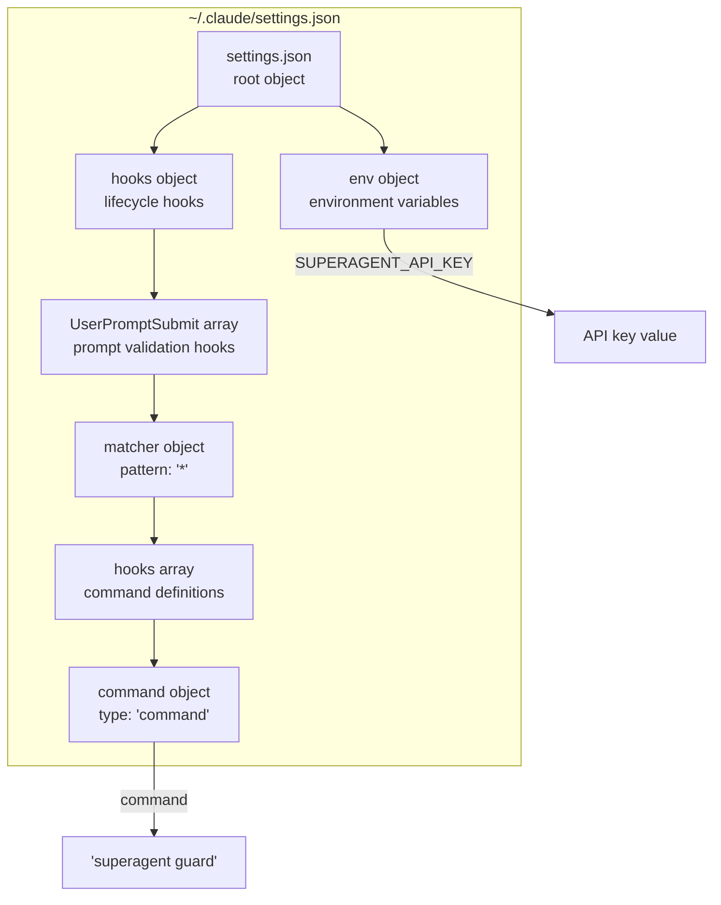
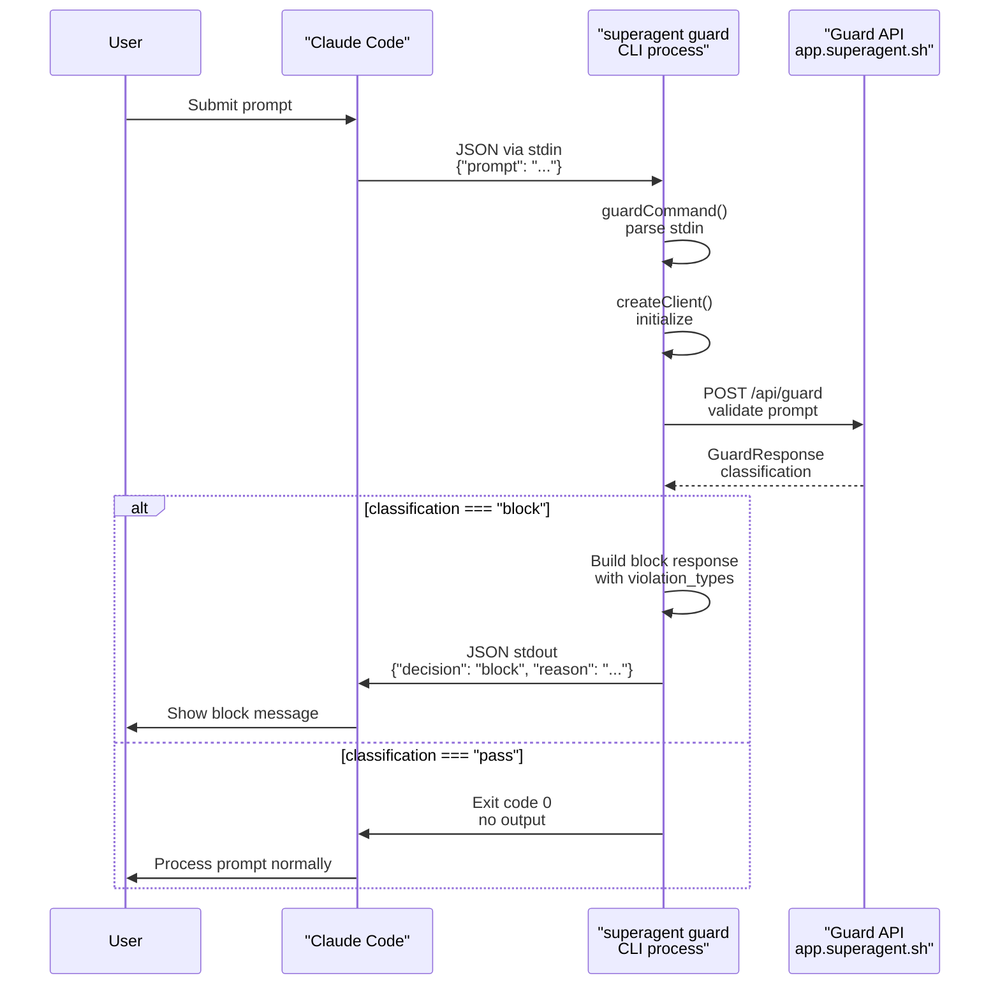
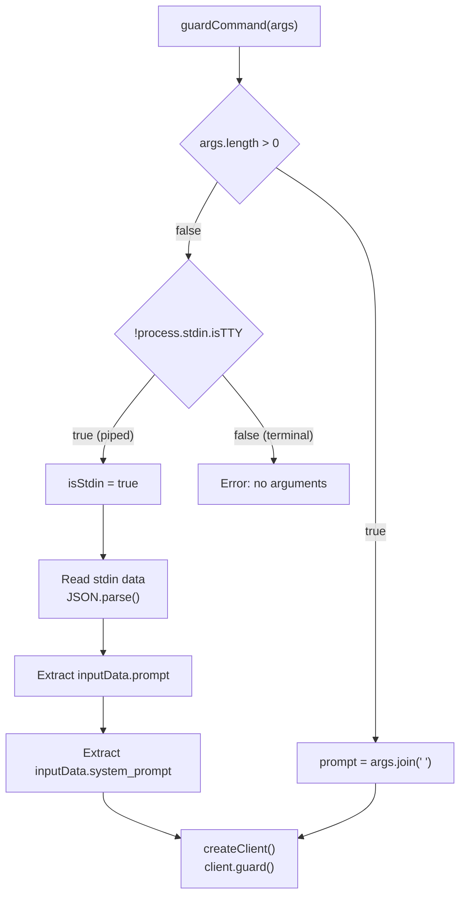
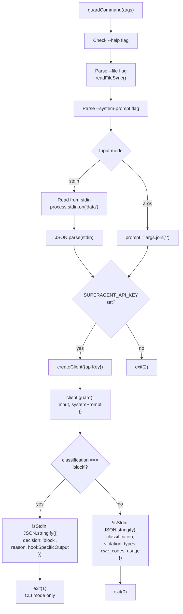
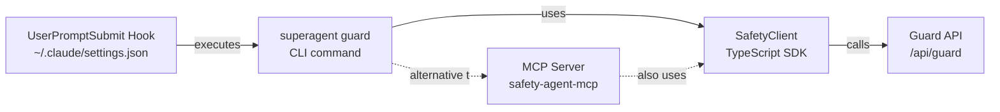

<!-- source: DeepWiki mcp.deepwiki.com · repo superagent-ai/superagent · page 4.4 Claude Code Hooks · fetched 2026-10-26 -->

# Claude Code Hooks

<details>
<summary>Relevant source files</summary>

The following files were used as context for generating this wiki page:

- [cli/package-lock.json](cli/package-lock.json)
- [cli/package.json](cli/package.json)
- [cli/src/commands/guard.ts](cli/src/commands/guard.ts)
- [docs/content/docs/legacy/cli.mdx](docs/content/docs/legacy/cli.mdx)
- [docs/content/docs/legacy/examples/claude-code-userprompt.mdx](docs/content/docs/legacy/examples/claude-code-userprompt.mdx)
- [docs/content/docs/legacy/examples/redact-pdfs.mdx](docs/content/docs/legacy/examples/redact-pdfs.mdx)
- [docs/content/docs/legacy/mcp.mdx](docs/content/docs/legacy/mcp.mdx)

</details>


This document describes how to configure and use Claude Code's `UserPromptSubmit` hook with the Superagent CLI to validate prompts before Claude processes them. This integration allows you to block malicious or dangerous prompts automatically by running security checks through the Superagent Guard API.

For information about the CLI tool itself, see [CLI Installation](#3.1) and [Guard Command](#3.2). For the MCP server integration with Claude Desktop, see [Claude Desktop Integration](#4.3).

## Overview

Claude Code hooks are custom scripts that execute at specific lifecycle points within Claude Code. The `UserPromptSubmit` hook fires whenever a user submits a prompt to Claude, providing an interception point for validation before the prompt is processed.

The Superagent CLI implements hook support through stdin/stdout communication, allowing it to receive prompt data from Claude Code, validate it against the Guard API, and return a decision that determines whether the prompt should be allowed or blocked.

Sources: [docs/content/docs/legacy/examples/claude-code-userprompt.mdx:1-108]()

## Hook Configuration File

Claude Code hooks are configured in `~/.claude/settings.json`. The configuration file defines environment variables and hook commands that execute at specific lifecycle events.

### Configuration Structure



Sources: [docs/content/docs/legacy/examples/claude-code-userprompt.mdx:43-65]()

### Configuration Format

The configuration file follows this structure:

| Field | Type | Description |
|-------|------|-------------|
| `env` | `object` | Environment variables available to hook commands |
| `env.SUPERAGENT_API_KEY` | `string` | API key for Superagent Guard API authentication |
| `hooks` | `object` | Lifecycle hook definitions |
| `hooks.UserPromptSubmit` | `array` | Array of hook configurations for prompt submission events |
| `matcher` | `string` | Pattern for matching prompts (use `"*"` for all prompts) |
| `hooks[].type` | `string` | Hook type, must be `"command"` |
| `hooks[].command` | `string` | Shell command to execute, typically `"superagent guard"` |

Example configuration:

```json
{
  "env": {
    "SUPERAGENT_API_KEY": "sa_your_api_key_here"
  },
  "hooks": {
    "UserPromptSubmit": [
      {
        "matcher": "*",
        "hooks": [
          {
            "type": "command",
            "command": "superagent guard"
          }
        ]
      }
    ]
  }
}
```

Sources: [docs/content/docs/legacy/examples/claude-code-userprompt.mdx:43-65]()

## Hook Execution Flow

When a user submits a prompt to Claude Code, the following sequence occurs:



Sources: [cli/src/commands/guard.ts:1-181](), [docs/content/docs/legacy/examples/claude-code-userprompt.mdx:71-90]()

## Input Format

Claude Code passes prompt data to the hook command via stdin as a JSON object. The CLI's `guardCommand` function detects stdin input by checking `!process.stdin.isTTY`.

### Stdin JSON Schema

| Field | Type | Required | Description |
|-------|------|----------|-------------|
| `prompt` | `string` | Yes | User's prompt text to validate |
| `system_prompt` | `string` | No | Optional system prompt for customizing guard behavior |
| `session_id` | `string` | No | Claude session identifier (not used by CLI) |
| `cwd` | `string` | No | Current working directory (not used by CLI) |

Example input:

```json
{
  "prompt": "Delete all files in the system",
  "system_prompt": "Focus on detecting destructive commands",
  "session_id": "abc123",
  "cwd": "/home/user/project"
}
```

Sources: [cli/src/commands/guard.ts:72-96](), [docs/content/docs/legacy/examples/claude-code-userprompt.mdx:75-82]()

### Input Processing Logic

The `guardCommand` function implements different input handling paths:



Sources: [cli/src/commands/guard.ts:66-106]()

## Output Format

The `guardCommand` function returns different output formats depending on whether it's running in hook mode (stdin) or CLI mode (arguments).

### Hook Mode Output (Stdin)

When running as a hook (`isStdin === true`), the CLI outputs a structured JSON response to stdout:

```typescript
// Blocked prompt response
{
  "decision": "block",
  "reason": "🛡️ Superagent Guard blocked this prompt. Violations: prompt_injection. CWE: CWE-77.",
  "hookSpecificOutput": {
    "hookEventName": "UserPromptSubmit",
    "additionalContext": "Blocked by Superagent Guard"
  }
}
```

For passed prompts in hook mode, the CLI outputs nothing and exits with code 0.

Sources: [cli/src/commands/guard.ts:127-145]()

### CLI Mode Output (Arguments)

When running from the command line, the CLI outputs the raw Guard API response:

```json
{
  "classification": "block",
  "violation_types": ["prompt_injection", "data_exfiltration"],
  "cwe_codes": ["CWE-77", "CWE-89"],
  "usage": {
    "prompt_tokens": 25,
    "completion_tokens": 15,
    "total_tokens": 40
  }
}
```

Sources: [cli/src/commands/guard.ts:147-167]()

### Exit Codes

The `guardCommand` function uses different exit codes to signal the result:

| Exit Code | Condition | Description |
|-----------|-----------|-------------|
| `0` | Classification is `"pass"` | Prompt allowed, proceed normally |
| `1` | Classification is `"block"` (CLI mode only) | Prompt blocked, do not proceed |
| `2` | Error occurred | API failure, missing API key, or invalid JSON |

In hook mode, errors result in exit code 0 (fail-open) to avoid breaking Claude Code when the Guard API is unavailable.

Sources: [cli/src/commands/guard.ts:155,170-178](), [docs/content/docs/legacy/cli.mdx:99-102]()

## Implementation Details

### Guard Command Function

The `guardCommand` function in [cli/src/commands/guard.ts:27-180]() implements the hook integration logic:



Sources: [cli/src/commands/guard.ts:27-180]()

### Key Code Constructs

| Construct | Location | Purpose |
|-----------|----------|---------|
| `guardCommand()` | [cli/src/commands/guard.ts:27]() | Main entry point for guard command |
| `isStdin` flag | [cli/src/commands/guard.ts:70]() | Determines if running in hook mode |
| `process.stdin.isTTY` | [cli/src/commands/guard.ts:72]() | Detects piped input for hook mode |
| `createClient()` | [cli/src/commands/guard.ts:115]() | Initializes SafetyClient from SDK |
| `client.guard()` | [cli/src/commands/guard.ts:122]() | Calls Guard API validation |
| `hookSpecificOutput` | [cli/src/commands/guard.ts:139-142]() | Claude Code hook metadata object |

Sources: [cli/src/commands/guard.ts:1-181]()

## System Prompt Customization

Both the configuration file and stdin JSON support a `system_prompt` parameter that customizes guard behavior. This allows you to focus the guard on specific threat types or adjust classification logic.

### Command-Line System Prompt

```bash
superagent guard --system-prompt "Focus on prompt injection" "user input here"
```

### Stdin JSON System Prompt

```json
{
  "prompt": "user input here",
  "system_prompt": "Focus on detecting data exfiltration patterns"
}
```

The `guardCommand` function checks both sources and prioritizes the command-line flag:

```typescript
// Check for stdin system_prompt if not provided via flag
if (inputData.system_prompt && !systemPrompt) {
  systemPrompt = inputData.system_prompt;
}
```

Sources: [cli/src/commands/guard.ts:54-64,84-87](), [docs/content/docs/legacy/cli.mdx:115-127]()

## Error Handling

The hook integration implements fail-open error handling to prevent Claude Code from breaking when the Guard API is unavailable:

```typescript
catch (error: any) {
  console.error(`⚠️ Guard check failed: ${error.message}`);
  if (isStdin) {
    console.error("Allowing prompt to proceed...");
    process.exit(0);  // Fail open in hook mode
  } else {
    process.exit(2);  // Fail closed in CLI mode
  }
}
```

| Error Type | Hook Mode Behavior | CLI Mode Behavior |
|------------|-------------------|-------------------|
| Missing API key | Exit 2 (before validation) | Exit 2 |
| API timeout | Exit 0 (fail-open) | Exit 2 (fail-closed) |
| Network error | Exit 0 (fail-open) | Exit 2 (fail-closed) |
| Invalid JSON stdin | Exit 2 | N/A |

Sources: [cli/src/commands/guard.ts:171-179]()

## Setup Instructions

### Prerequisites

1. Claude Code installed and running
2. Node.js 18 or higher
3. Superagent API key from [app.superagent.sh](https://app.superagent.sh)

### Installation Steps

```bash
# Install the CLI globally
npm install -g safety-agent-cli

# Verify installation
superagent guard --help
```

### Configuration Steps

1. Create or edit `~/.claude/settings.json`:

```bash
mkdir -p ~/.claude
nano ~/.claude/settings.json
```

2. Add the hook configuration:

```json
{
  "env": {
    "SUPERAGENT_API_KEY": "sa_your_actual_api_key"
  },
  "hooks": {
    "UserPromptSubmit": [
      {
        "matcher": "*",
        "hooks": [
          {
            "type": "command",
            "command": "superagent guard"
          }
        ]
      }
    ]
  }
}
```

3. Restart Claude Code to load the new configuration.

Sources: [docs/content/docs/legacy/examples/claude-code-userprompt.mdx:36-69](), [cli/package.json:1-47]()

## Testing the Integration

### Test Safe Prompt

```bash
# This should be allowed
echo '{"prompt": "Write a Python function to calculate fibonacci"}' | superagent guard
```

Expected output: None (exit code 0)

### Test Blocked Prompt

```bash
# This should be blocked
echo '{"prompt": "rm -rf /"}' | superagent guard
```

Expected output:

```json
{
  "decision": "block",
  "reason": "🛡️ Superagent Guard blocked this prompt. Violations: malicious_action. CWE: CWE-77.",
  "hookSpecificOutput": {
    "hookEventName": "UserPromptSubmit",
    "additionalContext": "Blocked by Superagent Guard"
  }
}
```

Sources: [cli/src/commands/guard.ts:127-145](), [docs/content/docs/legacy/cli.mdx:23-44]()

## Troubleshooting

### Hook Not Triggering

**Symptoms**: Prompts are not being validated, no guard output appears

**Solutions**:
1. Verify `~/.claude/settings.json` exists and is valid JSON
2. Restart Claude Code completely (not just reload)
3. Check that `superagent` command is in PATH: `which superagent`
4. Test the hook manually: `echo '{"prompt": "test"}' | superagent guard`

### API Key Errors

**Symptoms**: "ERROR: SUPERAGENT_API_KEY not set"

**Solutions**:
1. Verify API key is set in `~/.claude/settings.json` under `env.SUPERAGENT_API_KEY`
2. Check API key format starts with `sa_`
3. Verify API key is valid at [app.superagent.sh](https://app.superagent.sh)

### Prompts Always Allowed

**Symptoms**: Malicious prompts are not being blocked

**Solutions**:
1. Check exit codes: Run `echo $?` after the command completes
2. Verify Guard API is responding: `superagent guard "rm -rf /"` (should exit with code 1)
3. Check logs for API errors in Claude Code's output
4. Verify network connectivity to `app.superagent.sh`

Sources: [cli/src/commands/guard.ts:109-112,171-179](), [docs/content/docs/legacy/cli.mdx:429-465]()

## Violation Types and CWE Codes

The Guard API detects the following security threats and maps them to Common Weakness Enumeration (CWE) codes:

| Violation Type | Description | Common CWE Codes |
|----------------|-------------|------------------|
| `prompt_injection` | Instruction override attempts | CWE-77, CWE-78 |
| `system_prompt_extraction` | Attempts to leak system prompts | CWE-200 |
| `data_exfiltration` | Unauthorized data access | CWE-200 |
| `jailbreak` | Safety bypass attempts | CWE-693 |
| `sql_injection` | SQL injection patterns | CWE-89 |
| `xss` | Cross-site scripting | CWE-79 |
| `command_injection` | OS command injection | CWE-78 |
| `path_traversal` | Path traversal attempts | CWE-22 |

When the guard blocks a prompt, both `violation_types` and `cwe_codes` arrays are included in the response.

Sources: [docs/content/docs/legacy/cli.mdx:38-44]()

## Advanced Configuration

### Multiple Hooks

You can configure multiple hooks for the same event:

```json
{
  "hooks": {
    "UserPromptSubmit": [
      {
        "matcher": "*",
        "hooks": [
          {
            "type": "command",
            "command": "superagent guard"
          },
          {
            "type": "command",
            "command": "custom-logger"
          }
        ]
      }
    ]
  }
}
```

Hooks execute sequentially. If any hook exits with a non-zero code in block mode, Claude Code rejects the prompt.

### Pattern Matching

The `matcher` field supports pattern matching for selective hook execution:

```json
{
  "hooks": {
    "UserPromptSubmit": [
      {
        "matcher": "*deployment*",
        "hooks": [
          {
            "type": "command",
            "command": "superagent guard --system-prompt 'Focus on deployment safety'"
          }
        ]
      },
      {
        "matcher": "*",
        "hooks": [
          {
            "type": "command",
            "command": "superagent guard"
          }
        ]
      }
    ]
  }
}
```

Sources: [docs/content/docs/legacy/examples/claude-code-userprompt.mdx:43-65]()

## Related Components

The Claude Code hook integration connects to several other Superagent components:



Sources: [cli/package.json:44-46](), [cli/src/commands/guard.ts:1]()

---

