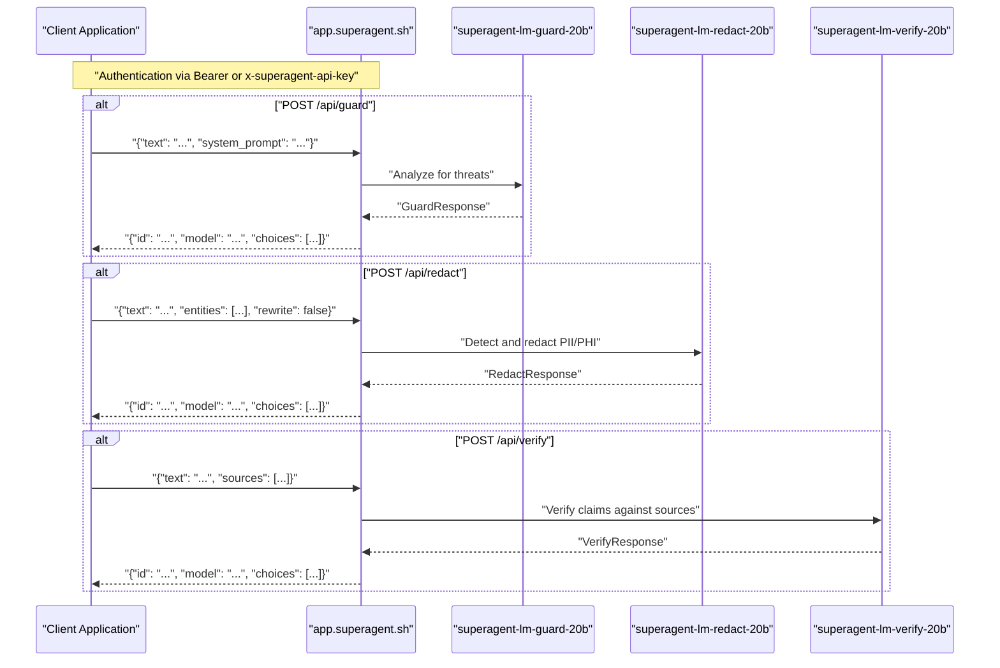
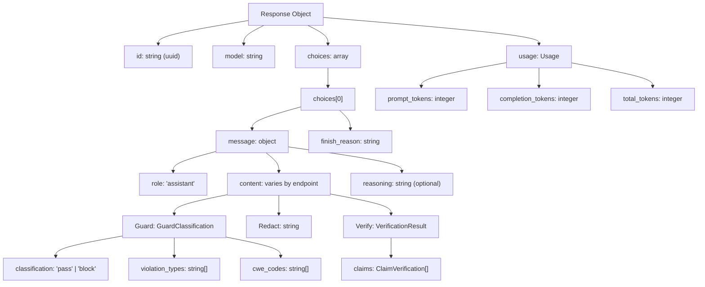
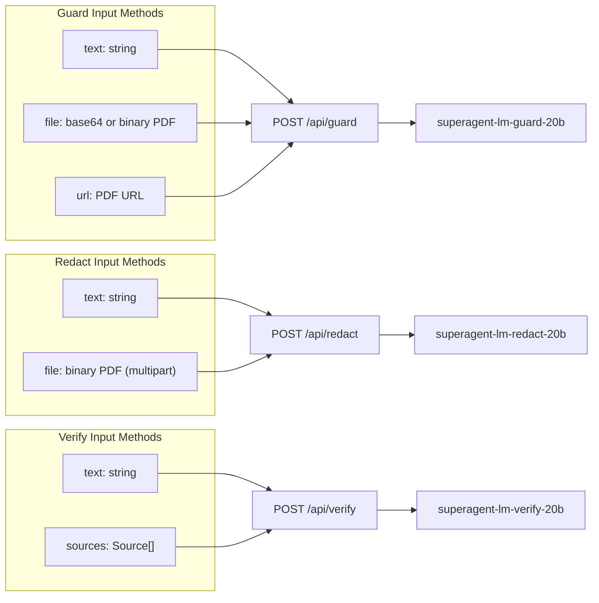

<!-- source: DeepWiki mcp.deepwiki.com · repo superagent-ai/superagent · page 5 REST API · fetched 2026-10-26 -->

# REST API

Relevant source files

The following files were used as context for generating this wiki page:

- [docs/app/global.css](docs/app/global.css)
- [docs/lib/openapi.ts](docs/lib/openapi.ts)
- [docs/lib/source.ts](docs/lib/source.ts)
- [docs/openapi.json](docs/openapi.json)
- [docs/scripts/generate-docs.ts](docs/scripts/generate-docs.ts)

The Superagent REST API provides programmatic access to three specialized AI models for securing and verifying AI applications: Guard (security threat detection), Redact (PII/PHI removal), and Verify (claim verification). This page documents the core API structure, authentication, common patterns, and endpoint overview. For detailed endpoint documentation, see [Guard Endpoint](#2.2), [Redact Endpoint](#2.3), and [Verify Endpoint](#2.4). For SDK-based access, see [Python SDK](#4) and [TypeScript SDK](#5).

## Base URL and Endpoints

The production API is hosted at `https://app.superagent.sh` with three primary endpoints:

| Endpoint | Method | Purpose | Model |
|----------|--------|---------|-------|
| `/api/guard` | POST | Security threat detection for user inputs | `superagent-lm-guard-20b` |
| `/api/redact` | POST | PII/PHI redaction from text and PDFs | `superagent-lm-redact-20b` |
| `/api/verify` | POST | Claim verification against source materials | `superagent-lm-verify-20b` |

Sources: [docs/openapi.json:12-16](), [docs/openapi.json:27-600]()

## Authentication

The API supports two authentication methods, both providing equivalent access:

| Method | Header | Format | Example |
|--------|--------|--------|---------|
| Bearer Token | `Authorization` | `Bearer <api_key>` | `Authorization: Bearer sk_test_abc123...` |
| Custom Header | `x-superagent-api-key` | `<api_key>` | `x-superagent-api-key: sk_test_abc123...` |

Both methods are defined in the security schemes and can be used interchangeably. All endpoints require authentication via one of these methods.

Sources: [docs/openapi.json:18-25](), [docs/openapi.json:603-615]()

## Request Flow Architecture

Sources: [docs/openapi.json:422-600]() (guard), [docs/openapi.json:27-242]() (redact), [docs/openapi.json:244-420]() (verify)

## Common Response Structure

All three endpoints return responses following a consistent schema with OpenAI-compatible structure:

Sources: [docs/openapi.json:617-669]() (RedactResponse), [docs/openapi.json:699-745]() (GuardResponse), [docs/openapi.json:747-789]() (VerifyResponse), [docs/openapi.json:870-890]() (Usage)

### Response Schema Objects

| Schema | Purpose | Key Fields |
|--------|---------|------------|
| `GuardResponse` | Security analysis result | `id`, `model`, `choices[].message.content.classification` |
| `GuardClassification` | Classification details | `classification`, `violation_types`, `cwe_codes` |
| `RedactResponse` | Redacted text result | `id`, `model`, `choices[].message.content`, `redacted_pdf` (optional) |
| `VerifyResponse` | Claim verification result | `id`, `model`, `choices[].message.content.claims` |
| `VerificationResult` | Verification details | `claims[]` |
| `ClaimVerification` | Individual claim verdict | `claim`, `verdict`, `sources`, `evidence`, `reasoning` |
| `Usage` | Token usage statistics | `prompt_tokens`, `completion_tokens`, `total_tokens` |
| `Error` | Error message | `error` |

Sources: [docs/openapi.json:616-900]()

## Content Type Support

Different endpoints support different content types based on their functionality:

### Guard Endpoint Content Types

| Content Type | Supports | Input Fields | Use Case |
|--------------|----------|--------------|----------|
| `application/json` | Text, Base64 PDF, URL | `text`, `file`, `url`, `system_prompt` | Standard text analysis or base64-encoded PDF |
| `multipart/form-data` | Text, Binary PDF, URL | `text`, `file`, `url`, `system_prompt` | File upload with binary PDF data |

Sources: [docs/openapi.json:436-493]()

### Redact Endpoint Content Types

| Content Type | Supports | Input Fields | Output Options |
|--------------|----------|--------------|----------------|
| `application/json` | Text only | `text`, `entities`, `rewrite` | JSON with `choices[].message.content` |
| `multipart/form-data` | Text and PDF | `text`, `entities`, `file`, `format`, `rewrite` | JSON (default) or PDF (`format=pdf`) |

When `format=pdf` is specified in multipart requests, the response is `application/pdf` binary data instead of JSON. Otherwise, JSON responses include `redacted_pdf` field with base64-encoded PDF.

Sources: [docs/openapi.json:41-104](), [docs/openapi.json:134-142]()

### Verify Endpoint Content Types

| Content Type | Supports | Input Fields | Use Case |
|--------------|----------|--------------|----------|
| `application/json` | Text and sources | `text`, `sources[]` | Standard claim verification |

Sources: [docs/openapi.json:258-290]()

## Input Methods Comparison

Sources: [docs/openapi.json:442-464]() (guard inputs), [docs/openapi.json:48-101]() (redact inputs), [docs/openapi.json:266-286]() (verify inputs)

## HTTP Status Codes

All endpoints use consistent HTTP status codes for error handling:

| Status Code | Meaning | Common Causes | Example Error Message |
|-------------|---------|---------------|----------------------|
| `200` | Success | Request processed successfully | N/A |
| `400` | Bad Request | Invalid parameters, missing required fields | `"Invalid text provided"` |
| `401` | Unauthorized | Missing or invalid API key | `"API key missing"`, `"Invalid API key"` |
| `402` | Payment Required | No active subscription | `"No subscription found"` |
| `404` | Not Found | Team or team owner not found | `"Team not found"` |
| `500` | Internal Server Error | Server-side processing failure | `"Failed to analyze prompt"` |

All error responses follow the `Error` schema with a single `error` field containing the error message.

Sources: [docs/openapi.json:143-241]() (redact errors), [docs/openapi.json:335-418]() (verify errors), [docs/openapi.json:506-597]() (guard errors), [docs/openapi.json:891-899]() (Error schema)

## Required Fields by Endpoint

| Endpoint | Required Fields | Optional Fields |
|----------|----------------|-----------------|
| `/api/guard` | One of: `text`, `file`, or `url` | `system_prompt` |
| `/api/redact` | `text` | `entities`, `rewrite`, `file`, `format` |
| `/api/verify` | `text`, `sources` (non-empty array) | None |

Sources: [docs/openapi.json:442-490](), [docs/openapi.json:46-67](), [docs/openapi.json:263-287]()

## Source Object Schema

The Verify endpoint requires an array of `Source` objects:

| Field | Type | Required | Description |
|-------|------|----------|-------------|
| `content` | string | Yes | The content of the source material |
| `name` | string | Yes | The name or identifier of the source |
| `url` | string | No | Optional URL of the source |

Sources: [docs/openapi.json:790-810]()

## OpenAPI Specification

The complete API specification is defined in `openapi.json` and follows OpenAPI 3.0.0 standard. The specification is used to:

1. Generate documentation via `fumadocs-openapi` using [docs/scripts/generate-docs.ts:1-11]()
2. Provide type definitions for client SDKs
3. Enable API validation and testing
4. Power the documentation site at `docs.superagent.sh`

The OpenAPI configuration is loaded through [docs/lib/openapi.ts:1-7]() and integrated into the Fumadocs framework via the `openapiPlugin` in [docs/lib/source.ts:1-12]().

Sources: [docs/openapi.json:1-916](), [docs/scripts/generate-docs.ts:1-11](), [docs/lib/openapi.ts:1-7](), [docs/lib/source.ts:1-12]()

## Rate Limiting and Subscriptions

The API enforces subscription-based access control. Requests without an active subscription receive a `402 Payment Required` response. Rate limiting details are managed at the subscription level and enforced by the authentication layer.

Sources: [docs/openapi.json:193-205]() (redact 402), [docs/openapi.json:550-562]() (guard 402)

## Next Steps

For detailed information about each endpoint, including request/response examples and parameter descriptions, see:

- [Authentication & Configuration](#2.1) - API key setup, base URLs, and request patterns
- [Guard Endpoint](#2.2) - Security threat detection with system prompts
- [Redact Endpoint](#2.3) - PII/PHI removal with custom entities and rewrite mode
- [Verify Endpoint](#2.4) - Claim verification against source materials
- [Error Handling](#2.5) - Detailed error scenarios and troubleshooting

For SDK-based usage instead of direct API calls, see [Python SDK](#4) and [TypeScript SDK](#5).

---

