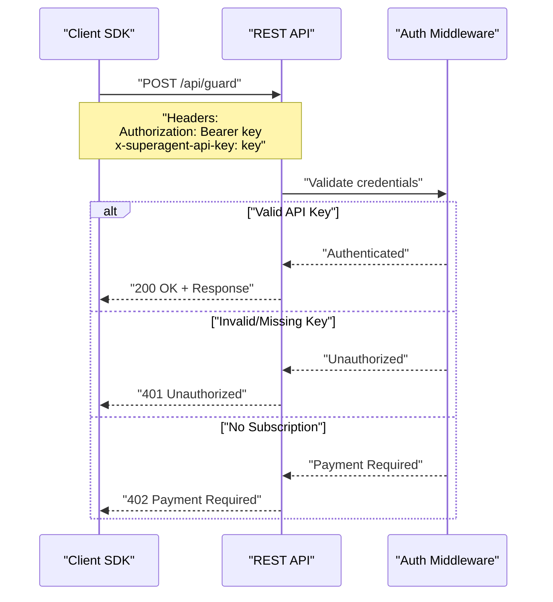
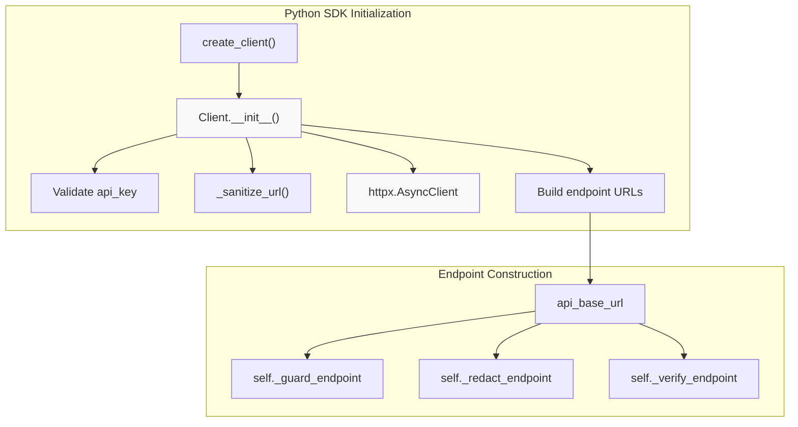
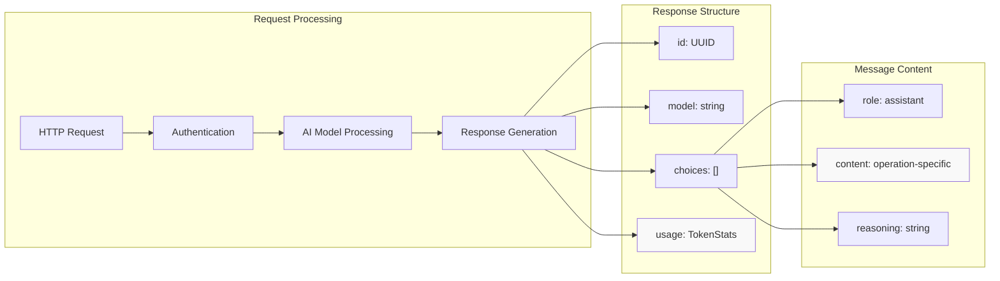
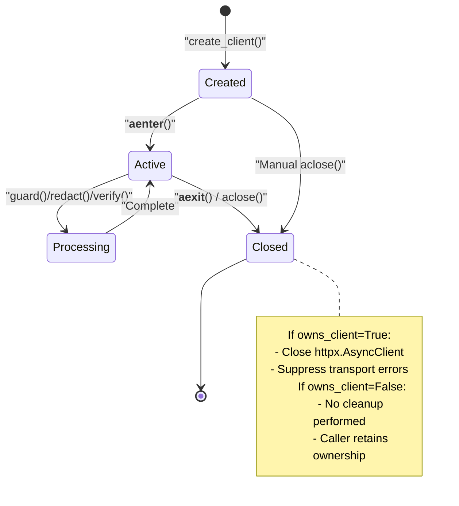

<!-- source: DeepWiki mcp.deepwiki.com · repo superagent-ai/superagent · page 5.1 Authentication & Configuration · fetched 2026-10-26 -->

# Authentication & Configuration

<details>
<summary>Relevant source files</summary>

The following files were used as context for generating this wiki page:

- [docs/content/docs/legacy/cli.mdx](docs/content/docs/legacy/cli.mdx)
- [docs/content/docs/legacy/examples/claude-code-userprompt.mdx](docs/content/docs/legacy/examples/claude-code-userprompt.mdx)
- [docs/content/docs/legacy/examples/redact-pdfs.mdx](docs/content/docs/legacy/examples/redact-pdfs.mdx)
- [docs/content/docs/legacy/mcp.mdx](docs/content/docs/legacy/mcp.mdx)
- [docs/openapi.json](docs/openapi.json)

</details>


This page documents how to authenticate requests to the Superagent REST API and configure client behavior. It covers API key authentication methods, base URLs, request headers, timeout settings, and common client initialization patterns used across all SDKs.

For detailed information about error responses and status codes, see [Error Handling](#2.5). For SDK-specific setup instructions, see [Python Installation & Setup](#4.1) and [TypeScript Installation & Setup](#5.1).

---

## Base URL and Endpoints

The Superagent REST API is hosted at a single base URL with three primary endpoints:

| Component | Value |
|-----------|-------|
| Base URL | `https://app.superagent.sh` |
| API Prefix | `/api` |
| Guard Endpoint | `/api/guard` |
| Redact Endpoint | `/api/redact` |
| Verify Endpoint | `/api/verify` |

All client libraries construct full endpoint URLs by combining the base URL with the API prefix and specific operation path.

**Sources:** [docs/openapi.json:12-16](), [sdk/python/src/superagent_ai/client.py:188-196]()

---

## Authentication Methods

The API supports two equivalent authentication methods. Both methods accept the same API key value and can be used interchangeably:

### Bearer Token Authentication

Pass the API key in the standard `Authorization` header using the Bearer scheme:

```
Authorization: Bearer YOUR_API_KEY
```

### Custom Header Authentication

Alternatively, pass the API key in a custom header:

```
x-superagent-api-key: YOUR_API_KEY
```

### Dual Header Pattern

All Superagent SDKs send both authentication headers simultaneously for maximum compatibility:

```
Authorization: Bearer YOUR_API_KEY
x-superagent-api-key: YOUR_API_KEY
```

This pattern ensures that requests succeed regardless of which authentication method the backend validates first.



**Dual Header Authentication Flow**

**Sources:** [docs/openapi.json:603-614](), [sdk/python/src/superagent_ai/client.py:246-249](), [sdk/python/src/superagent_ai/client.py:267-270]()

---

## Client Initialization

### Python SDK Configuration

The Python SDK uses the `create_client()` factory function or direct `Client` instantiation:

```python
from superagent_ai import create_client

client = create_client(
    api_key="your-api-key",
    api_base_url="https://app.superagent.sh/api",  # Optional, this is the default
    timeout=10.0  # Optional, seconds
)
```

The `Client` class constructor in [sdk/python/src/superagent_ai/client.py:179-199]() accepts:

| Parameter | Type | Default | Description |
|-----------|------|---------|-------------|
| `api_key` | `str` | Required | API key for authentication |
| `api_base_url` | `str` | `"https://app.superagent.sh/api"` | Base URL for API endpoints |
| `client` | `httpx.AsyncClient` | `None` | Custom HTTP client instance |
| `timeout` | `float` | `10.0` | Request timeout in seconds |

**Key Implementation Details:**

- The client validates that `api_key` is provided, raising `GuardError` if missing [sdk/python/src/superagent_ai/client.py:189-190]()
- Trailing slashes are automatically stripped from the base URL via `_sanitize_url()` [sdk/python/src/superagent_ai/client.py:111-112]()
- An internal `httpx.AsyncClient` is created if none is provided [sdk/python/src/superagent_ai/client.py:198]()
- The client supports async context manager protocol (`async with`) [sdk/python/src/superagent_ai/client.py:201-205]()

### TypeScript SDK Configuration

The TypeScript SDK uses the `createClient()` function which accepts similar parameters but adapted for JavaScript/TypeScript conventions. The implementation pattern mirrors the Python SDK but uses `fetch` API instead of httpx.



**Client Initialization Flow (Python SDK)**

**Sources:** [sdk/python/src/superagent_ai/client.py:527-548](), [sdk/python/src/superagent_ai/client.py:179-199]()

---

## Request Headers

All API requests must include authentication headers and may include additional headers based on the operation:

### Standard Request Headers

These headers are sent with every request:

```
Authorization: Bearer {api_key}
x-superagent-api-key: {api_key}
Content-Type: application/json  (for JSON payloads)
Content-Type: multipart/form-data  (for file uploads)
```

### Content Negotiation Headers

Some endpoints support multiple response formats:

```
Accept: application/pdf  (for PDF responses from /api/redact)
```

When the `Accept: application/pdf` header is present, the redact endpoint returns raw PDF bytes instead of JSON [sdk/python/src/superagent_ai/client.py:356-358]().

### Response Headers

The API may include these headers in responses:

```
Content-Type: application/json
Content-Type: application/pdf
X-Redaction-Stats: {"prompt_tokens": 150, "completion_tokens": 50}
```

The `X-Redaction-Stats` header provides token usage information when returning PDF responses [sdk/python/src/superagent_ai/client.py:403-409]().

**Sources:** [sdk/python/src/superagent_ai/client.py:246-256](), [sdk/python/src/superagent_ai/client.py:351-365](), [sdk/python/src/superagent_ai/client.py:396-410]()

---

## Timeout Configuration

### Default Timeout Behavior

All Superagent SDKs implement a default 10-second timeout for API requests:

| SDK | Default Timeout | Configuration Parameter |
|-----|----------------|------------------------|
| Python | 10.0 seconds | `timeout` in `create_client()` |
| TypeScript | 10.0 seconds | `timeout` in `createClient()` |

The Python SDK applies the timeout when creating the `httpx.AsyncClient` [sdk/python/src/superagent_ai/client.py:198]() and uses it for all requests [sdk/python/src/superagent_ai/client.py:256]().

### Custom HTTP Client

For advanced timeout control, connection pooling, or retry logic, you can provide a custom HTTP client:

**Python Example:**
```python
import httpx
from superagent_ai import create_client

custom_client = httpx.AsyncClient(
    timeout=30.0,
    limits=httpx.Limits(max_connections=100)
)

client = create_client(
    api_key="your-api-key",
    client=custom_client
)
```

When a custom client is provided, the SDK does not automatically close it during cleanup [sdk/python/src/superagent_ai/client.py:199](), [sdk/python/src/superagent_ai/client.py:208-216]().

**Sources:** [sdk/python/src/superagent_ai/client.py:179-199](), [sdk/python/src/superagent_ai/client.py:527-548]()

---

## Request/Response Patterns

### Common Response Structure

All API endpoints return responses following a consistent structure:

```json
{
  "id": "550e8400-e29b-41d4-a716-446655440000",
  "model": "superagent-lm-guard-20b",
  "choices": [
    {
      "message": {
        "role": "assistant",
        "content": { /* endpoint-specific content */ },
        "reasoning": "Explanation of the decision"
      },
      "finish_reason": "stop"
    }
  ],
  "usage": {
    "prompt_tokens": 150,
    "completion_tokens": 50,
    "total_tokens": 200
  }
}
```

This structure is defined in the `AnalysisResponse` TypedDict [sdk/python/src/superagent_ai/client.py:40-45]().

### Token Usage Tracking

All successful responses include a `usage` field with token consumption statistics:

| Field | Type | Description |
|-------|------|-------------|
| `prompt_tokens` | `int` | Tokens used in the request |
| `completion_tokens` | `int` | Tokens used in the response |
| `total_tokens` | `int` | Sum of prompt and completion tokens |

SDKs expose this information through the `usage` field on result objects (`GuardResult`, `RedactResult`, `VerifyResult`) [sdk/python/src/superagent_ai/client.py:86](), [sdk/python/src/superagent_ai/client.py:94](), [sdk/python/src/superagent_ai/client.py:104]().



**Standard API Response Structure**

**Sources:** [docs/openapi.json:617-669](), [sdk/python/src/superagent_ai/client.py:16-45](), [sdk/python/src/superagent_ai/client.py:80-105]()

---

## Error Handling Overview

The API returns standard HTTP status codes to indicate success or failure:

| Status Code | Meaning | Common Causes |
|-------------|---------|---------------|
| 200 | Success | Request processed successfully |
| 400 | Bad Request | Invalid parameters, missing required fields |
| 401 | Unauthorized | Missing or invalid API key |
| 402 | Payment Required | No active subscription |
| 404 | Not Found | Team or resource not found |
| 500 | Internal Server Error | Server-side processing error |

All SDKs raise exceptions when the status code is >= 400. The Python SDK raises `GuardError` for all error conditions [sdk/python/src/superagent_ai/client.py:291-294]().

For comprehensive error handling documentation, including error response formats and recovery strategies, see [Error Handling](#2.5).

**Sources:** [docs/openapi.json:144-240](), [sdk/python/src/superagent_ai/client.py:12-13](), [sdk/python/src/superagent_ai/client.py:288-294]()

---

## SDK Client Lifecycle

### Context Manager Pattern (Python)

The Python `Client` class implements the async context manager protocol for automatic resource cleanup:

```python
async with create_client(api_key="key") as client:
    result = await client.guard("test input")
    # Client automatically closed on exit
```

The implementation [sdk/python/src/superagent_ai/client.py:201-216]():
- Enters context by returning `self`
- Exits context by calling `aclose()`
- Suppresses specific `RuntimeError` exceptions related to transport cleanup issues with httpx/httpcore/uvloop

### Manual Cleanup

When not using context managers, explicitly close the client:

```python
client = create_client(api_key="key")
try:
    result = await client.guard("test input")
finally:
    await client.aclose()
```

**Important:** If a custom `httpx.AsyncClient` was provided during initialization, the SDK will not close it automatically [sdk/python/src/superagent_ai/client.py:208-209](). The caller retains ownership and cleanup responsibility.



**Client Lifecycle State Machine**

**Sources:** [sdk/python/src/superagent_ai/client.py:201-216](), [sdk/python/src/superagent_ai/client.py:527-548]()

---

