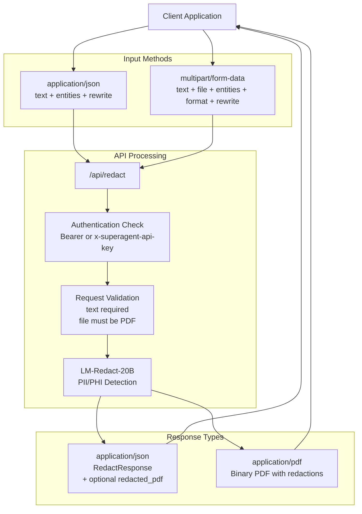
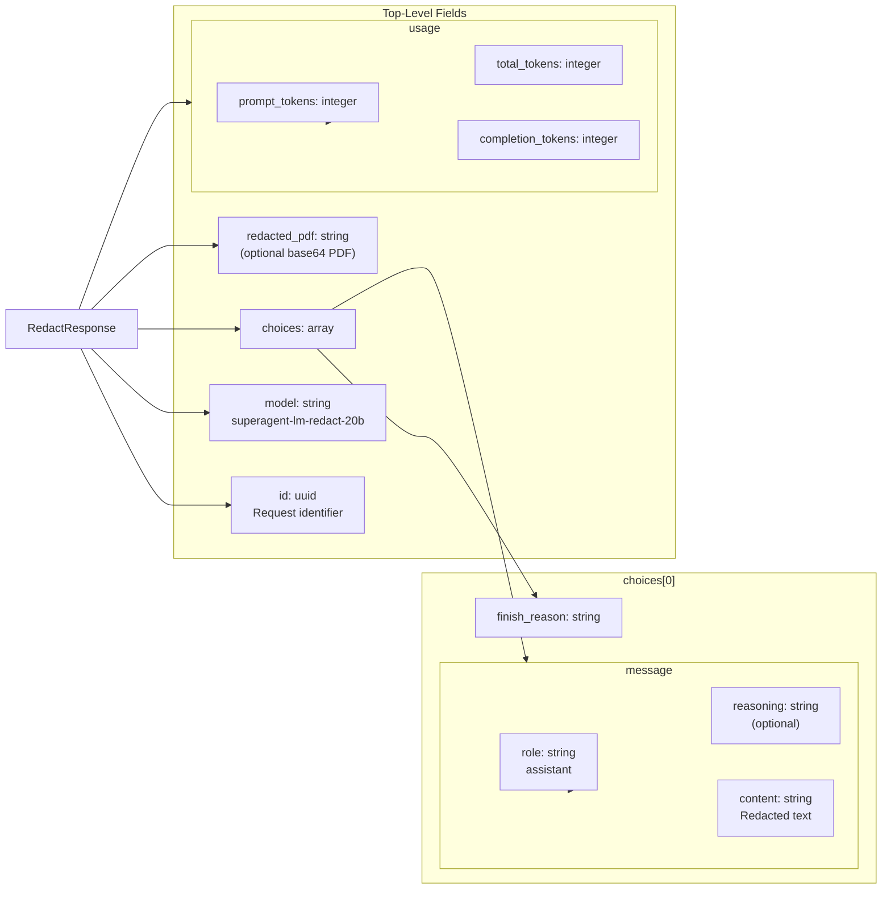
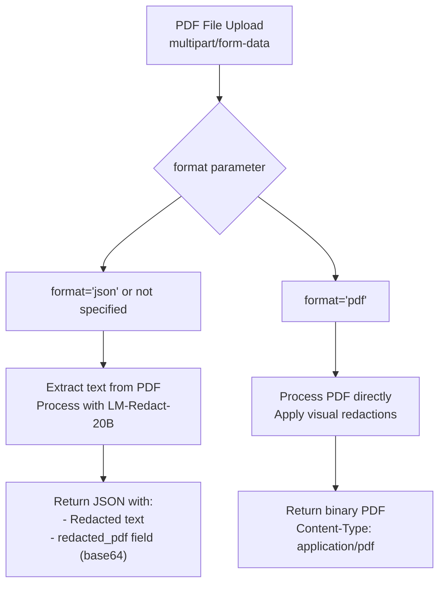
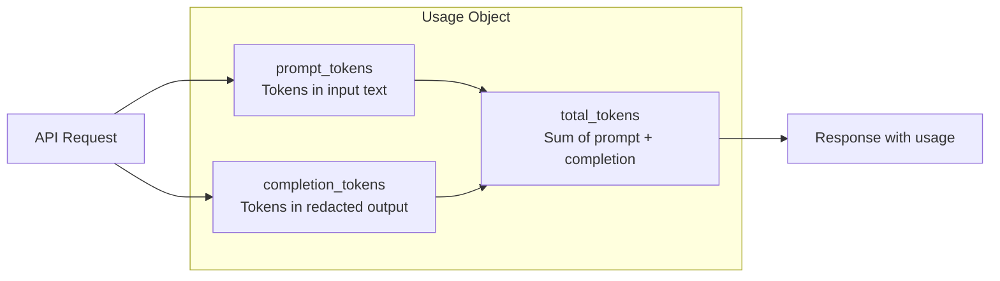

<!-- source: DeepWiki mcp.deepwiki.com · repo superagent-ai/superagent · page 5.3 Redact Endpoint · fetched 2026-10-26 -->

# Redact Endpoint

<details>
<summary>Relevant source files</summary>

The following files were used as context for generating this wiki page:

- [docs/app/global.css](docs/app/global.css)
- [docs/lib/openapi.ts](docs/lib/openapi.ts)
- [docs/lib/source.ts](docs/lib/source.ts)
- [docs/openapi.json](docs/openapi.json)
- [docs/scripts/generate-docs.ts](docs/scripts/generate-docs.ts)

</details>


The Redact endpoint provides AI-powered redaction of sensitive information (PII/PHI) from text and PDF documents using the LM-Redact-20B model. This endpoint analyzes input content and removes or rewrites sensitive data such as Social Security Numbers, email addresses, phone numbers, API keys, and custom entity types.

For authentication details, see [Authentication & Configuration](#5.1). For other API endpoints, see [Guard Endpoint](#5.2) and [Verify Endpoint](#5.4). For SDK implementations that wrap this endpoint, see [SDK Reference](#2).

## Endpoint Overview

| Property | Value |
|----------|-------|
| **URL** | `https://app.superagent.sh/api/redact` |
| **Method** | `POST` |
| **Model** | `superagent-lm-redact-20b` |
| **Authentication** | Bearer token or `x-superagent-api-key` header |
| **Content Types** | `application/json`, `multipart/form-data` |

Sources: [docs/openapi.json:27-29]()

## Request Flow

The endpoint supports two primary workflows: text-only redaction and PDF redaction with optional file output.



Sources: [docs/openapi.json:27-104](), [docs/openapi.json:106-142]()

## Request Parameters

### JSON Request Body

When using `Content-Type: application/json`, the request body contains:

| Parameter | Type | Required | Description |
|-----------|------|----------|-------------|
| `text` | `string` | Yes | The text content to analyze and redact |
| `entities` | `string[]` | No | Custom entity types to redact. Defaults to standard PII entities |
| `rewrite` | `boolean` | No | Enable natural rewriting mode (default: `false`) |

**Example Request:**
```json
{
  "text": "My email is john@example.com and SSN is 123-45-6789",
  "entities": ["Email Addresses", "Social Security Numbers", "API Keys"],
  "rewrite": false
}
```

Sources: [docs/openapi.json:44-68]()

### Multipart Form Data Request

When using `Content-Type: multipart/form-data`, the request supports:

| Field | Type | Required | Description |
|-------|------|----------|-------------|
| `text` | `string` | Yes | The text content to analyze and redact |
| `entities` | `string` | No | JSON string array of custom entity types |
| `file` | `binary` | No | PDF file to process (must be `application/pdf`) |
| `format` | `enum` | No | Output format: `"json"` (default) or `"pdf"` |
| `rewrite` | `string` | No | `"true"` or `"false"` for rewrite mode |

Sources: [docs/openapi.json:70-103]()

## Redaction Modes

### Placeholder Mode (Default)

In placeholder mode (`rewrite: false`), sensitive information is replaced with standardized placeholders:

```
Input:  "My email is john@example.com and SSN is 123-45-6789"
Output: "My email is <EMAIL_REDACTED> and SSN is <SSN_REDACTED>"
```

### Rewrite Mode

In rewrite mode (`rewrite: true`), content is naturally rewritten to remove sensitive information while maintaining readability:

```
Input:  "Contact me at john@example.com for more information"
Output: "Contact me via email for more information"
```

Sources: [docs/openapi.json:62-66](), [docs/openapi.json:95-100]()

## Response Schema

### JSON Response (RedactResponse)

The standard JSON response follows the `RedactResponse` schema:



**Example Response:**
```json
{
  "id": "550e8400-e29b-41d4-a716-446655440000",
  "model": "superagent-lm-redact-20b",
  "choices": [
    {
      "message": {
        "role": "assistant",
        "content": "My email is <EMAIL_REDACTED> and SSN is <SSN_REDACTED>",
        "reasoning": "Redacted email address and social security number"
      },
      "finish_reason": "stop"
    }
  ],
  "usage": {
    "prompt_tokens": 25,
    "completion_tokens": 12,
    "total_tokens": 37
  }
}
```

Sources: [docs/openapi.json:110-133](), [docs/openapi.json:617-669]()

### PDF File Response

When `format=pdf` is specified in multipart requests, the endpoint returns a binary PDF file with redactions applied:

| Header | Value |
|--------|-------|
| `Content-Type` | `application/pdf` |
| Body | Binary PDF content with sensitive information redacted |

Sources: [docs/openapi.json:134-141]()

## PDF Processing

When a PDF file is uploaded, the redaction behavior depends on the `format` parameter:



The `redacted_pdf` field in JSON responses is a base64-encoded data URL:
```
data:application/pdf;base64,JVBERi0xLjQKJeLjz9M...
```

Sources: [docs/openapi.json:84-94](), [docs/openapi.json:664-668]()

## Entity Types

The `entities` parameter allows specifying which types of sensitive information to redact. When not provided, the endpoint redacts standard PII/PHI entities.

### Default Entity Types

When `entities` is not specified, the following PII/PHI categories are automatically detected and redacted:

| Entity Type | Description | Example |
|-------------|-------------|---------|
| Email Addresses | Email addresses in any format | `john@example.com` |
| Social Security Numbers | SSN in various formats | `123-45-6789` |
| Phone Numbers | Phone numbers with/without formatting | `555-123-4567` |
| Credit Card Numbers | Credit card numbers | `4111-1111-1111-1111` |
| Names | Person names | `John Doe` |
| Addresses | Physical addresses | `123 Main St, City, ST` |
| Dates of Birth | Birth dates | `01/15/1990` |
| Medical Record Numbers | Healthcare MRN | `MRN-123456` |
| IP Addresses | IPv4 and IPv6 addresses | `192.168.1.1` |
| Account Numbers | Bank/financial account numbers | `ACC-9876543210` |
| API Keys/Secrets | Authentication credentials | `sk-1234567890abcdef` |

### Custom Entity Configuration

The `entities` parameter accepts an array of strings specifying custom entity types:

**JSON Request Example:**
```json
{
  "text": "API key: sk-1234567890 and database password: secret123",
  "entities": [
    "API Keys",
    "Database Passwords",
    "Authentication Tokens"
  ]
}
```

**Multipart Request Example:**

In multipart requests, the `entities` field must be a JSON-encoded string array:
```
text="sensitive content"
entities='["API Keys", "Passwords", "Internal IDs"]'
```

Custom entities enable domain-specific redaction for:
- Internal identifiers (employee IDs, customer codes)
- Industry-specific PII (patient IDs, case numbers)
- Application-specific secrets (tokens, credentials)
- Custom sensitive data types unique to your use case

Sources: [docs/openapi.json:54-61](), [docs/openapi.json:79-83]()

## Error Responses

The endpoint returns structured error responses for various failure scenarios:

| Status Code | Error Type | Example Message |
|-------------|------------|-----------------|
| `400` | Invalid request | `"Invalid text provided"` |
| `400` | Invalid entities | `"entities must be a non-empty array of strings"` |
| `400` | Invalid file | `"file must be a PDF file (application/pdf)"` |
| `401` | Missing authentication | `"API key missing"` |
| `401` | Invalid authentication | `"Invalid API key"` |
| `402` | No subscription | `"No subscription found"` |
| `404` | Team not found | `"Team not found"` |
| `404` | Owner not found | `"Team owner not found"` |
| `500` | Processing failure | `"Failed to analyze prompt"` |

**Error Response Schema:**
```json
{
  "error": "string describing what went wrong"
}
```

Sources: [docs/openapi.json:144-240](), [docs/openapi.json:891-899]()

## Usage Tracking

All successful responses include token usage statistics in the `usage` field:



This data enables tracking of API consumption for billing and rate limiting purposes.

Sources: [docs/openapi.json:127-132](), [docs/openapi.json:870-890]()

## Complete Request Example

### Text-Only Redaction (JSON)

```bash
curl -X POST https://app.superagent.sh/api/redact \
  -H "Content-Type: application/json" \
  -H "Authorization: Bearer YOUR_API_KEY" \
  -d '{
    "text": "Contact John at john.doe@example.com or call 555-123-4567",
    "entities": ["Email Addresses", "Phone Numbers"],
    "rewrite": false
  }'
```

### PDF Redaction with JSON Output

```bash
curl -X POST https://app.superagent.sh/api/redact \
  -H "Authorization: Bearer YOUR_API_KEY" \
  -F "text=Analyze this document" \
  -F "file=@sensitive_document.pdf" \
  -F "format=json" \
  -F 'entities=["SSN", "Email Addresses"]'
```

### PDF Redaction with PDF Output

```bash
curl -X POST https://app.superagent.sh/api/redact \
  -H "Authorization: Bearer YOUR_API_KEY" \
  -F "text=Redact all PII" \
  -F "file=@sensitive_document.pdf" \
  -F "format=pdf" \
  --output redacted_document.pdf
```

Sources: [docs/openapi.json:27-242]()

---

