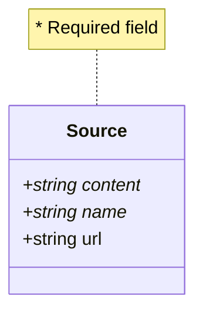
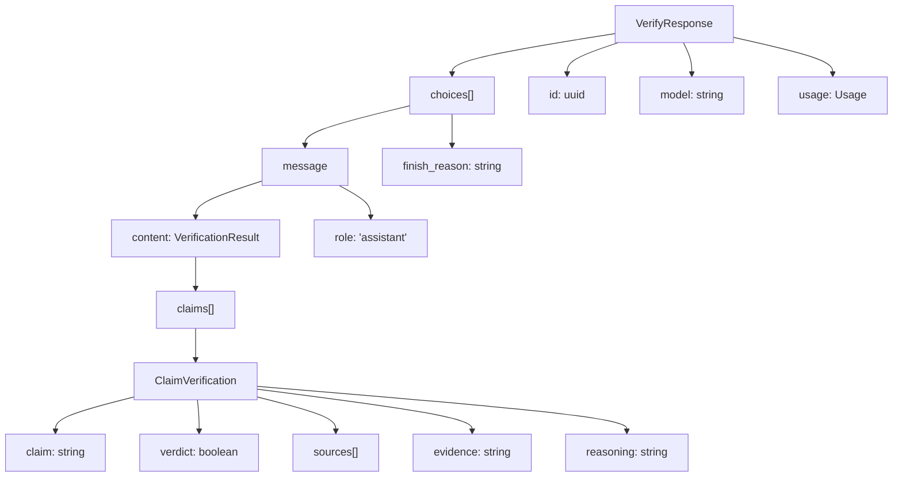
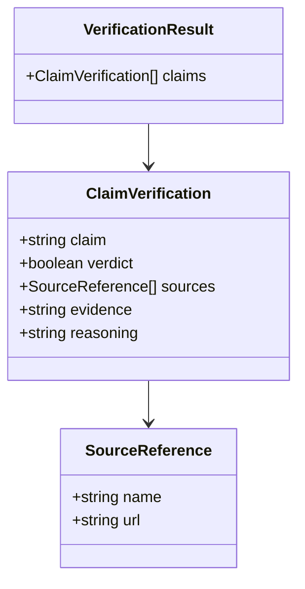
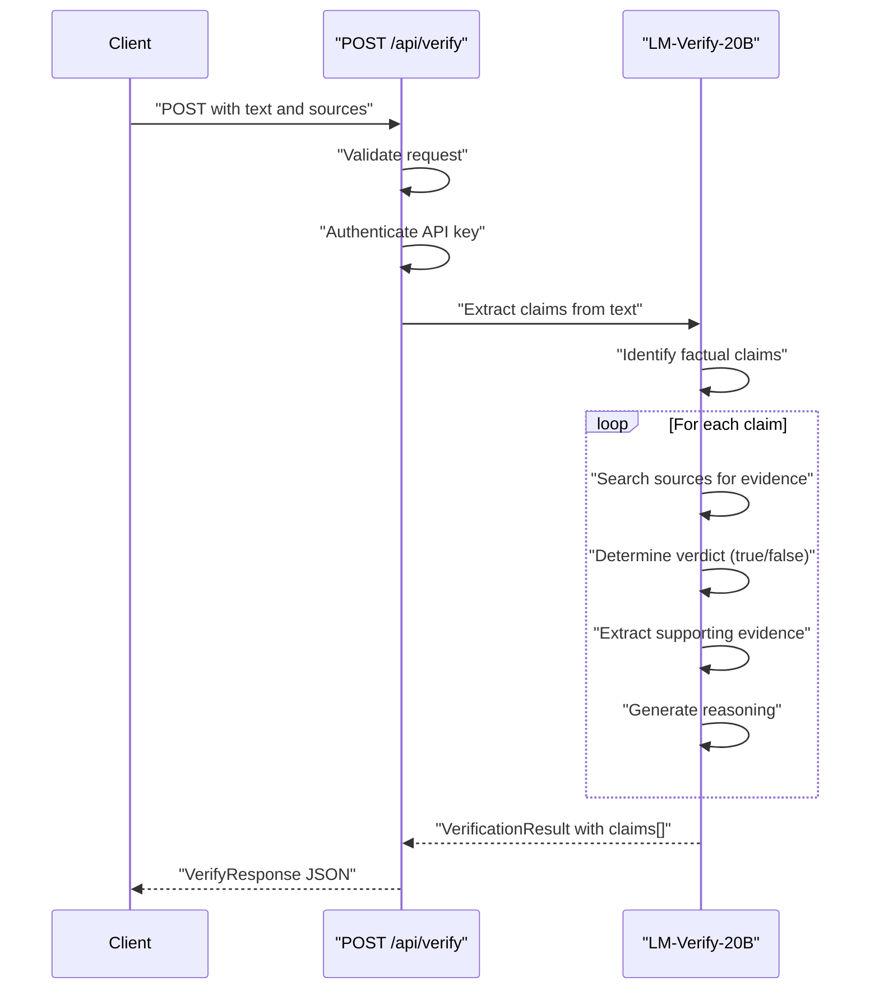
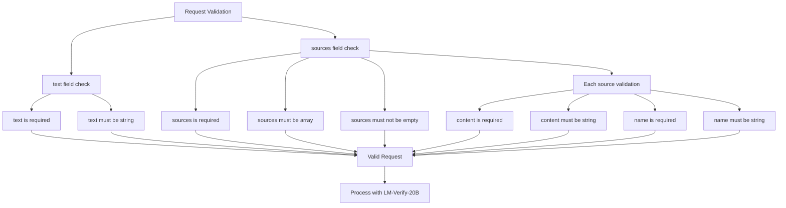

<!-- source: DeepWiki mcp.deepwiki.com · repo superagent-ai/superagent · page 5.4 Verify Endpoint · fetched 2026-10-26 -->

# Verify Endpoint

<details>
<summary>Relevant source files</summary>

The following files were used as context for generating this wiki page:

- [docs/app/global.css](docs/app/global.css)
- [docs/lib/openapi.ts](docs/lib/openapi.ts)
- [docs/lib/source.ts](docs/lib/source.ts)
- [docs/openapi.json](docs/openapi.json)
- [docs/scripts/generate-docs.ts](docs/scripts/generate-docs.ts)

</details>


The `/api/verify` endpoint verifies claims in text against provided source materials using the LM-Verify-20B model. This endpoint analyzes input text, extracts factual claims, and determines whether each claim is supported, contradicted, or unverifiable based on the provided sources. The endpoint returns structured verification results with verdicts, evidence excerpts, and reasoning for each claim.

For information about security threat detection, see [Guard Endpoint](#2.2). For information about PII/PHI removal, see [Redact Endpoint](#2.3). For general API authentication and configuration, see [Authentication & Configuration](#2.1).

## Endpoint Overview

The verify endpoint is a POST endpoint that accepts JSON payloads containing text to verify and source materials.

| Property | Value |
|----------|-------|
| **HTTP Method** | POST |
| **Endpoint Path** | `/api/verify` |
| **Base URL** | `https://app.superagent.sh` |
| **Content-Type** | `application/json` |
| **Authentication** | Bearer token or `x-superagent-api-key` header |
| **Model** | `superagent-lm-verify-20b` |

**Sources:** [docs/openapi.json:244-246]()

## Request Format

The verify endpoint requires two fields in the JSON request body:

```json
{
  "text": "The company was founded in 2020 and has 500 employees.",
  "sources": [
    {
      "name": "About Us",
      "content": "Founded in 2020, our company has grown rapidly...",
      "url": "https://example.com/about"
    }
  ]
}
```

### Text Parameter

| Property | Type | Required | Description |
|----------|------|----------|-------------|
| `text` | string | Yes | The text containing claims to verify |

The `text` field contains the content that will be analyzed for factual claims. The model automatically extracts individual claims from the text and verifies each one against the provided sources.

**Sources:** [docs/openapi.json:266-270]()

### Sources Parameter

| Property | Type | Required | Description |
|----------|------|----------|-------------|
| `sources` | array | Yes | Array of source materials (minimum 1 item) |

The `sources` field must be a non-empty array of source objects. Each source represents a document or piece of content that will be used to verify the claims.

**Sources:** [docs/openapi.json:271-285]()

## Source Object Structure

Each source in the `sources` array must follow this schema:



### Source Fields

| Field | Type | Required | Description |
|-------|------|----------|-------------|
| `content` | string | Yes | The content of the source material |
| `name` | string | Yes | The name or identifier of the source |
| `url` | string | No | Optional URL of the source |

**Example:**

```json
{
  "content": "Founded in 2020, our company has grown to 450 employees.",
  "name": "Company About Page",
  "url": "https://example.com/about"
}
```

**Sources:** [docs/openapi.json:790-809]()

## Response Format

The verify endpoint returns a `VerifyResponse` object with the following structure:



**Sources:** [docs/openapi.json:747-788]()

### Response Fields

| Field | Type | Description |
|-------|------|-------------|
| `id` | string (uuid) | Unique identifier for this request |
| `model` | string | Model used for verification (`superagent-lm-verify-20b`) |
| `choices` | array | Array containing the verification result |
| `usage` | object | Token usage statistics (`prompt_tokens`, `completion_tokens`, `total_tokens`) |

**Example Response:**

```json
{
  "id": "550e8400-e29b-41d4-a716-446655440000",
  "model": "superagent-lm-verify-20b",
  "choices": [
    {
      "message": {
        "role": "assistant",
        "content": {
          "claims": [
            {
              "claim": "The company was founded in 2020",
              "verdict": true,
              "sources": [
                {
                  "name": "About Us",
                  "url": "https://example.com/about"
                }
              ],
              "evidence": "Founded in 2020, our company has grown rapidly...",
              "reasoning": "The founding year is explicitly stated in the About Us source."
            }
          ]
        }
      },
      "finish_reason": "stop"
    }
  ],
  "usage": {
    "prompt_tokens": 250,
    "completion_tokens": 150,
    "total_tokens": 400
  }
}
```

**Sources:** [docs/openapi.json:299-331]()

## VerificationResult Structure

The `content` field in the response message contains a `VerificationResult` object:



**Sources:** [docs/openapi.json:811-868]()

### ClaimVerification Object

Each claim in the `claims` array contains:

| Field | Type | Description |
|-------|------|-------------|
| `claim` | string | The specific claim extracted from the input text |
| `verdict` | boolean | `true` if supported by sources, `false` if contradicted or unverifiable |
| `sources` | array | List of sources used for this verification |
| `evidence` | string | Relevant quotes or excerpts from the sources |
| `reasoning` | string | Brief reasoning for the verdict |

**Verdict Interpretation:**

- `verdict: true` - The claim is supported by the source materials
- `verdict: false` - The claim is contradicted by sources or cannot be verified

**Sources:** [docs/openapi.json:823-853]()

## Verification Process Flow



**Process Steps:**

1. **Claim Extraction**: The model analyzes the input text and identifies individual factual claims
2. **Source Search**: For each claim, the model searches through all provided sources
3. **Evidence Collection**: Relevant quotes and excerpts are extracted from sources
4. **Verdict Determination**: The model determines if the claim is supported (true) or not (false)
5. **Reasoning Generation**: A brief explanation is provided for each verdict

**Sources:** [docs/openapi.json:244-248]()

## Usage Example

### Complete Request/Response

**Request:**

```http
POST /api/verify HTTP/1.1
Host: app.superagent.sh
Content-Type: application/json
Authorization: Bearer YOUR_API_KEY

{
  "text": "Our product launched in Q1 2023 with 10,000 users in the first month. We achieved profitability by Q3.",
  "sources": [
    {
      "name": "2023 Annual Report",
      "content": "Product launch occurred on March 15, 2023. Initial user acquisition was strong with 9,500 users in the first 30 days. The company reached break-even in Q4 2023.",
      "url": "https://example.com/reports/2023"
    },
    {
      "name": "Press Release",
      "content": "Launch date: March 15, 2023. First month results exceeded expectations.",
      "url": "https://example.com/press/launch"
    }
  ]
}
```

**Response:**

```json
{
  "id": "a1b2c3d4-e5f6-7890-abcd-ef1234567890",
  "model": "superagent-lm-verify-20b",
  "choices": [
    {
      "message": {
        "role": "assistant",
        "content": {
          "claims": [
            {
              "claim": "Our product launched in Q1 2023",
              "verdict": true,
              "sources": [
                {
                  "name": "2023 Annual Report",
                  "url": "https://example.com/reports/2023"
                },
                {
                  "name": "Press Release",
                  "url": "https://example.com/press/launch"
                }
              ],
              "evidence": "Product launch occurred on March 15, 2023.",
              "reasoning": "Q1 2023 includes March, and both sources confirm the March 15, 2023 launch date."
            },
            {
              "claim": "10,000 users in the first month",
              "verdict": false,
              "sources": [
                {
                  "name": "2023 Annual Report",
                  "url": "https://example.com/reports/2023"
                }
              ],
              "evidence": "Initial user acquisition was strong with 9,500 users in the first 30 days.",
              "reasoning": "The source states 9,500 users, not 10,000. The claim overstates the actual figure."
            },
            {
              "claim": "We achieved profitability by Q3",
              "verdict": false,
              "sources": [
                {
                  "name": "2023 Annual Report",
                  "url": "https://example.com/reports/2023"
                }
              ],
              "evidence": "The company reached break-even in Q4 2023.",
              "reasoning": "The source indicates profitability (break-even) was achieved in Q4, not Q3."
            }
          ]
        }
      },
      "finish_reason": "stop"
    }
  ],
  "usage": {
    "prompt_tokens": 320,
    "completion_tokens": 215,
    "total_tokens": 535
  }
}
```

**Sources:** [docs/openapi.json:299-331]()

## Error Responses

The verify endpoint returns standard HTTP error codes with JSON error messages:

| Status Code | Description | Common Causes |
|-------------|-------------|---------------|
| 400 | Bad Request | Missing or invalid parameters |
| 401 | Unauthorized | Missing or invalid API key |
| 404 | Not Found | Team not found |
| 500 | Internal Server Error | Verification or parsing failure |

### 400 Bad Request Examples

```json
// Missing text field
{
  "error": "text is required and must be a string"
}

// Missing sources field
{
  "error": "sources is required and must be a non-empty array"
}

// Invalid source structure
{
  "error": "Each source must have a 'content' field (string)"
}
```

**Sources:** [docs/openapi.json:335-360]()

### 401 Unauthorized Examples

```json
// Missing API key
{
  "error": "API key missing"
}

// Invalid API key
{
  "error": "Invalid API key"
}
```

**Sources:** [docs/openapi.json:362-382]()

### 404 Not Found Example

```json
{
  "error": "Team not found"
}
```

**Sources:** [docs/openapi.json:384-395]()

### 500 Internal Server Error Examples

```json
// Verification failure
{
  "error": "Failed to verify text"
}

// Parsing failure
{
  "error": "Failed to parse verification result"
}
```

**Sources:** [docs/openapi.json:397-417]()

## Request Validation Rules

The endpoint validates the following constraints:



**Sources:** [docs/openapi.json:262-289](), [docs/openapi.json:790-809]()

## Integration Notes

- **Multiple Claims**: The model automatically extracts multiple claims from the input text. You do not need to separate claims manually.
- **Source Count**: At least one source is required. Providing more comprehensive sources improves verification accuracy.
- **Verdict Semantics**: A `false` verdict can mean either contradicted by sources or insufficient evidence to verify.
- **Evidence Quotes**: The `evidence` field contains direct quotes from sources, making results auditable.
- **Token Usage**: The `usage` object reports token consumption for billing and monitoring.

**Sources:** [docs/openapi.json:244-420](), [README.md:20-21]()

---

