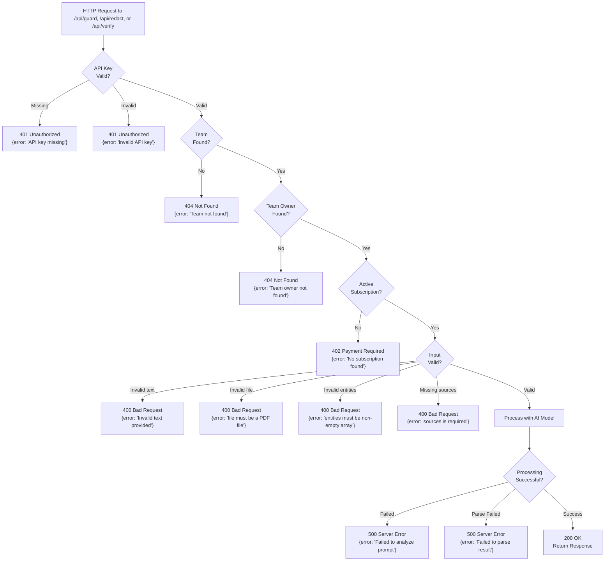
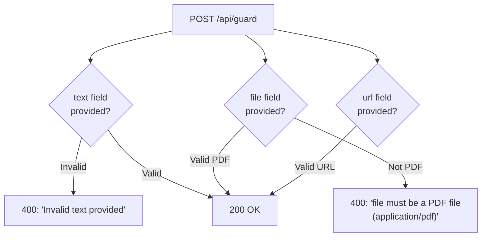
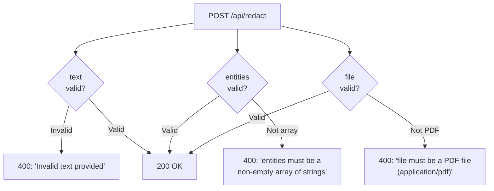
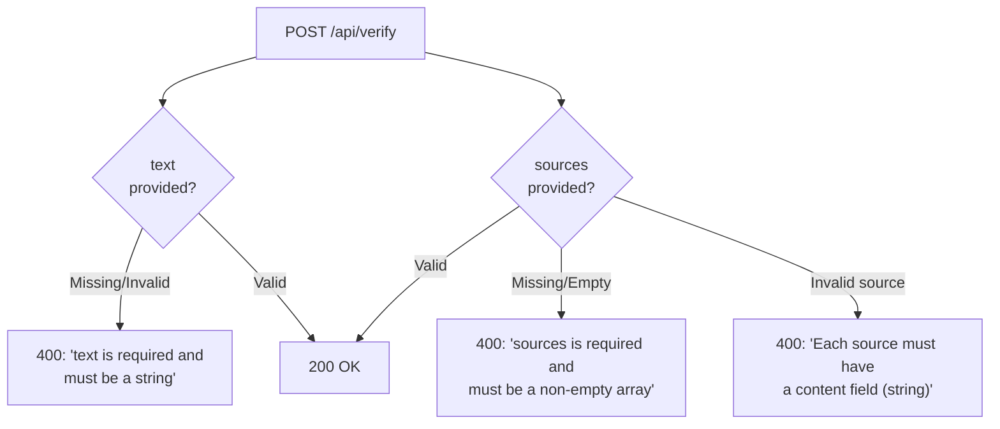
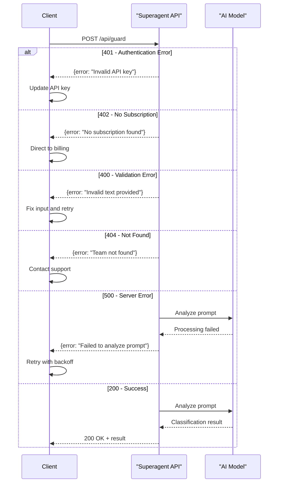

<!-- source: DeepWiki mcp.deepwiki.com · repo superagent-ai/superagent · page 5.5 Error Handling · fetched 2026-10-26 -->

# Error Handling

<details>
<summary>Relevant source files</summary>

The following files were used as context for generating this wiki page:

- [docs/openapi.json](docs/openapi.json)

</details>


This page documents the error handling mechanisms of the Superagent REST API. All three endpoints (`/api/guard`, `/api/redact`, `/api/verify`) follow a consistent error handling pattern using standard HTTP status codes and a uniform error response format.

For information about specific endpoint functionality, see [Guard Endpoint](#2.2), [Redact Endpoint](#2.3), and [Verify Endpoint](#2.4). For authentication setup, see [Authentication & Configuration](#2.1).

---

## Error Response Format

All API errors return a JSON object with a single `error` field containing a human-readable error message. This format is defined in the `Error` schema and is used consistently across all endpoints.

**Standard Error Schema:**

```json
{
  "error": "Error message describing what went wrong"
}
```

The error message provides specific details about what caused the failure, enabling developers to diagnose and handle errors appropriately.

**Sources:** [docs/openapi.json:891-899]()

---

## HTTP Status Codes

The Superagent API uses standard HTTP status codes to indicate the category of error. The following table summarizes all status codes returned by the API:

| Status Code | Category | Description |
|------------|----------|-------------|
| `200` | Success | Request completed successfully |
| `400` | Client Error | Invalid request parameters or malformed input |
| `401` | Authentication Error | Missing or invalid API key |
| `402` | Payment Required | No active subscription found for the account |
| `404` | Not Found | Team or team owner not found in the system |
| `500` | Server Error | Internal server error during processing |

**Sources:** [docs/openapi.json:106-241](), [docs/openapi.json:291-419](), [docs/openapi.json:495-598]()

---

## Error Flow Diagram



**Sources:** [docs/openapi.json:528-548](), [docs/openapi.json:171-192](), [docs/openapi.json:193-204](), [docs/openapi.json:206-227](), [docs/openapi.json:228-240]()

---

## Authentication Errors (401)

Authentication failures occur when the API key is missing or invalid. The API supports two authentication methods: Bearer token and custom header (`x-superagent-api-key`).

### Error Scenarios

| Scenario | Error Message | Cause |
|----------|--------------|-------|
| Missing API Key | `"API key missing"` | No Bearer token or `x-superagent-api-key` header provided |
| Invalid API Key | `"Invalid API key"` | API key does not match any account in the system |

### Example Response

```json
{
  "error": "Invalid API key"
}
```

**Guard Endpoint:** [docs/openapi.json:528-548]()  
**Redact Endpoint:** [docs/openapi.json:171-192]()  
**Verify Endpoint:** [docs/openapi.json:362-382]()

---

## Validation Errors (400)

Bad request errors indicate that the client sent invalid or malformed data. Each endpoint has specific validation rules for its input parameters.

### Guard Endpoint Validation Errors



| Error Message | Cause |
|--------------|-------|
| `"Invalid text provided"` | Text field is empty, not a string, or improperly formatted |
| `"file must be a PDF file (application/pdf)"` | Uploaded file is not a PDF or has incorrect MIME type |

**Sources:** [docs/openapi.json:506-526]()

### Redact Endpoint Validation Errors



| Error Message | Cause |
|--------------|-------|
| `"Invalid text provided"` | Text field is empty or not a string |
| `"entities must be a non-empty array of strings"` | Entities field is not an array, is empty, or contains non-string values |
| `"file must be a PDF file (application/pdf)"` | File upload is not a PDF with correct MIME type |

**Sources:** [docs/openapi.json:144-169]()

### Verify Endpoint Validation Errors



| Error Message | Cause |
|--------------|-------|
| `"text is required and must be a string"` | Text field is missing or not a string |
| `"sources is required and must be a non-empty array"` | Sources field is missing, not an array, or empty |
| `"Each source must have a 'content' field (string)"` | At least one source object is missing the required `content` field |

**Sources:** [docs/openapi.json:335-360]()

---

## Payment Required (402)

The `402 Payment Required` status code indicates that the API key is valid, but the associated account does not have an active subscription.

### Error Response

```json
{
  "error": "No subscription found"
}
```

This error occurs after successful authentication but before request processing. Clients should direct users to activate a subscription before retrying the request.

**Guard Endpoint:** [docs/openapi.json:550-561]()  
**Redact Endpoint:** [docs/openapi.json:193-204]()

---

## Resource Not Found (404)

Not found errors occur when the team or team owner associated with the API key cannot be found in the database. This typically indicates a data integrity issue.

### Error Scenarios

| Error Message | Cause |
|--------------|-------|
| `"Team not found"` | The team associated with the API key does not exist |
| `"Team owner not found"` | The owner of the team cannot be located |

### Example Response

```json
{
  "error": "Team not found"
}
```

**Guard Endpoint:** [docs/openapi.json:563-583]()  
**Redact Endpoint:** [docs/openapi.json:206-227]()  
**Verify Endpoint:** [docs/openapi.json:384-395]()

---

## Server Errors (500)

Internal server errors indicate that something went wrong during AI model processing or result parsing. These errors are not caused by client input.

### Error Scenarios by Endpoint

**Guard Endpoint:**
- `"Failed to analyze prompt"` - AI model processing failed

**Redact Endpoint:**
- `"Failed to analyze prompt"` - AI model processing failed

**Verify Endpoint:**
- `"Failed to verify text"` - Verification processing failed
- `"Failed to parse verification result"` - Result parsing from AI model failed

### Error Response Examples

```json
{
  "error": "Failed to analyze prompt"
}
```

```json
{
  "error": "Failed to parse verification result"
}
```

The Verify endpoint has two distinct 500 error types because it performs additional result parsing that can fail independently from the model invocation.

**Guard Endpoint:** [docs/openapi.json:585-597]()  
**Redact Endpoint:** [docs/openapi.json:228-240]()  
**Verify Endpoint:** [docs/openapi.json:397-418]()

---

## Error Handling Best Practices

When integrating with the Superagent API, implement error handling that:

1. **Check HTTP Status First**: Always inspect the HTTP status code before parsing the response body
2. **Parse Error Object**: Extract the `error` field from the JSON response for detailed error information
3. **Handle Each Status Code**: Implement specific logic for each error category:
   - `401`: Prompt user to check API key configuration
   - `402`: Direct user to subscription management
   - `400`: Display validation error to user and allow correction
   - `404`: Report configuration issue to support
   - `500`: Implement retry logic with exponential backoff

4. **Log Errors**: Preserve the exact error message for debugging and support inquiries
5. **Retry Strategy**: Only retry on `500` errors, not client errors (`4xx`)

### Error Handling Sequence



**Sources:** [docs/openapi.json:602-915]()

---

