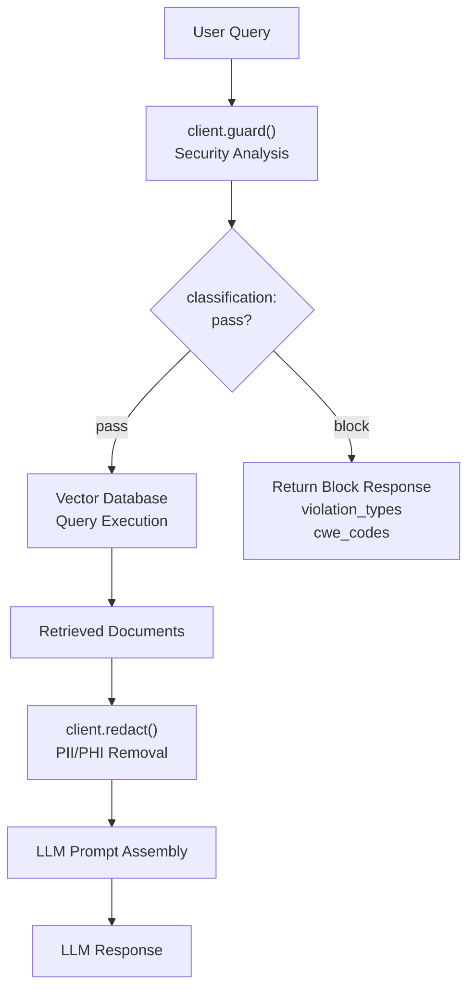
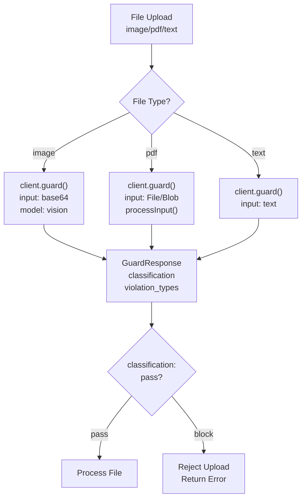
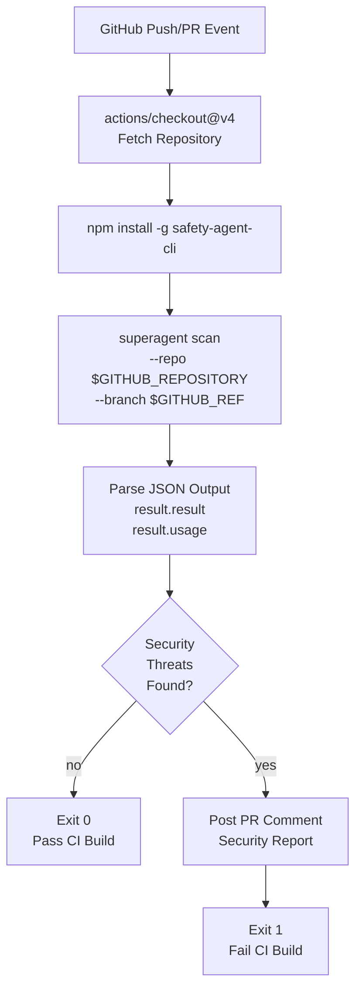
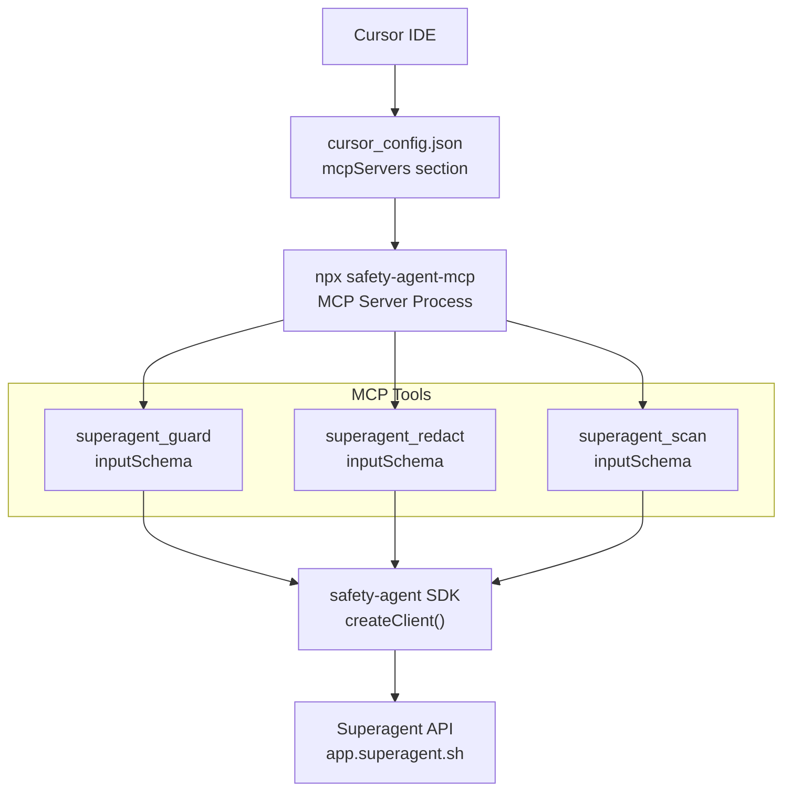

<!-- source: DeepWiki mcp.deepwiki.com · repo superagent-ai/superagent · page 6 Integration Examples · fetched 2026-10-26 -->

# Integration Examples

<details>
<summary>Relevant source files</summary>

The following files were used as context for generating this wiki page:

- [cli/src/commands/scan.ts](cli/src/commands/scan.ts)
- [cli/src/index.ts](cli/src/index.ts)
- [cli/tests/scan.test.ts](cli/tests/scan.test.ts)
- [docs/app/[[...slug]]/layout.tsx](docs/app/[[...slug]]/layout.tsx)
- [docs/content/docs/meta.json](docs/content/docs/meta.json)
- [docs/mdx-components.tsx](docs/mdx-components.tsx)
- [docs/next.config.mjs](docs/next.config.mjs)

</details>


This page provides practical examples demonstrating how to integrate Superagent safety features into real-world workflows and systems. Each example includes architecture diagrams, code references, and configuration patterns.

For SDK API reference, see [SDK Reference](#2). For CLI command details, see [Command-Line Interface](#3). For MCP server configuration, see [MCP Server](#4). For REST API integration, see [REST API](#5).

## Secure RAG Pipeline

This example demonstrates how to build a secure Retrieval-Augmented Generation (RAG) pipeline by using the `guard` operation to validate user queries before retrieval and the `redact` operation to sanitize retrieved documents before sending them to an LLM.

### Architecture



**Sources:** [sdk/typescript/src/types.ts](), [sdk/python/safety_agent/types.py](), [cli/src/commands/guard.ts](), [cli/src/commands/redact.ts]()

### Implementation Pattern

#### TypeScript Implementation

```typescript
import { createClient } from 'safety-agent';

const client = createClient({
  apiKey: process.env.SUPERAGENT_API_KEY
});

async function secureRAGQuery(userQuery: string) {
  // Step 1: Guard the user query
  const guardResult = await client.guard({
    input: userQuery,
    model: 'superagent/guard-0.6b'
  });

  // Step 2: Block malicious queries
  if (guardResult.classification === 'block') {
    return {
      error: 'Query blocked',
      violations: guardResult.violation_types,
      cweCodes: guardResult.cwe_codes
    };
  }

  // Step 3: Execute vector search
  const documents = await vectorDB.search(userQuery);

  // Step 4: Redact sensitive information from documents
  const redactedDocs = await Promise.all(
    documents.map(async (doc) => {
      const redacted = await client.redact({
        input: doc.content,
        entities: ['email', 'ssn', 'phone', 'credit_card'],
        rewrite: true
      });
      return { ...doc, content: redacted.redacted };
    })
  );

  // Step 5: Send to LLM
  const llmResponse = await generateResponse(userQuery, redactedDocs);
  return llmResponse;
}
```

#### Python Implementation

```python
from safety_agent import createClient

client = createClient(api_key=os.getenv('SUPERAGENT_API_KEY'))

async def secure_rag_query(user_query: str):
    # Step 1: Guard the user query
    guard_result = await client.guard(
        input=user_query,
        model='superagent/guard-0.6b'
    )
    
    # Step 2: Block malicious queries
    if guard_result['classification'] == 'block':
        return {
            'error': 'Query blocked',
            'violations': guard_result['violation_types'],
            'cwe_codes': guard_result['cwe_codes']
        }
    
    # Step 3: Execute vector search
    documents = await vector_db.search(user_query)
    
    # Step 4: Redact sensitive information
    redacted_docs = []
    for doc in documents:
        redacted = await client.redact(
            input=doc['content'],
            entities=['email', 'ssn', 'phone', 'credit_card'],
            rewrite=True
        )
        redacted_docs.append({**doc, 'content': redacted['redacted']})
    
    # Step 5: Send to LLM
    return await generate_response(user_query, redacted_docs)
```

**Sources:** [sdk/typescript/src/index.ts](), [sdk/python/safety_agent/client.py]()

### Key Components

| Component | Function Reference | Purpose |
|-----------|-------------------|---------|
| Guard Input | `client.guard({ input, model })` | Validates query for prompt injection, SQL injection, XSS |
| Guard Response | `{ classification, violation_types, cwe_codes }` | Contains security analysis results |
| Redact Input | `client.redact({ input, entities, rewrite })` | Removes PII/PHI from documents |
| Redact Response | `{ redacted, findings, usage }` | Contains sanitized text and detected entities |

**Sources:** [sdk/typescript/src/types.ts:1-100](), [sdk/python/safety_agent/types.py:1-100]()

---

## Scanning File Uploads

This example shows how to use the `guard` operation with vision models to analyze uploaded files and images for security threats before processing them.

### Architecture



**Sources:** [sdk/typescript/src/lib/input-processor.ts](), [sdk/typescript/src/lib/utils.ts]()

### Implementation: Image Upload with Vision Models

#### TypeScript

```typescript
import { createClient } from 'safety-agent';
import { readFileSync } from 'fs';

const client = createClient();

async function scanImageUpload(imagePath: string) {
  // Read image and convert to base64
  const imageBuffer = readFileSync(imagePath);
  const base64Image = imageBuffer.toString('base64');
  
  // Guard with vision model
  const result = await client.guard({
    input: base64Image,
    model: 'openai/gpt-4o'  // Vision-capable model
  });
  
  if (result.classification === 'block') {
    throw new Error(
      `Image rejected: ${result.violation_types.join(', ')}`
    );
  }
  
  return { safe: true, analysis: result };
}
```

#### Python

```python
import base64
from safety_agent import createClient

client = createClient()

async def scan_image_upload(image_path: str):
    # Read image and convert to base64
    with open(image_path, 'rb') as f:
        base64_image = base64.b64encode(f.read()).decode('utf-8')
    
    # Guard with vision model
    result = await client.guard(
        input=base64_image,
        model='openai/gpt-4o'  # Vision-capable model
    )
    
    if result['classification'] == 'block':
        raise ValueError(
            f"Image rejected: {', '.join(result['violation_types'])}"
        )
    
    return {'safe': True, 'analysis': result}
```

**Sources:** [sdk/typescript/src/lib/utils.ts:isVisionModel](), [sdk/typescript/src/types.ts:GuardInput]()

### Implementation: PDF Upload

#### TypeScript

```typescript
import { createClient } from 'safety-agent';

async function scanPDFUpload(file: File) {
  const client = createClient();
  
  // Guard PDF file - SDK handles PDF processing via processInput
  const result = await client.guard({
    input: file,
    model: 'openai/gpt-4o'
  });
  
  if (result.classification === 'block') {
    return {
      allowed: false,
      violations: result.violation_types,
      cweCodes: result.cwe_codes
    };
  }
  
  return { allowed: true };
}
```

**Sources:** [sdk/typescript/src/lib/input-processor.ts:processInput]()

### Supported Input Types

| Input Type | Format | Vision Model Required |
|------------|--------|----------------------|
| Text | `string` | No |
| URL | `https://...` | No |
| File | `File` or `Blob` | No (PDF), Yes (image) |
| Base64 Image | `data:image/...` or base64 string | Yes |

**Sources:** [sdk/typescript/src/types.ts:GuardInput](), [sdk/typescript/src/lib/input-processor.ts:1-150]()

---

## CI/CD Integration

This example demonstrates integrating the `scan` command into GitHub Actions workflows to check repositories for AI agent-targeted attacks during pull requests or commits.

### GitHub Actions Workflow



**Sources:** [cli/src/commands/scan.ts:1-123](), [.github/workflows/test.yml]()

### GitHub Actions Configuration

Create `.github/workflows/superagent-scan.yml`:

```yaml
name: Superagent Security Scan

on:
  pull_request:
    branches: [main, develop]
  push:
    branches: [main]

jobs:
  security-scan:
    runs-on: ubuntu-latest
    
    steps:
      - name: Checkout code
        uses: actions/checkout@v4
        
      - name: Setup Node.js
        uses: actions/setup-node@v4
        with:
          node-version: '20'
          
      - name: Install Superagent CLI
        run: npm install -g safety-agent-cli
        
      - name: Run repository scan
        env:
          SUPERAGENT_API_KEY: ${{ secrets.SUPERAGENT_API_KEY }}
          DAYTONA_API_KEY: ${{ secrets.DAYTONA_API_KEY }}
        run: |
          superagent scan \
            --repo https://github.com/${{ github.repository }} \
            --branch ${{ github.ref_name }} \
            --model anthropic/claude-sonnet-4-5 \
            > scan-result.json
            
      - name: Check scan results
        run: |
          if grep -q "CRITICAL\|HIGH" scan-result.json; then
            echo "Security threats detected!"
            cat scan-result.json
            exit 1
          fi
          
      - name: Upload scan results
        if: always()
        uses: actions/upload-artifact@v4
        with:
          name: security-scan-results
          path: scan-result.json
```

**Sources:** [cli/src/commands/scan.ts:75-122]()

### CLI Scan Command Reference

The `superagent scan` command is implemented in [cli/src/commands/scan.ts:28-122]() and requires:

| Environment Variable | Purpose | Required |
|---------------------|---------|----------|
| `SUPERAGENT_API_KEY` | Authentication for Superagent API | Yes |
| `DAYTONA_API_KEY` | Authentication for Daytona sandbox | Yes |

Command flags:
- `--repo <url>`: Repository URL to scan (required)
- `--branch <ref>`: Branch, tag, or commit (optional)
- `--model <id>`: Model to use (default: `anthropic/claude-sonnet-4-5`)

**Sources:** [cli/src/commands/scan.ts:1-123](), [cli/tests/scan.test.ts:9-30]()

### Integration with Other CI Platforms

#### GitLab CI

```yaml
security-scan:
  stage: test
  image: node:20
  script:
    - npm install -g safety-agent-cli
    - superagent scan --repo $CI_REPOSITORY_URL --branch $CI_COMMIT_REF_NAME
  variables:
    SUPERAGENT_API_KEY: $SUPERAGENT_API_KEY
    DAYTONA_API_KEY: $DAYTONA_API_KEY
```

#### CircleCI

```yaml
version: 2.1
jobs:
  security-scan:
    docker:
      - image: node:20
    steps:
      - checkout
      - run: npm install -g safety-agent-cli
      - run: superagent scan --repo https://github.com/$CIRCLE_PROJECT_USERNAME/$CIRCLE_PROJECT_REPONAME --branch $CIRCLE_BRANCH
```

**Sources:** [cli/src/commands/scan.ts:89-108]()

---

## Cursor Integration

This example shows how to integrate Superagent safety checks with the Cursor AI IDE using the MCP server.

### Integration Architecture



**Sources:** [mcp/src/index.ts](), [mcp/src/tools.ts]()

### MCP Server Configuration

Create or modify `~/.cursor/cursor_config.json` or the Cursor-specific MCP configuration file:

```json
{
  "mcpServers": {
    "superagent": {
      "command": "npx",
      "args": ["-y", "safety-agent-mcp"],
      "env": {
        "SUPERAGENT_API_KEY": "your-api-key-here",
        "DAYTONA_API_KEY": "your-daytona-key-here"
      }
    }
  }
}
```

**Sources:** [mcp/README.md](), [mcp/src/index.ts:1-50]()

### Available MCP Tools

The MCP server exposes three tools that Cursor can invoke:

#### superagent_guard

```typescript
{
  name: "superagent_guard",
  description: "Analyze text for security threats",
  inputSchema: {
    type: "object",
    properties: {
      input: { type: "string", description: "Text to analyze" },
      model: { type: "string", description: "Model ID (optional)" },
      systemPrompt: { type: "string", description: "Custom system prompt (optional)" }
    },
    required: ["input"]
  }
}
```

#### superagent_redact

```typescript
{
  name: "superagent_redact",
  description: "Remove sensitive data from text",
  inputSchema: {
    type: "object",
    properties: {
      input: { type: "string", description: "Text to redact" },
      entities: { 
        type: "array",
        items: { type: "string" },
        description: "Entity types to redact (optional)"
      },
      rewrite: { type: "boolean", description: "Rewrite mode (optional)" }
    },
    required: ["input"]
  }
}
```

#### superagent_scan

```typescript
{
  name: "superagent_scan",
  description: "Scan repository for AI agent attacks",
  inputSchema: {
    type: "object",
    properties: {
      repo: { type: "string", description: "Repository URL" },
      branch: { type: "string", description: "Branch name (optional)" },
      model: { type: "string", description: "Model ID (optional)" }
    },
    required: ["repo"]
  }
}
```

**Sources:** [mcp/src/tools.ts:1-150]()

### Usage in Cursor

Once configured, users can invoke Superagent tools in Cursor by:

1. **Natural Language Requests**: Ask Cursor to "check this code for security issues using superagent_guard"
2. **Direct Tool Invocation**: Cursor will automatically suggest using Superagent tools when appropriate
3. **Workflow Integration**: Tools appear in Cursor's MCP tool palette

Example conversation:
```
User: "Can you scan this repository for AI agent attacks?"
Cursor: [Invokes superagent_scan tool with current repo URL]
Cursor: "I found the following security issues: ..."
```

**Sources:** [mcp/src/index.ts:listTools](), [mcp/src/index.ts:callTool]()

### Alternative: Claude Code Hooks

For automated prompt checking in Claude Code (not Cursor), configure `~/.claude/settings.json`:

```json
{
  "hooks": {
    "UserPromptSubmit": [
      {
        "command": "superagent",
        "args": ["guard"]
      }
    ]
  }
}
```

This runs `superagent guard` on every prompt submission, blocking unsafe prompts automatically.

**Sources:** [cli/src/commands/guard.ts:1-100](), [cli/README.md]()

---

## Summary

These integration patterns demonstrate the flexibility of the Superagent safety system:

| Integration | Primary Component | Use Case |
|-------------|------------------|----------|
| Secure RAG | `client.guard()`, `client.redact()` | Validate queries, sanitize documents |
| File Uploads | `client.guard()` with vision models | Scan images and PDFs for threats |
| CI/CD | `superagent scan` CLI command | Automated repository security checks |
| Cursor IDE | MCP server tools | Interactive AI safety within IDE |

All integrations share the same underlying SDK ([sdk/typescript/src/index.ts](), [sdk/python/safety_agent/client.py]()), ensuring consistent behavior across different workflows.

**Sources:** [cli/src/index.ts:1-52](), [mcp/src/index.ts:1-200](), [sdk/typescript/src/index.ts](), [sdk/python/safety_agent/__init__.py]()

---

