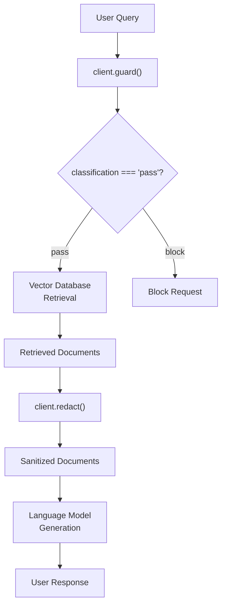
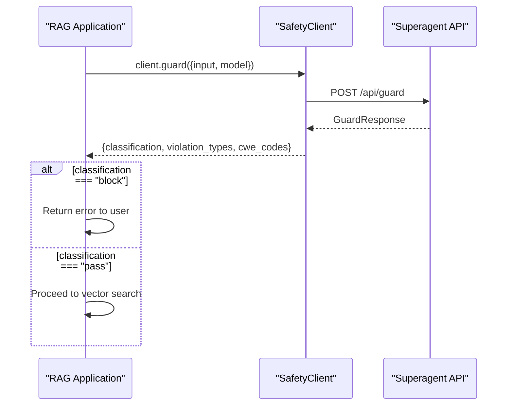
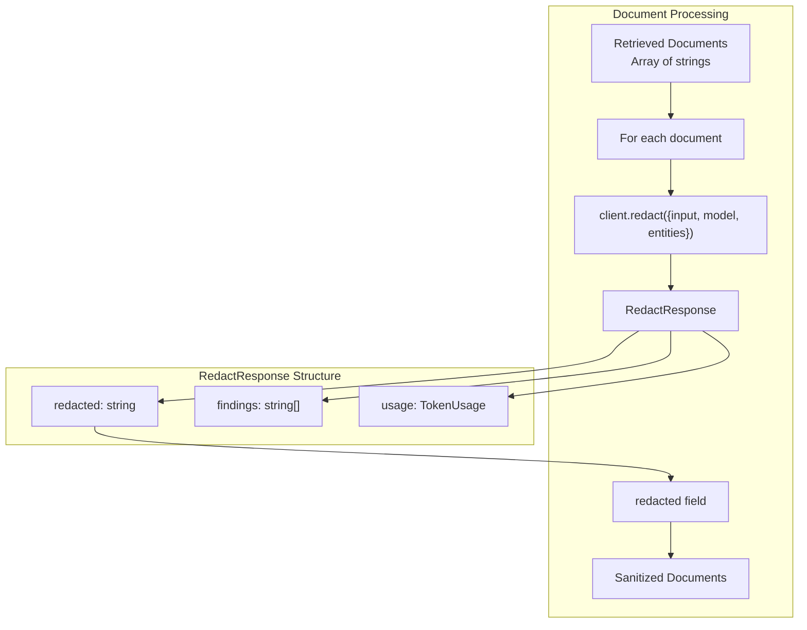

<!-- source: DeepWiki mcp.deepwiki.com · repo superagent-ai/superagent · page 6.1 Secure RAG Pipeline · fetched 2026-10-26 -->

# Secure RAG Pipeline

<details>
<summary>Relevant source files</summary>

The following files were used as context for generating this wiki page:

- [docs/public/visual-prompt-injection-example.png](docs/public/visual-prompt-injection-example.png)
- [sdk/python/README.md](sdk/python/README.md)
- [sdk/typescript/README.md](sdk/typescript/README.md)

</details>


This document provides a practical example of integrating Superagent safety operations into a Retrieval-Augmented Generation (RAG) pipeline. It demonstrates how to use the `guard()` operation to validate user queries before retrieval and the `redact()` operation to sanitize retrieved documents before passing them to language models.

For general SDK usage patterns, see [SDK Reference](#2). For other integration examples, see [Scanning File Uploads](#6.2) and [CI/CD Integration](#6.3).

## RAG Security Concerns

RAG pipelines face two primary security vulnerabilities:

| Vulnerability | Attack Vector | Impact |
|--------------|---------------|--------|
| **Malicious Queries** | User submits prompt injections or jailbreak attempts disguised as legitimate queries | Retrieval system returns manipulated results; LLM executes attacker instructions |
| **Sensitive Document Content** | Retrieved documents contain PII, PHI, or confidential data | LLM response leaks sensitive information to unauthorized users |

A secure RAG pipeline must validate incoming queries and sanitize outgoing document content before LLM processing.

Sources: [sdk/typescript/README.md:1-372](), [sdk/python/README.md:1-129]()

## Secure RAG Architecture

The following diagram shows the complete flow of a secure RAG pipeline with Superagent safety operations integrated at critical checkpoints:



**Pipeline Flow:**
1. User query passes through `client.guard()` to detect prompt injections, jailbreaks, and malicious instructions
2. If classification is `"block"`, request terminates; if `"pass"`, proceeds to retrieval
3. Vector database returns relevant documents based on semantic similarity
4. Documents pass through `client.redact()` to remove PII/PHI and sensitive data
5. Sanitized documents are injected into LLM context for generation
6. LLM generates response using safe, redacted content

Sources: [sdk/typescript/README.md:145-192](), [sdk/typescript/README.md:275-332]()

## Query Validation Flow

This diagram maps the query validation process to specific SDK methods and response types:



### Guard Operation Configuration

The `guard()` method accepts multiple input types and returns a structured classification response:

| Parameter | Type | Purpose |
|-----------|------|---------|
| `input` | `string \| Blob \| URL` | User query to validate |
| `model` | `string` | Model for classification (defaults to `superagent/guard-0.6b`) |
| `systemPrompt` | `string` | Optional custom prompt for domain-specific rules |
| `chunkSize` | `number` | Characters per chunk for large queries (default: 8000) |

**Response Structure:**
- `classification`: `"pass"` or `"block"` - determines if query proceeds
- `violation_types`: Array of detected violations (e.g., `["prompt_injection"]`)
- `cwe_codes`: Array of CWE codes for security tracking (e.g., `["CWE-94"]`)
- `usage`: Token usage metrics for cost tracking

Sources: [sdk/typescript/README.md:145-192](), [sdk/python/README.md:48-63]()

### TypeScript Implementation

```typescript
import { createClient } from "safety-agent";

const client = createClient();

async function validateQuery(userQuery: string): Promise<boolean> {
  const result = await client.guard({
    input: userQuery,
    model: "openai/gpt-4o-mini"
  });

  if (result.classification === "block") {
    console.error("Query blocked:", result.violation_types);
    return false;
  }

  return true;
}
```

The `createClient()` function is defined in [sdk/typescript/src/client.ts:1-50]() and the `guard()` method implementation is in [sdk/typescript/src/guard.ts:1-200]().

Sources: [sdk/typescript/README.md:20-41](), [sdk/typescript/README.md:145-192]()

### Python Implementation

```python
from safety_agent import create_client

client = create_client()

async def validate_query(user_query: str) -> bool:
    result = await client.guard(
        input=user_query,
        model="openai/gpt-4o-mini"
    )
    
    if result.classification == "block":
        print(f"Query blocked: {result.violation_types}")
        return False
    
    return True
```

The Python `create_client()` function is in [sdk/python/src/safety_agent/client.py:1-50]() and `guard()` method is in [sdk/python/src/safety_agent/guard.py:1-200]().

Sources: [sdk/python/README.md:27-46](), [sdk/python/README.md:48-81]()

## Document Sanitization Flow

The following diagram shows how the `redact()` operation processes retrieved documents before LLM injection:



### Redact Operation Configuration

The `redact()` method sanitizes sensitive content with configurable entity types and output modes:

| Parameter | Type | Default | Purpose |
|-----------|------|---------|---------|
| `input` | `string` | - | Document text to sanitize |
| `model` | `string` | - | Model for redaction (required) |
| `entities` | `string[]` | Default PII entities | Custom entity types to redact |
| `rewrite` | `boolean` | `false` | Contextual rewriting vs. placeholders |

**Default Entity Types:**
- Email addresses
- Phone numbers
- Social Security Numbers (SSN)
- Credit card numbers
- Physical addresses
- Medical record numbers
- Account numbers
- API keys and secrets

**Output Modes:**
1. **Placeholder Mode** (`rewrite: false`): Replaces entities with `<ENTITY_TYPE_REDACTED>` tokens
2. **Rewrite Mode** (`rewrite: true`): Contextually rewrites text to preserve meaning while removing sensitive data

Sources: [sdk/typescript/README.md:275-332](), [sdk/python/README.md:84-97]()

### TypeScript Implementation

```typescript
async function sanitizeDocuments(
  documents: string[],
  mode: "placeholder" | "rewrite" = "placeholder"
): Promise<string[]> {
  const sanitizedDocs = await Promise.all(
    documents.map(async (doc) => {
      const result = await client.redact({
        input: doc,
        model: "openai/gpt-4o-mini",
        rewrite: mode === "rewrite"
      });

      console.log(`Redacted ${result.findings.length} items`);
      return result.redacted;
    })
  );

  return sanitizedDocs;
}
```

The `redact()` method implementation is in [sdk/typescript/src/redact.ts:1-150]().

Sources: [sdk/typescript/README.md:275-332]()

### Python Implementation

```python
async def sanitize_documents(
    documents: list[str],
    mode: str = "placeholder"
) -> list[str]:
    sanitized = []
    
    for doc in documents:
        result = await client.redact(
            input=doc,
            model="openai/gpt-4o-mini",
            rewrite=(mode == "rewrite")
        )
        
        print(f"Redacted {len(result.findings)} items")
        sanitized.append(result.redacted)
    
    return sanitized
```

The Python `redact()` method is in [sdk/python/src/safety_agent/redact.py:1-150]().

Sources: [sdk/python/README.md:84-97]()

## Complete RAG Pipeline Implementation

The following example demonstrates a complete secure RAG pipeline integrating both guard and redact operations:

### TypeScript Complete Example

```typescript
import { createClient } from "safety-agent";

const client = createClient();

interface RAGConfig {
  guardModel: string;
  redactModel: string;
  redactMode: "placeholder" | "rewrite";
}

async function secureRAGPipeline(
  userQuery: string,
  vectorSearch: (query: string) => Promise<string[]>,
  llmGenerate: (context: string[], query: string) => Promise<string>,
  config: RAGConfig
): Promise<string | null> {
  // Step 1: Validate user query with guard
  const guardResult = await client.guard({
    input: userQuery,
    model: config.guardModel
  });

  if (guardResult.classification === "block") {
    console.error("Query blocked:", guardResult.violation_types);
    return null;
  }

  // Step 2: Retrieve documents from vector database
  const documents = await vectorSearch(userQuery);

  // Step 3: Sanitize retrieved documents
  const sanitizedDocs = await Promise.all(
    documents.map(async (doc) => {
      const redactResult = await client.redact({
        input: doc,
        model: config.redactModel,
        rewrite: config.redactMode === "rewrite"
      });
      return redactResult.redacted;
    })
  );

  // Step 4: Generate LLM response with sanitized context
  const response = await llmGenerate(sanitizedDocs, userQuery);

  return response;
}

// Usage
const response = await secureRAGPipeline(
  "What are the email addresses in the customer database?",
  vectorSearch,
  llmGenerate,
  {
    guardModel: "openai/gpt-4o-mini",
    redactModel: "openai/gpt-4o-mini",
    redactMode: "placeholder"
  }
);
```

Sources: [sdk/typescript/README.md:20-51](), [sdk/typescript/README.md:145-192](), [sdk/typescript/README.md:275-332]()

### Python Complete Example

```python
from safety_agent import create_client
from typing import List, Optional, Callable

client = create_client()

class RAGConfig:
    def __init__(
        self,
        guard_model: str,
        redact_model: str,
        redact_mode: str = "placeholder"
    ):
        self.guard_model = guard_model
        self.redact_model = redact_model
        self.redact_mode = redact_mode

async def secure_rag_pipeline(
    user_query: str,
    vector_search: Callable[[str], List[str]],
    llm_generate: Callable[[List[str], str], str],
    config: RAGConfig
) -> Optional[str]:
    # Step 1: Validate user query with guard
    guard_result = await client.guard(
        input=user_query,
        model=config.guard_model
    )
    
    if guard_result.classification == "block":
        print(f"Query blocked: {guard_result.violation_types}")
        return None
    
    # Step 2: Retrieve documents from vector database
    documents = await vector_search(user_query)
    
    # Step 3: Sanitize retrieved documents
    sanitized_docs = []
    for doc in documents:
        redact_result = await client.redact(
            input=doc,
            model=config.redact_model,
            rewrite=(config.redact_mode == "rewrite")
        )
        sanitized_docs.append(redact_result.redacted)
    
    # Step 4: Generate LLM response with sanitized context
    response = await llm_generate(sanitized_docs, user_query)
    
    return response

# Usage
response = await secure_rag_pipeline(
    "What are the email addresses in the customer database?",
    vector_search,
    llm_generate,
    RAGConfig(
        guard_model="openai/gpt-4o-mini",
        redact_model="openai/gpt-4o-mini",
        redact_mode="placeholder"
    )
)
```

Sources: [sdk/python/README.md:27-46](), [sdk/python/README.md:48-81](), [sdk/python/README.md:84-97]()

## Custom Entity Redaction

For domain-specific RAG applications, you can configure custom entity types to redact specialized sensitive data:

### TypeScript Custom Entities

```typescript
// Redact only specific entities for healthcare RAG
const result = await client.redact({
  input: document,
  model: "openai/gpt-4o-mini",
  entities: [
    "patient names",
    "medical record numbers",
    "dates of birth",
    "insurance policy numbers"
  ]
});
```

### Python Custom Entities

```python
# Redact only specific entities for financial RAG
result = await client.redact(
    input=document,
    model="openai/gpt-4o-mini",
    entities=[
        "account numbers",
        "social security numbers",
        "credit card numbers",
        "routing numbers"
    ]
)
```

The custom entities are passed directly to the LLM prompt. See [sdk/typescript/src/prompts.ts:50-100]() for the prompt template structure.

Sources: [sdk/typescript/README.md:321-332]()

## Performance Optimization

For high-throughput RAG pipelines, apply the following optimizations:

### Parallel Document Processing

```typescript
// Process multiple documents in parallel
const sanitizedDocs = await Promise.all(
  documents.map(doc => client.redact({
    input: doc,
    model: "openai/gpt-4o-mini"
  }))
);
```

### Chunk Size Configuration

```typescript
// Adjust chunk size for large documents
const guardResult = await client.guard({
  input: longUserQuery,
  model: "openai/gpt-4o-mini",
  chunkSize: 4000  // Smaller chunks for faster processing
});
```

The chunking logic splits text at `chunkSize` character boundaries and processes chunks in parallel with OR logic aggregation. See [sdk/typescript/src/guard.ts:100-150]() for the implementation.

Sources: [sdk/typescript/README.md:194-218]()

## Cost Management

Both `guard()` and `redact()` operations return token usage metrics for cost tracking:

```typescript
let totalTokens = 0;

// Track guard usage
const guardResult = await client.guard({
  input: query,
  model: "openai/gpt-4o-mini"
});
totalTokens += guardResult.usage.totalTokens;

// Track redact usage
for (const doc of documents) {
  const redactResult = await client.redact({
    input: doc,
    model: "openai/gpt-4o-mini"
  });
  totalTokens += redactResult.usage.totalTokens;
}

console.log(`Total tokens used: ${totalTokens}`);
```

The `usage` object contains:
- `promptTokens`: Input tokens
- `completionTokens`: Output tokens  
- `totalTokens`: Sum of prompt and completion tokens

Sources: [sdk/typescript/README.md:336-356]()

## Best Practices

| Practice | Rationale | Implementation |
|----------|-----------|----------------|
| **Always guard user queries** | Prevents prompt injection attacks from reaching retrieval system | Place `guard()` as first step in pipeline |
| **Redact in placeholder mode for retrieval** | Preserves document structure for vector similarity | Use `rewrite: false` for documents used in embeddings |
| **Redact in rewrite mode for LLM context** | Improves readability while maintaining security | Use `rewrite: true` for documents passed to LLM |
| **Use custom entities for domain-specific data** | Reduces false positives and improves precision | Configure `entities` array based on application domain |
| **Monitor token usage** | Controls costs and identifies expensive queries | Log `usage.totalTokens` for each operation |
| **Use Superagent guard model by default** | Zero API key requirements and fast inference | Omit `model` parameter for guard operations |

Sources: [sdk/typescript/README.md:1-372](), [sdk/python/README.md:1-129]()

## Related Examples

For additional integration patterns:
- [Scanning File Uploads](#6.2) - Validate uploaded documents and images
- [CI/CD Integration](#6.3) - Repository scanning in automated pipelines
- [Guard Operation Reference](#2.3) - Complete guard API documentation
- [Redact Operation Reference](#2.4) - Complete redact API documentation

---

