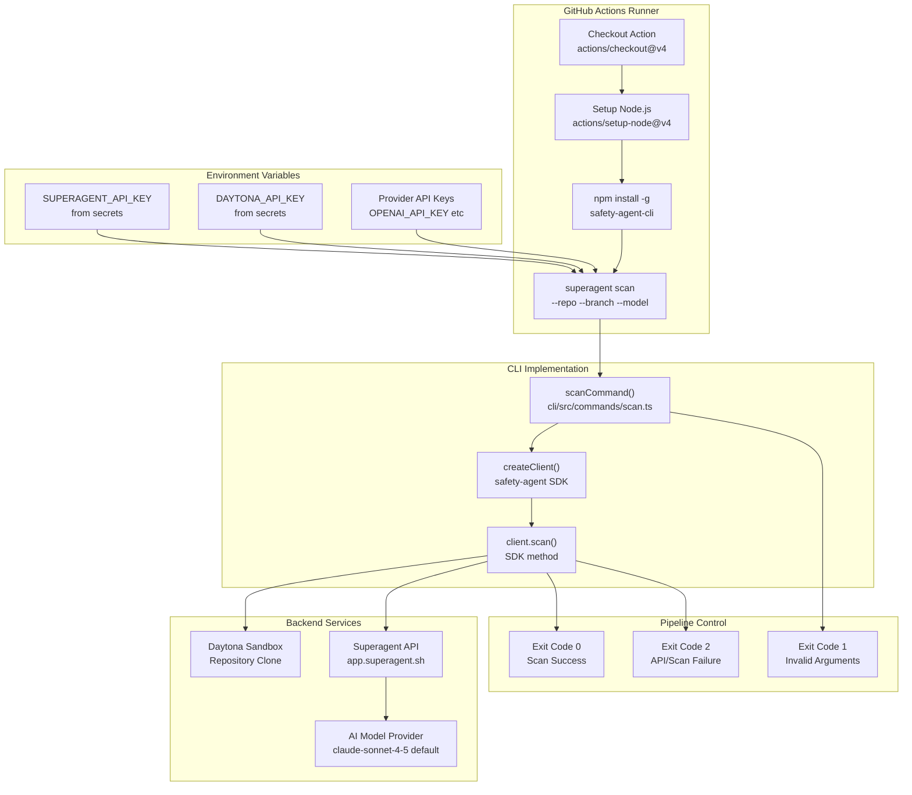
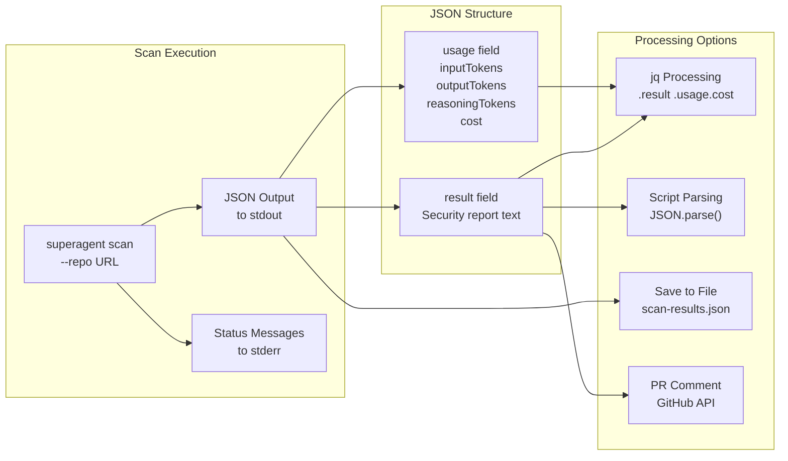
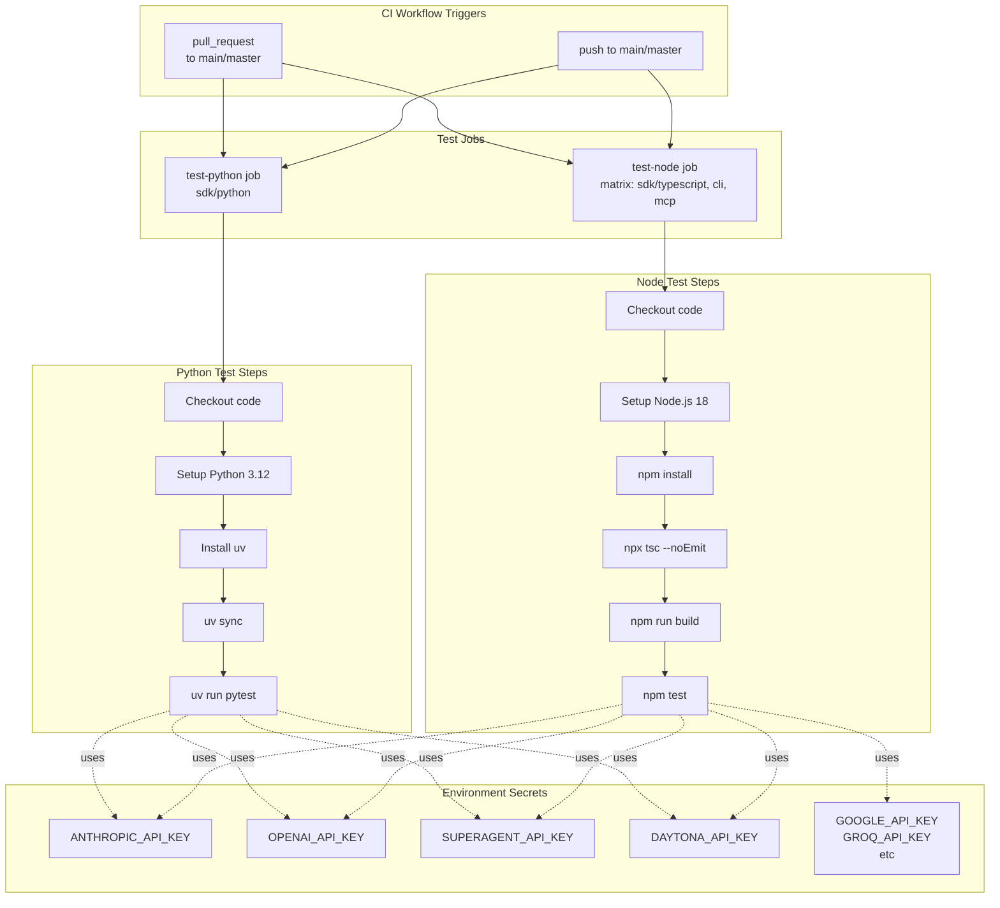

<!-- source: DeepWiki mcp.deepwiki.com · repo superagent-ai/superagent · page 6.3 CI/CD Integration · fetched 2026-10-26 -->

# CI/CD Integration

<details>
<summary>Relevant source files</summary>

The following files were used as context for generating this wiki page:

- [.github/workflows/ci.yml](.github/workflows/ci.yml)
- [cli/src/commands/scan.ts](cli/src/commands/scan.ts)
- [cli/src/index.ts](cli/src/index.ts)
- [cli/tests/scan.test.ts](cli/tests/scan.test.ts)
- [sdk/python/src/safety_agent/__init__.py](sdk/python/src/safety_agent/__init__.py)
- [sdk/python/tests/test_scan.py](sdk/python/tests/test_scan.py)

</details>


This document covers integrating Superagent security scanning into CI/CD pipelines to automatically detect AI agent attacks in code repositories. The primary use case is running the `superagent scan` command during pull requests or commits to identify repository poisoning, hidden prompt injections, and malicious instructions embedded in code or documentation.

For general information about the scan operation and its capabilities, see [Scan Operation](#2.5). For CLI-specific usage outside of CI/CD contexts, see [Scan Command](#3.4).

## Overview

The `scan` operation analyzes Git repositories for AI-specific security threats by cloning them into Daytona sandboxes and performing deep security analysis. In CI/CD environments, this enables automated security validation as part of the development workflow.

**Key Integration Points:**
- GitHub Actions workflows via CLI commands
- Direct SDK integration for custom pipeline logic
- Environment-based credential management
- Exit code handling for build gating

Sources: [cli/src/commands/scan.ts:1-122](), [.github/workflows/ci.yml:1-80]()

## GitHub Actions Integration

### Basic Workflow Configuration

The following workflow demonstrates scanning a repository on every push or pull request:

```yaml
name: Security Scan

on:
  push:
    branches: [main]
  pull_request:
    branches: [main]

jobs:
  scan-repository:
    runs-on: ubuntu-latest
    steps:
      - name: Checkout code
        uses: actions/checkout@v4

      - name: Setup Node.js
        uses: actions/setup-node@v4
        with:
          node-version: '18'

      - name: Install Superagent CLI
        run: npm install -g safety-agent-cli

      - name: Scan repository
        run: superagent scan --repo https://github.com/${{ github.repository }}
        env:
          SUPERAGENT_API_KEY: ${{ secrets.SUPERAGENT_API_KEY }}
          DAYTONA_API_KEY: ${{ secrets.DAYTONA_API_KEY }}
```

### Scanning Specific Branches or Commits

```yaml
      - name: Scan specific branch
        run: |
          superagent scan \
            --repo https://github.com/${{ github.repository }} \
            --branch ${{ github.head_ref || github.ref_name }}
        env:
          SUPERAGENT_API_KEY: ${{ secrets.SUPERAGENT_API_KEY }}
          DAYTONA_API_KEY: ${{ secrets.DAYTONA_API_KEY }}
```

### Custom Model Selection

```yaml
      - name: Scan with GPT-4o
        run: |
          superagent scan \
            --repo https://github.com/${{ github.repository }} \
            --model openai/gpt-4o
        env:
          SUPERAGENT_API_KEY: ${{ secrets.SUPERAGENT_API_KEY }}
          DAYTONA_API_KEY: ${{ secrets.DAYTONA_API_KEY }}
          OPENAI_API_KEY: ${{ secrets.OPENAI_API_KEY }}
```

Sources: [cli/src/commands/scan.ts:75-87](), [.github/workflows/ci.yml:4-7]()

## System Architecture in CI/CD Context



**Diagram: GitHub Actions Scan Workflow**

This diagram shows the execution flow from GitHub Actions runner through the CLI command to backend services. The `scanCommand()` function validates arguments, creates a `SafetyClient` instance, and invokes `client.scan()`. Success or failure is communicated via exit codes that control pipeline execution.

Sources: [cli/src/commands/scan.ts:28-122](), [.github/workflows/ci.yml:16-27]()

## Exit Codes and Error Handling

The `superagent scan` command uses exit codes to communicate results to the CI/CD system:

| Exit Code | Meaning | Pipeline Behavior |
|-----------|---------|-------------------|
| `0` | Scan completed successfully | Pipeline continues |
| `1` | Invalid arguments (missing `--repo`, invalid URL) | Pipeline fails |
| `2` | API error or scan failure (missing credentials, network error) | Pipeline fails |

### Exit Code Implementation

The CLI implements exit codes as follows:

```typescript
// Argument validation errors -> exit 1
if (!repo) {
  console.error("❌ ERROR: --repo flag is required");
  process.exit(1);
}

// Missing credentials -> exit 2
if (!process.env.SUPERAGENT_API_KEY) {
  console.error("❌ ERROR: SUPERAGENT_API_KEY environment variable not set");
  process.exit(2);
}

if (!process.env.DAYTONA_API_KEY) {
  console.error("❌ ERROR: DAYTONA_API_KEY environment variable not set");
  process.exit(2);
}

// Scan execution errors -> exit 2
try {
  const result = await client.scan({ repo, branch, model });
  console.log(JSON.stringify(output, null, 2));
  process.exit(0);
} catch (error) {
  console.error(`❌ Scan failed: ${error.message}`);
  process.exit(2);
}
```

### Handling Scan Failures in Workflows

```yaml
      - name: Scan and continue on failure
        run: superagent scan --repo https://github.com/${{ github.repository }}
        continue-on-error: true
        env:
          SUPERAGENT_API_KEY: ${{ secrets.SUPERAGENT_API_KEY }}
          DAYTONA_API_KEY: ${{ secrets.DAYTONA_API_KEY }}

      - name: Parse scan results
        if: always()
        run: |
          echo "Scan completed with exit code: $?"
```

Sources: [cli/src/commands/scan.ts:41-87](), [cli/src/commands/scan.ts:103-121]()

## Environment Variables Configuration

### Required Variables

Both `SUPERAGENT_API_KEY` and `DAYTONA_API_KEY` are required for scan operations:

```yaml
env:
  SUPERAGENT_API_KEY: ${{ secrets.SUPERAGENT_API_KEY }}
  DAYTONA_API_KEY: ${{ secrets.DAYTONA_API_KEY }}
```

The scan command validates these at runtime:

- `SUPERAGENT_API_KEY`: Authenticates with the Superagent API backend
- `DAYTONA_API_KEY`: Provides access to Daytona sandbox infrastructure for repository cloning

Sources: [cli/src/commands/scan.ts:76-87]()

### Optional Provider API Keys

When using custom models via `--model`, additional provider keys may be required:

```yaml
env:
  SUPERAGENT_API_KEY: ${{ secrets.SUPERAGENT_API_KEY }}
  DAYTONA_API_KEY: ${{ secrets.DAYTONA_API_KEY }}
  OPENAI_API_KEY: ${{ secrets.OPENAI_API_KEY }}        # For openai/* models
  ANTHROPIC_API_KEY: ${{ secrets.ANTHROPIC_API_KEY }}  # For anthropic/* models
  GOOGLE_API_KEY: ${{ secrets.GOOGLE_API_KEY }}        # For google/* models
  GROQ_API_KEY: ${{ secrets.GROQ_API_KEY }}            # For groq/* models
```

The default model (`anthropic/claude-sonnet-4-5`) is routed through the Superagent API and does not require separate provider keys.

Sources: [.github/workflows/ci.yml:40-51]()

### Secrets Configuration

Add secrets in GitHub repository settings under **Settings → Secrets and variables → Actions**:

1. Navigate to repository settings
2. Click "New repository secret"
3. Add `SUPERAGENT_API_KEY` with your API key
4. Add `DAYTONA_API_KEY` with your Daytona key
5. Add provider keys as needed

## Alternative CI/CD Systems

### GitLab CI/CD

```yaml
security-scan:
  stage: test
  image: node:18
  before_script:
    - npm install -g safety-agent-cli
  script:
    - superagent scan --repo ${CI_PROJECT_URL}
  variables:
    SUPERAGENT_API_KEY: ${SUPERAGENT_API_KEY}
    DAYTONA_API_KEY: ${DAYTONA_API_KEY}
  only:
    - merge_requests
    - main
```

### Jenkins Pipeline

```groovy
pipeline {
    agent any
    
    environment {
        SUPERAGENT_API_KEY = credentials('superagent-api-key')
        DAYTONA_API_KEY = credentials('daytona-api-key')
    }
    
    stages {
        stage('Security Scan') {
            steps {
                sh 'npm install -g safety-agent-cli'
                sh "superagent scan --repo ${env.GIT_URL}"
            }
        }
    }
}
```

### CircleCI

```yaml
version: 2.1

jobs:
  security-scan:
    docker:
      - image: cimg/node:18.0
    steps:
      - checkout
      - run:
          name: Install CLI
          command: npm install -g safety-agent-cli
      - run:
          name: Scan repository
          command: superagent scan --repo https://github.com/${CIRCLE_PROJECT_USERNAME}/${CIRCLE_PROJECT_REPONAME}
          environment:
            SUPERAGENT_API_KEY: ${SUPERAGENT_API_KEY}
            DAYTONA_API_KEY: ${DAYTONA_API_KEY}

workflows:
  scan-workflow:
    jobs:
      - security-scan
```

### Azure Pipelines

```yaml
trigger:
  - main

pool:
  vmImage: 'ubuntu-latest'

steps:
  - task: NodeTool@0
    inputs:
      versionSpec: '18.x'
  
  - script: npm install -g safety-agent-cli
    displayName: 'Install Superagent CLI'
  
  - script: superagent scan --repo $(Build.Repository.Uri)
    displayName: 'Scan repository'
    env:
      SUPERAGENT_API_KEY: $(SUPERAGENT_API_KEY)
      DAYTONA_API_KEY: $(DAYTONA_API_KEY)
```

Sources: [cli/src/commands/scan.ts:1-122]()

## SDK-Based Integration

For more complex pipeline logic, use the TypeScript or Python SDK directly:

### TypeScript SDK in Custom Scripts

```typescript
import { createClient } from 'safety-agent';

const client = createClient({
  apiKey: process.env.SUPERAGENT_API_KEY,
});

async function scanInPipeline() {
  try {
    const result = await client.scan({
      repo: process.env.GITHUB_REPOSITORY_URL,
      branch: process.env.GITHUB_REF_NAME,
      model: 'anthropic/claude-sonnet-4-5',
    });
    
    console.log('Scan result:', result.result);
    console.log('Usage:', result.usage);
    
    // Custom logic: parse results, post to PR, etc.
    if (result.result.includes('CRITICAL')) {
      process.exit(1);
    }
  } catch (error) {
    console.error('Scan failed:', error);
    process.exit(2);
  }
}

scanInPipeline();
```

### Python SDK in Custom Scripts

```python
import os
import sys
from safety_agent import create_client

client = create_client()

async def scan_in_pipeline():
    try:
        result = await client.scan(
            repo=os.environ['GITHUB_REPOSITORY_URL'],
            branch=os.environ['GITHUB_REF_NAME'],
            model='anthropic/claude-sonnet-4-5',
        )
        
        print(f"Scan result: {result.result}")
        print(f"Usage: {result.usage}")
        
        # Custom logic
        if 'CRITICAL' in result.result:
            sys.exit(1)
    except Exception as error:
        print(f"Scan failed: {error}", file=sys.stderr)
        sys.exit(2)

if __name__ == '__main__':
    import asyncio
    asyncio.run(scan_in_pipeline())
```

### GitHub Actions with SDK Script

```yaml
      - name: Run custom scan script
        run: |
          npm install safety-agent
          node scan-script.js
        env:
          SUPERAGENT_API_KEY: ${{ secrets.SUPERAGENT_API_KEY }}
          DAYTONA_API_KEY: ${{ secrets.DAYTONA_API_KEY }}
          GITHUB_REPOSITORY_URL: https://github.com/${{ github.repository }}
          GITHUB_REF_NAME: ${{ github.ref_name }}
```

Sources: [cli/src/commands/scan.ts:89-122](), [cli/tests/scan.test.ts:1-30](), [sdk/python/tests/test_scan.py:1-96]()

## Output Parsing and Result Processing



**Diagram: Scan Output Processing Flow**

The scan command outputs structured JSON to stdout and human-readable status messages to stderr. This separation enables programmatic parsing while preserving diagnostic information.

### Parsing with jq

```yaml
      - name: Scan and extract result
        id: scan
        run: |
          RESULT=$(superagent scan --repo https://github.com/${{ github.repository }} | jq -r '.result')
          echo "result=$RESULT" >> $GITHUB_OUTPUT
          
          COST=$(superagent scan --repo https://github.com/${{ github.repository }} | jq -r '.usage.cost')
          echo "cost=$COST" >> $GITHUB_OUTPUT
        env:
          SUPERAGENT_API_KEY: ${{ secrets.SUPERAGENT_API_KEY }}
          DAYTONA_API_KEY: ${{ secrets.DAYTONA_API_KEY }}

      - name: Comment on PR
        uses: actions/github-script@v7
        with:
          script: |
            github.rest.issues.createComment({
              issue_number: context.issue.number,
              owner: context.repo.owner,
              repo: context.repo.repo,
              body: '## Security Scan Results\n\n${{ steps.scan.outputs.result }}'
            })
```

### JSON Output Structure

The scan command produces output in this format:

```json
{
  "result": "# Security Analysis Report\n\n## Summary\nNo critical issues found...",
  "usage": {
    "inputTokens": 15432,
    "outputTokens": 1205,
    "reasoningTokens": 0,
    "cost": 0.0543
  }
}
```

Sources: [cli/src/commands/scan.ts:110-115]()

## Real-World CI/CD Example from Superagent Repository

The Superagent repository itself uses GitHub Actions for continuous integration:



**Diagram: Superagent Repository CI Pipeline**

The workflow includes integration tests for the scan functionality, requiring both `SUPERAGENT_API_KEY` and `DAYTONA_API_KEY` to execute repository scans in test environments.

Sources: [.github/workflows/ci.yml:1-80]()

### Test Integration Details

The CI pipeline runs scan integration tests with real API credentials:

**TypeScript Test:** [cli/tests/scan.test.ts:1-30]()
- Skips if credentials missing
- 5-minute timeout for scan operations
- Validates response structure

**Python Test:** [sdk/python/tests/test_scan.py:1-96]()
- Input validation tests (no credentials required)
- Integration tests with `@pytest.mark.skipif` conditional execution
- Credentials check: `SKIP_INTEGRATION = not DAYTONA_API_KEY or not SUPERAGENT_API_KEY`

Sources: [cli/tests/scan.test.ts:4-29](), [sdk/python/tests/test_scan.py:19-96]()

## Best Practices

### When to Run Scans

**Recommended Triggers:**
- Pull requests before merge
- Scheduled scans (nightly/weekly)
- Manual workflow dispatch for investigation

**Not Recommended:**
- Every commit on feature branches (expensive)
- Local pre-commit hooks (slow, requires network)

### Timeout Configuration

Repository scans can take several minutes. Configure appropriate timeouts:

```yaml
      - name: Scan repository
        timeout-minutes: 10
        run: superagent scan --repo https://github.com/${{ github.repository }}
```

The test suite uses 5-minute timeouts (`timeout: 300000` milliseconds) for scan operations.

Sources: [cli/tests/scan.test.ts:12](), [sdk/python/tests/test_scan.py:77]()

### Credential Security

- Store API keys as encrypted secrets, never in code
- Use repository secrets for private repos
- Use organization secrets for shared access across repos
- Rotate keys periodically
- Audit secret access logs

### Cost Management

Scan operations consume AI model tokens and incur costs. The `usage.cost` field in scan results tracks spending:

```yaml
      - name: Track scan costs
        run: |
          COST=$(superagent scan --repo ${{ github.repository }} | jq '.usage.cost')
          echo "Scan cost: \$${COST}" >> $GITHUB_STEP_SUMMARY
```

**Cost Optimization:**
- Scan only changed repositories
- Use cheaper models for routine scans (`--model openai/gpt-4o-mini`)
- Cache scan results for unchanged branches
- Limit scan frequency on large repositories

Sources: [cli/src/commands/scan.ts:104-115](), [sdk/python/tests/test_scan.py:92-95]()

---

