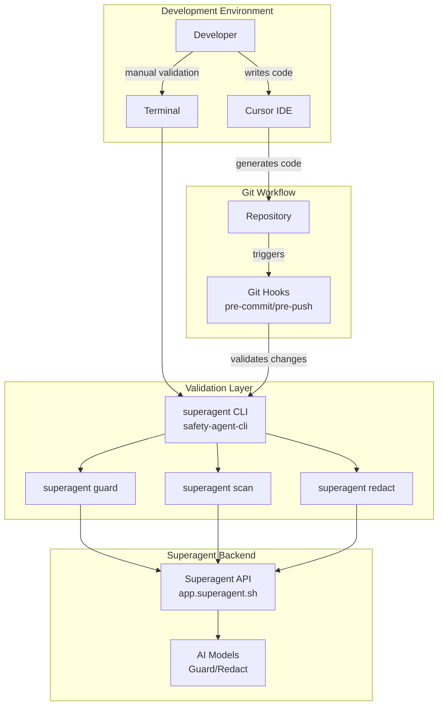
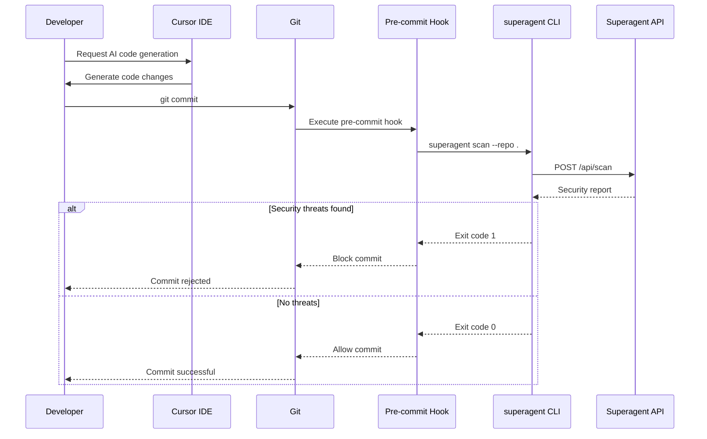
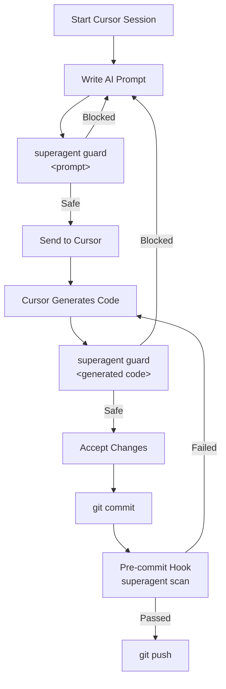

<!-- source: DeepWiki mcp.deepwiki.com · repo superagent-ai/superagent · page 6.4 Cursor Integration · fetched 2026-10-26 -->

# Cursor Integration

<details>
<summary>Relevant source files</summary>

The following files were used as context for generating this wiki page:

- [cli/package-lock.json](cli/package-lock.json)
- [cli/package.json](cli/package.json)
- [cli/src/commands/guard.ts](cli/src/commands/guard.ts)
- [docs/content/docs/legacy/cli.mdx](docs/content/docs/legacy/cli.mdx)
- [docs/content/docs/legacy/examples/claude-code-userprompt.mdx](docs/content/docs/legacy/examples/claude-code-userprompt.mdx)
- [docs/content/docs/legacy/examples/redact-pdfs.mdx](docs/content/docs/legacy/examples/redact-pdfs.mdx)
- [docs/content/docs/legacy/mcp.mdx](docs/content/docs/legacy/mcp.mdx)

</details>


This page demonstrates how to integrate Superagent safety checks with Cursor AI IDE to validate AI-generated code, prompts, and repository changes. While Cursor does not currently provide a native hooks system like Claude Code, several integration patterns enable security validation workflows.

For integrating with Claude Code's native hooks system, see the Claude Code example documentation. For general CLI usage, see [Command-Line Interface](#3).

---

## Integration Architecture

Cursor integration relies on the Superagent CLI as a validation layer between the developer, Cursor's AI features, and the codebase. The CLI can be invoked manually, through git hooks, or via wrapper scripts.



**Integration Points:**
- **Manual Validation**: Developer runs CLI commands to check prompts or code
- **Git Hooks**: Automated validation before commits or pushes
- **Wrapper Scripts**: Custom automation around Cursor workflows

Sources: [cli/package.json:1-47](), [cli/src/commands/guard.ts:1-181]()

---

## Manual Validation Workflow

### Validating Prompts Before Sending to Cursor

Before submitting a complex or potentially dangerous prompt to Cursor's AI, validate it with the `guard` command:

```bash
# Validate a prompt for security issues
superagent guard "Generate a Python script to recursively delete all .log files older than 30 days"
```

**Response (if safe):**
```json
{
  "classification": "pass",
  "violation_types": [],
  "cwe_codes": [],
  "usage": {
    "prompt_tokens": 18,
    "completion_tokens": 5,
    "total_tokens": 23
  }
}
```

**Response (if blocked):**
```json
{
  "classification": "block",
  "violation_types": ["command_injection"],
  "cwe_codes": ["CWE-78"],
  "usage": {
    "prompt_tokens": 18,
    "completion_tokens": 12,
    "total_tokens": 30
  }
}
```

The exit code indicates the result:
- `0`: Prompt is safe to use
- `1`: Prompt contains security threats
- `2`: API error occurred

Sources: [cli/src/commands/guard.ts:119-179]()

### Validating AI-Generated Code

After Cursor generates code, validate it before accepting:

```bash
# Check generated Python script
superagent guard "$(cat generated_script.py)"

# Check generated shell commands
superagent guard "find . -name '*.tmp' -delete"
```

### Scanning Generated Files

Validate entire files or directories after Cursor makes changes:

```bash
# Scan current repository for AI attacks
superagent scan --repo . --branch main

# Scan specific directory
cd cursor-generated-code/
superagent scan --repo . --branch feature/ai-changes
```

Sources: [docs/content/docs/legacy/cli.mdx:80-127]()

---

## Git Hooks Integration

Automated validation triggers when committing or pushing code, catching security issues introduced by Cursor's AI before they enter version control.



Sources: [cli/src/commands/guard.ts:27-180]()

### Pre-commit Hook Setup

Create `.git/hooks/pre-commit`:

```bash
#!/bin/bash
# .git/hooks/pre-commit

echo "🔍 Scanning code for AI security threats..."

# Get staged files
STAGED_FILES=$(git diff --cached --name-only --diff-filter=ACM)

if [ -z "$STAGED_FILES" ]; then
    echo "No files staged for commit"
    exit 0
fi

# Validate each staged file
for FILE in $STAGED_FILES; do
    if [[ "$FILE" =~ \.(py|js|ts|sh|bash)$ ]]; then
        echo "Checking $FILE..."
        
        if ! superagent guard "$(cat "$FILE")"; then
            echo "❌ Security threat detected in $FILE"
            echo "Commit blocked by Superagent Guard"
            exit 1
        fi
    fi
done

echo "✅ All files passed security checks"
exit 0
```

Make the hook executable:

```bash
chmod +x .git/hooks/pre-commit
```

Sources: [docs/content/docs/legacy/cli.mdx:504-516]()

### Pre-push Hook for Repository Scanning

Create `.git/hooks/pre-push` to scan the entire repository before pushing:

```bash
#!/bin/bash
# .git/hooks/pre-push

echo "🔍 Scanning repository for AI attacks..."

# Get current branch
BRANCH=$(git rev-parse --abbrev-ref HEAD)

# Scan repository
if ! superagent scan --repo . --branch "$BRANCH"; then
    echo "❌ Repository scan failed"
    echo "Push blocked by Superagent Scan"
    exit 1
fi

echo "✅ Repository scan passed"
exit 0
```

Make the hook executable:

```bash
chmod +x .git/hooks/pre-push
```

**Environment Setup:**

Both hooks require the `SUPERAGENT_API_KEY` environment variable. Add to your shell profile:

```bash
# ~/.bashrc or ~/.zshrc
export SUPERAGENT_API_KEY="sa_your_key_here"
```

Sources: [docs/content/docs/legacy/cli.mdx:54-70]()

---

## Wrapper Script Integration

Custom scripts can provide streamlined workflows for common Cursor usage patterns.

### Validate Cursor Chat Prompts

Create `validate-cursor-prompt.sh`:

```bash
#!/bin/bash
# validate-cursor-prompt.sh
# Validates a prompt before copying to Cursor

if [ -z "$1" ]; then
    echo "Usage: ./validate-cursor-prompt.sh \"your prompt\""
    exit 1
fi

PROMPT="$1"

echo "🔍 Validating prompt..."
if superagent guard "$PROMPT"; then
    echo "✅ Prompt is safe to use in Cursor"
    echo "$PROMPT" | pbcopy  # macOS clipboard
    echo "📋 Copied to clipboard"
    exit 0
else
    echo "❌ Security threat detected in prompt"
    echo "Do NOT use this prompt in Cursor"
    exit 1
fi
```

**Usage:**

```bash
chmod +x validate-cursor-prompt.sh
./validate-cursor-prompt.sh "Write a function to process user input"
```

### Batch Validate AI-Generated Files

Create `batch-validate.sh`:

```bash
#!/bin/bash
# batch-validate.sh
# Validates all files in a directory

DIR="${1:-.}"
BLOCKED=0

echo "🔍 Scanning files in $DIR..."

find "$DIR" -type f \( -name "*.py" -o -name "*.js" -o -name "*.ts" \) | while read -r file; do
    echo "Checking $file..."
    
    if ! superagent guard "$(cat "$file")" > /dev/null 2>&1; then
        echo "❌ BLOCKED: $file"
        ((BLOCKED++))
    else
        echo "✅ SAFE: $file"
    fi
done

if [ "$BLOCKED" -gt 0 ]; then
    echo "⚠️  $BLOCKED file(s) blocked"
    exit 1
else
    echo "✅ All files passed validation"
    exit 0
fi
```

**Usage:**

```bash
chmod +x batch-validate.sh
./batch-validate.sh ./cursor-generated-code/
```

Sources: [cli/src/commands/guard.ts:27-106]()

---

## Redacting Sensitive Data from Cursor Outputs

When Cursor generates code or documentation that may contain sensitive information, use the `redact` command:

```bash
# Redact PII from generated documentation
superagent redact "$(cat generated-docs.md)"

# Redact specific entity types
superagent redact --entities "API keys,email addresses,SSN" "$(cat config.py)"

# Redact PDF documentation generated by Cursor
superagent redact --file generated-report.pdf "Redact sensitive information"
```

**Example Output:**

```json
{
  "redacted": "Contact support at <REDACTED_EMAIL> or call <REDACTED_PHONE>",
  "reasoning": "Redacted email addresses and phone numbers",
  "usage": {
    "prompt_tokens": 45,
    "completion_tokens": 12,
    "total_tokens": 57
  }
}
```

Sources: [docs/content/docs/legacy/cli.mdx:129-190]()

---

## Workspace Configuration

### Environment Variables

Configure the CLI for seamless integration with Cursor workflows:

```bash
# Required
export SUPERAGENT_API_KEY="sa_your_key_here"

# Optional: For repository scanning
export DAYTONA_API_KEY="your_daytona_key_here"

# Optional: Custom API endpoint
export SUPERAGENT_API_BASE_URL="https://app.superagent.sh/api"
```

Add to your project's `.envrc` (if using direnv):

```bash
# .envrc
export SUPERAGENT_API_KEY=sa_...
```

Or to `.env`:

```bash
# .env
SUPERAGENT_API_KEY=sa_...
```

Sources: [docs/content/docs/legacy/cli.mdx:54-79]()

### NPM Script Integration

Add validation scripts to `package.json`:

```json
{
  "scripts": {
    "validate:prompts": "superagent guard",
    "validate:code": "superagent guard \"$(cat src/index.ts)\"",
    "scan:repo": "superagent scan --repo . --branch main",
    "redact:docs": "superagent redact --file docs/api.pdf"
  }
}
```

**Usage:**

```bash
npm run scan:repo
npm run validate:code
```

---

## Command Reference for Cursor Workflows

### Guard Command Options

The `guard` command validates text, URLs, files, or images for security threats:

| Option | Description | Example |
|--------|-------------|---------|
| `<prompt>` | Text to validate | `superagent guard "user input"` |
| `--file <path>` | Path to PDF file | `superagent guard --file doc.pdf` |
| `--system-prompt <text>` | Custom guard behavior | `superagent guard --system-prompt "Focus on prompt injection" "input"` |
| `--help` | Show help | `superagent guard --help` |

**Exit Codes:**
- `0`: Input is safe
- `1`: Input contains threats
- `2`: API error

Sources: [cli/src/commands/guard.ts:4-25](), [docs/content/docs/legacy/cli.mdx:82-127]()

### Scan Command Options

The `scan` command analyzes repositories for AI security threats:

| Option | Description | Example |
|--------|-------------|---------|
| `--repo <url or path>` | Repository to scan | `superagent scan --repo .` |
| `--branch <name>` | Branch to analyze | `superagent scan --repo . --branch main` |
| `--model <model>` | AI model to use | `superagent scan --repo . --model gpt-4o` |

**Exit Codes:**
- `0`: Scan successful
- `2`: Scan failed or threats found

Sources: [docs/content/docs/legacy/cli.mdx:1-127]()

### Redact Command Options

The `redact` command removes sensitive information:

| Option | Description | Example |
|--------|-------------|---------|
| `<text>` | Text to redact | `superagent redact "email: user@example.com"` |
| `--file <path>` | PDF file to redact | `superagent redact --file doc.pdf` |
| `--entities <list>` | Entity types (natural language) | `superagent redact --entities "SSN,emails"` |
| `--url-whitelist <urls>` | URLs to preserve | `superagent redact --url-whitelist https://github.com` |

Sources: [docs/content/docs/legacy/cli.mdx:129-240]()

---

## Security Validation Workflow



**Workflow Steps:**

1. **Validate Prompt**: Check prompt for security issues before sending to Cursor
2. **Generate Code**: Allow Cursor to generate code if prompt is safe
3. **Validate Output**: Check generated code for threats
4. **Git Commit**: Stage validated changes
5. **Pre-commit Scan**: Automated repository scan via git hook
6. **Push**: Push validated changes to remote

Sources: [cli/src/commands/guard.ts:27-180](), [docs/content/docs/legacy/examples/claude-code-userprompt.mdx:72-90]()

---

## Use Cases

### Validating Cursor Composer Changes

When using Cursor's Composer feature for multi-file edits:

```bash
# After Composer generates changes
git diff > changes.diff
superagent guard "$(cat changes.diff)"

# Or scan the entire modified codebase
superagent scan --repo . --branch feature/cursor-changes
```

### Protecting Against Prompt Injection

Validate user-provided specifications before passing to Cursor:

```bash
# Read specification from file
SPEC=$(cat client-requirements.txt)

# Validate before using in Cursor
if superagent guard "$SPEC"; then
    echo "✅ Safe to use in Cursor"
else
    echo "❌ Potential prompt injection detected"
fi
```

### Sanitizing Generated Configuration

Redact secrets from Cursor-generated configuration:

```bash
# Generate config with Cursor
# Then redact sensitive data
superagent redact --entities "API keys,passwords,tokens" "$(cat config.yaml)"
```

### CI/CD Integration

Run repository scans in GitHub Actions:

```yaml
name: Cursor Code Validation
on: [push, pull_request]

jobs:
  security-scan:
    runs-on: ubuntu-latest
    steps:
      - uses: actions/checkout@v3
      
      - name: Install Superagent CLI
        run: npm install -g safety-agent-cli
        
      - name: Scan Repository
        env:
          SUPERAGENT_API_KEY: ${{ secrets.SUPERAGENT_API_KEY }}
          DAYTONA_API_KEY: ${{ secrets.DAYTONA_API_KEY }}
        run: superagent scan --repo . --branch ${{ github.ref_name }}
```

Sources: [docs/content/docs/legacy/cli.mdx:488-500]()

---

## Limitations and Considerations

### No Native Hook Support

Unlike Claude Code, Cursor does not currently provide a native hooks system. Integration requires:
- Manual CLI invocation
- Git hooks for automated validation
- Custom wrapper scripts

### Async Validation

The CLI performs synchronous validation, which may interrupt workflow. Consider:
- Running scans asynchronously in background
- Batch validation during git operations
- Pre-validation of common patterns

### API Rate Limits

Frequent validation may hit API rate limits. Optimize by:
- Validating only changed files
- Caching validation results
- Using git hooks for critical checkpoints only

Sources: [cli/src/commands/guard.ts:1-181]()

---

## Next Steps

- Set up git hooks for automated validation
- Create workspace-specific wrapper scripts
- Integrate scanning into CI/CD pipeline
- Explore the [CLI reference](#3) for additional commands
- Review [CI/CD Integration examples](#6.3)

Sources: [docs/content/docs/legacy/cli.mdx:1-565](), [docs/content/docs/legacy/examples/claude-code-userprompt.mdx:1-108]()

---

