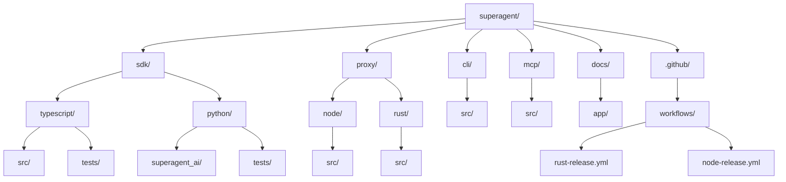
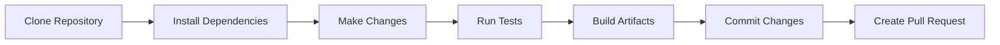
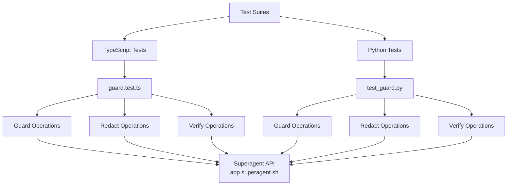
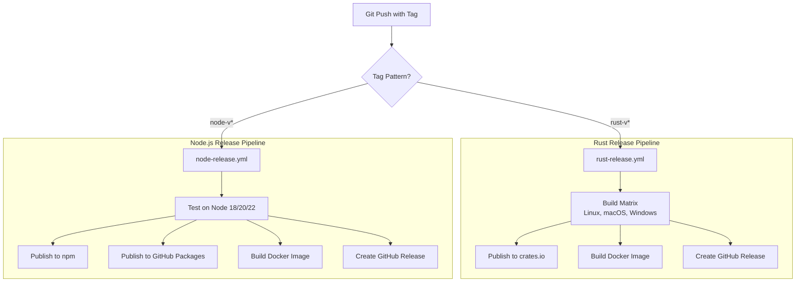
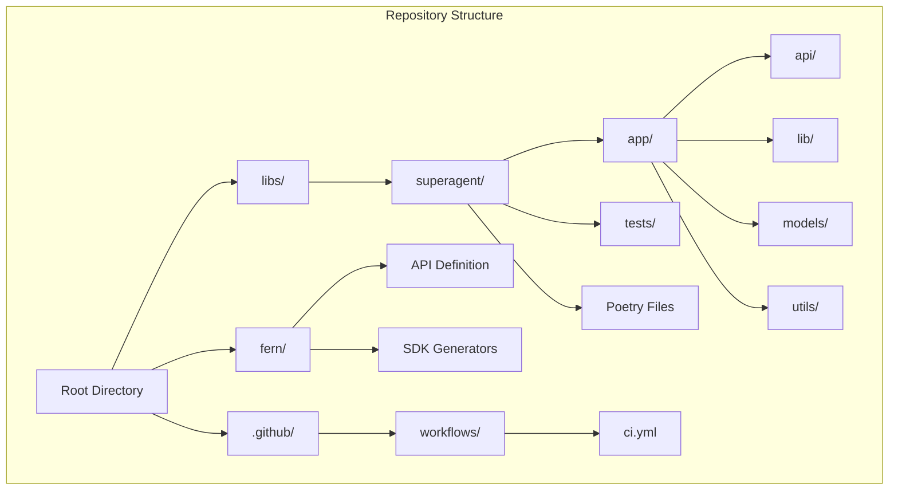

<!-- source: DeepWiki mcp.deepwiki.com · repo superagent-ai/superagent · page 7 Development · fetched 2026-10-26 -->

# Development

<details>
<summary>Relevant source files</summary>

The following files were used as context for generating this wiki page:

- [.github/workflows/ci.yml](.github/workflows/ci.yml)
- [.gitignore](.gitignore)
- [sdk/python/src/safety_agent/__init__.py](sdk/python/src/safety_agent/__init__.py)
- [sdk/python/tests/test_scan.py](sdk/python/tests/test_scan.py)
- [sdk/typescript/tsconfig.json](sdk/typescript/tsconfig.json)

</details>


This document provides guidance for developers contributing to or extending the Superagent codebase. The repository is a polyglot project containing TypeScript/JavaScript, Python, and Rust components that work together to provide AI security and compliance tooling.

The development workflow varies depending on which component you're working on. This page provides an overview of the repository structure, tooling requirements, and common development tasks.

## Repository Structure

The Superagent repository is organized into multiple language-specific directories, each containing distinct components of the platform.

### Repository Layout



**Component Directory Structure**

| Directory | Language | Purpose |
|-----------|----------|---------|
| `sdk/typescript/` | TypeScript | TypeScript/JavaScript SDK for browser and Node.js |
| `sdk/python/` | Python | Python SDK with async/await support |
| `cli/` | TypeScript | Command-line tool for Guard, Redact, and Verify operations |
| `mcp/` | TypeScript | Model Context Protocol server for Claude integration |
| `proxy/node/` | TypeScript | Node.js implementation of AI Firewall proxy |
| `proxy/rust/` | Rust | Rust implementation of AI Firewall proxy |
| `docs/` | TypeScript | Next.js documentation site using Fumadocs |

Sources: [sdk/typescript/tests/guard.test.ts:1-10](), [sdk/python/tests/test_guard.py:1-10](), [.github/workflows/rust-release.yml:1-10](), [.github/workflows/node-release.yml:1-10]()

## Required Tooling

Development on Superagent requires multiple language runtimes depending on which component you're working with.

### Core Requirements

| Tool | Version | Used For |
|------|---------|----------|
| Node.js | 18.x, 20.x, or 22.x | TypeScript SDK, CLI, MCP, Node.js proxy, docs |
| npm | Latest | Node.js package management |
| Python | 3.8+ | Python SDK |
| pip | Latest | Python package management |
| Rust | Stable | Rust proxy implementation |
| Cargo | Latest | Rust package management |

### Optional Tools

| Tool | Purpose |
|------|---------|
| Docker | Running AI Firewall proxies in containers |
| Redis | Required for AI Firewall multitenant mode |
| Git | Version control |

Sources: [.github/workflows/node-release.yml:18-20](), [.github/workflows/rust-release.yml:41-44]()

## Development Workflow

The typical development workflow varies by component but follows this general pattern:



### Environment Setup

Each component has its own dependency installation process:

**TypeScript SDK**
```bash
cd sdk/typescript
npm install
```

**Python SDK**
```bash
cd sdk/python
pip install -e .
```

**CLI**
```bash
cd cli
npm install
```

**MCP Server**
```bash
cd mcp
npm install
```

**Node.js Proxy**
```bash
cd proxy/node
npm install
```

**Rust Proxy**
```bash
cd proxy/rust
cargo build
```

**Documentation Site**
```bash
cd docs
npm install
```

Sources: [sdk/typescript/tests/guard.test.ts:1-5](), [sdk/python/tests/test_guard.py:1-10](), [.github/workflows/node-release.yml:31-33](), [.github/workflows/rust-release.yml:55-59]()

## Environment Variables

Most components require a Superagent API key for testing and development:

| Variable | Purpose |
|----------|---------|
| `SUPERAGENT_LM_API_KEY` | API key for Superagent services |
| `SUPERAGENT_LM_API_BASE_URL` | Base URL for API (defaults to `https://app.superagent.sh/api`) |

For AI Firewall proxy development, additional variables may be required depending on the deployment mode. See the AI Firewall documentation for details.

Sources: [sdk/python/tests/test_guard.py:13-14](), [sdk/typescript/tests/guard.test.ts:5-7]()

## Testing

Testing is performed at the SDK level to ensure API compatibility and correct behavior. Both the TypeScript and Python SDKs include comprehensive test suites.

### Test Structure



### Running TypeScript Tests

The TypeScript SDK uses Vitest for testing:

```bash
cd sdk/typescript
npm test
```

Test files are located in [sdk/typescript/tests/]() and cover:
- Guard operations with pass/block decisions
- Redact operations with URL whitelisting and custom entities
- Verify operations with source verification
- File and URL input handling

Sources: [sdk/typescript/tests/guard.test.ts:1-393]()

### Running Python Tests

The Python SDK uses pytest for testing:

```bash
cd sdk/python
pytest tests/
```

Test files are located in [sdk/python/tests/]() and include:
- Async client operations for guard, redact, and verify
- Callback handling for `on_pass` and `on_block`
- URL whitelisting in redaction
- Custom entity redaction
- Error handling and validation

Sources: [sdk/python/tests/test_guard.py:1-436]()

### Test Data Requirements

Both test suites require valid API credentials to run against the production API:
- Set `SUPERAGENT_LM_API_KEY` environment variable
- Optionally override `SUPERAGENT_LM_API_BASE_URL` for testing against different environments

Tests validate against live API responses, including:
- LM-Guard-20B model for security analysis
- LM-Redact-20B model for PII/PHI detection
- LM-Verify-20B model for claim verification

Sources: [sdk/python/tests/test_guard.py:13-14](), [sdk/typescript/tests/guard.test.ts:5-7]()

## CI/CD Pipeline

Superagent uses GitHub Actions for automated testing, building, and releasing. The repository maintains separate workflows for Rust and Node.js components, triggered by version tags.

### Release Workflows



### Rust Release Workflow

The Rust release workflow ([.github/workflows/rust-release.yml]()) is triggered by tags matching `rust-v*`:

**Build Job**
- Cross-compiles for multiple platforms using GitHub Actions matrix:
  - Linux (x86_64-unknown-linux-gnu)
  - macOS (x86_64-apple-darwin, aarch64-apple-darwin)
  - Windows (x86_64-pc-windows-msvc)
- Uses cargo caching to speed up builds
- Generates platform-specific binary artifacts

**Publish Job**
- Updates version in [proxy/rust/Cargo.toml]()
- Publishes to crates.io using `CARGO_TOKEN` secret
- Builds and pushes Docker image to GitHub Container Registry

**Release Job**
- Creates GitHub Release with auto-generated notes
- Attaches all platform binaries as release assets

Sources: [.github/workflows/rust-release.yml:1-162]()

### Node.js Release Workflow

The Node.js release workflow ([.github/workflows/node-release.yml]()) is triggered by tags matching `node-v*`:

**Test Job**
- Runs tests on Node.js 18.x, 20.x, and 22.x
- Validates package integrity with `npm pack --dry-run`

**Publish Jobs**
- Updates version in [proxy/node/package.json]()
- Publishes to public npm registry
- Publishes to GitHub Packages (scoped to repository owner)
- Builds Docker image and pushes to GitHub Container Registry

**Binary Build Job**
- Creates standalone binaries for:
  - Linux (tarball)
  - macOS (tarball)
  - Windows (zip)
- Packages include all dependencies and configuration files

**Release Job**
- Creates GitHub Release with installation instructions
- Attaches binary packages for all platforms

Sources: [.github/workflows/node-release.yml:1-271]()

### Version Management

Version tags follow the pattern:
- `rust-v1.2.3` for Rust AI Firewall releases
- `node-v1.2.3` for Node.js component releases (CLI, SDK, MCP, Node proxy)

The CI pipeline automatically extracts version numbers from tags and updates package metadata before publishing.

Sources: [.github/workflows/rust-release.yml:87-89](), [.github/workflows/node-release.yml:63-65]()

## Project Structure

Understanding the project structure is essential for effective development.



The key components of the project structure are:

- **libs/superagent/**: Main Python package containing the Superagent implementation
- **fern/**: API definition and SDK generation configuration
- **.github/workflows/**: CI/CD pipeline configuration

## Development Best Practices

Follow these best practices when developing for Superagent:

1. **Environment Management**: Always use a dedicated virtual environment via Poetry
2. **Code Style**: Follow PEP 8 and use Black for formatting
3. **Testing**: Write tests for new features and ensure they pass before submitting PRs
4. **Documentation**: Document new features, API endpoints, and configuration options
5. **Branch Strategy**: Create feature branches from `main` and submit PRs for review

## Troubleshooting Common Issues

| Issue | Solution |
|-------|----------|
| Database connection errors | Verify `DATABASE_URL` in `.env` file |
| Missing dependencies | Run `poetry install` to update dependencies |
| API validation errors | Check Fern API definition for inconsistencies |
| Environment variable issues | Compare your `.env` file with `.env.example` |

## Conclusion

This page provided an overview of the development workflow for Superagent. By following these guidelines, you can set up a development environment, understand the codebase structure, and contribute effectively to the project.

Sources: [libs/superagent/pyproject.toml](), [.github/workflows/ci.yml](), [libs/superagent/.env.example]()

---

