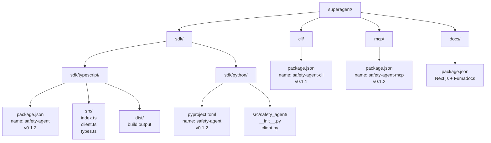
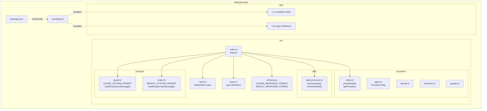
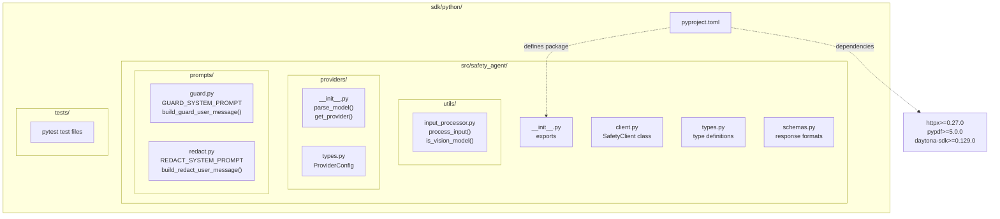
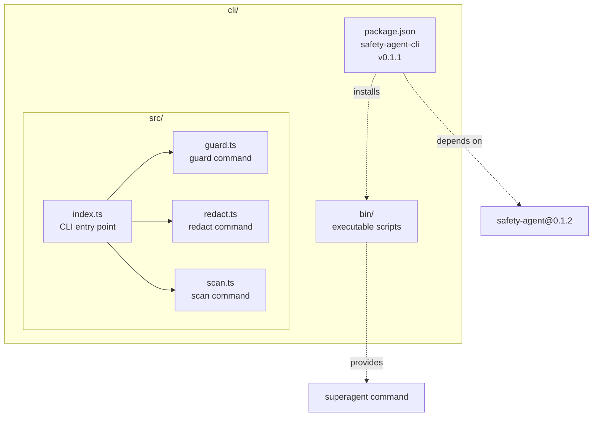
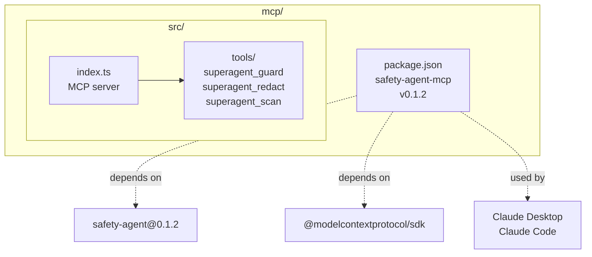
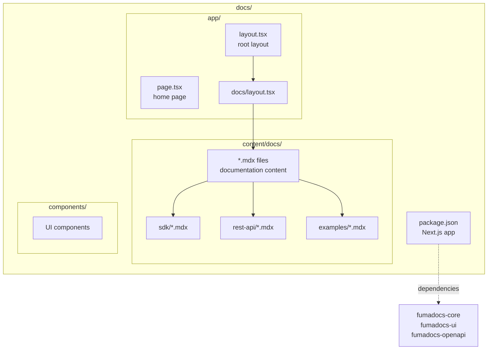

<!-- source: DeepWiki mcp.deepwiki.com · repo superagent-ai/superagent · page 7.1 Project Structure · fetched 2026-10-26 -->

# Project Structure

<details>
<summary>Relevant source files</summary>

The following files were used as context for generating this wiki page:

- [.gitignore](.gitignore)
- [CHANGELOG.md](CHANGELOG.md)
- [sdk/python/pyproject.toml](sdk/python/pyproject.toml)
- [sdk/typescript/package.json](sdk/typescript/package.json)
- [sdk/typescript/src/index.ts](sdk/typescript/src/index.ts)

</details>


This document describes the monorepo structure of the Superagent codebase, including the organization of SDKs, command-line tools, documentation, and supporting infrastructure. It covers directory layout, package organization, build configuration, and development workflows.

For instructions on building components from source, see [Building from Source](#7.2). For testing procedures, see [Testing](#7.3). For documentation site development, see [Documentation Site](#7.4).

## Repository Layout

The Superagent repository is organized as a monorepo containing multiple related packages. The top-level structure divides components by type and programming language.



**Sources:** [sdk/typescript/package.json:1-52](), [sdk/python/pyproject.toml:1-51](), [.gitignore:1-120]()

## Core Packages

The repository contains four primary distributable packages and one documentation site.

| Package | Directory | Language | Version | Published To | Purpose |
|---------|-----------|----------|---------|--------------|---------|
| `safety-agent` | `sdk/typescript/` | TypeScript | 0.1.2 | npm | Core SDK for Node.js applications |
| `safety-agent` | `sdk/python/` | Python | 0.1.2 | PyPI | Core SDK for Python applications |
| `safety-agent-cli` | `cli/` | TypeScript | 0.1.1 | npm | Command-line interface tool |
| `safety-agent-mcp` | `mcp/` | TypeScript | 0.1.2 | npm | Model Context Protocol server |
| Documentation | `docs/` | TypeScript | N/A | Deployed | Next.js documentation site |

**Sources:** [sdk/typescript/package.json:2-3](), [sdk/python/pyproject.toml:2-3]()

## TypeScript SDK Structure

The TypeScript SDK (`sdk/typescript/`) implements the core safety client and is consumed by both the CLI and MCP server.



### Key TypeScript SDK Exports

The main entry point [sdk/typescript/src/index.ts:1-55]() exports:

- **Client Creation**: `createClient()` function and `SafetyClient` class
- **Type Definitions**: `ClientConfig`, `GuardInput`, `GuardOptions`, `RedactOptions`, `ScanOptions`, `GuardResponse`, `RedactResponse`, `ScanResponse`
- **Utilities**: `processInput()`, `isVisionModel()`
- **Provider Abstraction**: `providers`, `parseModel()`, `getProvider()`
- **Response Schemas**: `GUARD_RESPONSE_FORMAT`, `REDACT_RESPONSE_FORMAT`
- **Prompt Systems**: `GUARD_SYSTEM_PROMPT`, `buildGuardUserMessage()`, `REDACT_SYSTEM_PROMPT`, `buildRedactUserMessage()`

**Sources:** [sdk/typescript/src/index.ts:1-55](), [sdk/typescript/package.json:1-52]()

## Python SDK Structure

The Python SDK (`sdk/python/`) mirrors the TypeScript SDK's functionality with an equivalent API surface.



### Python Package Configuration

The [sdk/python/pyproject.toml:1-51]() defines:

- **Package Name**: `safety-agent` (matches TypeScript SDK)
- **Version**: `0.1.2` (synchronized with TypeScript)
- **Python Requirements**: `>=3.10`
- **Dependencies**: `httpx`, `pypdf`, `daytona-sdk`
- **Dev Dependencies**: `pytest`, `pytest-asyncio`, `python-dotenv`
- **Build System**: Hatchling
- **Package Location**: `src/safety_agent`

**Sources:** [sdk/python/pyproject.toml:1-51]()

## CLI Package Structure

The CLI package (`cli/`) provides a command-line interface built on top of the TypeScript SDK.



The CLI exposes three commands:
- `superagent guard` - Security analysis via stdin or file
- `superagent redact` - PII/PHI redaction
- `superagent scan` - Repository scanning

**Sources:** [sdk/typescript/package.json:1-52]()

## MCP Server Package Structure

The MCP package (`mcp/`) implements the Model Context Protocol server for Claude integration.



The MCP server exposes three tools that wrap the TypeScript SDK:
- `superagent_guard` - Guard tool for Claude
- `superagent_redact` - Redact tool for Claude
- `superagent_scan` - Scan tool for Claude

**Sources:** [sdk/typescript/package.json:1-52]()

## Documentation Site Structure

The documentation site (`docs/`) is built with Next.js and Fumadocs framework.



**Sources:** None directly provided, but inferred from architecture diagrams.

## Build Configuration

### TypeScript Build

The TypeScript SDK uses native TypeScript compiler configuration in [sdk/typescript/package.json:18-23]():

```json
"scripts": {
  "build": "tsc",
  "dev": "tsc --watch",
  "test": "vitest run",
  "test:watch": "vitest",
  "prepublishOnly": "npm run build"
}
```

Build artifacts are output to `dist/` directory, which is published to npm. The package specifies:
- **Main Entry**: `./dist/index.js`
- **Type Definitions**: `./dist/index.d.ts`
- **Module Type**: ESM (`"type": "module"`)
- **Node Requirement**: `>=18.0.0`

**Sources:** [sdk/typescript/package.json:5-46]()

### Python Build

The Python SDK uses Hatchling as the build backend specified in [sdk/python/pyproject.toml:33-38]():

```toml
[build-system]
requires = ["hatchling"]
build-backend = "hatchling.build"

[tool.hatch.build.targets.wheel]
packages = ["src/safety_agent"]
```

The package is located at `src/safety_agent` and supports Python `>=3.10`.

**Sources:** [sdk/python/pyproject.toml:8-38]()

## Dependency Management

### TypeScript Dependencies

The TypeScript SDK has minimal runtime dependencies specified in [sdk/typescript/package.json:47-51]():

- `@daytonaio/sdk` - Daytona sandbox integration for scan operations
- `ipaddr.js` - IP address validation
- `unpdf` - PDF processing

Dev dependencies include TypeScript, Vitest for testing, and dotenv.

**Sources:** [sdk/typescript/package.json:38-51]()

### Python Dependencies

The Python SDK dependencies are specified in [sdk/python/pyproject.toml:22-26]():

- `httpx>=0.27.0` - HTTP client for API requests
- `pypdf>=5.0.0` - PDF processing
- `daytona-sdk>=0.129.0` - Daytona sandbox integration

Dev dependencies include pytest, pytest-asyncio, and python-dotenv.

**Sources:** [sdk/python/pyproject.toml:22-45]()

## Version Synchronization

The repository maintains synchronized versions across related packages:

| Package | Version | File |
|---------|---------|------|
| TypeScript SDK | 0.1.2 | [sdk/typescript/package.json:3]() |
| Python SDK | 0.1.2 | [sdk/python/pyproject.toml:3]() |
| MCP Server | 0.1.2 | Inferred from architecture |
| CLI | 0.1.1 | Inferred from architecture |

The SDKs and MCP server share version 0.1.2, ensuring API compatibility. The CLI is at 0.1.1, likely reflecting independent release cycles.

**Sources:** [sdk/typescript/package.json:3](), [sdk/python/pyproject.toml:3]()

## Ignored Files and Directories

The [.gitignore:1-120]() file excludes common build artifacts, dependencies, and development files:

### Build Outputs
- `node_modules/`, `dist/`, `build/`, `target/`
- Python: `__pycache__/`, `*.py[cod]`, `.egg-info/`

### Development Files
- Virtual environments: `venv/`, `.venv/`
- Environment variables: `.env`, `.env.local`, `.env.*.local`
- Lock files: `sdk/python/uv.lock`
- Editor configs: `.vscode/`, `.idea/`, `.claude/`

### AI Model Files
- `models/`, `*.gguf` - Excluded to prevent large model files in version control

**Sources:** [.gitignore:1-120]()

## Package Publication

The TypeScript packages use `prepublishOnly` scripts to ensure builds run before npm publication. The Python package uses Hatchling's build system for PyPI distribution.

Both SDKs maintain consistent metadata:
- **License**: MIT
- **Repository**: https://github.com/superagent-ai/superagent
- **Homepage**: https://superagent.sh
- **Documentation**: https://docs.superagent.sh

**Sources:** [sdk/typescript/package.json:32-37](), [sdk/python/pyproject.toml:28-31]()

---

