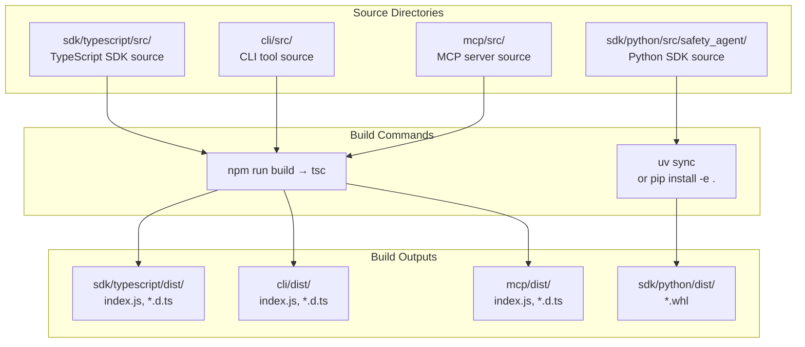
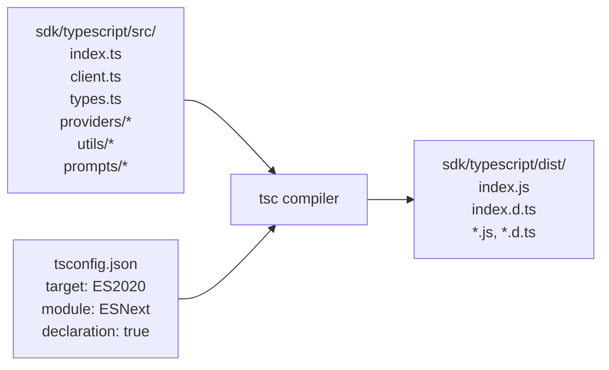
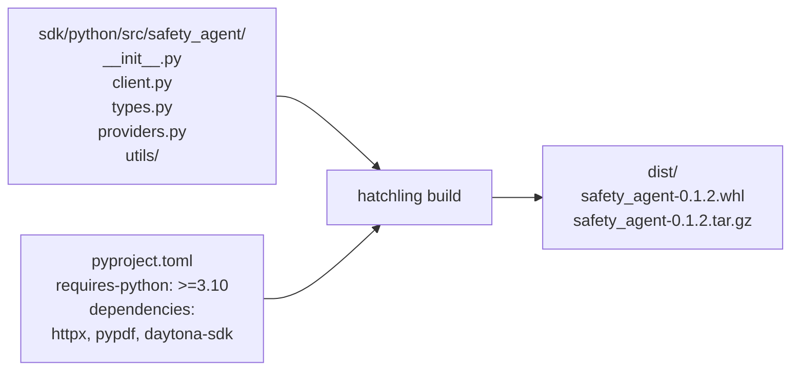
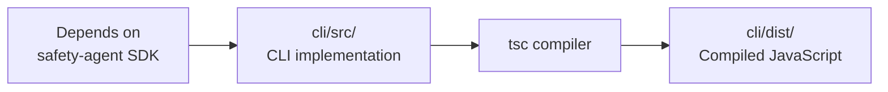
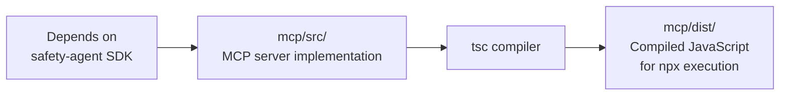
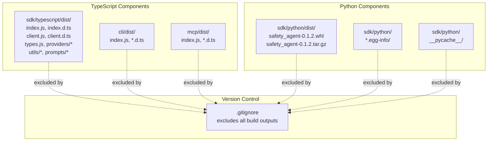
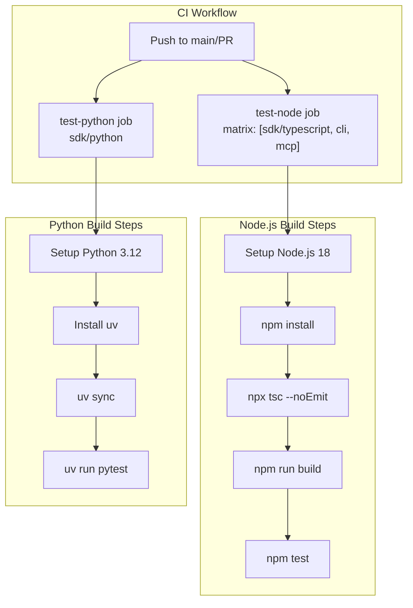

<!-- source: DeepWiki mcp.deepwiki.com · repo superagent-ai/superagent · page 7.2 Building from Source · fetched 2026-10-26 -->

# Building from Source

<details>
<summary>Relevant source files</summary>

The following files were used as context for generating this wiki page:

- [.github/workflows/ci.yml](.github/workflows/ci.yml)
- [CHANGELOG.md](CHANGELOG.md)
- [sdk/python/pyproject.toml](sdk/python/pyproject.toml)
- [sdk/python/src/safety_agent/__init__.py](sdk/python/src/safety_agent/__init__.py)
- [sdk/python/tests/test_scan.py](sdk/python/tests/test_scan.py)
- [sdk/typescript/package.json](sdk/typescript/package.json)
- [sdk/typescript/src/index.ts](sdk/typescript/src/index.ts)
- [sdk/typescript/tsconfig.json](sdk/typescript/tsconfig.json)

</details>


This document explains how to build Superagent components from source code. The repository contains four primary components: the TypeScript SDK, Python SDK, CLI tool, and MCP server. Each component has its own build process and tooling.

For information about running tests, see page 7.3. For information about the documentation site, see page 7.4.

## Prerequisites

Building from source requires the following tools installed on your system:

| Component | Required Tools | Version |
|-----------|---------------|---------|
| TypeScript SDK | Node.js, npm | >=18.0.0 |
| Python SDK | Python, pip or uv | >=3.10 |
| CLI | Node.js, npm | >=18.0.0 |
| MCP Server | Node.js, npm | >=18.0.0 |
| Documentation | Node.js, npm | >=18.0.0 |

The repository uses a multi-language build system where each component has its own build tooling and process.

Sources: [sdk/typescript/package.json:44-46](), [sdk/python/pyproject.toml:8](), [.github/workflows/ci.yml:20-23]()

## Build System Architecture

**Build System Overview**



The Superagent codebase contains four independently buildable components. TypeScript components (SDK, CLI, MCP) use `tsc` for compilation to JavaScript and type definition generation. The Python SDK uses standard Python packaging tools (`pip` or `uv`).

Sources: [sdk/typescript/package.json:18-23](), [sdk/python/pyproject.toml:33-38](), [.github/workflows/ci.yml:29-35]()

## Building TypeScript SDK

The TypeScript SDK is located in `sdk/typescript/` and exports the `SafetyClient` class along with related types and utilities.

**TypeScript SDK Build Process**



### Build Commands

```bash
# Navigate to SDK directory
cd sdk/typescript

# Install dependencies
npm install

# Build (runs tsc)
npm run build

# Watch mode for development
npm run dev

# Run tests
npm test
```

The `npm run build` command executes `tsc` which reads [sdk/typescript/tsconfig.json:1-21]() and compiles TypeScript source to JavaScript. The configuration specifies:
- `target: ES2020` - Output ECMAScript 2020 code
- `module: ESNext` - Use modern ES modules
- `declaration: true` - Generate `.d.ts` type definitions
- `outDir: ./dist` - Output to `dist/` directory
- `rootDir: ./src` - Source files in `src/`

### Build Outputs

The build produces the following in `sdk/typescript/dist/`:

| File | Purpose |
|------|---------|
| `index.js` | Main entry point exporting `createClient`, `SafetyClient` |
| `index.d.ts` | TypeScript type definitions for imports |
| `client.js` | `SafetyClient` class implementation |
| `types.js` | Type definitions compilation artifact |
| `providers/*.js` | Provider abstraction (OpenAI, Anthropic, etc.) |
| `utils/*.js` | Utility functions like `processInput`, `isVisionModel` |
| `prompts/*.js` | Guard and redact prompt templates |
| `schemas.js` | Response format schemas |

The package is configured as an ES module with exports defined in [sdk/typescript/package.json:9-13]():

```json
"exports": {
  ".": {
    "types": "./dist/index.d.ts",
    "import": "./dist/index.js"
  }
}
```

Sources: [sdk/typescript/package.json:1-52](), [sdk/typescript/tsconfig.json:1-21](), [sdk/typescript/src/index.ts:1-55](), [.github/workflows/ci.yml:29-35]()

## Building Python SDK

The Python SDK is located in `sdk/python/` and uses modern Python packaging with `pyproject.toml` and the `hatchling` build backend.

**Python SDK Build Architecture**



### Build Commands

```bash
# Navigate to Python SDK directory
cd sdk/python

# Option 1: Development installation with uv (recommended)
uv sync

# Option 2: Development installation with pip
pip install -e .

# Option 3: Build distribution packages
pip install build
python -m build
```

The Python SDK configuration is defined in [sdk/python/pyproject.toml:1-51]():
- Package name: `safety-agent` (version 0.1.2)
- Requires Python >=3.10
- Dependencies: `httpx`, `pypdf`, `daytona-sdk`
- Build system: `hatchling`
- Dev dependencies: `pytest`, `pytest-asyncio`, `python-dotenv`

### Development Mode

Installing with `pip install -e .` or `uv sync` creates an editable installation:
- Changes to source files are immediately reflected
- No reinstallation needed after code modifications
- Ideal for development and testing

The package structure follows the `src` layout pattern with the main package at `src/safety_agent/`.

### Build Outputs

The `python -m build` command produces:

| File | Purpose |
|------|---------|
| `dist/safety_agent-0.1.2.whl` | Wheel distribution (pip-installable) |
| `dist/safety_agent-0.1.2.tar.gz` | Source distribution |

The package exports the following main symbols from [sdk/python/src/safety_agent/__init__.py:1-52]():
- `SafetyClient` - Main client class
- `create_client()` - Client factory function
- Type definitions: `GuardInput`, `GuardOptions`, `RedactOptions`, `ScanOptions`
- Response types: `GuardResponse`, `RedactResponse`, `ScanResponse`

Sources: [sdk/python/pyproject.toml:1-51](), [sdk/python/src/safety_agent/__init__.py:1-52](), [.github/workflows/ci.yml:60-74]()

## Building CLI Tool

The CLI tool (`safety-agent-cli`) is located in `cli/` and provides terminal access to guard, redact, and scan operations.

**CLI Build Architecture**



### Build Commands

```bash
# Navigate to CLI directory
cd cli

# Install dependencies (including safety-agent SDK)
npm install

# Build
npm run build

# Run tests
npm test
```

The CLI is built using TypeScript and compiled to JavaScript. It imports the TypeScript SDK as a dependency and wraps it with command-line argument parsing.

### Build Configuration

The CLI uses the same TypeScript compiler configuration pattern as the SDK, compiling source files from `cli/src/` to `cli/dist/`.

Sources: [.github/workflows/ci.yml:14-15](), [.github/workflows/ci.yml:29-35]()

## Building MCP Server

The MCP (Model Context Protocol) server is located in `mcp/` and provides Claude Desktop/Code integration.

**MCP Server Build Architecture**



### Build Commands

```bash
# Navigate to MCP directory
cd mcp

# Install dependencies (including safety-agent SDK)
npm install

# Build
npm run build

# Run tests
npm test
```

The MCP server is built using TypeScript and depends on the `safety-agent` SDK. It implements the Model Context Protocol specification to expose guard, redact, and scan operations as MCP tools.

### Build Configuration

The MCP server uses TypeScript compilation similar to the SDK and CLI, outputting to `mcp/dist/`.

Sources: [.github/workflows/ci.yml:14-15](), [.github/workflows/ci.yml:29-35]()

## Build Artifacts and Output Structure

**Complete Build Output Structure**



All build outputs are excluded from version control via `.gitignore` to prevent accidental commits. CI workflows build and publish these artifacts to npm and PyPI.

### Build Output Locations

| Component | Output Directory | Artifacts |
|-----------|------------------|-----------|
| TypeScript SDK | `sdk/typescript/dist/` | `index.js`, `index.d.ts`, `client.js`, `types.js`, `providers/*`, `utils/*`, `prompts/*`, `schemas.js` |
| Python SDK | `sdk/python/dist/` | `safety_agent-0.1.2.whl`, `safety_agent-0.1.2.tar.gz` |
| CLI | `cli/dist/` | `index.js`, `*.d.ts` |
| MCP Server | `mcp/dist/` | `index.js`, `*.d.ts` |

### Package Exports

The TypeScript SDK exports are defined in [sdk/typescript/package.json:9-13]():

```json
"exports": {
  ".": {
    "types": "./dist/index.d.ts",
    "import": "./dist/index.js"
  }
}
```

The Python SDK exports are defined via [sdk/python/pyproject.toml:37-38]():

```toml
[tool.hatch.build.targets.wheel]
packages = ["src/safety_agent"]
```

Sources: [sdk/typescript/package.json:9-16](), [sdk/python/pyproject.toml:37-38](), [.github/workflows/ci.yml:29-39]()

## CI Build Pipeline

The CI system builds and tests all components in parallel using GitHub Actions.

**CI Build Matrix**



### Node.js Build Job

The CI workflow at [.github/workflows/ci.yml:10-51]() defines the `test-node` job which:

1. Runs on Ubuntu latest
2. Uses a matrix strategy to build three packages: `sdk/typescript`, `cli`, `mcp`
3. Sets up Node.js 18
4. Installs dependencies with `npm install`
5. Type checks with `npx tsc --noEmit`
6. Builds with `npm run build`
7. Runs tests with `npm test`

Required environment variables for testing:
- `SUPERAGENT_API_KEY`
- `DAYTONA_API_KEY`
- Provider API keys (Anthropic, OpenAI, Google, etc.)

### Python Build Job

The `test-python` job at [.github/workflows/ci.yml:53-79]() builds the Python SDK:

1. Runs on Ubuntu latest
2. Sets up Python 3.12
3. Installs `uv` package manager
4. Installs dependencies with `uv sync`
5. Runs tests with `uv run pytest`

Required environment variables:
- `SUPERAGENT_API_KEY`
- `DAYTONA_API_KEY`
- `ANTHROPIC_API_KEY`
- `OPENAI_API_KEY`

Sources: [.github/workflows/ci.yml:1-80]()

## Version Management

Component versions are maintained in their respective package manifests:

| Component | Version File | Current Version |
|-----------|-------------|-----------------|
| TypeScript SDK | `sdk/typescript/package.json` | 0.1.2 |
| Python SDK | `sdk/python/pyproject.toml` | 0.1.2 |
| CLI | `cli/package.json` | 0.1.1 |
| MCP Server | `mcp/package.json` | 0.1.2 |

### TypeScript Version

The TypeScript SDK version is defined in [sdk/typescript/package.json:3]():

```json
"version": "0.1.2"
```

### Python Version

The Python SDK version is defined in [sdk/python/pyproject.toml:3]():

```toml
version = "0.1.2"
```

Both SDKs maintain version parity (0.1.2) to ensure API compatibility. The CLI and MCP server versions may differ as they wrap the SDKs.

The `prepublishOnly` script in [sdk/typescript/package.json:23]() ensures builds are current before publishing:

```json
"prepublishOnly": "npm run build"
```

Sources: [sdk/typescript/package.json:3](), [sdk/python/pyproject.toml:3]()

## Troubleshooting Build Issues

Common build problems and solutions:

| Issue | Solution |
|-------|----------|
| TypeScript compilation errors | Ensure `tsconfig.json` is present; check Node.js version compatibility |
| Missing Python dependencies | Run `pip install -e .` from `sdk/python/` |
| Rust linker errors | Install platform-specific build tools (gcc/clang on Linux, Xcode on macOS) |
| Docker build context errors | Run from repository root, not subdirectory |
| Version mismatch in package | Manually update version in `package.json` or `Cargo.toml` |
| npm cache corruption | Run `npm cache clean --force` and retry |

For TypeScript builds, check for:
- Correct `tsconfig.json` configuration
- All dependencies installed via `npm ci`
- Compatible Node.js version (18.x, 20.x, or 22.x)

For Rust builds, ensure:
- Rust toolchain is up to date (`rustup update`)
- Target platform is installed (`rustup target add <target>`)
- System linker and C compiler are available

Sources: [.github/workflows/node-release.yml:40-42](), [.github/workflows/rust-release.yml:41-44]()

---

