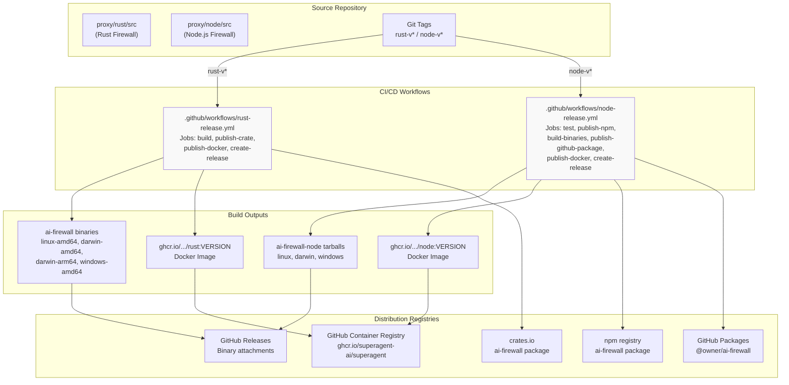
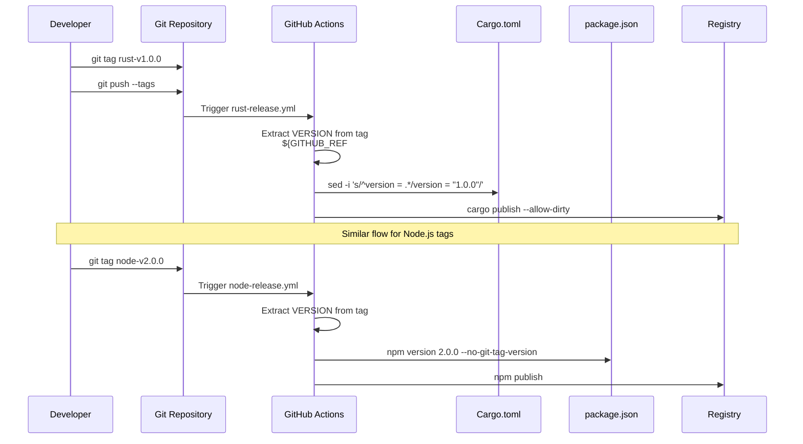
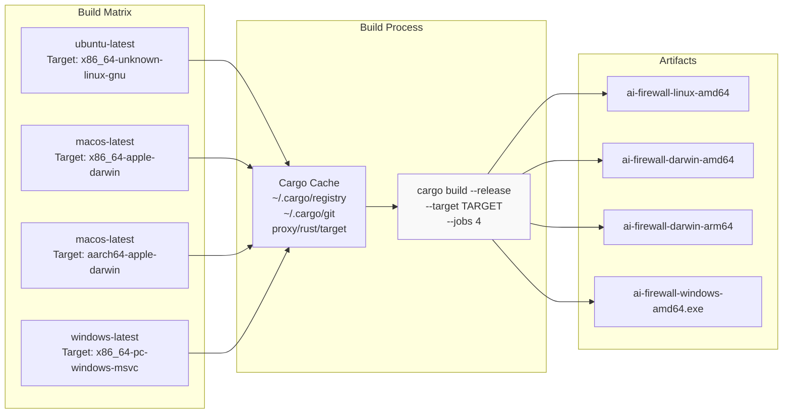
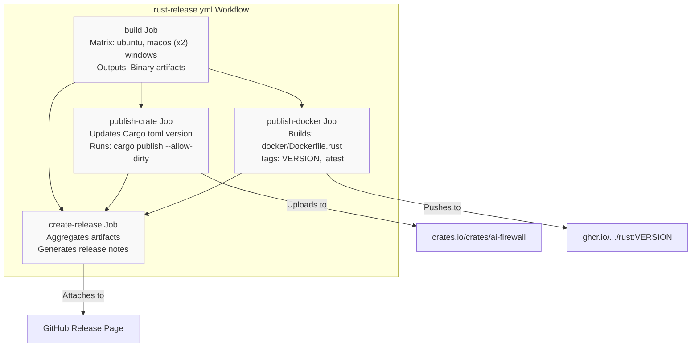
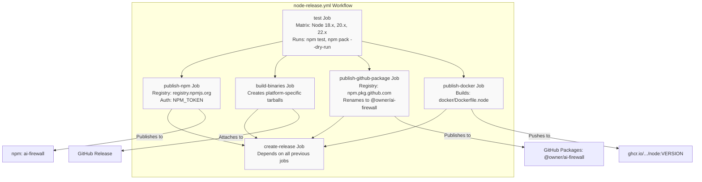
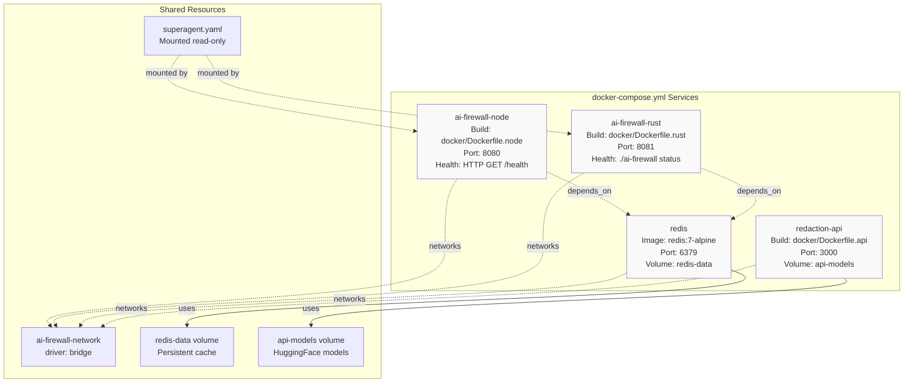
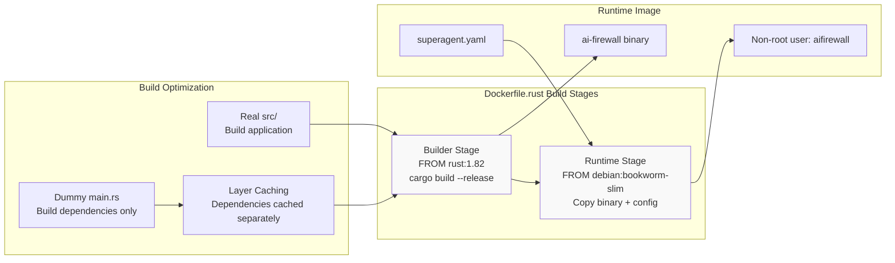

<!-- source: DeepWiki mcp.deepwiki.com · repo superagent-ai/superagent · page 8 Deployment · fetched 2026-10-26 -->

# Distribution & Deployment

<details>
<summary>Relevant source files</summary>

The following files were used as context for generating this wiki page:

- [CHANGELOG.md](CHANGELOG.md)
- [README.md](README.md)
- [sdk/python/pyproject.toml](sdk/python/pyproject.toml)
- [sdk/typescript/package.json](sdk/typescript/package.json)
- [sdk/typescript/src/index.ts](sdk/typescript/src/index.ts)

</details>


This document describes how Superagent components are packaged, released, and distributed across multiple registries and deployment targets. It covers the automated release workflows, versioning strategy, distribution channels, and deployment options.

For detailed information about the release automation process, see [Release Process](#10.1). For specifics on package publishing, see [Package Distribution](#10.2). For Docker-specific deployment, see [Docker Images](#10.3).

## Overview

Superagent uses a multi-channel distribution strategy to support different language ecosystems and deployment scenarios. The system maintains separate release pipelines for Rust and Node.js components, each triggered by version-specific Git tags and publishing to multiple registries.

### Distribution Architecture



**Sources:** [.github/workflows/rust-release.yml:1-162](), [.github/workflows/node-release.yml:1-271]()

### Distribution Channels

The project publishes to five primary distribution channels, each serving different use cases:

| Channel | Package Name | Component | Installation Command | Use Case |
|---------|--------------|-----------|---------------------|----------|
| **crates.io** | `ai-firewall` | Rust Firewall | `cargo install ai-firewall` | Rust developers, performance-critical deployments |
| **npm Registry** | `ai-firewall` | Node.js Firewall | `npm install -g ai-firewall` | Node.js developers, quick installation |
| **GitHub Packages** | `@owner/ai-firewall` | Node.js Firewall | `npm install -g @owner/ai-firewall` | Private/enterprise deployments |
| **GitHub Container Registry** | `ghcr.io/superagent-ai/superagent/rust:VERSION`<br/>`ghcr.io/superagent-ai/superagent/node:VERSION` | Docker Images | `docker pull ghcr.io/...` | Containerized deployments |
| **GitHub Releases** | Binary artifacts | Pre-built binaries | Manual download | Direct binary execution |

**Sources:** [.github/workflows/rust-release.yml:97-99](), [.github/workflows/node-release.yml:78-82](), [.github/workflows/node-release.yml:188-190](), [.github/workflows/rust-release.yml:118-126](), [.github/workflows/node-release.yml:211-219]()

## Tag-Based Versioning

The release system uses Git tags as the single source of truth for versioning. Two tag patterns trigger separate release workflows:

- **`rust-v*`**: Triggers Rust package releases (e.g., `rust-v0.1.0`)
- **`node-v*`**: Triggers Node.js package releases (e.g., `node-v1.2.3`)

### Version Extraction and Application



**Sources:** [.github/workflows/rust-release.yml:87-95](), [.github/workflows/node-release.yml:63-76]()

The workflows extract the version number from the tag name and automatically update package manifests during the build process:

- **Rust**: Uses `sed` to update the `version` field in `Cargo.toml` at [.github/workflows/rust-release.yml:94]()
- **Node.js**: Uses `npm version` to update `package.json` at [.github/workflows/node-release.yml:73]()

Both workflows include the `--allow-dirty` and `--no-git-tag-version` flags to allow publishing with uncommitted version changes, ensuring the tagged version matches the published artifact.

## Multi-Platform Binary Builds

Both Rust and Node.js workflows build platform-specific binaries for three major operating systems:

### Rust Build Matrix



**Sources:** [.github/workflows/rust-release.yml:14-76]()

The Rust build matrix at [.github/workflows/rust-release.yml:16-34]() defines four build targets with specific platform configurations. Each build uses Cargo's caching mechanism to speed up dependency compilation by caching registry, git dependencies, and build artifacts at [.github/workflows/rust-release.yml:46-53]().

### Node.js Build Matrix

The Node.js workflow at [.github/workflows/node-release.yml:84-151]() creates platform-specific distribution packages containing the complete runtime:

| Platform | Artifact Name | Contents |
|----------|--------------|----------|
| Linux | `ai-firewall-node-linux-amd64.tar.gz` | `src/`, `package.json`, `node_modules/`, `superagent.yaml` |
| macOS | `ai-firewall-node-darwin-amd64.tar.gz` | `src/`, `package.json`, `node_modules/`, `superagent.yaml` |
| Windows | `ai-firewall-node-windows-amd64.zip` | `src/`, `package.json`, `node_modules/`, `superagent.yaml` |

Each package includes production dependencies installed via `npm ci --only=production` at [.github/workflows/node-release.yml:111]() and the default configuration file for immediate use.

## Release Pipeline Jobs

### Rust Release Pipeline



**Sources:** [.github/workflows/rust-release.yml:13-162]()

The Rust release workflow defines four sequential jobs with dependencies managed via `needs`:

1. **`build`** (lines 14-76): Parallel builds across platforms
2. **`publish-crate`** (lines 78-99): Publishes to crates.io using `CARGO_TOKEN`
3. **`publish-docker`** (lines 101-126): Builds and pushes Docker images to GHCR
4. **`create-release`** (lines 128-162): Creates GitHub release with all artifacts

### Node.js Release Pipeline



**Sources:** [.github/workflows/node-release.yml:13-271]()

The Node.js workflow includes comprehensive testing before release:

1. **`test`** (lines 14-43): Validates across Node.js versions 18.x, 20.x, and 22.x
2. **`publish-npm`** (lines 44-82): Publishes to public npm registry
3. **`build-binaries`** (lines 84-151): Creates platform-specific distribution packages
4. **`publish-github-package`** (lines 153-192): Publishes to GitHub Packages with scoped name
5. **`publish-docker`** (lines 194-219): Builds and pushes Docker images
6. **`create-release`** (lines 221-271): Aggregates all artifacts into GitHub release

## Docker Deployment Stack

The project provides a complete Docker Compose stack for deploying the AI Firewall with supporting infrastructure:

### Docker Compose Services



**Sources:** [docker/docker-compose.yml:1-106]()

The compose file at [docker/docker-compose.yml]() defines four services that work together:

| Service | Image/Build | Ports | Volumes | Health Check |
|---------|-------------|-------|---------|--------------|
| `ai-firewall-node` | `docker/Dockerfile.node` | 8080:8080 | `superagent.yaml:ro` | Node.js HTTP check on `/health` |
| `ai-firewall-rust` | `docker/Dockerfile.rust` | 8081:8080 | `superagent.yaml:ro` | `./ai-firewall status` command |
| `redis` | `redis:7-alpine` | 6379:6379 | `redis-data` | `redis-cli ping` |
| `redaction-api` | `docker/Dockerfile.api` | 3000:3000 | `api-models` | HTTP GET `/health` |

### Deployment Modes

The Docker services support two operational modes controlled by environment variables:

**Standard Mode** (default at [docker/docker-compose.yml:14]()):
```yaml
MULTITENANT=false
```
- Reads configuration from `superagent.yaml` file
- Single tenant operation
- Static configuration

**Multitenant Mode** (commented at [docker/docker-compose.yml:16-20]()):
```yaml
MULTITENANT=true
MULTITENANT_CONFIG_API_URL=http://api:3000/api/proxy/
REDIS_URL=redis://redis:6379
CONFIG_CACHE_TTL=3600
NINJA_LM_API_URL=http://redaction-api:3000/redact
```
- Fetches per-tenant configuration from API
- Uses Redis for configuration caching
- Supports dynamic configuration updates

### Multi-Stage Docker Build



**Sources:** [docker/Dockerfile.rust:1-49]()

The Rust Dockerfile at [docker/Dockerfile.rust]() uses a multi-stage build pattern to optimize image size:

1. **Builder stage** (lines 2-18): 
   - Uses `rust:1.82` base image
   - Creates dummy `main.rs` to pre-build dependencies at line 10
   - Replaces with real source and rebuilds at line 18

2. **Runtime stage** (lines 20-49):
   - Uses minimal `debian:bookworm-slim` base at line 21
   - Copies only the compiled binary at line 31
   - Creates non-root user `aifirewall` at lines 37-39
   - Includes health check using `./ai-firewall status` at line 45

The CMD at line 49 starts the firewall with default configuration:
```dockerfile
CMD ["./ai-firewall", "start", "--port", "8080", "--config", "superagent.yaml"]
```

## Release Artifacts

Each release produces multiple artifacts for different deployment scenarios:

### Rust Release Artifacts

Generated by [.github/workflows/rust-release.yml:128-161]():

```markdown
## Rust Package Release

### Installation Options

**Via crates.io:**
```bash
cargo install ai-firewall
```

**Via Docker:**
```bash
docker pull ghcr.io/${{ github.repository }}/rust:${{ VERSION }}
```

**Via binary download:**
Download the appropriate binary for your platform below.
```

Artifacts attached to release:
- `ai-firewall-linux-amd64`
- `ai-firewall-darwin-amd64`
- `ai-firewall-darwin-arm64`
- `ai-firewall-windows-amd64.exe`

### Node.js Release Artifacts

Generated by [.github/workflows/node-release.yml:221-269]():

```markdown
## Node.js Package Release

### Installation Options

**Via npm:**
```bash
npm install -g ai-firewall
```

**Via GitHub Packages:**
```bash
npm install -g @${{ github.repository_owner }}/ai-firewall
```

**Via Docker:**
```bash
docker pull ghcr.io/${{ github.repository }}/node:${{ VERSION }}
```

**Via binary download:**
Download the appropriate binary for your platform and extract it.

### Usage
```bash
ai-firewall start --port 8080 --config superagent.yaml
```
```

Artifacts attached to release:
- `ai-firewall-node-linux-amd64.tar.gz`
- `ai-firewall-node-darwin-amd64.tar.gz`
- `ai-firewall-node-windows-amd64.zip`

**Sources:** [.github/workflows/rust-release.yml:128-161](), [.github/workflows/node-release.yml:221-269]()

## Authentication and Secrets

The workflows require several GitHub secrets for publishing to external registries:

| Secret | Used By | Purpose | Scope |
|--------|---------|---------|-------|
| `CARGO_TOKEN` | `rust-release.yml:99` | Publishes to crates.io | Rust package publishing |
| `NPM_TOKEN` | `node-release.yml:82` | Publishes to npm public registry | Node.js package publishing |
| `GITHUB_TOKEN` | Both workflows | Publishes to GHCR and GitHub Packages | Automatically provided by GitHub Actions |

The `GITHUB_TOKEN` is automatically provided with appropriate permissions defined at the workflow level:

```yaml
permissions:
  contents: write    # For creating releases
  packages: write    # For publishing to GHCR
```

These permissions are declared in both [.github/workflows/rust-release.yml:9-11]() and [.github/workflows/node-release.yml:9-11]().

## Deployment Health Checks

All Docker services include health checks to ensure proper startup and ongoing operation:

| Service | Health Check Command | Interval | Timeout | Retries | Start Period |
|---------|---------------------|----------|---------|---------|--------------|
| `ai-firewall-node` | Node.js HTTP GET to `/health` | 30s | 10s | 3 | 40s |
| `ai-firewall-rust` | `./ai-firewall status` | 30s | 3s | 3 | 5s |
| `redis` | `redis-cli ping` | 30s | 3s | 3 | - |
| `redaction-api` | `curl -f http://localhost:3000/health` | 30s | 10s | 3 | 60s |

**Sources:** [docker/docker-compose.yml:26-31](), [docker/docker-compose.yml:55-60](), [docker/docker-compose.yml:71-75](), [docker/docker-compose.yml:91-96]()

The health checks ensure services are ready before dependent services start. For example, both firewall services declare `depends_on: redis` at [docker/docker-compose.yml:24-25]() and [docker/docker-compose.yml:53-54](), ensuring Redis is healthy before the firewalls start.

---

