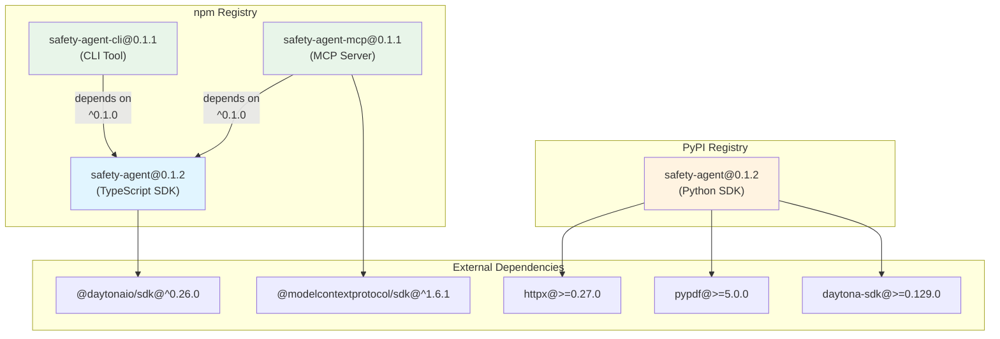
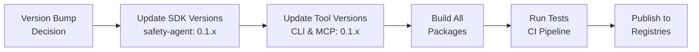
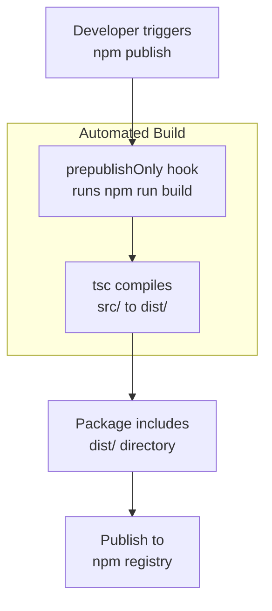
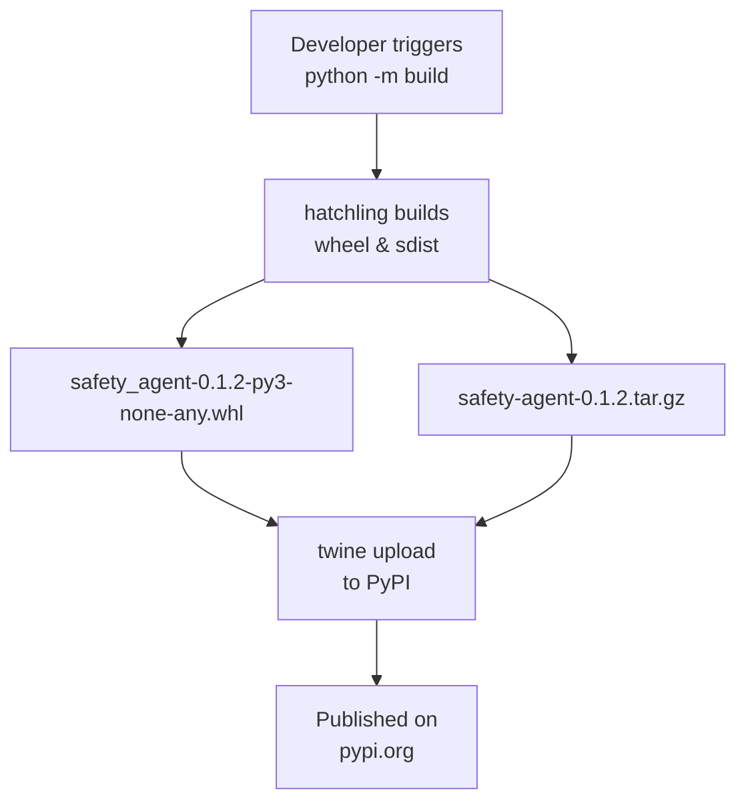
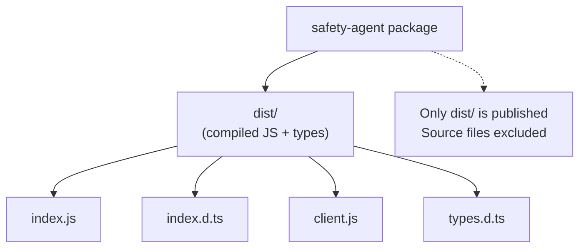
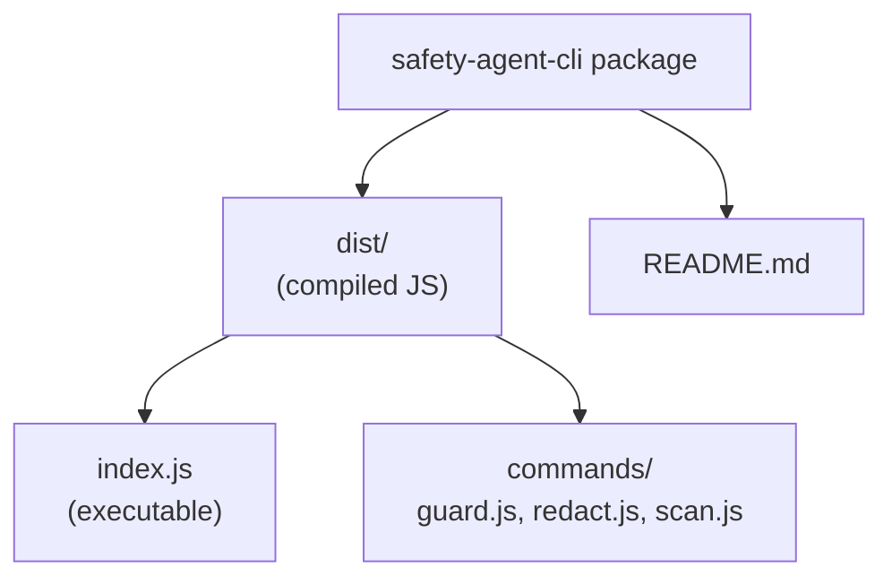
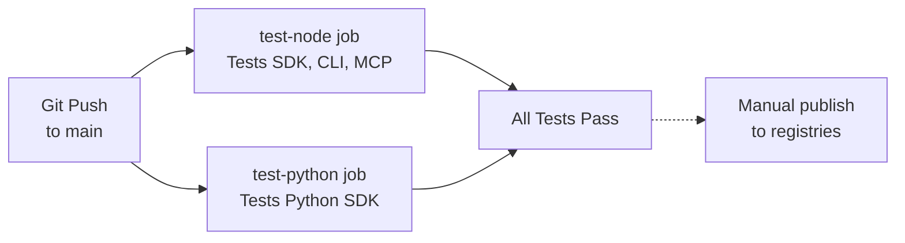

<!-- source: DeepWiki mcp.deepwiki.com · repo superagent-ai/superagent · page 8.1 Package Distribution · fetched 2026-10-26 -->

# Package Distribution

<details>
<summary>Relevant source files</summary>

The following files were used as context for generating this wiki page:

- [CHANGELOG.md](CHANGELOG.md)
- [cli/package-lock.json](cli/package-lock.json)
- [cli/package.json](cli/package.json)
- [cli/src/commands/guard.ts](cli/src/commands/guard.ts)
- [mcp/package-lock.json](mcp/package-lock.json)
- [mcp/package.json](mcp/package.json)
- [mcp/src/index.ts](mcp/src/index.ts)
- [sdk/python/pyproject.toml](sdk/python/pyproject.toml)
- [sdk/typescript/package.json](sdk/typescript/package.json)
- [sdk/typescript/src/index.ts](sdk/typescript/src/index.ts)

</details>


This document describes the publishing and distribution process for Superagent's four packages across npm (TypeScript SDK, CLI, MCP server) and PyPI (Python SDK). It covers package names, versioning strategy, build processes, and publication workflows.

For information about building packages from source during development, see [Building from Source](#7.2). For environment configuration required to use these packages, see [Environment Configuration](#8.2).

---

## Package Overview

The Superagent safety system distributes four distinct packages across two package registries:

| Package Name | Version | Registry | Type | Purpose |
|--------------|---------|----------|------|---------|
| `safety-agent` | 0.1.2 | npm | Library | TypeScript SDK for browser and Node.js |
| `safety-agent` | 0.1.2 | PyPI | Library | Python SDK for safety operations |
| `safety-agent-cli` | 0.1.1 | npm | CLI Tool | Command-line interface |
| `safety-agent-mcp` | 0.1.1 | npm | Server | MCP server for Claude integration |

**Sources:** [sdk/typescript/package.json:2-3](), [sdk/python/pyproject.toml:2-3](), [cli/package.json:2-3](), [mcp/package.json:2-3]()

---

## Package Dependency Architecture



The CLI and MCP packages both depend on the TypeScript SDK (`safety-agent`), creating a hierarchical dependency structure. The Python SDK is independent.

**Sources:** [cli/package.json:44-46](), [mcp/package.json:34-37](), [sdk/typescript/package.json:47-51](), [sdk/python/pyproject.toml:22-26]()

---

## Versioning Strategy

### Version Synchronization

The system follows a **coordinated versioning strategy** where related packages maintain version parity:

- **Core SDKs** (TypeScript and Python) share identical versions (`0.1.2`) to maintain feature parity
- **Tools** (CLI and MCP) share identical versions (`0.1.1`) and lag behind SDKs
- **Dependency constraints** use caret ranges (`^0.1.0`) to allow patch updates

### Version Number Format

All packages follow semantic versioning (`MAJOR.MINOR.PATCH`):

| Component | Current Values | Meaning |
|-----------|---------------|---------|
| MAJOR | 0 | Pre-1.0 development phase |
| MINOR | 1 | Feature releases |
| PATCH | 1-2 | Bug fixes and improvements |

**Sources:** [sdk/typescript/package.json:3](), [sdk/python/pyproject.toml:3](), [cli/package.json:3](), [mcp/package.json:3]()

### Version Update Workflow



Version bumps begin with the SDKs, followed by tools that depend on them. All packages are built and tested before publication.

**Sources:** [sdk/typescript/package.json:23](), [sdk/python/pyproject.toml:33-35](), [cli/package.json:18](), [mcp/package.json:13]()

---

## TypeScript SDK Distribution

### Package Configuration

The TypeScript SDK package (`safety-agent`) is configured as an ES module with TypeScript definitions:

```
Package: safety-agent
Version: 0.1.2
Main: ./dist/index.js
Types: ./dist/index.d.ts
Module Type: ES module
```

**Sources:** [sdk/typescript/package.json:2-14]()

### Build Process

The TypeScript SDK uses a straightforward TypeScript compilation pipeline:

| Script | Command | Purpose |
|--------|---------|---------|
| `build` | `tsc` | Compile TypeScript to JavaScript |
| `dev` | `tsc --watch` | Watch mode for development |
| `test` | `vitest run` | Run test suite |
| `prepublishOnly` | `npm run build` | Auto-build before publishing |

The `prepublishOnly` script ensures the package is always built before publication, preventing accidental publication of stale builds.

**Sources:** [sdk/typescript/package.json:18-23]()

### Publication Workflow



The publication process automatically compiles TypeScript source files before uploading to npm. Only the `dist/` directory is included in the published package.

**Sources:** [sdk/typescript/package.json:15-17](), [sdk/typescript/package.json:23]()

### Exported Modules

The package exports a comprehensive API surface through `index.ts`:

- **Core exports**: `createClient`, `SafetyClient`
- **Type exports**: `GuardInput`, `RedactOptions`, `ScanOptions`, response types
- **Utility exports**: `processInput`, `isVisionModel`
- **Provider exports**: `providers`, `parseModel`, `getProvider`
- **Schema exports**: `GUARD_RESPONSE_FORMAT`, `REDACT_RESPONSE_FORMAT`
- **Prompt exports**: Guard and redact system prompts

**Sources:** [sdk/typescript/src/index.ts:1-55]()

---

## Python SDK Distribution

### Package Configuration

The Python SDK package (`safety-agent`) uses modern Python packaging with `pyproject.toml`:

```
Package: safety-agent
Version: 0.1.2
Build System: hatchling
Python Requirement: >=3.10
License: MIT
```

**Sources:** [sdk/python/pyproject.toml:1-8]()

### Build System

The Python package uses **Hatchling** as its build backend:

| Configuration | Value | Purpose |
|---------------|-------|---------|
| `build-backend` | `hatchling.build` | PEP 517 compliant builder |
| `packages` | `["src/safety_agent"]` | Source directory mapping |
| `requires` | `["hatchling"]` | Build-time dependencies |

Hatchling handles the creation of wheel and source distributions automatically.

**Sources:** [sdk/python/pyproject.toml:33-38]()

### Publication Workflow



The Python build process generates both wheel and source distributions, which are uploaded to PyPI using `twine` or similar tools.

**Sources:** [sdk/python/pyproject.toml:33-38]()

### Package Classifiers

The Python package includes metadata classifiers for discoverability:

```python
Development Status :: 4 - Beta
Intended Audience :: Developers
License :: OSI Approved :: MIT License
Programming Language :: Python :: 3.10
Programming Language :: Python :: 3.11
Programming Language :: Python :: 3.12
Programming Language :: Python :: 3.13
Topic :: Software Development :: Libraries :: Python Modules
Topic :: Scientific/Engineering :: Artificial Intelligence
```

**Sources:** [sdk/python/pyproject.toml:10-21]()

---

## CLI Distribution

### Package Configuration

The CLI package (`safety-agent-cli`) provides the `superagent` command-line tool:

```
Package: safety-agent-cli
Version: 0.1.1
Binary: superagent -> ./dist/index.js
Node Requirement: >=18
```

**Sources:** [cli/package.json:2-9]()

### Binary Configuration

The package defines a single executable binary:

| Binary Name | Entry Point | Purpose |
|-------------|-------------|---------|
| `superagent` | `./dist/index.js` | Main CLI command |

When installed globally (`npm install -g safety-agent-cli`), this creates a `superagent` command in the system PATH.

**Sources:** [cli/package.json:7-9]()

### Build and Publication

The CLI uses the same build pattern as the TypeScript SDK:

| Script | Command | Purpose |
|--------|---------|---------|
| `build` | `tsc` | Compile TypeScript |
| `test` | `vitest run` | Run tests |
| `prepublishOnly` | `npm run build` | Pre-publish build |

**Sources:** [cli/package.json:14-18]()

### CLI Dependency on SDK

The CLI depends on the TypeScript SDK using a caret range:

```json
"dependencies": {
  "safety-agent": "^0.1.0"
}
```

This allows the CLI to receive patch updates to the SDK automatically while preventing breaking changes from minor version bumps during the 0.x development phase.

**Sources:** [cli/package.json:44-46]()

---

## MCP Server Distribution

### Package Configuration

The MCP server package (`safety-agent-mcp`) provides Claude Desktop integration:

```
Package: safety-agent-mcp
Version: 0.1.1
Binary: superagent-mcp -> dist/index.js
Node Requirement: >=18
```

**Sources:** [mcp/package.json:2-9]()

### Binary and Execution

The MCP server provides a single executable entry point:

| Binary Name | Entry Point | Usage |
|-------------|-------------|-------|
| `superagent-mcp` | `dist/index.js` | MCP server (stdio transport) |

The entry point includes a shebang (`#!/usr/bin/env node`) to make it directly executable.

**Sources:** [mcp/package.json:7-9](), [mcp/src/index.ts:1]()

### Build Process

| Script | Command | Purpose |
|--------|---------|---------|
| `build` | `tsc` | Compile TypeScript |
| `dev` | `tsx watch src/index.ts` | Development mode |
| `start` | `node dist/index.js` | Run compiled server |
| `test` | `vitest run` | Run tests |

Unlike the SDK and CLI, the MCP server **does not** include a `prepublishOnly` script. The package must be manually built before publication.

**Sources:** [mcp/package.json:10-15]()

### MCP Dependencies

The MCP server has two critical dependencies:

```json
"dependencies": {
  "@modelcontextprotocol/sdk": "^1.6.1",
  "safety-agent": "^0.1.0",
  "zod": "^3.23.8"
}
```

- `@modelcontextprotocol/sdk`: Provides MCP protocol implementation
- `safety-agent`: TypeScript SDK for safety operations
- `zod`: Schema validation for tool inputs

**Sources:** [mcp/package.json:34-37](), [mcp/src/index.ts:10-13]()

---

## Package Files and Distributions

### TypeScript SDK File Structure



The `files` field in `package.json` restricts the published content to only the `dist` directory, keeping the package size minimal.

**Sources:** [sdk/typescript/package.json:15-17]()

### CLI File Structure



The CLI package includes `dist` and `README.md` in the published distribution.

**Sources:** [cli/package.json:10-13]()

---

## Publication Checklist

### Pre-Publication Steps

Before publishing any package, verify:

1. **Version Numbers**: Update version in `package.json` or `pyproject.toml`
2. **Build Success**: Run `npm run build` or `python -m build`
3. **Tests Pass**: Run `npm test` or `pytest`
4. **Dependencies Updated**: Check dependency versions in lock files
5. **Documentation**: Update CHANGELOG.md with version changes

**Sources:** [CHANGELOG.md:1]()

### npm Publication Commands

For TypeScript SDK:
```bash
cd sdk/typescript
npm run build
npm test
npm publish
```

For CLI:
```bash
cd cli
npm run build
npm test
npm publish
```

For MCP:
```bash
cd mcp
npm run build
npm test
npm publish
```

**Sources:** [sdk/typescript/package.json:18-23](), [cli/package.json:14-18](), [mcp/package.json:10-15]()

### PyPI Publication Commands

For Python SDK:
```bash
cd sdk/python
python -m build
twine check dist/*
twine upload dist/*
```

**Sources:** [sdk/python/pyproject.toml:33-35]()

---

## Version Dependency Matrix

The following matrix shows how package versions interact:

| Consumer Package | Provider Package | Version Constraint | Semantic Meaning |
|------------------|------------------|-------------------|------------------|
| `safety-agent-cli@0.1.1` | `safety-agent` (npm) | `^0.1.0` | ≥0.1.0 <0.2.0 |
| `safety-agent-mcp@0.1.1` | `safety-agent` (npm) | `^0.1.0` | ≥0.1.0 <0.2.0 |
| `safety-agent` (npm) | `@daytonaio/sdk` | `^0.26.0` | ≥0.26.0 <0.27.0 |
| `safety-agent` (npm) | `unpdf` | `^1.4.0` | ≥1.4.0 <2.0.0 |
| `safety-agent` (PyPI) | `httpx` | `>=0.27.0` | ≥0.27.0 |
| `safety-agent` (PyPI) | `daytona-sdk` | `>=0.129.0` | ≥0.129.0 |

The caret (`^`) ranges for npm packages allow automatic patch and minor updates during 0.x phase. The Python `>=` constraints allow all compatible versions.

**Sources:** [cli/package.json:44-46](), [mcp/package.json:34-37](), [sdk/typescript/package.json:47-51](), [sdk/python/pyproject.toml:22-26]()

---

## Distribution Metadata

### npm Package Metadata

All npm packages include standardized metadata:

```json
{
  "author": "Superagent AI",
  "license": "MIT",
  "repository": {
    "type": "git",
    "url": "https://github.com/superagent-ai/superagent"
  },
  "keywords": ["guardrail", "safety", "llm", "ai", "content-moderation"]
}
```

**Sources:** [sdk/typescript/package.json:32-37](), [cli/package.json:29-34]()

### Python Package Metadata

The Python package includes comprehensive metadata:

```toml
[project.urls]
Homepage = "https://superagent.sh"
Documentation = "https://docs.superagent.sh"
Repository = "https://github.com/superagent-ai/superagent"

[project]
authors = [{ name = "Superagent AI" }]
keywords = ["guardrail", "safety", "llm", "ai", "content-moderation"]
```

**Sources:** [sdk/python/pyproject.toml:28-31](), [sdk/python/pyproject.toml:7](), [sdk/python/pyproject.toml:9]()

---

## Automated Build Integration

### CI/CD Pipeline

The GitHub Actions CI pipeline tests packages before publication:



The CI pipeline runs `npm test` for TypeScript packages and `pytest` for Python packages, ensuring code quality before manual publication.

**Sources:** Reference to CI/CD system from architecture diagrams

---

## Summary

The Superagent package distribution system maintains:

- **Four packages** across two registries (npm and PyPI)
- **Synchronized versioning** between core SDKs (0.1.2)
- **Tool coordination** with CLI and MCP at 0.1.1
- **Automated builds** via `prepublishOnly` hooks (TypeScript SDK, CLI)
- **Dependency management** using semver caret ranges
- **Quality gates** through CI pipeline testing

All packages share the MIT license and point to the same GitHub repository, maintaining consistency across the distribution ecosystem.

---

