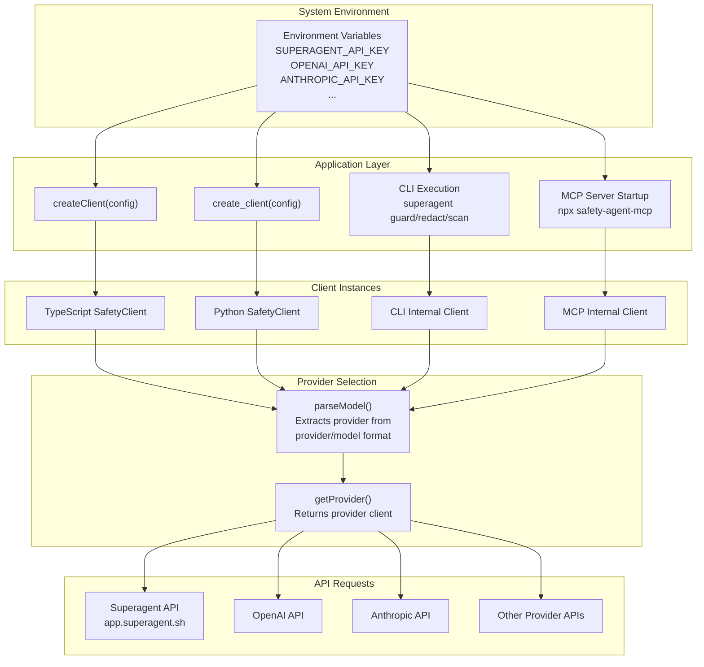
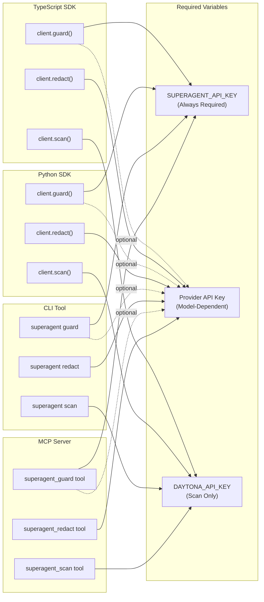
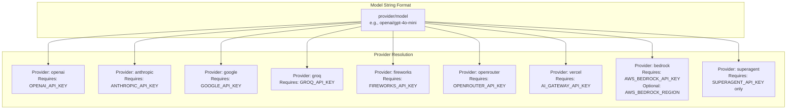

<!-- source: DeepWiki mcp.deepwiki.com · repo superagent-ai/superagent · page 8.2 Environment Configuration · fetched 2026-10-26 -->

# Environment Configuration

<details>
<summary>Relevant source files</summary>

The following files were used as context for generating this wiki page:

- [mcp/.env.example](mcp/.env.example)
- [mcp/.gitignore](mcp/.gitignore)
- [mcp/evaluation.xml](mcp/evaluation.xml)
- [mcp/tsconfig.json](mcp/tsconfig.json)
- [sdk/python/README.md](sdk/python/README.md)
- [sdk/typescript/README.md](sdk/typescript/README.md)

</details>


This page provides a complete reference for all environment variables used across the Superagent ecosystem. Environment variables control authentication, provider selection, and operational behavior for the TypeScript SDK, Python SDK, CLI tool, and MCP server.

For information about model provider configuration and the `provider/model` format, see [Model Provider Configuration](#2.6). For REST API authentication methods, see [Authentication & Configuration](#5.1).

## Overview

The Superagent system uses environment variables for three primary purposes:

1. **Authentication**: API keys for Superagent services and third-party model providers
2. **Service Integration**: Keys for specialized services like Daytona sandbox
3. **Regional Configuration**: Optional region settings for certain providers

All components (SDKs, CLI, MCP server) read environment variables from the system environment or can accept them programmatically at runtime.

**Sources**: [sdk/typescript/README.md:1-372](), [sdk/python/README.md:1-129](), [mcp/.env.example:1-4]()

## Environment Variable Reference

### Core Variables

| Variable Name | Required | Used By | Purpose |
|--------------|----------|---------|---------|
| `SUPERAGENT_API_KEY` | Yes | All components | Authenticates requests to the Superagent API for usage tracking and default guard models |
| `DAYTONA_API_KEY` | Conditional | SDK, CLI | Required only for `scan()` operations that analyze repositories in Daytona sandboxes |

The `SUPERAGENT_API_KEY` is the primary authentication credential. Obtain it by signing up at https://superagent.sh and creating an API key from the dashboard.

**Sources**: [sdk/typescript/README.md:14-16](), [sdk/python/README.md:19-23](), [mcp/.env.example:1-4]()

### Provider-Specific API Keys

When using models from third-party providers, the corresponding API key must be set. The system automatically routes requests to the appropriate provider based on the `provider/model` format.

| Variable Name | Provider | Model Format | Optional Settings |
|--------------|----------|--------------|-------------------|
| `OPENAI_API_KEY` | OpenAI | `openai/{model}` | - |
| `ANTHROPIC_API_KEY` | Anthropic | `anthropic/{model}` | - |
| `GOOGLE_API_KEY` | Google | `google/{model}` | - |
| `GROQ_API_KEY` | Groq | `groq/{model}` | - |
| `FIREWORKS_API_KEY` | Fireworks | `fireworks/{model}` | - |
| `OPENROUTER_API_KEY` | OpenRouter | `openrouter/{provider}/{model}` | - |
| `AI_GATEWAY_API_KEY` | Vercel AI Gateway | `vercel/{provider}/{model}` | - |
| `AWS_BEDROCK_API_KEY` | AWS Bedrock | `bedrock/{model}` | `AWS_BEDROCK_REGION` |

**Note**: The Superagent guard models (`superagent/guard-0.6b`, `superagent/guard-1.7b`, `superagent/guard-4b`) do not require any provider API keys beyond `SUPERAGENT_API_KEY`.

**Sources**: [sdk/typescript/README.md:57-70](), [sdk/python/README.md:112-124]()

## Environment Variable Flow



This diagram shows how environment variables flow from the system environment through client initialization to provider selection and API requests. All components follow the same pattern: read environment variables, initialize a client, parse the model string to determine the provider, and route requests to the appropriate API.

**Sources**: [sdk/typescript/README.md:128-143](), [sdk/python/README.md:27-30]()

## Configuration Methods

### Direct Environment Variables

The standard method for all components:

```bash
export SUPERAGENT_API_KEY=sk_your_key_here
export OPENAI_API_KEY=sk-proj-your_openai_key
export ANTHROPIC_API_KEY=sk-ant-your_anthropic_key
```

### Programmatic Configuration (SDK Only)

The TypeScript and Python SDKs support passing the API key directly to `createClient()`:

**TypeScript**:
```typescript
const client = createClient({
  apiKey: "sk_your_key_here"
});
```

**Python**:
```python
client = create_client(api_key="sk_your_key_here")
```

When provided programmatically, the API key parameter takes precedence over the environment variable.

**Sources**: [sdk/typescript/README.md:133-136](), [sdk/typescript/README.md:140-142]()

### Environment Files

For local development, use `.env` files:

```bash
# .env
SUPERAGENT_API_KEY=sk_your_key_here
OPENAI_API_KEY=sk-proj-your_openai_key
ANTHROPIC_API_KEY=sk-ant-your_anthropic_key
GOOGLE_API_KEY=your_google_key
GROQ_API_KEY=your_groq_key
```

**CLI and MCP**: These tools automatically load `.env` files from the current directory.

**SDK**: Use a library like `dotenv` (Node.js) or `python-dotenv` (Python) to load `.env` files before creating the client.

**Sources**: [mcp/.env.example:1-4]()

## Component-Specific Requirements



This diagram shows the environment variable dependencies for each operation across all components. All operations require `SUPERAGENT_API_KEY`. Guard operations can use the default Superagent models (no additional keys) or specify a provider model (requires provider key). Redact operations always require a provider key. Scan operations require `DAYTONA_API_KEY`.

**Sources**: [sdk/typescript/README.md:146-218](), [sdk/typescript/README.md:275-333](), [sdk/python/README.md:48-97]()

## Operation-Specific Configuration

### Guard Operation

| Scenario | Required Variables |
|----------|-------------------|
| Default model (`superagent/guard-0.6b` or `superagent/guard-1.7b`) | `SUPERAGENT_API_KEY` only |
| Custom LLM (e.g., `openai/gpt-4o-mini`) | `SUPERAGENT_API_KEY` + provider key |
| Vision model (e.g., `openai/gpt-4o`) | `SUPERAGENT_API_KEY` + `OPENAI_API_KEY` |

Example with default model:
```bash
export SUPERAGENT_API_KEY=sk_your_key_here
# No other keys needed - uses superagent/guard-0.6b
```

Example with OpenAI:
```bash
export SUPERAGENT_API_KEY=sk_your_key_here
export OPENAI_API_KEY=sk-proj-your_openai_key
```

**Sources**: [sdk/typescript/README.md:25-38](), [sdk/typescript/README.md:158-159]()

### Redact Operation

Redact always requires a provider model (there is no default):

```bash
export SUPERAGENT_API_KEY=sk_your_key_here
export OPENAI_API_KEY=sk-proj-your_openai_key
```

**Sources**: [sdk/typescript/README.md:42-50](), [sdk/typescript/README.md:275-333]()

### Scan Operation

Scan operations require both Superagent and Daytona credentials:

```bash
export SUPERAGENT_API_KEY=sk_your_key_here
export DAYTONA_API_KEY=your_daytona_key
```

Optionally, specify a custom model for analysis (requires provider key):
```bash
export SUPERAGENT_API_KEY=sk_your_key_here
export DAYTONA_API_KEY=your_daytona_key
export ANTHROPIC_API_KEY=sk-ant-your_anthropic_key
```

**Sources**: Reference to scan documentation in [Scan Operation](#2.5)

## Provider Configuration Matrix



The system parses the model string to extract the provider prefix, then looks up the corresponding environment variable. If the required API key is not found, the request fails with an authentication error.

**Sources**: [sdk/typescript/README.md:54-70](), [sdk/python/README.md:99-110]()

## AWS Bedrock Special Configuration

AWS Bedrock is the only provider that supports an optional region setting:

```bash
export AWS_BEDROCK_API_KEY=your_bedrock_key
export AWS_BEDROCK_REGION=us-west-2  # Optional, defaults to us-east-1
```

The region controls which AWS region the Bedrock API requests are routed to. If not specified, the SDK uses the default region.

**Sources**: [sdk/typescript/README.md:61]()

## MCP Server Configuration

The MCP server requires environment variables to be configured in the Claude Desktop configuration file:

```json
{
  "mcpServers": {
    "safety-agent": {
      "command": "npx",
      "args": ["-y", "safety-agent-mcp"],
      "env": {
        "SUPERAGENT_API_KEY": "sk_your_key_here",
        "OPENAI_API_KEY": "sk-proj-your_openai_key",
        "ANTHROPIC_API_KEY": "sk-ant-your_anthropic_key"
      }
    }
  }
}
```

Environment variables must be explicitly declared in the `env` object. The MCP server does not inherit environment variables from the parent shell.

**Sources**: Reference to MCP configuration in [Installation & Configuration](#4.1)

## Security Best Practices

### Never Commit API Keys

Add environment files to `.gitignore`:
```
.env
.env.local
.env.production
```

**Sources**: [mcp/.gitignore:5]()

### Use Secret Management in Production

For production deployments, use secret management services:
- **Cloud Platforms**: AWS Secrets Manager, GCP Secret Manager, Azure Key Vault
- **Container Orchestration**: Kubernetes Secrets
- **CI/CD**: GitHub Secrets, GitLab CI/CD Variables

### Rotate Keys Regularly

API keys should be rotated periodically:
1. Generate a new key in the provider dashboard
2. Update the environment variable
3. Test the new configuration
4. Revoke the old key

### Principle of Least Privilege

Only configure the provider API keys you actually use. If your application only uses OpenAI models, only set `OPENAI_API_KEY`.

## Troubleshooting

### Missing API Key Errors

**Symptom**: `Error: Missing API key for provider: openai`

**Solution**: Verify the required environment variable is set:
```bash
echo $OPENAI_API_KEY
```

If empty, set the variable and restart your application.

### Wrong Provider Credentials

**Symptom**: Authentication error from provider API

**Solution**: Verify the API key format matches the provider's requirements:
- OpenAI keys start with `sk-proj-` or `sk-`
- Anthropic keys start with `sk-ant-`
- Check the provider's documentation for key format

### MCP Server Not Finding Variables

**Symptom**: MCP server fails with authentication error despite environment variables being set

**Solution**: MCP servers do not inherit shell environment variables. Add all required variables to the `env` object in `claude_desktop_config.json`.

### Default Model Not Working

**Symptom**: Guard operation fails even though no model is specified

**Solution**: The default Superagent guard models require `SUPERAGENT_API_KEY` to be set. Verify:
```bash
echo $SUPERAGENT_API_KEY
```

## Environment Variable Validation

Both SDKs validate required environment variables at runtime when operations are invoked. The validation occurs in the provider abstraction layer when a model string is parsed.

**TypeScript**: The `parseModel()` function extracts the provider, then `getProvider()` checks for the required API key.

**Python**: Similar validation occurs in the provider resolution logic.

If a required variable is missing, the SDK throws an error immediately rather than attempting the API request.

**Sources**: References to provider abstraction in [Model Provider Configuration](#2.6)