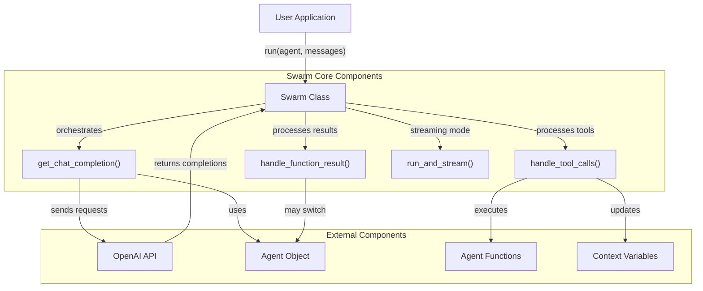
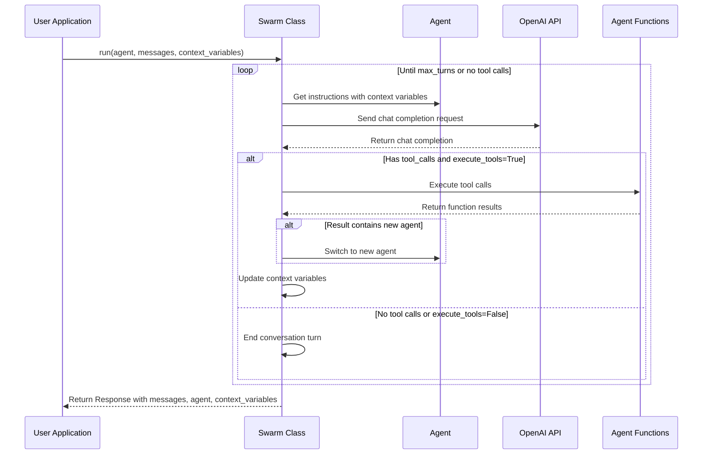
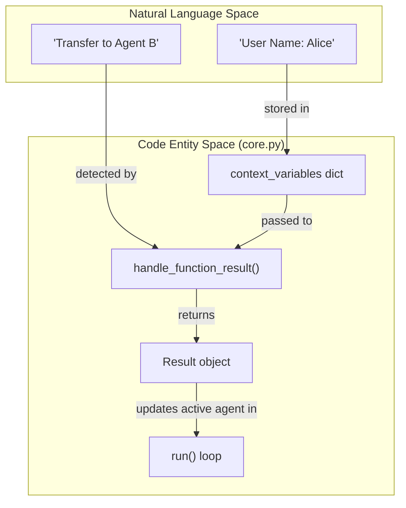

<!-- source: DeepWiki mcp.deepwiki.com · repo openai/swarm · page 2.1 Swarm Class (core.py) · fetched 2026-10-26 -->

# Swarm Class (core.py)

<details>
<summary>Relevant source files</summary>

The following files were used as context for generating this wiki page:

- [README.md](README.md)

</details>


## Purpose and Overview

The `Swarm` class serves as the central orchestrator for the OpenAI Swarm framework, providing the core functionality for managing AI agent interactions. This class handles the lifecycle of agent conversations, including chat completions, tool calls, and function execution. It forms the backbone of the framework, enabling multi-turn conversations with AI agents that can execute functions and maintain contextual information.

Sources: [swarm/core.py:26-292]()

## Class Structure and Initialization

The `Swarm` class has a simple initialization that accepts an optional OpenAI client:

```python
def __init__(self, client=None):
    if not client:
        client = OpenAI()
    self.client = client
```

This allows users to either provide their own configured OpenAI client or have the class create a default one.

Sources: [swarm/core.py:26-30]()

## Core Components and Relationships



Diagram: Swarm Class Core Components and Relationships

Sources: [swarm/core.py:32-69](), [swarm/core.py:71-87](), [swarm/core.py:89-137](), [swarm/core.py:139-230](), [swarm/core.py:231-292]()

## Execution Flow

The core loop of Swarm is implemented in the `run` method. It continues to iterate until the model stops requesting tool calls or the `max_turns` limit is reached.



Diagram: Swarm Class Execution Flow

Sources: [swarm/core.py:139-230](), [swarm/core.py:231-292]()

## Key Methods

### get_chat_completion

This method prepares and sends a chat completion request to the OpenAI API. It handles the transformation of `Agent` attributes into OpenAI API parameters.

1.  **Instructions**: Processes the agent's instructions (can be a string or a callable that takes `context_variables`) [swarm/core.py:36-40]().
2.  **Message Assembly**: Builds the messages array, prepending the system instruction [swarm/core.py:42-45]().
3.  **Tool Conversion**: Converts Python functions in `agent.functions` into JSON schemas using `function_to_json` [swarm/core.py:47-51]().
4.  **API Call**: Sends the request to the OpenAI client with specified model and streaming settings [swarm/core.py:58-69]().

Sources: [swarm/core.py:32-69]()

### handle_tool_calls

This method processes the `tool_calls` list returned by the OpenAI API.

1.  **Function Mapping**: Maps function names to the actual callables stored in the `Agent` [swarm/core.py:94-96]().
2.  **Argument Parsing**: Parses the JSON arguments provided by the model [swarm/core.py:104-105]().
3.  **Context Injection**: If a function signature includes `context_variables`, Swarm injects the current context [swarm/core.py:108-110]().
4.  **Execution**: Calls the function and processes the output via `handle_function_result` [swarm/core.py:113-116]().

Sources: [swarm/core.py:89-137]()

### handle_function_result

This method standardizes the output of an agent's function.

-   If the result is an `Agent`, it signals a handoff [swarm/core.py:76-80]().
-   If the result is a `Result` object (defined in `types.py`), it extracts updated `context_variables` and the new `agent` if present [swarm/core.py:73-75]().
-   Otherwise, it coerces the result to a string [swarm/core.py:82-84]().

Sources: [swarm/core.py:71-87]()

### run and run_and_stream

These are the primary entry points for interacting with Swarm.

-   `run`: Executes the loop synchronously and returns a `Response` object containing the final state [swarm/core.py:231-292]().
-   `run_and_stream`: Yields partial response chunks (as dictionaries) for real-time UI updates. It uses a internal `Response` accumulator to track state during the stream [swarm/core.py:139-230]().

Sources: [swarm/core.py:139-292]()

## Data Flow

The following diagram maps how high-level concepts (like "handoffs") relate to specific code entities within `core.py`.



Diagram: Mapping Natural Language Concepts to Code Entities

Sources: [swarm/core.py:71-87](), [swarm/core.py:231-292](), [swarm/types.py:12-23]()

## Context Variables

Context variables serve as a shared state mechanism. They:
1.  Allow passing data between different components and function calls.
2.  Are automatically passed to functions that declare the parameter `context_variables` [swarm/core.py:108-110]().
3.  Are updated by function results if a `Result` object is returned [swarm/core.py:120-121]().

The `Swarm` class manages context variables by creating a shallow copy at the start of a run to prevent unintended side effects on the original dictionary [swarm/core.py:245]().

Sources: [swarm/core.py:36-56](), [swarm/core.py:119-121](), [swarm/core.py:133-134]()

## Agent Switching (Handoffs)

Handoffs occur when a function returns another `Agent` instance.

1.  An agent function returns an `Agent` object.
2.  `handle_function_result` wraps this in a `Result` [swarm/core.py:76-80]().
3.  The `run` loop detects the new agent and updates its local `active_agent` variable [swarm/core.py:285-286]().
4.  The next iteration of the loop uses the new agent's instructions and tools [swarm/core.py:250-252]().

Sources: [swarm/core.py:76-80](), [swarm/core.py:134-135](), [swarm/core.py:220-221](), [swarm/core.py:285-286]()

## Summary

The `Swarm` class in `core.py` provides the fundamental orchestration mechanism. It is stateless by design, requiring the caller to pass the conversation history and context variables back into each `run()` call, similar to the OpenAI Chat Completions API.

Key features include:
-   **Orchestration**: Managing the multi-turn loop between the model and tool execution.
-   **Flexibility**: Supporting both synchronous and streaming modes.
-   **Handoffs**: Native support for switching agents via function return values.
-   **Context Management**: Seamless injection of state into agent functions.

Sources: [swarm/core.py:26-292]()

---

