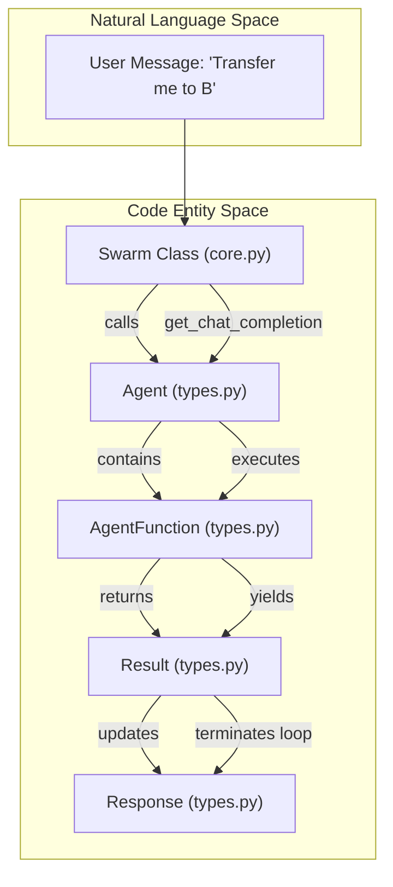
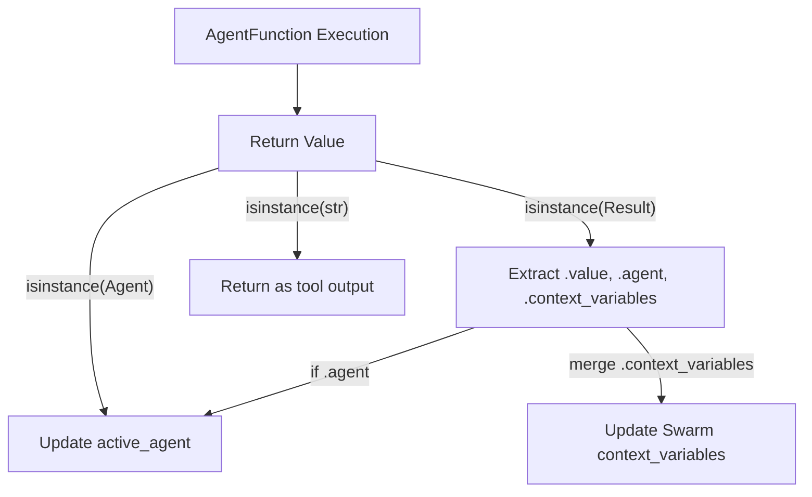

<!-- source: DeepWiki mcp.deepwiki.com · repo openai/swarm · page 2.2 Types and Data Models · fetched 2026-10-26 -->

# Types and Data Models

Relevant source files

The following files were used as context for generating this wiki page:

- [README.md](README.md)

This section provides a technical deep dive into the Pydantic data models defined in `swarm/types.py`. These models serve as the backbone for the Swarm framework, ensuring type safety and structured data flow between the `Swarm` orchestrator, `Agent` instances, and Python functions.

## Core Data Architecture

Swarm utilizes Pydantic for its core primitives. This allows for seamless serialization, validation, and clear definitions of the state passed between the client and the LLM.

### Agent
The `Agent` class is the primary unit of abstraction. It encapsulates the instructions, model configuration, and the tools (functions) available to the LLM at any given turn.

| Field | Type | Default | Description |
| :--- | :--- | :--- | :--- |
| `name` | `str` | `"Agent"` | The name of the agent. |
| `model` | `str` | `"gpt-4o"` | The OpenAI model ID to be used. |
| `instructions` | `Union[str, Callable]` | `"You are a helpful agent."` | System prompt. Can be a string or a callable that returns a string (receiving `context_variables`). |
| `functions` | `List[AgentFunction]` | `[]` | A list of Python functions the agent can invoke. |
| `tool_choice` | `str` | `None` | Restricts the model to specific tool usage (e.g., "required"). |
| `parallel_tool_calls` | `bool` | `True` | Whether to allow multiple tool calls in a single turn. |

**Sources:** [swarm/types.py:24-32](), [swarm/core.py:100-104]()

### Response
The `Response` object is the final output of a `client.run()` call. It captures the state of the conversation after all turns (including tool executions and handoffs) have been completed.

| Field | Type | Description |
| :--- | :--- | :--- |
| `messages` | `List` | The complete list of messages generated during the run. |
| `agent` | `Agent` | The last `Agent` that was active (useful for tracking handoffs). |
| `context_variables` | `dict` | The final state of context variables after all function modifications. |

**Sources:** [swarm/types.py:46-50](), [swarm/core.py:133-138]()

### Result
The `Result` class is a specialized return type for `AgentFunction`s. While a function can return a simple string or an `Agent` (for handoffs), returning a `Result` allows the function to update `context_variables` and return a value simultaneously.

| Field | Type | Default | Description |
| :--- | :--- | :--- | :--- |
| `value` | `str` | `""` | The string representation of the tool output to be sent back to the LLM. |
| `agent` | `Agent` | `None` | If provided, triggers a handoff to this new agent. |
| `context_variables` | `dict` | `{}` | New or updated variables to be merged into the global state. |

**Sources:** [swarm/types.py:35-39](), [swarm/core.py:255-265]()

---

## Data Flow and Transitions

The following diagram illustrates how these types interact during a `Swarm.run` execution. It maps the transition from the high-level request to the internal code entities.

### Code Entity Flow: Request to Response
"Code Entity Space" describes how the `Swarm` class processes `Agent` and `AgentFunction` definitions into OpenAI-compatible schemas.

**Sources:** [swarm/core.py:82-138](), [swarm/types.py:24-50]()

---

## Tool Execution and Handoff Logic

When an `Agent` invokes a function, the `Swarm` orchestrator processes the return value to determine the next state. This is handled primarily within `handle_tool_calls`.

### Tool Return Handling Logic
The system supports polymorphic return types for functions defined in `Agent.functions`:

1.  **String**: Treated as the tool's output.
2.  **Agent**: Treated as a handoff; the `active_agent` is updated.
3.  **Result**: A composite object updating the value, the agent, and the context variables.

**Sources:** [swarm/core.py:250-275](), [swarm/types.py:35-43]()

---

## Detailed Field Definitions

### AgentFunction
This is a type alias for a standard Python `Callable`. However, Swarm expects these functions to follow specific patterns:
- They can optionally accept `context_variables` if it is defined in their signature.
- They should return a `str`, `Agent`, or `Result`.

**Sources:** [swarm/types.py:11-12](), [swarm/util.py:10-30]()

### Summary Table: Type Flow

| Step | Component | Entity Used | File Reference |
| :--- | :--- | :--- | :--- |
| 1 | Initialization | `Agent` | [swarm/types.py:24]() |
| 2 | Execution Loop | `Swarm.run()` | [swarm/core.py:82]() |
| 3 | Tool Call | `AgentFunction` | [swarm/core.py:250]() |
| 4 | State Update | `Result` | [swarm/types.py:35]() |
| 5 | Completion | `Response` | [swarm/types.py:46]() |

**Sources:** [swarm/core.py:82-138](), [swarm/types.py:11-50]()

---

