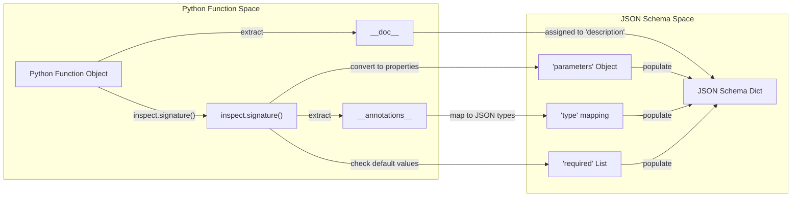
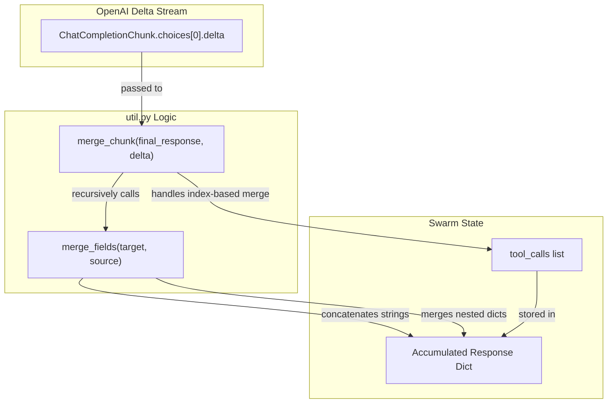

<!-- source: DeepWiki mcp.deepwiki.com · repo openai/swarm · page 2.3 Utility Functions · fetched 2026-10-26 -->

# Utility Functions

Relevant source files

The following files were used as context for generating this wiki page:

- [README.md](README.md)

This document details the utility functions provided by the Swarm framework in the `util.py` module. These functions serve as foundational helpers for various operations within the Swarm system, including function schema conversion, response merging, and debug logging. These utilities are primarily used by the core Swarm implementation to facilitate interaction with the OpenAI API and manage response data.

Sources: [swarm/util.py:1-88]()

## Overview

The Swarm utility module provides four key functions:

- `function_to_json()`: Converts Python functions into JSON schema format for use with OpenAI function calling [swarm/util.py:31-31]().
- `merge_fields()`: Recursively merges fields between two dictionary objects [swarm/util.py:13-13]().
- `merge_chunk()`: Merges streaming chunks of API responses into a final response object [swarm/util.py:22-22]().
- `debug_print()`: Provides formatted debug output with timestamps [swarm/util.py:5-5]().

These utilities abstract away common operations needed when working with the OpenAI API and processing its responses.

Sources: [swarm/util.py:5-87]()

## Function Conversion

The `function_to_json()` function is a critical utility that bridges Python function definitions and the OpenAI API's function calling format.

### Natural Language to Code Entity Space: Function Conversion
This diagram maps how natural language components of a Python function (docstrings, parameter names) are transformed into structured `tool` definitions.

Sources: [swarm/util.py:31-87]()

### Function to JSON Conversion

The `function_to_json()` function performs the following operations:

1. Extracts the function signature using Python's `inspect` module [swarm/util.py:40-40]().
2. Maps Python type annotations to JSON schema types (e.g., `str` to `"string"`, `int` to `"integer"`) [swarm/util.py:52-60]().
3. Identifies required parameters by checking for the absence of default values [swarm/util.py:46-47]().
4. Extracts the function's docstring to serve as the tool description [swarm/util.py:42-42]().

This conversion enables the Swarm system to use Python functions as tools that can be called by AI models via the OpenAI API. It specifically filters out `context_variables` from the schema, as these are injected internally by the `Swarm` client and should not be generated by the model [swarm/util.py:44-45]().

| Python Type | JSON Schema Type |
|-------------|------------------|
| `str`       | "string"         |
| `int`       | "integer"        |
| `float`     | "number"         |
| `bool`      | "boolean"        |
| `list`      | "array"          |
| `dict`      | "object"         |
| `Any` / Default | "string"     |

Sources: [swarm/util.py:31-87]()

## Response Merging

The Swarm framework includes utilities for handling streaming responses from the OpenAI API, which arrive in chunks (`ChatCompletionChunk`) that need to be merged into a single coherent state.

### Code Entity Space: Streaming Data Flow
This diagram shows how `merge_chunk` and `merge_fields` interact with OpenAI response objects.

Sources: [swarm/util.py:13-29]()

### Merge Functions

Two functions work together to handle response merging:

1. `merge_fields(target, source)`: A recursive helper function. If both values are dictionaries, it iterates through the source and calls itself. If both are strings, it concatenates the source onto the target [swarm/util.py:13-20]().
2. `merge_chunk(final_response, delta)`: The main entry point for stream processing. It converts the delta to a dictionary and removes the `role` (as it is redundant in chunks) [swarm/util.py:23-25](). It handles the special complexity of `tool_calls`, which arrive as a list of deltas with indices; it ensures the correct tool call is updated based on its index [swarm/util.py:27-29]().

Sources: [swarm/util.py:13-29]()

## Debug Printing

The `debug_print()` function provides a simple way to output debug information with timestamps, primarily used within the `Swarm.run` loop.

### Debug Print Function

The `debug_print()` function:

1. Checks the `debug` boolean flag; if `False`, it returns immediately [swarm/util.py:6-6]().
2. Generates a timestamp using `datetime.now().strftime("%Y-%m-%d %H:%M:%S")` [swarm/util.py:7-7]().
3. Prints the message to the console, prepending the timestamp and using a specific color code (`\033[97m`) for visual distinction [swarm/util.py:9-10]().

Sources: [swarm/util.py:5-10]()

## Integration with Core Swarm

The utility functions are integrated into the `Swarm` class in `core.py`:

- **Function Discovery**: When an `Agent` is initialized, its `functions` are converted using `function_to_json` to populate the `tools` parameter for the OpenAI request.
- **Streaming**: If `stream=True` is passed to `client.run()`, the loop uses `merge_chunk` to assemble the full message before returning the final `Response`.
- **Logging**: `debug_print` is called at the start of every turn and when tools are executed to provide visibility into the orchestration process.

Sources: [swarm/util.py:1-88]()

---

