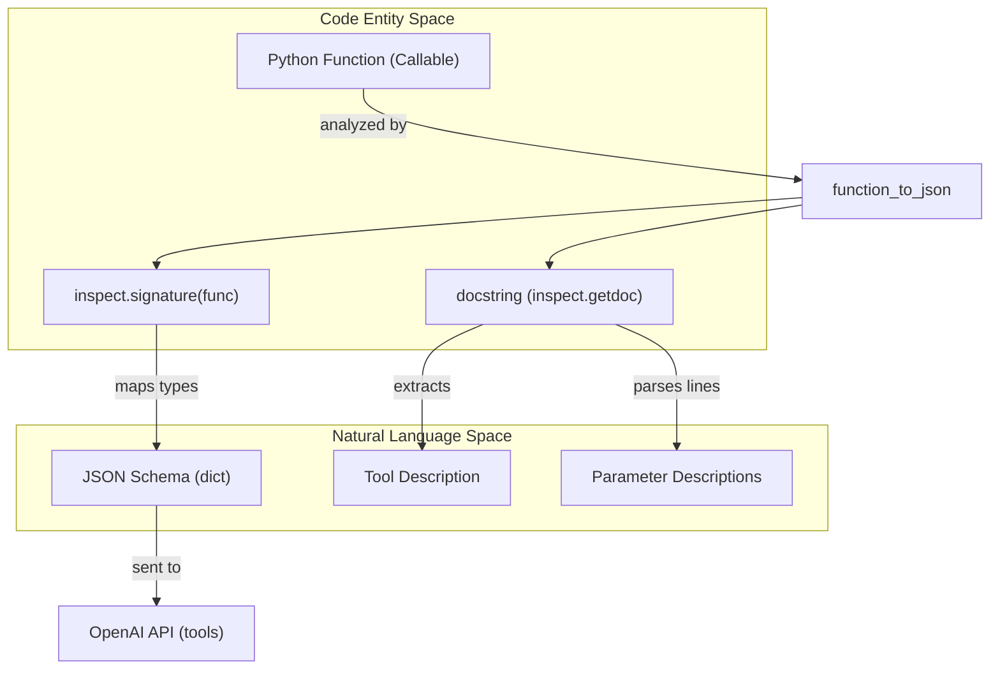
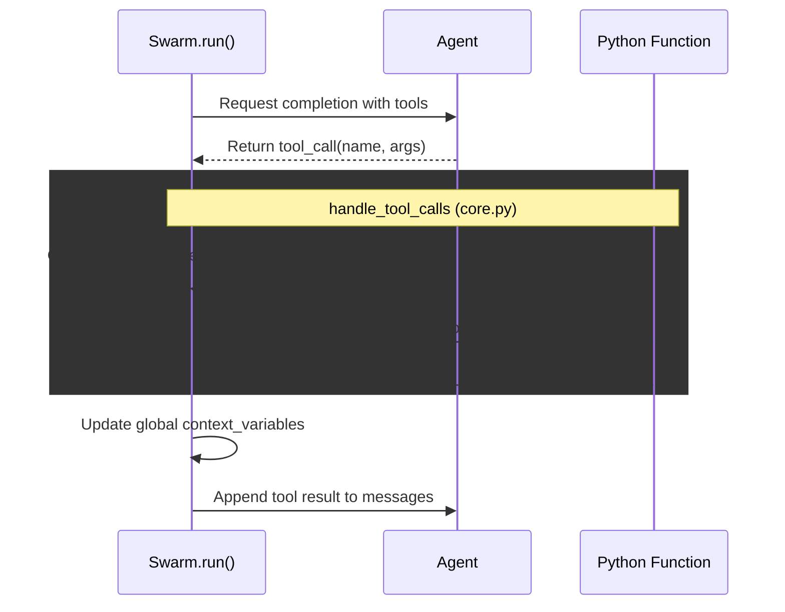
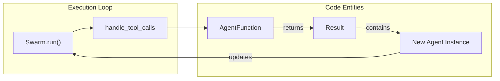

<!-- source: DeepWiki mcp.deepwiki.com · repo openai/swarm · page 3 Tool System · fetched 2026-10-26 -->

# Tool System

Relevant source files

The following files were used as context for generating this wiki page:

- [README.md](README.md)

## Purpose and Scope

The Tool System is the mechanism by which Swarm converts standard Python functions into structured JSON schemas compatible with the OpenAI Chat Completions API. This allows AI agents to "call" Python code by generating arguments that match a function's signature. The system handles type mapping, docstring extraction for parameter descriptions, and the injection of dynamic `context_variables`.

## Core Logic: `function_to_json`

The heart of the Tool System is the `function_to_json` utility. This function inspects a Python function's signature and docstring to generate a tool definition.

### Transformation Process

Sources: [swarm/util.py:10-58]()

### Type Mapping
The system maps Python type hints to JSON schema types. If a type hint is missing, it defaults to `string`.

| Python Type | JSON Schema Type |
| :--- | :--- |
| `str` | `string` |
| `int` | `integer` |
| `float` | `number` |
| `bool` | `boolean` |
| `list` | `array` |
| `dict` | `object` |
| `Any` | `string` (fallback) |

Sources: [swarm/util.py:27-37]()

## Context Variables Injection

Swarm supports a special parameter called `context_variables`. If a tool function includes this parameter in its signature, the `Swarm.run` loop will automatically inject the current state of `context_variables` into the function call without the model needing to provide it.

### Data Flow for Tool Execution

Sources: [swarm/core.py:183-205](), [swarm/core.py:255-275]()

## Key Implementation Details

### Docstring Extraction
The tool's description is pulled from the function's docstring using `inspect.getdoc(func)`. The system expects the first part of the docstring to be the general description, while specific parameter descriptions are often parsed from the subsequent lines.
Sources: [swarm/util.py:22-25]()

### The `Result` Object
Tools can return a simple string, but for complex interactions, they should return a `Result` object. This allows a tool to:
1. Return a value to the model.
2. Update `context_variables` for future turns.
3. Trigger an agent handoff by returning a new `Agent` instance.

Sources: [swarm/types.py:44-49]()

### Handling Handoffs
When a tool returns an `Agent` object (either directly or wrapped in a `Result`), the `Swarm` controller detects this change and switches the "active" agent for the next turn in the loop.

Sources: [swarm/core.py:266-271](), [swarm/types.py:44-49]()

## Pydantic Schema (Customer Service Example)

In the `customer_service_streaming` example, the tool system is further formalized using Pydantic models to define a strict schema for tool definitions.

| Class | Purpose |
| :--- | :--- |
| `Parameter` | Defines a single input field (type, description, enum). |
| `FunctionParameters` | A collection of `Parameter` objects in a JSON-compliant object. |
| `FunctionTool` | Combines a name, description, and parameters. |
| `Tool` | The top-level wrapper sent to the API (type="function"). |

Sources: [examples/customer_service_streaming/src/swarm/tool.py:5-26]()

## Summary Table of Tool Attributes

| Feature | Source in Code | Description |
| :--- | :--- | :--- |
| **Name** | `func.__name__` | The identifier the model uses to call the tool. |
| **Description** | `inspect.getdoc(func)` | Instructions to the model on when to use this tool. |
| **Arguments** | `inspect.signature(func)` | The schema generated from type hints. |
| **Context** | `context_variables` | Injected if present in the function signature. |
| **Handoff** | `return Agent(...)` | Changes the conversation's active agent. |

Sources: [swarm/util.py:10-58](), [swarm/core.py:255-275]()

---

