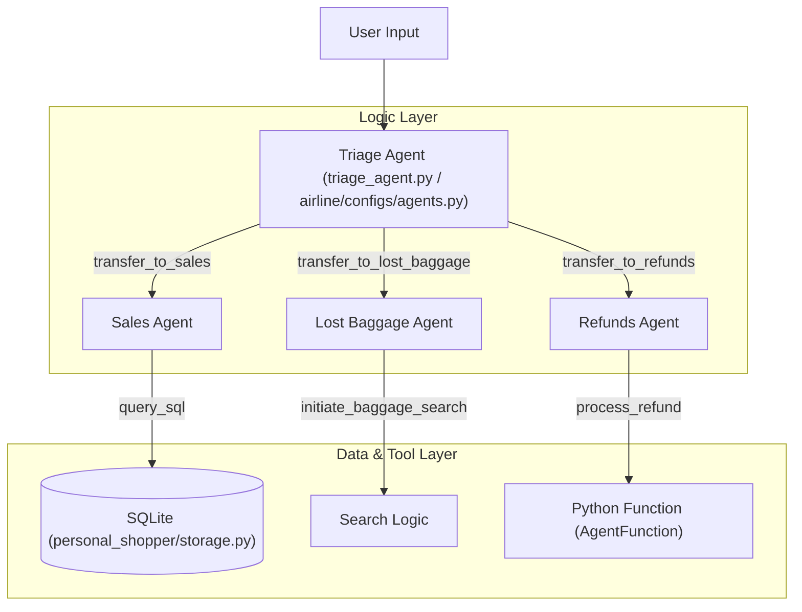
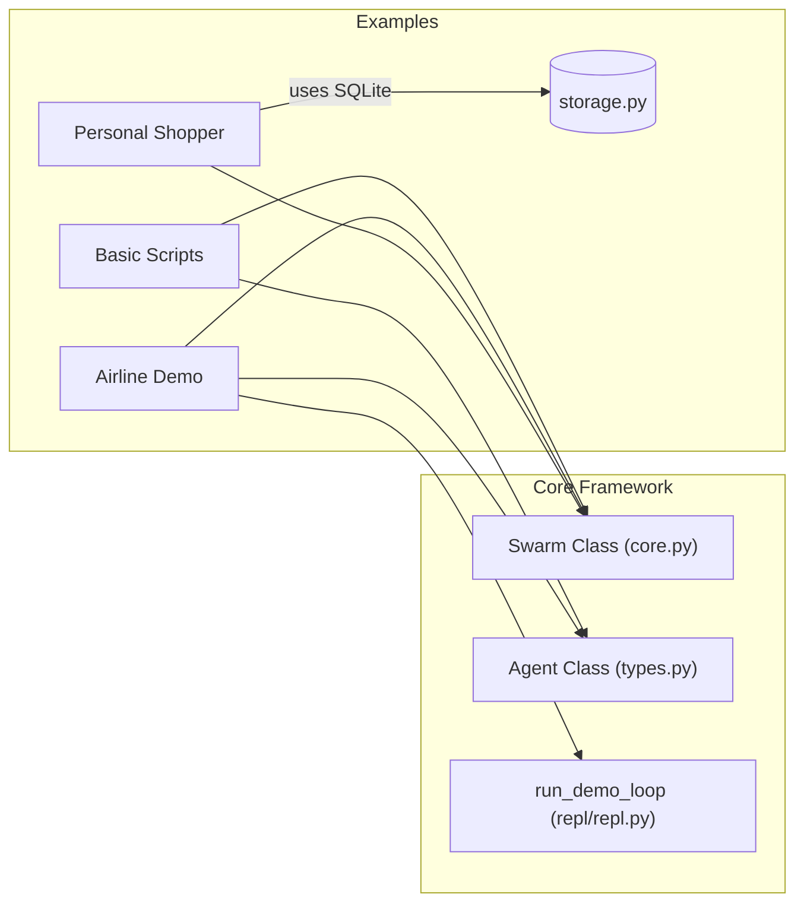

<!-- source: DeepWiki mcp.deepwiki.com · repo openai/swarm · page 4 Examples · fetched 2026-10-26 -->

# Examples

Relevant source files

The following files were used as context for generating this wiki page:

- [examples/__init__.py](examples/__init__.py)
- [examples/airline/README.md](examples/airline/README.md)
- [examples/basic/README.md](examples/basic/README.md)

The Swarm repository provides a diverse set of example applications designed to demonstrate the framework's multi-agent orchestration capabilities. These examples range from "bare minimum" scripts for beginners to complex, production-oriented systems featuring evaluation frameworks, database integrations, and streaming interfaces.

## High-Level Architecture of Examples

Most examples in this repository follow a common pattern: defining specialized `Agent` objects that use function-based handoffs to navigate a conversation graph.

### Mapping Natural Language to Code Entities

The following diagram illustrates how user requests are mapped to specific code entities across the example suite.

**Request Routing Diagram**

Sources: [examples/airline/README.md:8-12](), [examples/basic/README.md:9-11]()

---

## Basic Examples
The `examples/basic/` directory contains the fundamental building blocks of Swarm. These scripts are designed to be read in sequence to understand core mechanics like handoffs, context variables, and function calling.

*   **`bare_minimum.py`**: The simplest possible implementation of a `Swarm` client and an `Agent` [examples/basic/README.md:12-15]().
*   **`agent_handoff.py`**: Demonstrates the pattern of an `Agent` returning another `Agent` to transfer control [examples/basic/README.md:7-10]().
*   **`context_variables.py`**: Shows how to pass state (like a user's name) into agent instructions and functions [examples/basic/README.md:17-20]().
*   **`function_calling.py`**: Illustrates how agents interact with external Python functions to retrieve data [examples/basic/README.md:22-25]().

For details, see [Basic Examples](#4.1).

---

## Airline Customer Service
The Airline example is a comprehensive multi-agent system that simulates a complex service desk. It features a hierarchical agent structure where a `Triage Agent` routes users to specialized agents for flight modifications, cancellations, or lost baggage [examples/airline/README.md:1-13]().

This example is notable for including:
*   **Evaluation Framework**: A system to run deterministic tests against agent handoffs using `function_evals.py` [examples/airline/README.md:27-55]().
*   **Policy Management**: Use of structured instructions to guide agent behavior.

For details, see [Airline Customer Service Example](#4.2).

---

## Customer Service Streaming
This example focuses on real-time interactions and more advanced system integration. It introduces the concept of "Engines" (such as `AssistantsEngine` and `LocalEngine`) to handle the execution of tasks.

Key components include:
*   **Knowledge Base**: Integration of `query_docs` tools to answer user questions from articles.
*   **Task System**: A structured way to deploy and manage specific agent responsibilities.

For details, see [Customer Service Streaming Example](#4.3).

---

## Other Specialized Examples
The repository includes several other examples targeting specific technical integrations or use cases:

| Example | Key Feature | Description |
| :--- | :--- | :--- |
| **Triage Agent** | Routing Logic | A focused look at sales vs. refund routing with associated evals. |
| **Weather Agent** | Tool Use | A clean demonstration of function calling for external API simulation. |
| **Personal Shopper** | Persistence | Uses a SQLite backend (`storage.py`) to manage a shopping cart. |
| **Support Bot** | RAG | Integrates with Qdrant vector database for retrieval-augmented generation. |

For details, see [Other Examples](#4.4).

### Entity Relationship: Examples to Core Components

The following diagram shows how different examples utilize the core `swarm` package components.

**Component Usage Diagram**

Sources: [examples/airline/README.md:4-5](), [examples/basic/README.md:3-5]()

---

