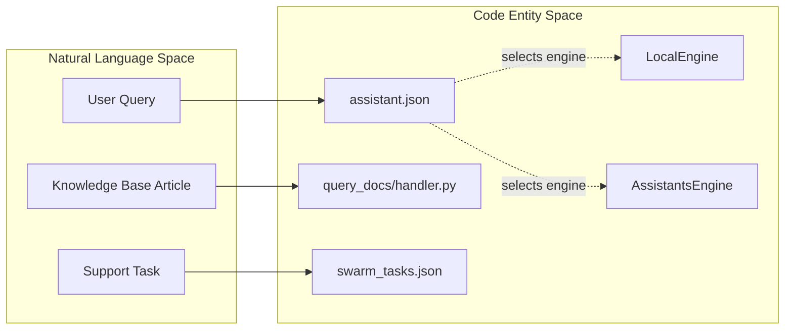
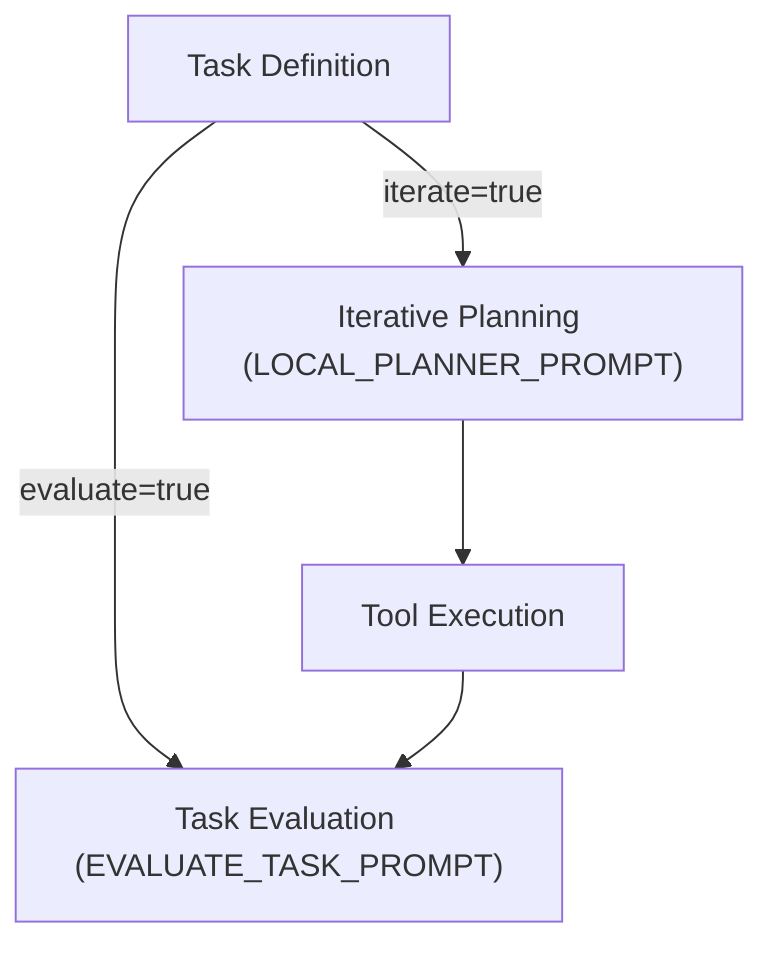
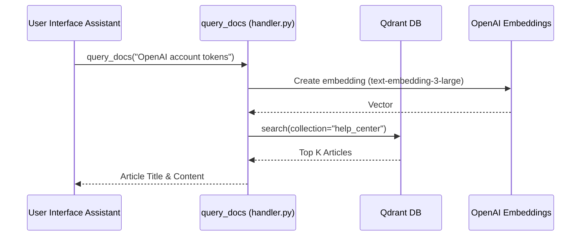

<!-- source: DeepWiki mcp.deepwiki.com · repo openai/swarm · page 4.3 Customer Service Streaming Example · fetched 2026-10-26 -->

# Customer Service Streaming Example

Relevant source files

The following files were used as context for generating this wiki page:

- [examples/customer_service_streaming/configs/__init__.py](examples/customer_service_streaming/configs/__init__.py)
- [examples/customer_service_streaming/configs/assistants/user_interface/assistant.json](examples/customer_service_streaming/configs/assistants/user_interface/assistant.json)
- [examples/customer_service_streaming/configs/general.py](examples/customer_service_streaming/configs/general.py)
- [examples/customer_service_streaming/configs/prompts.py](examples/customer_service_streaming/configs/prompts.py)
- [examples/customer_service_streaming/configs/swarm_tasks.json](examples/customer_service_streaming/configs/swarm_tasks.json)
- [examples/customer_service_streaming/configs/tools/query_docs/handler.py](examples/customer_service_streaming/configs/tools/query_docs/handler.py)
- [examples/customer_service_streaming/configs/tools/query_docs/tool.json](examples/customer_service_streaming/configs/tools/query_docs/tool.json)
- [examples/customer_service_streaming/configs/tools/send_email/handler.py](examples/customer_service_streaming/configs/tools/send_email/handler.py)
- [examples/customer_service_streaming/configs/tools/send_email/tool.json](examples/customer_service_streaming/configs/tools/send_email/tool.json)
- [examples/customer_service_streaming/configs/tools/submit_ticket/handler.py](examples/customer_service_streaming/configs/tools/submit_ticket/handler.py)
- [examples/customer_service_streaming/configs/tools/submit_ticket/tool.json](examples/customer_service_streaming/configs/tools/submit_ticket/tool.json)
- [examples/customer_service_streaming/data/article_6233728.json](examples/customer_service_streaming/data/article_6233728.json)

## Purpose and Scope

This document provides an overview of the Customer Service Streaming Example implementation within the OpenAI Swarm repository. This example demonstrates a sophisticated multi-agent orchestration system capable of handling customer service requests through different execution engines. It features a streaming architecture, a knowledge base integration via Qdrant, and specialized tool configurations for real-world support scenarios like ticket submission and email dispatch.

For detailed documentation on the orchestration logic, see [Customer Service Swarm Class](#4.3.1). For details on the execution backends, see [Engines](#4.3.2).

## Architecture Overview

The Customer Service Streaming Example bridges natural language tasks with code-defined tools and engines. It uses a `user_interface` assistant as the primary entry point for user interactions.

### System Mapping: Natural Language to Code Entities

The following diagram maps high-level system concepts to their specific code implementations and configuration files.

Sources: [examples/customer_service_streaming/configs/assistants/user_interface/assistant.json:1-11](), [examples/customer_service_streaming/configs/swarm_tasks.json:1-14](), [examples/customer_service_streaming/configs/tools/query_docs/handler.py:36-57]()

## Key Components

### Swarm and Engine Selection
The `Swarm` class manages the lifecycle of tasks. The system is configurable to run using either a `LocalEngine` (for local execution logic) or an `AssistantsEngine` (leveraging OpenAI's Assistants API). This is controlled via the `engine_name` setting in the general configuration.

| Configuration Key | Description | File Reference |
|:---|:---|:---|
| `engine_name` | Switches between 'assistants' or 'local' | [examples/customer_service_streaming/configs/general.py:18]() |
| `max_iterations` | Limits the planning loop for tasks | [examples/customer_service_streaming/configs/general.py:20]() |
| `tasks_path` | Path to the JSON file containing task definitions | [examples/customer_service_streaming/configs/general.py:15]() |

### Task and Prompt System
Tasks are defined in `swarm_tasks.json`. Each task can specify whether it requires iteration (refined planning) or evaluation (verification of completion).

Sources: [examples/customer_service_streaming/configs/prompts.py:19-30](), [examples/customer_service_streaming/configs/prompts.py:7-13](), [examples/customer_service_streaming/configs/swarm_tasks.json:1-14]()

### Tool Configurations
The example includes three primary tools that the `user_interface` assistant can invoke:

1.  **query_docs**: Interfaces with a Qdrant vector database to search the `help_center` collection for relevant articles. [examples/customer_service_streaming/configs/tools/query_docs/handler.py:36-57]()
2.  **send_email**: A tool for dispatching messages to a specific email address. [examples/customer_service_streaming/configs/tools/send_email/handler.py:1-3]()
3.  **submit_ticket**: Creates a help center ticket based on a technical description. [examples/customer_service_streaming/configs/tools/submit_ticket/handler.py:1-2]()

### Knowledge Base Integration
The `query_docs` tool retrieves information from a knowledge base. The example includes raw JSON data representing help articles, such as the "Answers Transition Guide".

Sources: [examples/customer_service_streaming/configs/tools/query_docs/handler.py:18-33](), [examples/customer_service_streaming/data/article_6233728.json:1]()

## Detailed Sub-Pages

For more granular technical details, please refer to the following child pages:

- **[Customer Service Swarm Class](#4.3.1)**: Covers the `Swarm` class implementation, task management, and the deployment lifecycle.
- **[Engines](#4.3.2)**: Covers the implementation of `AssistantsEngine` and `LocalEngine`, including the differences in how they handle tool calls and state.

---

