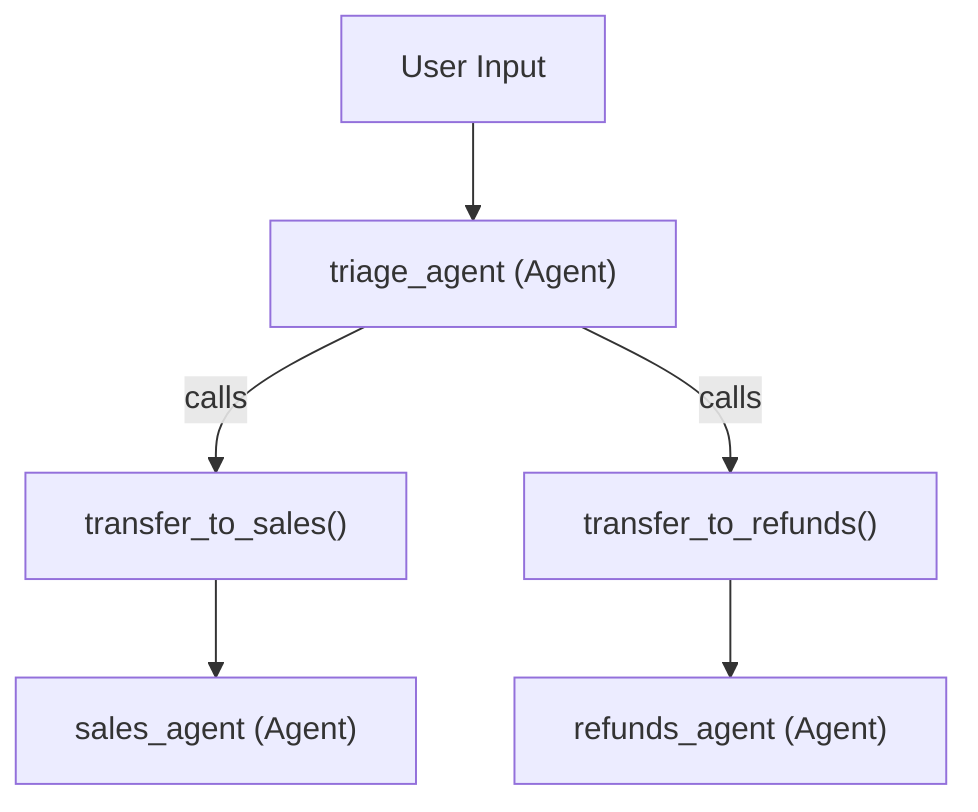
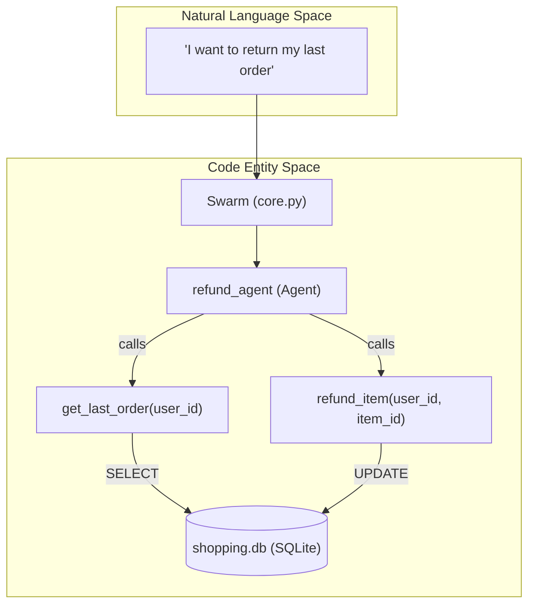
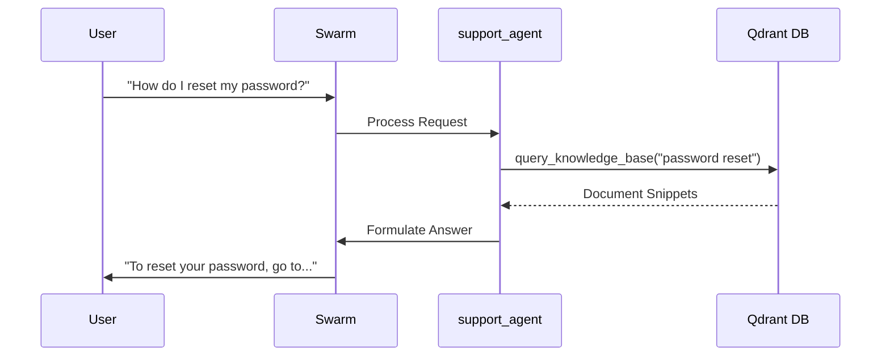

<!-- source: DeepWiki mcp.deepwiki.com · repo openai/swarm · page 4.4 Other Examples · fetched 2026-10-26 -->

# Other Examples

Relevant source files

The following files were used as context for generating this wiki page:

- [examples/__init__.py](examples/__init__.py)
- [examples/customer_service/logs/session_20240422-134602.json](examples/customer_service/logs/session_20240422-134602.json)
- [examples/customer_service_lite/logs/session_20240425-175026.json](examples/customer_service_lite/logs/session_20240425-175026.json)

This page documents the specialized example applications within the Swarm repository. These examples demonstrate advanced integration patterns, including database persistence, vector search, and evaluation frameworks for multi-agent routing.

## Triage Agent

The `triage_agent` example demonstrates a foundational pattern for customer service: a central router that directs user intent to specialized agents. It also includes a basic evaluation script to verify routing logic.

### Implementation Detail
The system consists of three agents: `triage_agent`, `sales_agent`, and `refunds_agent`. The `triage_agent` acts as the entry point, using functions to hand off control based on user requests.

*   **`triage_agent`**: Its instructions direct it to determine if a user wants to make a purchase or request a refund [examples/triage_agent/configs/agents.py:10-14]().
*   **Handoff Functions**: The `transfer_to_sales` and `transfer_to_refunds` functions return the respective `Agent` objects, triggering the Swarm handoff mechanism [examples/triage_agent/configs/agents.py:17-25]().

### Evaluation Logic
The `evals.py` script runs a series of test cases against the `triage_agent` to ensure it routes correctly. It compares the `name` of the active agent in the final `Response` against an expected value.

**Triage Routing Flow**

**Sources:**
* [examples/triage_agent/configs/agents.py:1-35]()
* [examples/triage_agent/evals.py:1-30]()
* [examples/triage_agent/run.py:1-10]()

---

## Weather Agent

The `weather_agent` is a concise demonstration of function calling where the agent must determine the correct arguments for a tool based on natural language input.

### Key Components
*   **`get_weather(location, time="now")`**: A mock function that returns a JSON string containing weather data. It serves as the tool available to the agent [examples/weather_agent/run.py:7-10]().
*   **Agent Configuration**: The agent is initialized with instructions to be a helpful agent and is provided the `get_weather` function in its `functions` list [examples/weather_agent/run.py:13-17]().

**Sources:**
* [examples/weather_agent/run.py:1-25]()

---

## Personal Shopper

The `personal_shopper` example demonstrates how to integrate Swarm with a relational database (`SQLite`) to maintain state across agent interactions and handle complex tasks like order lookups and cancellations.

### Database Integration
The example uses a SQLite database (`shopping.db`) with two primary tables: `users` and `purchases`.
*   **`setup_database()`**: Initializes the schema and populates mock data [examples/personal_shopper/main.py:15-45]().
*   **Context Variables**: The system uses `user_id` in `context_variables` to scope database queries to the current user [examples/personal_shopper/main.py:100-105]().

### Agent Hierarchy
1.  **`triage_agent`**: Identifies the user and routes to specialized agents.
2.  **`refund_agent`**: Handles order returns using `get_last_order` and `refund_item` [examples/personal_shopper/main.py:75-85]().
3.  **`sales_inventory_agent`**: Handles product discovery and stock checks.

**Code Entity Interaction Diagram**

**Sources:**
* [examples/personal_shopper/main.py:1-110]()

---

## Support Bot

The `support_bot` example showcases the integration of a Vector Database (**Qdrant**) to provide agents with Retrieval-Augmented Generation (RAG) capabilities.

### Implementation Components
*   **Vector Storage**: Uses `QdrantClient` to store and query document embeddings [examples/support_bot/main.py:20-30]().
*   **`query_knowledge_base`**: A tool provided to the `support_agent` that performs a similarity search in Qdrant and returns relevant snippets [examples/support_bot/main.py:40-55]().
*   **Handoff to Human**: Includes a `transfer_to_human` function that signals the end of automated support if the agent cannot resolve the issue [examples/support_bot/main.py:60-65]().

**Data Flow: Support Query**

**Sources:**
* [examples/support_bot/main.py:1-80]()

---

