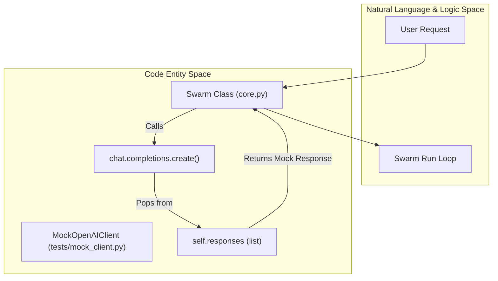
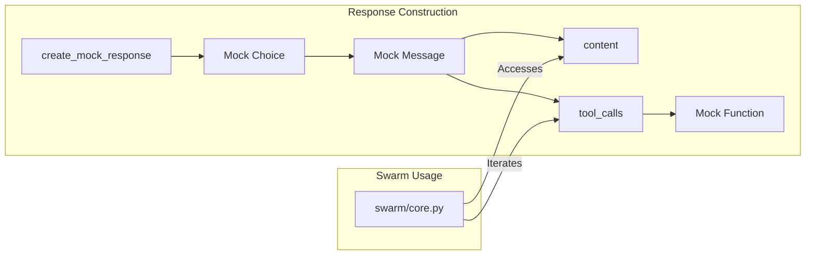

<!-- source: DeepWiki mcp.deepwiki.com · repo openai/swarm · page 5.2 Mock Client · fetched 2026-10-26 -->

# Mock Client

Relevant source files

The following files were used as context for generating this wiki page:

- [README.md](README.md)

The Mock Client is a testing utility designed to facilitate deterministic, offline testing of the Swarm framework. It provides a way to simulate OpenAI API responses without making actual network requests, allowing for repeatable test cases and verification of the Swarm orchestration logic, tool execution, and agent handoffs.

## Overview

The testing infrastructure relies on `MockOpenAIClient` to intercept calls typically directed to the `openai.OpenAI` client. By using predefined response patterns, developers can verify how the `Swarm` class handles various scenarios, such as multiple tool calls, nested handoffs, and context variable updates.

### Key Components

| Component | Description |
| :--- | :--- |
| `MockOpenAIClient` | A mock class that mimics the interface of the OpenAI Python client, specifically the `chat.completions.create` method. |
| `create_mock_response` | A helper function to generate structured mock objects that follow the OpenAI API response format (Choice, Message, ToolCall). |
| `set_sequential_responses` | A utility to queue a series of responses, allowing the mock client to return different results for consecutive calls in a single `run()` loop. |

Sources: [tests/mock_client.py:1-73]()

## Implementation Details

### MockOpenAIClient Class
The `MockOpenAIClient` acts as a drop-in replacement for the standard client. It maintains an internal queue of responses that are returned sequentially when `chat.completions.create` is invoked.

Sources: [tests/mock_client.py:53-73](), [swarm/core.py:82-110]()

### Response Generation
The `create_mock_response` function constructs a complex nested object structure that satisfies the attribute access patterns used by the Swarm `run` loop (e.g., `response.choices[0].message`).

Sources: [tests/mock_client.py:1-40](), [swarm/core.py:112-135]()

## Key Functions

### `create_mock_response`
Constructs a mock object with the following structure:
- **Content**: The string message from the agent.
- **Tool Calls**: A list of mock tool call objects, each containing a function name and JSON-encoded arguments.
- **Role**: Defaults to "assistant".

[tests/mock_client.py:1-40]()

### `set_sequential_responses`
This function is used to prepare the `MockOpenAIClient` for complex interactions. In Swarm, a single `client.run()` call might trigger multiple API turns (e.g., Turn 1: Tool Call, Turn 2: Result Summary). This utility allows the test to pre-load the exact sequence of responses expected.

[tests/mock_client.py:43-50]()

## Usage in Testing

The mock client is used extensively in `tests/test_core.py` to validate the `Swarm` orchestrator. By injecting a `MockOpenAIClient` into the `Swarm` constructor, tests can assert that the framework correctly interprets tool calls and performs agent transitions.

### Data Flow Example: Tool Execution
1.  **Setup**: A test creates a `MockOpenAIClient` and uses `set_sequential_responses` to provide a tool call response followed by a final content response.
2.  **Execution**: `Swarm.run()` is called.
3.  **Turn 1**: `Swarm` calls `chat.completions.create()`. The mock returns a `tool_call` for a function (e.g., `get_weather`).
4.  **Action**: `Swarm` executes the local Python function and appends the result to the message history.
5.  **Turn 2**: `Swarm` calls `chat.completions.create()` again. The mock returns the final conversational content.
6.  **Assertion**: The test verifies the final response contains the expected messages and that the tool was called with the correct parameters.

Sources: [tests/test_core.py:10-45](), [swarm/core.py:112-150]()

---

