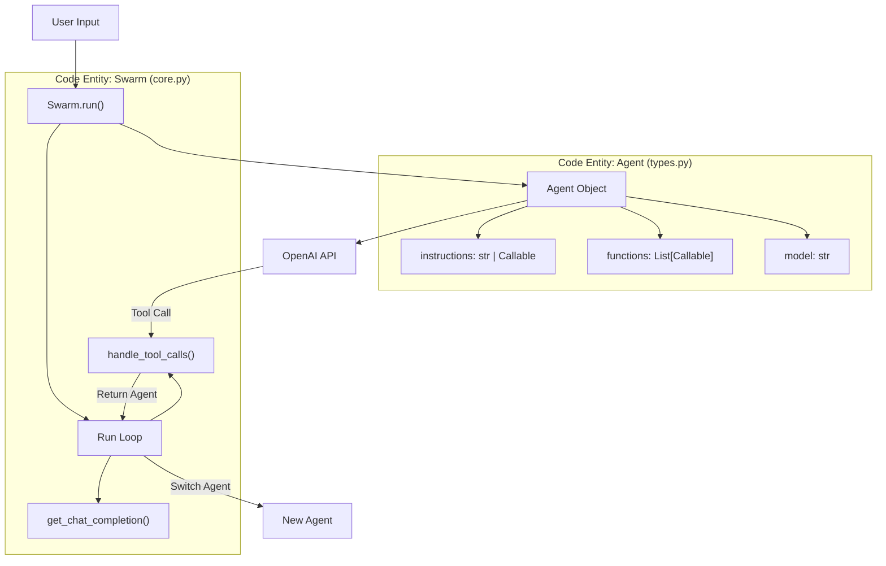
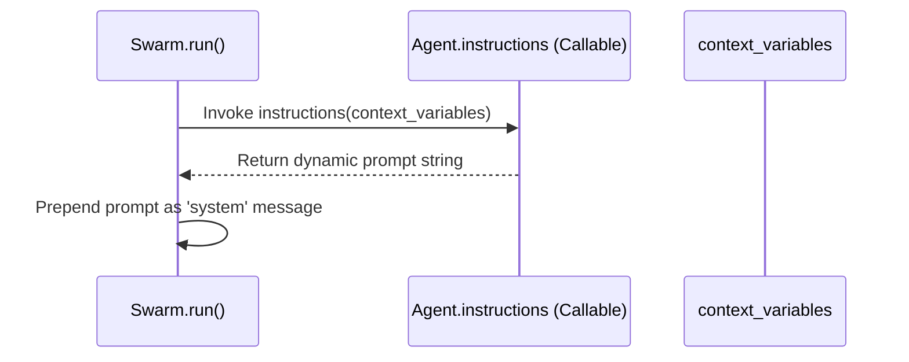
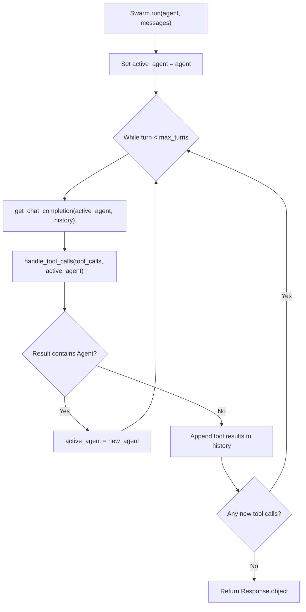

<!-- source: DeepWiki mcp.deepwiki.com · repo openai/swarm · page 6.1 Creating Custom Agents · fetched 2026-10-26 -->

# Creating Custom Agents

<details>
<summary>Relevant source files</summary>

The following files were used as context for generating this wiki page:

- [README.md](README.md)
- [examples/basic/agent_handoff.py](examples/basic/agent_handoff.py)
- [examples/basic/bare_minimum.py](examples/basic/bare_minimum.py)

</details>


This page provides a technical guide for creating and configuring custom agents using the Swarm framework. Agents are the primary abstractions that encapsulate instructions, tools, and model configurations to handle specific tasks.

## Overview

In Swarm, an `Agent` is a stateless configuration object that describes how a language model should behave and what tools it has access to. The core orchestration is handled by the `Swarm` class, which manages the lifecycle of a conversation, including function execution and agent handoffs.



Sources: [swarm/types.py:11-21](), [swarm/core.py:116-125]()

## Defining an Agent

The `Agent` class is defined as a Pydantic model, ensuring type safety and easy configuration.

| Field | Type | Default | Description |
| :--- | :--- | :--- | :--- |
| `name` | `str` | `"Agent"` | The identifier for the agent used in logs and handoffs. |
| `model` | `str` | `"gpt-4o"` | The specific OpenAI model to use for this agent. |
| `instructions` | `str` or `Callable` | `"You are a helpful agent."` | The system prompt or a function that returns one. |
| `functions` | `List[Callable]` | `[]` | Python functions the agent can invoke as tools. |
| `tool_choice` | `str` | `None` | Overrides the default tool selection behavior. |
| `parallel_tool_calls` | `bool` | `True` | Whether to allow multiple tool calls in one turn. |

Sources: [swarm/types.py:11-21]()

### Model Selection
Agents default to `gpt-4o`. You can override this per-agent or globally during `Swarm.run()` using the `model_override` parameter [swarm/core.py:134-134]().

## Instructions and Dynamic Context

Instructions can be static strings or dynamic callables. If a callable is provided, it is executed at the start of `Swarm.run()` and passed the current `context_variables`.



Sources: [swarm/core.py:192-197]()

## Tool Assignment and Handoff Patterns

Tools are assigned to an agent via the `functions` list. Swarm automatically converts these Python functions into JSON schemas using `function_to_json` [swarm/util.py:11-58]().

### Handoffs (Agent Switching)
A handoff occurs when an agent's tool returns another `Agent` object. This is the primary mechanism for multi-agent orchestration.

```python
def transfer_to_spanish_agent():
    """Transfer spanish speaking users immediately."""
    return spanish_agent # Returns an Agent instance

english_agent = Agent(
    name="English Agent",
    instructions="You only speak English.",
    functions=[transfer_to_spanish_agent]
)
```

**Data Flow during Handoff:**
1. The model generates a `tool_call` for `transfer_to_spanish_agent`.
2. `Swarm.handle_tool_calls` executes the function [swarm/core.py:94-114]().
3. The function returns an `Agent` object.
4. `Swarm.run` detects the new agent and updates the active agent for the next turn [swarm/core.py:279-282]().

Sources: [examples/basic/agent_handoff.py:16-21](), [swarm/core.py:279-286]()

## Implementation Detail: The Run Loop

The lifecycle of a custom agent within a `Swarm.run()` call follows a strict loop.



### Response Object
After the loop terminates, Swarm returns a `Response` object containing:
- `messages`: The full conversation history, including tool outputs.
- `agent`: The last active agent (useful if a handoff occurred).
- `context_variables`: The final state of any modified context.

Sources: [swarm/core.py:231-292](), [swarm/types.py:24-28]()

## Best Practices

1.  **Docstrings as Metadata**: Always include docstrings in your handoff functions. Swarm uses the docstring to populate the tool's description in the JSON schema [swarm/util.py:35-37]().
2.  **Statelessness**: Remember that `Agent` objects are stateless. Any persistent state should be stored in `context_variables` and passed through the `run()` method [README.md:81-81]().
3.  **Encapsulation**: Create specialized agents for specific domains (e.g., `triage_agent`, `billing_agent`) rather than one large agent with many tools [README.md:85-86]().

Sources: [swarm/util.py:35-37](), [README.md:81-87]()

---

