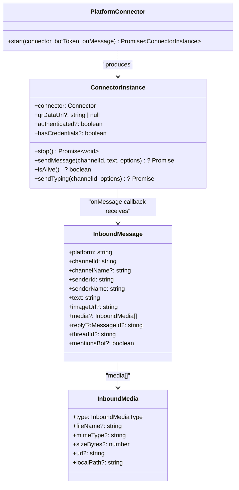
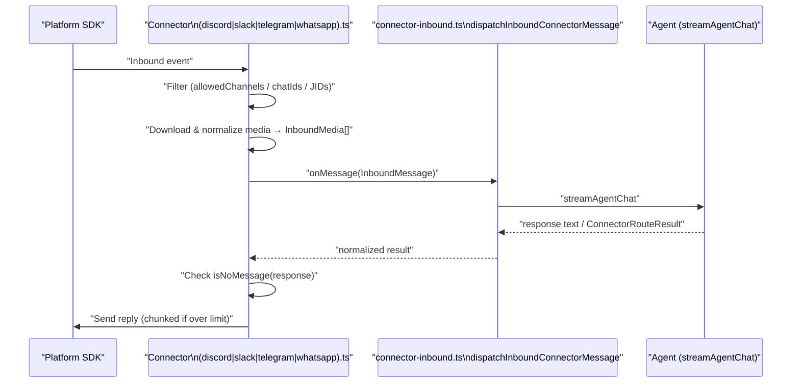
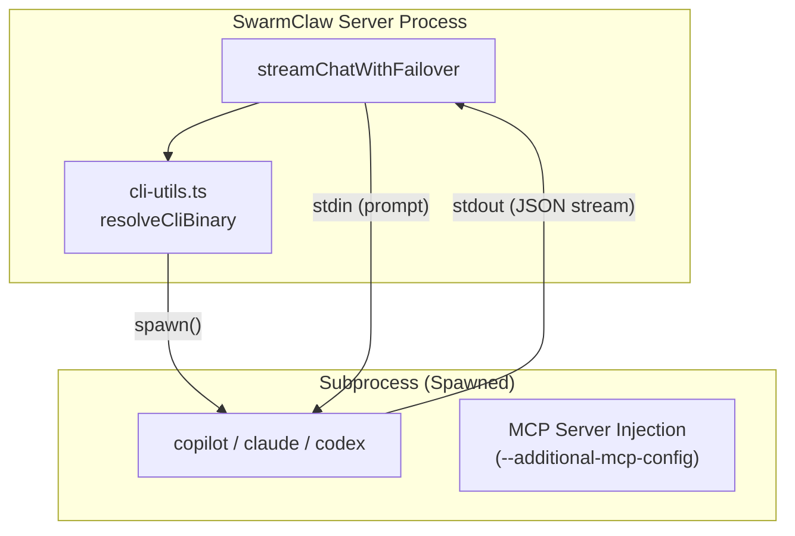

<!-- source: DeepWiki mcp.deepwiki.com · repo swarmclawai/swarmclaw · page 10.2 Platform Connectors · fetched 2026-10-26 -->

# Platform Connectors

<details>
<summary>Relevant source files</summary>

The following files were used as context for generating this wiki page:

- [scripts/benchmark-autonomy-harness.mjs](scripts/benchmark-autonomy-harness.mjs)
- [scripts/codex-login-noninteractive.sh](scripts/codex-login-noninteractive.sh)
- [scripts/run-agent-regression-suite.ts](scripts/run-agent-regression-suite.ts)
- [src/app/globals.css](src/app/globals.css)
- [src/components/agents/agent-list.tsx](src/components/agents/agent-list.tsx)
- [src/lib/providers/claude-cli.ts](src/lib/providers/claude-cli.ts)
- [src/lib/providers/codex-cli.ts](src/lib/providers/codex-cli.ts)
- [src/lib/providers/copilot-cli.ts](src/lib/providers/copilot-cli.ts)
- [src/lib/server/agents/subagent-runtime.test.ts](src/lib/server/agents/subagent-runtime.test.ts)
- [src/lib/server/connectors/connector-inbound.ts](src/lib/server/connectors/connector-inbound.ts)
- [src/lib/server/connectors/discord.ts](src/lib/server/connectors/discord.ts)
- [src/lib/server/connectors/manager.test.ts](src/lib/server/connectors/manager.test.ts)
- [src/lib/server/connectors/manager.ts](src/lib/server/connectors/manager.ts)
- [src/lib/server/connectors/media.ts](src/lib/server/connectors/media.ts)
- [src/lib/server/connectors/slack.ts](src/lib/server/connectors/slack.ts)
- [src/lib/server/connectors/telegram.ts](src/lib/server/connectors/telegram.ts)
- [src/lib/server/connectors/types.ts](src/lib/server/connectors/types.ts)
- [src/lib/server/connectors/whatsapp.ts](src/lib/server/connectors/whatsapp.ts)
- [src/lib/server/eval/agent-regression.ts](src/lib/server/eval/agent-regression.ts)
- [src/lib/server/playwright-proxy.mjs](src/lib/server/playwright-proxy.mjs)
- [src/lib/server/session-tools/delegate-fallback.test.ts](src/lib/server/session-tools/delegate-fallback.test.ts)
- [src/lib/server/skills/discovered-skill-prompt.test.ts](src/lib/server/skills/discovered-skill-prompt.test.ts)
- [src/lib/server/tool-planning.test.ts](src/lib/server/tool-planning.test.ts)

</details>


This page documents each individual chat platform connector implementation: the shared interfaces they implement, how authentication works per platform, how inbound messages are normalized to `InboundMessage`, and how outbound replies are delivered. It covers the core platform connectors including Discord, Slack, Telegram, and WhatsApp, as well as the specialized CLI providers that bridge to external agent tools.

For the connector lifecycle (starting, stopping, routing messages through agents, and proactive outbound sends) see [Connector Manager](#10.1). For the OpenClaw WebSocket gateway connector specifically, see [OpenClaw Gateway Connector](#10.3).

---

## Core Interfaces

All platform connectors are defined in [src/lib/server/connectors/types.ts]() and must conform to two contracts.

**Connector Architecture**



Sources: [src/lib/server/connectors/types.ts:1-143]()

### `PlatformConnector`

The single-method interface every platform module exports:

```typescript
start(
  connector: Connector,
  botToken: string,
  onMessage: (msg: InboundMessage) => Promise<ConnectorIngressResult>,
): Promise<ConnectorInstance>
```

- `connector` — the stored `Connector` record (config, credential IDs, etc.)
- `botToken` — the plaintext credential resolved by the manager
- `onMessage` — callback that routes the normalized message through an agent and returns the agent's text reply or a `ConnectorRouteResult` [src/lib/server/connectors/types.ts:136-142]().

### `ConnectorInstance`

The object returned from `start`. The manager stores it in the `running` map [src/lib/server/connectors/manager.ts:4-9]().

| Field | Type | Description |
|---|---|---|
| `connector` | `Connector` | Reference to the stored config |
| `stop` | `() => Promise<void>` | Shuts down the platform connection |
| `sendMessage` | optional | Delivers proactive outbound messages |
| `qrDataUrl` | `string \| null` | WhatsApp QR code (base64 PNG data URL) |
| `authenticated` | `boolean` | WhatsApp: whether the session is live |
| `isAlive` | `() => boolean` | Health check for the underlying connection |

Sources: [src/lib/server/connectors/types.ts:102-133]()

### `InboundMessage`

The normalized form every platform converter produces.

| Field | Notes |
|---|---|
| `platform` | `'discord'`, `'slack'`, `'telegram'`, `'whatsapp'`, etc. |
| `channelId` | Platform-specific channel/chat/JID identifier |
| `senderId` | Platform user ID |
| `text` | Message body; falls back to `'(media message)'` if empty |
| `threadId` | Platform-native thread or topic identifier |
| `mentionsBot` | Boolean indicating if the bot was explicitly tagged |

Sources: [src/lib/server/connectors/types.ts:24-50]()

---

## Platform Connector Implementations

**Message Flow Through Platform Connector**



Sources: [src/lib/server/connectors/connector-inbound.ts:60-62](), [src/lib/server/connectors/discord.ts:133-178](), [src/lib/server/connectors/slack.ts:175-210]()

---

### Discord

**File:** [src/lib/server/connectors/discord.ts]()  
**Library:** `discord.js`

**Authentication:** Calls `client.login(botToken)`. Required intents include `Guilds`, `GuildMessages`, `MessageContent`, and `DirectMessages` [src/lib/server/connectors/discord.ts:101-109]().

**Thread Context:** `hydrateDiscordThreadContext` fetches the starter message and recent history (up to 8 messages) to provide context to the agent [src/lib/server/connectors/discord.ts:35-71]().

**Media:** Uses `downloadInboundMediaToUpload` to persist attachments locally [src/lib/server/connectors/discord.ts:148-163]().

---

### Slack

**File:** [src/lib/server/connectors/slack.ts]()  
**Library:** `@slack/bolt` (Socket Mode)

**Authentication:** Requires an App-Level Token (`xapp-`) for Socket Mode and a Bot Token (`xoxb-`) for API calls [src/lib/server/connectors/slack.ts:111-136]().

**Thread Context:** `hydrateSlackThreadContext` uses `conversations.replies` to fetch the last 6 messages in a thread for history normalization [src/lib/server/connectors/slack.ts:44-107]().

---

### Telegram

**File:** [src/lib/server/connectors/telegram.ts]()  
**Library:** `grammy`

**Media Resolution:** Supports `photo`, `video`, `audio`, `voice`, and `animation`. Voice notes are specifically forced to `audio/ogg` [src/lib/server/connectors/telegram.ts:72-115]().

**Outbound:** Uses `deliverChunkedConnectorText` to split long responses into chunks of 4090 characters to stay within Telegram's 4096 limit [src/lib/server/connectors/telegram.ts:162-178]().

---

### WhatsApp

**File:** [src/lib/server/connectors/whatsapp.ts]()  
**Library:** `@whiskeysockets/baileys`

**Pairing:** Uses QR-code pairing. The `qrDataUrl` is generated via `QRCode.toDataURL` when the `connection.update` event provides a new QR string [src/lib/server/connectors/whatsapp.ts:9]().

**Audio Transcription:** WhatsApp voice notes (ogg/opus) are automatically transcribed if an transcription service is configured. The connector also supports sending outbound audio as native voice notes (`ptt: true`) using `ffmpeg` for transcoding [src/lib/server/connectors/whatsapp.ts:183-210]().

---

## CLI & Specialized Providers

SwarmClaw supports "CLI Providers" which act as connectors to external agentic CLI tools. These bridge the gap between the SwarmClaw agent loop and tools like GitHub Copilot or Claude CLI.

**CLI Provider Data Flow**



Sources: [src/lib/providers/copilot-cli.ts:108-121](), [src/lib/providers/claude-cli.ts:76-86]()

### Copilot CLI
**File:** [src/lib/providers/copilot-cli.ts]()  
Spawns `copilot` with `--output-format=json`. It tracks `session.copilotSessionId` to maintain multi-turn continuity [src/lib/providers/copilot-cli.ts:13-16](). It can inject SwarmClaw-managed MCP servers into the Copilot subprocess via the `--additional-mcp-config` flag [src/lib/providers/copilot-cli.ts:70-103]().

### Claude CLI
**File:** [src/lib/providers/claude-cli.ts]()  
Spawns `claude` with `stream-json`. It utilizes a specialized `playwright-proxy.mjs` to intercept `browser_screenshot` responses from the CLI's internal tools, saving them to the SwarmClaw uploads directory so they can be displayed in the UI [src/lib/providers/claude-cli.ts:41-56]().

### Playwright Proxy
**File:** [src/lib/server/playwright-proxy.mjs]()  
An MCP proxy that parses Content-Length framed messages. It intercepts image blocks, writes them to disk, and replaces them with a local API URL so the agent can reference the screenshot in its response [src/lib/server/playwright-proxy.mjs:72-92]().

Sources: [src/lib/server/playwright-proxy.mjs:1-115]()

---

## Audio & Media Normalization

Connectors use shared utilities in [src/lib/server/connectors/media.ts]() and [src/lib/server/connectors/response-media.ts]() to handle files.

1.  **Inbound:** `downloadInboundMediaToUpload` fetches remote attachments (Discord/Telegram/Slack) and saves them to the local `uploads` directory [src/lib/server/connectors/discord.ts:148-154]().
2.  **Transcription:** `enrichInboundMessageWithAudioTranscript` (called in `connector-inbound.ts`) attempts to convert audio messages to text before the agent sees them [src/lib/server/connectors/connector-inbound.ts:41]().
3.  **Outbound:** `selectOutboundMediaFiles` filters and prepares local files or URLs to be sent back to the platform [src/lib/server/connectors/connector-inbound.ts:81]().

Sources: [src/lib/server/connectors/connector-inbound.ts:41-83](), [src/lib/server/connectors/whatsapp.ts:18-19]()

---

