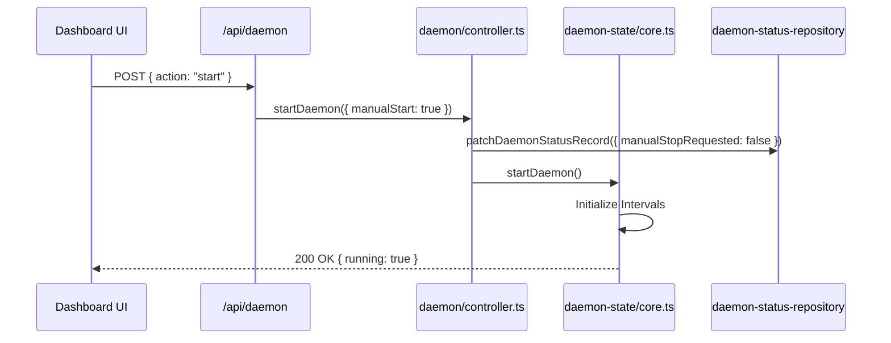

<!-- source: DeepWiki mcp.deepwiki.com · repo swarmclawai/swarmclaw · page 11 Background Daemon · fetched 2026-10-26 -->

# Background Daemon

<details>
<summary>Relevant source files</summary>

The following files were used as context for generating this wiki page:

- [CONTRIBUTING.md](CONTRIBUTING.md)
- [src/app/api/auth/route.ts](src/app/api/auth/route.ts)
- [src/app/api/daemon/health-check/route.ts](src/app/api/daemon/health-check/route.ts)
- [src/app/api/daemon/route.ts](src/app/api/daemon/route.ts)
- [src/app/api/version/route.ts](src/app/api/version/route.ts)
- [src/app/api/version/update/route.ts](src/app/api/version/update/route.ts)
- [src/lib/providers/cli-utils.ts](src/lib/providers/cli-utils.ts)
- [src/lib/server/daemon/controller.ts](src/lib/server/daemon/controller.ts)
- [src/lib/server/daemon/lease-owner.test.ts](src/lib/server/daemon/lease-owner.test.ts)
- [src/lib/server/daemon/lease-owner.ts](src/lib/server/daemon/lease-owner.ts)
- [src/lib/server/git-metadata.test.ts](src/lib/server/git-metadata.test.ts)
- [src/lib/server/git-metadata.ts](src/lib/server/git-metadata.ts)
- [src/lib/server/provider-health.ts](src/lib/server/provider-health.ts)
- [src/lib/server/runtime/daemon-state/core.ts](src/lib/server/runtime/daemon-state/core.ts)
- [src/lib/server/runtime/heartbeat-service.test.ts](src/lib/server/runtime/heartbeat-service.test.ts)
- [src/lib/server/runtime/heartbeat-service.ts](src/lib/server/runtime/heartbeat-service.ts)
- [src/lib/server/runtime/process-manager.ts](src/lib/server/runtime/process-manager.ts)
- [src/lib/server/session-tools/context.ts](src/lib/server/session-tools/context.ts)

</details>


The SwarmClaw Background Daemon is a long-running supervisor that coordinates all background services: task queue processing, job scheduling, heartbeat pings, browser cleanup, connector management, and health monitoring. It ensures that autonomous agents remain active and that the system recovers from transient failures without manual intervention.

For detailed documentation on specific daemon subsystems, see:
- [Daemon Lifecycle](#11.1) — State persistence, manual controls, and startup/shutdown logic.
- [Heartbeat Service](#11.2) — Autonomous session pings and orchestrator wake loops.
- [Health Monitoring](#11.3) — Provider cooldowns, connector restarts, and stale session detection.

---

## Service Orchestration

The daemon acts as a central hub, managing several parallel loops and workers. It is responsible for triggering the following operations:

| Service | Logic Source | Responsibility |
|---|---|---|
| **Queue Processor** | `processNext` | Polls the task queue and executes pending tasks. |
| **Scheduler** | `runScheduler` | Evaluates cron, interval, and one-time schedules. |
| **Heartbeat** | `tickHeartbeats` | Sends periodic pings to keep autonomous sessions alive. |
| **Health Monitor** | `runHealthChecks` | Detects stale sessions and restarts failed connectors. |
| **Browser Sweep** | `sweepOrphanedBrowsers` | Cleans up idle Playwright/Docker browser instances. |
| **Memory Dream** | `dream-service` | Triggers background memory consolidation and reflection. |

Sources: [src/lib/server/runtime/daemon-state/core.ts:73-95](), [src/lib/server/runtime/heartbeat-service.ts:36-50]()

---

## Code-to-System Mapping

The following diagram bridges the high-level service names to their primary implementation files and function entries within the daemon runtime.

**Diagram: Daemon Service Architecture**

```mermaid
graph TB
    subgraph "Daemon Runtime Control"
        "controller.ts"["daemon/controller.ts"]
        "core.ts"["daemon-state/core.ts"]
    end

    subgraph "Background Services"
        "HB"["heartbeat-service.ts\ntickHeartbeats()"]
        "QP"["queue.ts\nprocessNext()"]
        "SCH"["scheduler.ts\nstartScheduler()"]
        "HM"["daemon-state/core.ts\nrunHealthChecks()"]
        "BS"["session-tools/index.ts\nsweepOrphanedBrowsers()"]
    end

    "controller.ts" -- "RPC/HTTP" --> "core.ts"
    "core.ts" -- "setInterval" --> "HB"
    "core.ts" -- "setInterval" --> "QP"
    "core.ts" -- "setInterval" --> "SCH"
    "core.ts" -- "setInterval" --> "HM"
    "core.ts" -- "setInterval" --> "BS"

    "HM" -- "checks" --> "PH"["provider-health.ts\nisProviderCoolingDown()"]
    "HM" -- "restarts" --> "CM"["connectors/manager.ts\nstartConnector()"]
```

Sources: [src/lib/server/daemon/controller.ts:28-33](), [src/lib/server/runtime/daemon-state/core.ts:105-128](), [src/lib/server/runtime/daemon-state/core.ts:148-187]()

---

## Lifecycle and Control

The daemon is typically managed via the `daemon-controller`, which provides an abstraction for starting and stopping the background process. It supports both in-process execution and detached subprocess mode (used by the CLI).

### Control Flow
1. **Auto-start**: Triggered by `ensureDaemonStarted` during the first authenticated API request to `POST /api/auth` or `GET /api/daemon`.
2. **Manual Override**: Users can explicitly stop the daemon via the UI or CLI, which sets a `manualStopRequested` flag in `daemon-status-repository`.
3. **Hot Reload Safety**: The daemon state is stored in a `hmrSingleton` on `globalThis` (`__swarmclaw_daemon__`), allowing the background loops to persist across Next.js hot-module reloads during development.

**Diagram: Control and API Interaction**



Sources: [src/lib/server/daemon/controller.ts:192-214](), [src/lib/server/runtime/daemon-state/core.ts:105-146](), [src/app/api/auth/route.ts:82-143]()

---

## Configuration Reference

The daemon's behavior is governed by several constants and environment variables defined in the core runtime.

| Parameter | Default | File Reference |
|---|---|---|
| `QUEUE_CHECK_INTERVAL` | 30s | [src/lib/server/runtime/daemon-state/core.ts:73]() |
| `HEALTH_CHECK_INTERVAL` | 120s | [src/lib/server/runtime/daemon-state/core.ts:76]() |
| `CONNECTOR_HEALTH_CHECK_INTERVAL` | 15s | [src/lib/server/runtime/daemon-state/core.ts:77]() |
| `STALE_MIN_MS` | 4m | [src/lib/server/runtime/daemon-state/core.ts:81]() |
| `HEARTBEAT_TICK_MS` | 60s | [src/lib/server/runtime/heartbeat-service.ts:36]() |
| `STARTUP_GRACE_MS` | 180s | [src/lib/server/runtime/heartbeat-service.ts:43]() |

---

## Related Pages

- [Daemon Lifecycle](#11.1) — Detailed explanation of `ensureDaemonStarted`, `startDaemon`, `stopDaemon`, and `globalThis` state persistence.
- [Heartbeat Service](#11.2) — Documentation for `tickHeartbeats`, session wake prompts, and orchestrator agent ticks.
- [Health Monitoring](#11.3) — Logic for `runHealthChecks`, provider circuit breakers, and exponential backoff for connectors.
- [Task Queue](#8.1) — How the daemon processes tasks via the `queue.ts` engine.
- [Connector Manager](#10.1) — Interaction between the daemon and external chat platform connectors.

---

