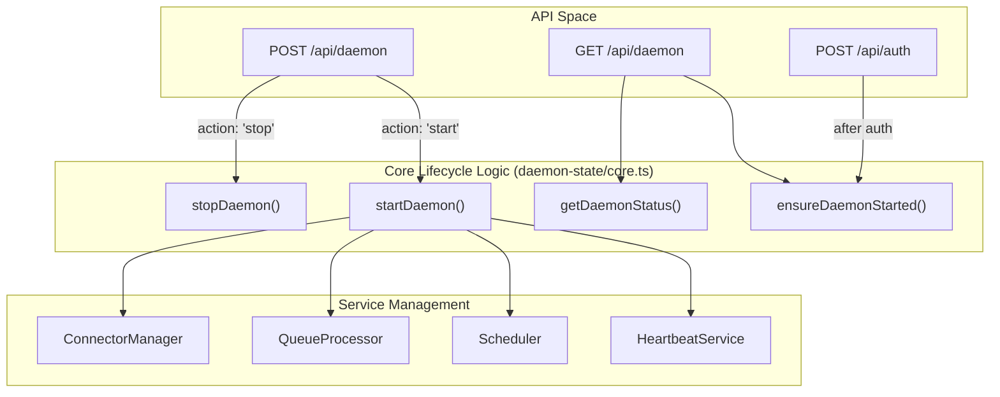
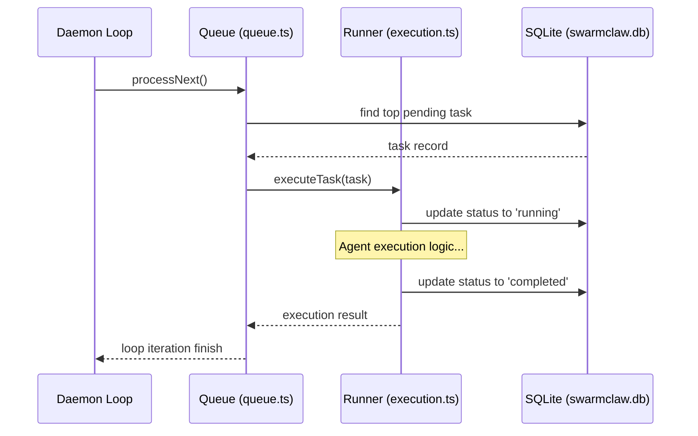

<!-- source: DeepWiki mcp.deepwiki.com · repo swarmclawai/swarmclaw · page 11.1 Daemon Lifecycle · fetched 2026-10-26 -->

# Daemon Lifecycle

Relevant source files

The following files were used as context for generating this wiki page:

- [CONTRIBUTING.md](CONTRIBUTING.md)
- [src/app/api/auth/route.ts](src/app/api/auth/route.ts)
- [src/app/api/daemon/health-check/route.ts](src/app/api/daemon/health-check/route.ts)
- [src/app/api/daemon/route.ts](src/app/api/daemon/route.ts)
- [src/app/api/version/route.ts](src/app/api/version/route.ts)
- [src/app/api/version/update/route.ts](src/app/api/version/update/route.ts)
- [src/lib/server/agents/guardian.ts](src/lib/server/agents/guardian.ts)
- [src/lib/server/chat-execution/situational-awareness.ts](src/lib/server/chat-execution/situational-awareness.ts)
- [src/lib/server/daemon/controller.ts](src/lib/server/daemon/controller.ts)
- [src/lib/server/daemon/lease-owner.test.ts](src/lib/server/daemon/lease-owner.test.ts)
- [src/lib/server/daemon/lease-owner.ts](src/lib/server/daemon/lease-owner.ts)
- [src/lib/server/git-metadata.test.ts](src/lib/server/git-metadata.test.ts)
- [src/lib/server/git-metadata.ts](src/lib/server/git-metadata.ts)
- [src/lib/server/memory/memory-consolidation.ts](src/lib/server/memory/memory-consolidation.ts)
- [src/lib/server/memory/memory-db.ts](src/lib/server/memory/memory-db.ts)
- [src/lib/server/runtime/daemon-state.ts](src/lib/server/runtime/daemon-state.ts)
- [src/lib/server/runtime/daemon-state/core.ts](src/lib/server/runtime/daemon-state/core.ts)
- [src/lib/server/runtime/idle-window.ts](src/lib/server/runtime/idle-window.ts)
- [src/lib/server/runtime/queue.ts](src/lib/server/runtime/queue.ts)
- [src/lib/server/skills/learned-skills.ts](src/lib/server/skills/learned-skills.ts)

The background daemon is a set of managed services that handle autonomous agent activity, task execution, and system maintenance. It is not a separate OS process; rather, it is a collection of asynchronous loops running within the Next.js server process, coordinated by a central controller.

## Daemon Architecture

The daemon operates as a singleton within the server process. Its state is persisted on `globalThis` to ensure continuity across hot-module replacement (HMR) events during development.

### Global State Persistence

The daemon maintains its runtime state in a `DaemonState` object stored under the `globalThis.__swarmclaw_daemon__` key.

| Field | Type | Description |
|---|---|---|
| `running` | `boolean` | Indicates if the background services are active. |
| `manualStopRequested` | `boolean` | Flag set when a user explicitly stops the daemon, preventing autostart. |
| `queueIntervalId` | `NodeJS.Timeout` | Handle for the task queue processing loop. |
| `healthIntervalId` | `NodeJS.Timeout` | Handle for the system health monitoring loop. |
| `staleSessionIds` | `Set<string>` | Tracks sessions that have already triggered health alerts. |
| `lastProcessedAt` | `number` | Timestamp of the last successful queue processing tick. |

Sources: [src/lib/server/runtime/daemon-state/core.ts:105-131](), [src/lib/server/runtime/daemon-state/core.ts:133-143]()

### The Lease Mechanism

To prevent multiple instances (e.g., across different hosts or overlapping process starts) from conflicting, the daemon uses a runtime lock named `daemon-primary`. The process holding this lock is considered the "lease owner".

- **Owner String Format**: `pid:${process.pid}:${random_hex}`.
- **Lease Validation**: The `isOwnerProcessDead` utility checks if the PID recorded in the lease is still active on the host using `process.kill(pid, 0)`.
- **Reclamation**: If the owner process is dead, a new instance can reclaim the lease before the TTL expires.

Sources: [src/lib/server/daemon/lease-owner.ts:23-43](), [src/lib/server/daemon/lease-owner.ts:56-68](), [src/lib/server/runtime/daemon-state/core.ts:92-94]()

---

## Lifecycle Management

### Lifecycle Control Functions

The daemon lifecycle is managed through four primary functions in `src/lib/server/runtime/daemon-state/core.ts`.

#### `ensureDaemonStarted(source)`
A defensive guard called by API routes. It initiates the daemon only if `running` is false, `manualStopRequested` is false, and autostart is enabled via environment variables.
- **Source**: [src/lib/server/runtime/daemon-state/core.ts:200-209]()

#### `startDaemon(options)`
The primary entry point for activation.
1. If `manualStart: true` is passed, it clears the `manualStopRequested` flag.
2. It acquires the `daemon-primary` runtime lock.
3. It initializes sub-services: `startScheduler`, `startHeartbeatService`, and `startQueueProcessor`.
4. It triggers `autoStartConnectors` to restore external platform links.
- **Source**: [src/lib/server/runtime/daemon-state/core.ts:211-255]()

#### `stopDaemon(options)`
Gracefully shuts down all loops.
1. Sets `running = false`.
2. If `manualStop: true` is passed, sets `manualStopRequested = true`.
3. Stops the scheduler, heartbeat service, and all active connectors.
4. Releases the `daemon-primary` lock.
- **Source**: [src/lib/server/runtime/daemon-state/core.ts:257-285]()

#### `getDaemonStatus()`
Compiles a comprehensive status payload including queue length, health summary, and scheduler state.
- **Source**: [src/lib/server/runtime/daemon-state/core.ts:394-430]()

### Code Entity Space: Lifecycle Control

Sources: [src/app/api/daemon/route.ts:16-40](), [src/app/api/auth/route.ts:138-142](), [src/lib/server/runtime/daemon-state/core.ts:211-255]()

---

## Sub-Service Loops

When running, the daemon manages several internal intervals:

| Service | Interval | Function | File |
|---|---|---|---|
| **Queue Processor** | 30s | `processNext()` | [src/lib/server/runtime/queue/execution.ts]() |
| **Health Monitor** | 120s | `runHealthChecks()` | [src/lib/server/runtime/daemon-state/core.ts]() |
| **Connector Health** | 15s | `checkConnectorHealth()` | [src/lib/server/connectors/manager.ts]() |
| **Browser Sweep** | 60s | `sweepOrphanedBrowsers()` | [src/lib/server/session-tools/index.ts]() |
| **Scheduler** | 60s | `tick()` | [src/lib/server/runtime/scheduler.ts]() |

Sources: [src/lib/server/runtime/daemon-state/core.ts:73-84]()

### Data Flow: Task Execution Loop

Sources: [src/lib/server/runtime/queue/execution.ts:1-20](), [src/lib/server/runtime/daemon-state/core.ts:287-296]()

---

## Environment & Metadata Integration

### Git Metadata & Updates
The daemon lifecycle is often interrupted by system updates. The `POST /api/version/update` endpoint handles this by:
1. Checking `gitAvailable()` to ensure it's a source checkout.
2. Checkpointing the SQLite WAL via `wal_checkpoint(TRUNCATE)` to prevent corruption during native module rebuilds (e.g., `better-sqlite3`).
3. Performing a `git pull` and `npm install`.
4. Signalling a required restart.

Sources: [src/app/api/version/update/route.ts:17-23](), [src/app/api/version/update/route.ts:45-51](), [src/app/api/version/update/route.ts:91-101]()

### Manual Control Flags
The `manualStart` and `manualStop` flags are stored in the `daemon-status` repository. 
- If `manualStopRequested` is set in the database, the daemon will not autostart on server reboot or API request until a manual `start` action is received.
- This state is checked in `daemonAutostartEnvEnabled`.

Sources: [src/lib/server/daemon/daemon-status-repository.ts:1-20](), [src/lib/server/runtime/daemon-state/core.ts:58-65]()

---

