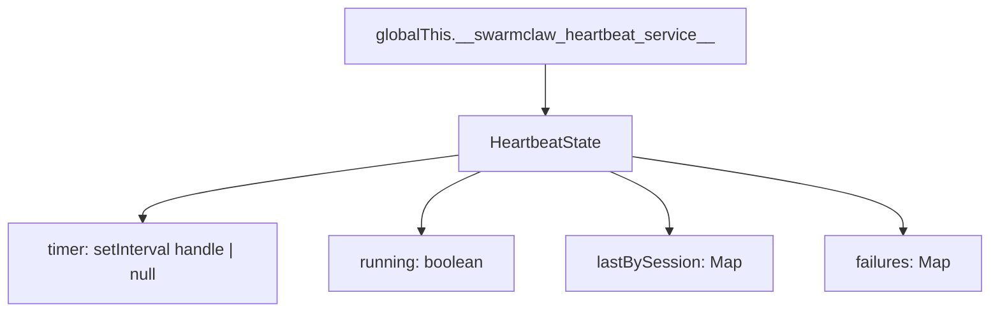
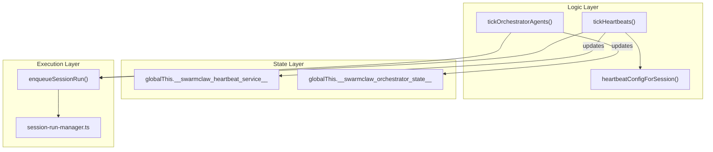
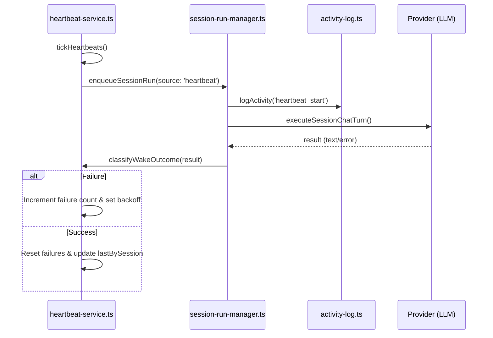

<!-- source: DeepWiki mcp.deepwiki.com · repo swarmclawai/swarmclaw · page 11.2 Heartbeat Service · fetched 2026-10-26 -->

# Heartbeat Service

Relevant source files

The following files were used as context for generating this wiki page:

- [src/lib/providers/cli-utils.ts](src/lib/providers/cli-utils.ts)
- [src/lib/server/memory/memory-integration.test.ts](src/lib/server/memory/memory-integration.test.ts)
- [src/lib/server/provider-health.ts](src/lib/server/provider-health.ts)
- [src/lib/server/runtime/heartbeat-service-timer.test.ts](src/lib/server/runtime/heartbeat-service-timer.test.ts)
- [src/lib/server/runtime/heartbeat-service.test.ts](src/lib/server/runtime/heartbeat-service.test.ts)
- [src/lib/server/runtime/heartbeat-service.ts](src/lib/server/runtime/heartbeat-service.ts)
- [src/lib/server/runtime/heartbeat-wake.ts](src/lib/server/runtime/heartbeat-wake.ts)
- [src/lib/server/runtime/process-manager.ts](src/lib/server/runtime/process-manager.ts)
- [src/lib/server/runtime/session-run-manager.test.ts](src/lib/server/runtime/session-run-manager.test.ts)
- [src/lib/server/runtime/session-run-manager.ts](src/lib/server/runtime/session-run-manager.ts)
- [src/lib/server/session-tools/context.ts](src/lib/server/session-tools/context.ts)
- [src/stores/use-chat-store.test.ts](src/stores/use-chat-store.test.ts)

This page documents the heartbeat service: what it does, how its tick loop works, how per-session configuration is resolved, and how it integrates with the daemon and session run manager. It also covers the **Orchestrator Mode** for autonomous background task management.

---

## Purpose

The heartbeat service keeps autonomous agent sessions alive between external triggers. When no human or connector message has arrived for a configurable period, the service injects a synthetic internal message into the session to prompt the agent to check for pending work. This is what enables agents to operate continuously in "ongoing" mode without any human input [src/lib/server/runtime/heartbeat-service.ts:44-49]().

The service lives in [src/lib/server/runtime/heartbeat-service.ts]().

---

## Service Lifecycle

The service is started and stopped by the daemon. It is not started independently.

**State object diagram:**

Sources: [src/lib/server/runtime/heartbeat-service.ts:85-99]()

The state is stored on `globalThis` under `__swarmclaw_heartbeat_service__` to survive Next.js hot-module reloads (HMR). On each call to `startHeartbeatService`, the old timer is always cleared and replaced [src/lib/server/runtime/heartbeat-service.ts:445-460]().

| Function | Description |
|---|---|
| `startHeartbeatService()` | Clears any existing timer, seeds cold-start state, starts 60s tick [src/lib/server/runtime/heartbeat-service.ts:445-472]() |
| `stopHeartbeatService()` | Sets `running = false`, clears the interval [src/lib/server/runtime/heartbeat-service.ts:474-478]() |
| `tickHeartbeats()` | The core loop that iterates sessions and enqueues runs [src/lib/server/runtime/heartbeat-service.ts:310-417]() |

Sources: [src/lib/server/runtime/heartbeat-service.ts:310-478]()

---

## Tick Logic & Eligibility

`tickHeartbeats()` is called every `HEARTBEAT_TICK_MS` (60,000 ms) [src/lib/server/runtime/heartbeat-service.ts:36]().

### Active Window Enforcement
Before iterating sessions, the service checks `inActiveWindow()`. If the current time is outside the configured `heartbeatActiveStart` and `heartbeatActiveEnd` window (using `heartbeatTimezone`), the tick exits immediately [src/lib/server/runtime/heartbeat-service.ts:313-315](). This allows for "quiet hours" where autonomous activity is suppressed [src/lib/server/runtime/heartbeat-service.ts:92-106]().

### Isolated Mode
If `isolatedMode` is enabled in settings, heartbeats are suppressed for all sessions except those explicitly listed in `isolatedHeartbeatSessionIds` [src/lib/server/runtime/heartbeat-service.ts:340-345]().

### Failure Backoff & Auto-Disable
The service tracks consecutive failures per session. If a session fails to respond to a heartbeat (e.g., provider errors or empty responses), it enters an exponential backoff phase [src/lib/server/runtime/heartbeat-service.ts:38-41](). If failures reach `MAX_CONSECUTIVE_FAILURES` (10), heartbeats for that session are auto-disabled [src/lib/server/runtime/heartbeat-service.ts:41](), [src/lib/server/runtime/heartbeat-service.ts:74-83]().

### Session Eligibility Filters
A session must pass these checks to receive a heartbeat [src/lib/server/runtime/heartbeat-service.ts:348-390]():
1. **Tool Check**: Session must have tools enabled [src/lib/server/runtime/heartbeat-service.ts:348]().
2. **Type Check**: Must be a `human` or `orchestrated` session [src/lib/server/runtime/heartbeat-service.ts:348]().
3. **Idle Check**: Must be idle longer than `userIdleThresholdSec` [src/lib/server/runtime/heartbeat-service.ts:365-375]().
4. **Main Loop Check**: If it's a main agent session, it must have "momentum" or pending events to warrant a wake [src/lib/server/runtime/heartbeat-service.ts:377-385]().
5. **Interval Check**: Time since last heartbeat must exceed `cfg.intervalSec` [src/lib/server/runtime/heartbeat-service.ts:390]().

Sources: [src/lib/server/runtime/heartbeat-service.ts:310-417]()

---

## Orchestrator Mode

The Heartbeat Service also manages **Orchestrator Agents**. These are background agents that coordinate multiple sessions or monitor system state without being tied to a specific user chat session.

### `tickOrchestratorAgents()`
This function runs alongside standard heartbeats. It identifies agents eligible for orchestration via `isOrchestratorEligible()` [src/lib/server/runtime/heartbeat-service.ts:420-442]().

- **Wake Logic**: Uses a dedicated `orchestratorState` to track agent-level (rather than session-level) last wake times [src/lib/server/runtime/heartbeat-service.ts:101-112]().
- **Daily Limits**: Enforces `orchestratorMaxDailyCycles` to prevent runaway costs [src/lib/server/runtime/heartbeat-service.ts:430-432]().
- **Wake Prompt**: Uses `buildOrchestratorWakePrompt()` which aggregates system events, orchestrator-specific events, and recent failures into a comprehensive context for the coordinator [src/lib/server/runtime/heartbeat-service.ts:480-530]().

### Deferred Wakes
The system can queue "deferred wakes" via `drainDeferredWakes()`. This allows the heartbeat service to trigger an immediate run for a session that was just updated by an external event (like a webhook or task completion) instead of waiting for the next 60s tick [src/lib/server/runtime/heartbeat-service.ts:16](), [src/lib/server/runtime/heartbeat-wake.ts:60-72]().

Sources: [src/lib/server/runtime/heartbeat-service.ts:420-530](), [src/lib/server/runtime/heartbeat-wake.ts:1-27]()

---

## Configuration Resolution

`heartbeatConfigForSession()` merges three layers of configuration: Global Settings, Agent Defaults, and Session Overrides [src/lib/server/runtime/heartbeat-service.ts:150-193]().

| Field | Description |
|---|---|
| `intervalSec` | Seconds between heartbeats (supports duration strings like "30m") [src/lib/server/runtime/heartbeat-service.ts:129-150]() |
| `prompt` | The instruction injected into the agent's context [src/lib/server/runtime/heartbeat-service.ts:175]() |
| `enabled` | Master toggle for the session [src/lib/server/runtime/heartbeat-service.ts:182]() |
| `model` | Optional model override (e.g., use a cheaper model for heartbeats) [src/lib/server/runtime/heartbeat-service.ts:186]() |

Sources: [src/lib/server/runtime/heartbeat-service.ts:108-193]()

---

## Code Entity Map

Sources: [src/lib/server/runtime/heartbeat-service.ts:93-112](), [src/lib/server/runtime/heartbeat-service.ts:310-442](), [src/lib/server/runtime/session-run-manager.ts:67-73]()

## Sequence: Heartbeat Wake to Execution

Sources: [src/lib/server/runtime/heartbeat-service.ts:65-72](), [src/lib/server/runtime/heartbeat-service.ts:392-410](), [src/lib/server/runtime/session-run-manager.ts:67-73]()

---

