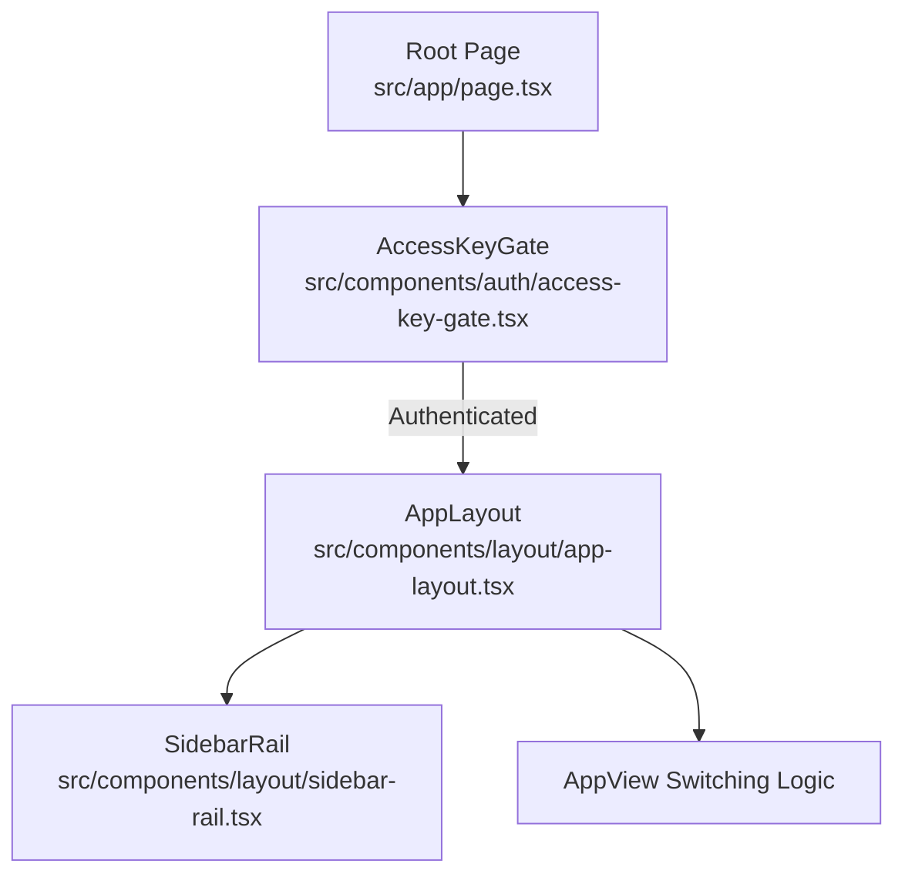
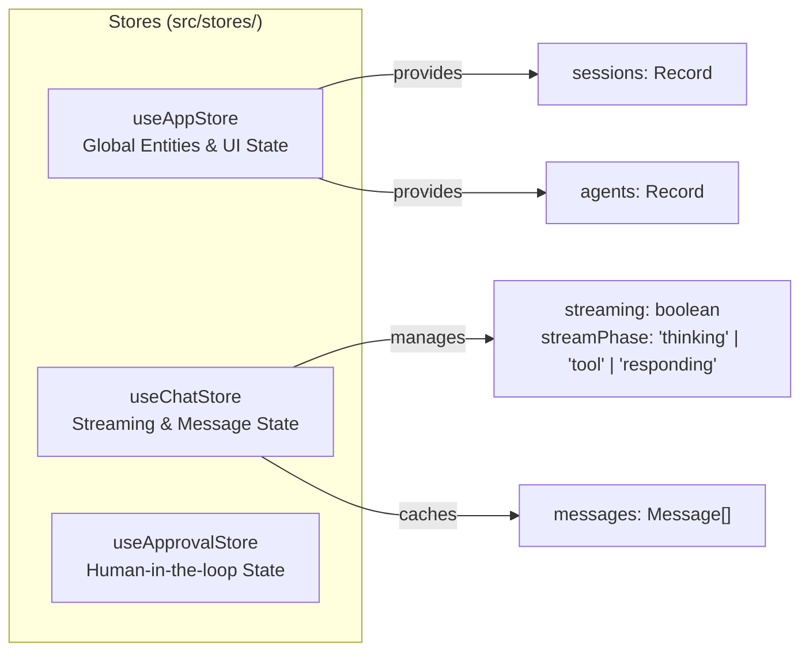

<!-- source: DeepWiki mcp.deepwiki.com · repo swarmclawai/swarmclaw · page 12 User Interface · fetched 2026-10-26 -->

# User Interface

Relevant source files

The following files were used as context for generating this wiki page:

- [src/app/api/tasks/[id]/route.ts](src/app/api/tasks/[id]/route.ts)
- [src/app/api/tasks/route.ts](src/app/api/tasks/route.ts)
- [src/components/agents/agent-card.tsx](src/components/agents/agent-card.tsx)
- [src/components/auth/access-key-gate.tsx](src/components/auth/access-key-gate.tsx)
- [src/components/chat/chat-area.tsx](src/components/chat/chat-area.tsx)
- [src/components/chat/chat-header.tsx](src/components/chat/chat-header.tsx)
- [src/components/chat/message-bubble.tsx](src/components/chat/message-bubble.tsx)
- [src/components/chat/message-list.tsx](src/components/chat/message-list.tsx)
- [src/components/layout/sidebar-rail.tsx](src/components/layout/sidebar-rail.tsx)
- [src/components/shared/settings-sheet.tsx](src/components/shared/settings-sheet.tsx)
- [src/components/tasks/task-card.tsx](src/components/tasks/task-card.tsx)
- [src/components/tasks/task-sheet.tsx](src/components/tasks/task-sheet.tsx)
- [src/lib/app/navigation.ts](src/lib/app/navigation.ts)
- [src/lib/app/view-constants.ts](src/lib/app/view-constants.ts)
- [src/lib/server/session-tools.ts](src/lib/server/session-tools.ts)
- [src/stores/use-app-store.ts](src/stores/use-app-store.ts)

This page provides an overview of the SwarmClaw Next.js/React dashboard. It details the application shell, the view management system, global state flow via Zustand, and the primary component organization.

Detailed documentation for UI subsystems is available on child pages:

- **[App Layout & Navigation](#12.1)** — The `AppLayout` shell, navigation rail, collapsible sidebar, and view switching logic.
- **[Chat Interface](#12.2)** — Message bubbles, streaming state, tool call visualization, and session controls.
- **[Agent & Provider Management UI](#12.3)** — Agent creation sheets, provider configuration, and the authentication gate.
- **[Task & Memory UI](#12.4)** — Kanban task boards, memory detail views, and AI-assisted task generation.
- **[API Client](#12.5)** — The frontend `api()` utility, WebSocket client, and authentication header management.

---

## Application Shell & Entry Point

The SwarmClaw dashboard is a Next.js application. The entry flow begins with the `AccessKeyGate`, which handles authentication before mounting the persistent `AppLayout` shell.

The `AccessKeyGate` checks for a stored key and manages the first-time setup flow, including key generation and `.env.local` persistence [src/components/auth/access-key-gate.tsx:130-167]().

Sources: [src/components/auth/access-key-gate.tsx:1-167](), [src/components/layout/app-layout.tsx:1-50]()

---

## Navigation and View System

The UI uses an `AppView` system to coordinate the sidebar and main content area. The `SidebarRail` provides high-level navigation, while the `AppLayout` manages the rendering of specific views based on the active route.

### SidebarRail
The `SidebarRail` [src/components/layout/sidebar-rail.tsx]() acts as the primary navigation anchor. It supports a collapsed (60px) and expanded (180px) state, persisted in `localStorage` via the `sc_rail_expanded` key [src/components/layout/sidebar-rail.tsx:17-54]().

- **Default Agent Shortcut**: Provides one-click access to the default agent's chat session [src/components/layout/sidebar-rail.tsx:134-160]().
- **Daemon Indicator**: Displays the status of the background daemon process [src/components/layout/sidebar-rail.tsx:8-8]().
- **Navigation Items**: Maps routes to views like Agents, Tasks, Memory, and Settings [src/components/layout/sidebar-rail.tsx:10-10]().

### AppView Bindings
The `AppView` state in `useAppStore` determines the content of the dashboard.

| View | Primary Component | Purpose |
| :--- | :--- | :--- |
| `agents` | `ChatArea` | Primary interaction loop with agents. |
| `tasks` | `TaskBoard` / `TaskList` | Kanban and list management of agent goals. |
| `memory` | `MemoryList` | Browsing and inspecting agent long-term memory. |
| `providers` | `ProviderSheet` | LLM API and CLI provider configuration. |

Sources: [src/components/layout/sidebar-rail.tsx:17-160](), [src/lib/app/view-constants.ts:1-20]()

---

## Global State Management

The frontend relies on **Zustand** stores for global state. The primary store, `useAppStore`, manages entity caches (agents, sessions, tasks) and UI visibility flags.

### Store Architecture

The `useChatStore` is specifically optimized for high-frequency updates during LLM streaming, tracking phases such as `queued`, `thinking`, `tool`, and `responding` [src/components/chat/message-bubble.tsx:177-183]().

Sources: [src/stores/use-app-store.ts:1-100](), [src/components/chat/chat-area.tsx:50-75](), [src/components/chat/message-bubble.tsx:177-183]()

---

## Component Catalog

The UI is built from a modular roster of React components organized by domain:

### Chat Components
Located in `src/components/chat/`, these handle the conversational interface.
- **`ChatArea`**: The main container for the chat interface, including header, message list, and input [src/components/chat/chat-area.tsx:50-140]().
- **`ChatHeader`**: Displays agent status, session metadata, and provides controls for heartbeats and mission pausing [src/components/chat/chat-header.tsx:89-116]().
- **`MessageBubble`**: Renders markdown content, tool events, and delegation banners [src/components/chat/message-bubble.tsx:3-28]().
- **`MessageList`**: Manages scrolling, date separators, and "Live Thinking" lanes [src/components/chat/message-list.tsx:185-200]().

### Task & Agent Components
- **`TaskSheet`**: A comprehensive form for creating and editing tasks, including Quality Gate configuration and DAG dependency management [src/components/tasks/task-sheet.tsx:47-87]().
- **`TaskCard`**: Displays task status (running, blocked, failed) and priority in the Kanban board [src/components/tasks/task-card.tsx:24-84]().
- **`AgentAvatar`**: A consistent visual identifier for agents based on their `avatarSeed` or `avatarUrl` [src/components/agents/agent-avatar.tsx:1-20]().

Sources: [src/components/chat/chat-area.tsx:50-140](), [src/components/tasks/task-sheet.tsx:47-142](), [src/components/chat/message-bubble.tsx:1-28]()

---

## Sheet & Modal Pattern

SwarmClaw uses a "Global Sheet" pattern where overlays (like `AgentSheet`, `TaskSheet`, or `SettingsSheet`) are mounted at the layout level and controlled via `useAppStore` flags.

- **Persistence**: Because sheets are mounted at the top level, their internal form state is preserved even if the user navigates between different background views.
- **Triggering**: Sheets are opened via centralized actions like `setTaskSheetOpen(true)` or `setEditingTaskId(id)` [src/components/tasks/task-card.tsx:34-35]().

Sources: [src/components/tasks/task-sheet.tsx:47-53](), [src/components/tasks/task-card.tsx:34-35]()

---

