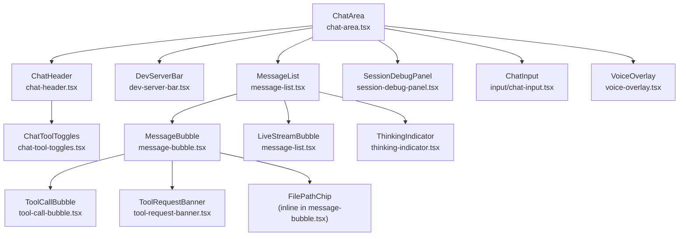
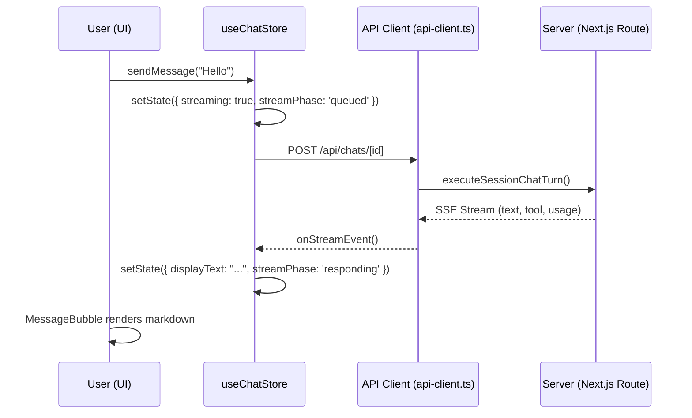

<!-- source: DeepWiki mcp.deepwiki.com · repo swarmclawai/swarmclaw · page 12.2 Chat Interface · fetched 2026-10-26 -->

# Chat Interface

Relevant source files

The following files were used as context for generating this wiki page:

- [src/app/api/chats/[id]/clear/route.ts](src/app/api/chats/[id]/clear/route.ts)
- [src/app/api/chats/[id]/clear/undo/route.ts](src/app/api/chats/[id]/clear/undo/route.ts)
- [src/app/api/chats/[id]/compact/route.ts](src/app/api/chats/[id]/compact/route.ts)
- [src/app/api/chats/[id]/context-status/route.ts](src/app/api/chats/[id]/context-status/route.ts)
- [src/app/api/chats/[id]/execution-log/route.ts](src/app/api/chats/[id]/execution-log/route.ts)
- [src/app/api/chats/clear-route.test.ts](src/app/api/chats/clear-route.test.ts)
- [src/app/api/chats/compact-route.test.ts](src/app/api/chats/compact-route.test.ts)
- [src/app/api/chats/context-status-route.test.ts](src/app/api/chats/context-status-route.test.ts)
- [src/components/agents/agent-card.tsx](src/components/agents/agent-card.tsx)
- [src/components/chat/chat-area.tsx](src/components/chat/chat-area.tsx)
- [src/components/chat/chat-header.tsx](src/components/chat/chat-header.tsx)
- [src/components/chat/message-bubble.tsx](src/components/chat/message-bubble.tsx)
- [src/components/chat/message-list.tsx](src/components/chat/message-list.tsx)
- [src/components/chat/session-debug-panel.tsx](src/components/chat/session-debug-panel.tsx)
- [src/stores/use-chat-store.ts](src/stores/use-chat-store.ts)

This page documents the chat UI layer: the components responsible for displaying a conversation session, rendering messages, and providing session controls. It covers `ChatArea`, `ChatHeader`, `MessageList`, `MessageBubble`, `ToolCallBubble`, and their supporting components in `src/components/chat/`.

For information about how the underlying session data flows from the server (SSE streaming, run queuing), see [Session Run Manager](#6.3) and [Chat Turn Execution](#6.1). For the global app layout that hosts `ChatArea`, see [App Layout & Navigation](#12.1).

---

## Component Hierarchy

**Diagram: ChatArea component tree**

Sources: [src/components/chat/chat-area.tsx:22-50](), [src/components/chat/message-list.tsx:15-24](), [src/components/chat/message-bubble.tsx:12-28]()

---

## ChatArea

`ChatArea` ([src/components/chat/chat-area.tsx:50-406]()) is the top-level component mounted for the active session. It orchestrates the full session view: loading messages, managing streaming state, and composing subcomponents.

### Session Loading and State Reconciliation

On `sessionId` change, `ChatArea` runs a `useEffect` that:

1. Clears stale messages with `setMessages([])`.
2. Calls `fetchMessages(sessionId)` to load persisted messages.
3. Calls `checkBrowser(sessionId)` if the session has a `browser` tool.
4. If `session.active` is true, it calls `startServerStreamingPlaceholder` to show a "thinking" phase while the server-side run progresses.

[src/components/chat/chat-area.tsx:78-106]()

### Streaming State Management

The `useChatStore` tracks the granular phase of the current stream:
- `queued`: Request is in the server-side queue.
- `thinking`: Model is generating reasoning or planning.
- `tool`: Model is executing a tool call.
- `responding`: Model is generating the final text response.
- `connecting`: Handshake or failover is in progress.

[src/stores/use-chat-store.ts:59-60]()

### Session Debug Panel (Session X-Ray)

The `SessionDebugPanel` ([src/components/chat/session-debug-panel.tsx:140-205]()) provides a deep-dive view into session internals. It merges two data sources:
1. **Message History**: Classified into user, assistant, system, and delegation events ([src/components/chat/session-debug-panel.tsx:38-67]()).
2. **Execution Logs**: Fetched from `/api/chats/[id]/execution-log`, these show low-level events like `loop_detection`, `decision`, and `tool_result` ([src/components/chat/session-debug-panel.tsx:69-103]()).

---

## ChatHeader

`ChatHeader` ([src/components/chat/chat-header.tsx:89-491]()) provides session-level controls and metadata.

### Controls and Indicators

| Control | Purpose | Implementation |
|---|---|---|
| **Heartbeat Toggle** | Toggles autonomous wake-ups | `PUT /api/sessions/[id]` with `heartbeatEnabled` |
| **Mission Pause** | Pauses/Resumes main loop | `POST /api/sessions/[id]/main-loop` with action `pause`/`resume` |
| **TTS Toggle** | Enables Text-to-Speech | Toggles `ttsEnabled` in `useChatStore` |
| **Context Meter** | Shows token window usage | `ContextMeterBadge` component |
| **Resume Handle** | Copies CLI resume commands | Detects IDs like `claudeSessionId` or `codexThreadId` |

Sources: [src/components/chat/chat-header.tsx:105-189](), [src/components/chat/chat-header.tsx:161-181]()

---

## Message Rendering

### MessageBubble & Markdown

`MessageBubble` renders content using `ReactMarkdown`. It includes specialized rendering for:
- **File Paths**: Interactive `FilePathChip` for paths matching `FILE_PATH_RE` ([src/components/chat/message-bubble.tsx:21]()).
- **Delegation**: `DelegationSourceBanner` appears when a message is routed from a sub-agent ([src/components/chat/message-bubble.tsx:23]()).
- **Tool Events**: `ToolEventsSection` displays tool activity pills and results ([src/components/chat/message-bubble.tsx:16]()).

### ToolCallBubble

When an assistant message contains `toolEvents`, they are rendered via `ToolEventsSection`. Notable tools (like shell commands or file writes) are highlighted, while internal tools can be collapsed.

[src/components/chat/message-bubble.tsx:174-176](), [src/components/chat/message-list.tsx:53-67]()

**Diagram: Natural Language to Code Entity Space (Chat Flow)**

Sources: [src/stores/use-chat-store.ts:106-110](), [src/components/chat/chat-area.tsx:61-68](), [src/components/chat/message-bubble.tsx:3-7]()

---

## Session Management Actions

The interface supports several maintenance operations via API routes:

| Feature | Route | Description |
|---|---|---|
| **Clear Chat** | `POST /api/chats/[id]/clear` | Wipes message history with an undo option ([src/app/api/chats/[id]/clear/route.ts:5-13]()). |
| **Compact Context** | `POST /api/chats/[id]/compact` | Summarizes old messages to free up context window ([src/app/api/chats/[id]/compact/route.ts:18-72]()). |
| **Context Status** | `GET /api/chats/[id]/context-status` | Returns token usage and strategy (ok/warning/critical) ([src/app/api/chats/context-status-route.test.ts:6-68]()). |
| **Execution Log** | `GET /api/chats/[id]/execution-log` | Returns low-level trace events for debugging ([src/app/api/chats/[id]/execution-log/route.ts:8-20]()). |

---

## Voice and Audio

The chat interface includes a `VoiceOverlay` ([src/components/chat/voice-overlay.tsx]()) managed by `useVoiceConversation`. This allows for hands-free interaction, where the UI displays a visualizer while the agent is "listening" or "speaking" via TTS.

[src/components/chat/chat-area.tsx:18-19](), [src/components/chat/chat-area.tsx:125-129]()

Sources:
- Component Hierarchy: `src/components/chat/chat-area.tsx`, `src/components/chat/message-list.tsx`, `src/components/chat/message-bubble.tsx`
- ChatArea: `src/components/chat/chat-area.tsx:50-406`
- Streaming Phases: `src/stores/use-chat-store.ts:51-138`
- Session X-Ray: `src/components/chat/session-debug-panel.tsx:1-205`
- ChatHeader Controls: `src/components/chat/chat-header.tsx:89-491`
- Message Rendering: `src/components/chat/message-bubble.tsx:1-487`
- API Routes: `src/app/api/chats/[id]/clear/route.ts`, `src/app/api/chats/[id]/compact/route.ts`, `src/app/api/chats/[id]/execution-log/route.ts`

---

