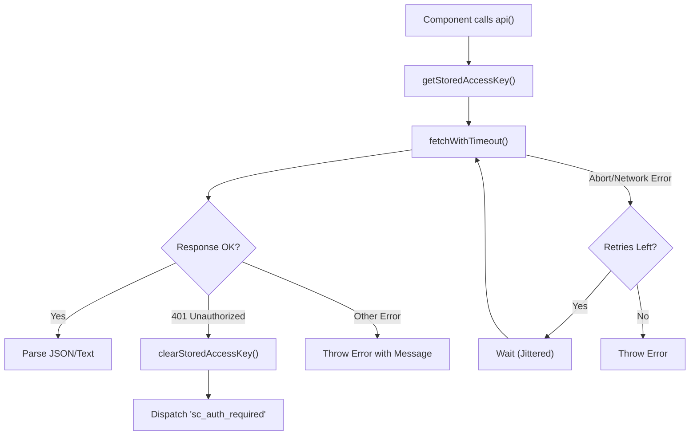
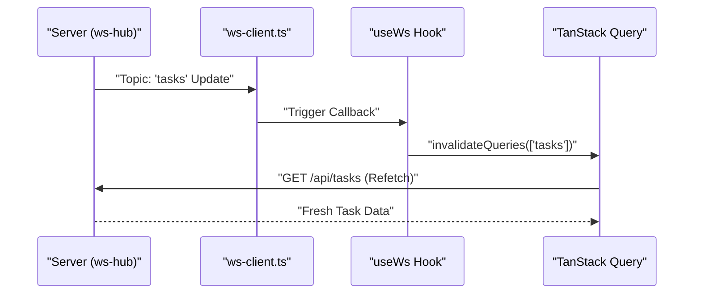

<!-- source: DeepWiki mcp.deepwiki.com · repo swarmclawai/swarmclaw · page 12.5 API Client · fetched 2026-10-26 -->

# API Client

Relevant source files

The following files were used as context for generating this wiki page:

- [src/app/api/auth/route.ts](src/app/api/auth/route.ts)
- [src/app/api/credentials/route.ts](src/app/api/credentials/route.ts)
- [src/app/api/daemon/health-check/route.ts](src/app/api/daemon/health-check/route.ts)
- [src/app/api/daemon/route.ts](src/app/api/daemon/route.ts)
- [src/app/api/documents/route.ts](src/app/api/documents/route.ts)
- [src/app/api/external-agents/route.ts](src/app/api/external-agents/route.ts)
- [src/app/api/mcp-servers/[id]/tools/route.ts](src/app/api/mcp-servers/[id]/tools/route.ts)
- [src/app/api/providers/ollama/route.ts](src/app/api/providers/ollama/route.ts)
- [src/app/api/setup/openclaw-device/route.ts](src/app/api/setup/openclaw-device/route.ts)
- [src/app/api/webhooks/[id]/history/route.ts](src/app/api/webhooks/[id]/history/route.ts)
- [src/components/auth/access-key-gate.tsx](src/components/auth/access-key-gate.tsx)
- [src/components/layout/live-query-sync.tsx](src/components/layout/live-query-sync.tsx)
- [src/components/layout/sidebar-rail.tsx](src/components/layout/sidebar-rail.tsx)
- [src/hooks/use-ws.ts](src/hooks/use-ws.ts)
- [src/lib/app/navigation.ts](src/lib/app/navigation.ts)
- [src/lib/app/view-constants.ts](src/lib/app/view-constants.ts)
- [src/lib/ws-client.ts](src/lib/ws-client.ts)

This page documents the frontend API client utilities and WebSocket communication layer. It covers the `api()` function, the access key lifecycle, request resilience (timeout/retry), and the real-time synchronization system via WebSockets.

---

## Overview

The SwarmClaw frontend communicates with the backend through two primary channels:
1.  **REST API**: Handled by the `api()` utility in `src/lib/api-client.ts` for state mutations and data fetching.
2.  **WebSockets**: Handled by `ws-client.ts` and the `useWs` hook for real-time updates (e.g., agent status, task progress, and message streaming).

---

## Access Key Authentication

SwarmClaw uses an `X-Access-Key` header for authentication. This key is generated during first-time setup and persisted in the browser's `localStorage`.

### Key Storage Helpers
The client manages the key lifecycle using the following helpers:

| Function | File:Line | Purpose |
| :--- | :--- | :--- |
| `getStoredAccessKey()` | [src/lib/api-client.ts:1-7]() | Retrieves the key from `localStorage` (`sc_access_key`). |
| `setStoredAccessKey(key)` | [src/lib/api-client.ts:9-12]() | Saves a new key to `localStorage`. |
| `clearStoredAccessKey()` | [src/lib/api-client.ts:14-17]() | Removes the key (used during logout or 401 errors). |

### The Authentication Gate
The `AccessKeyGate` component [src/components/auth/access-key-gate.tsx:17]() manages the initial entry of this key. It handles the "First-Time Setup" flow where a generated key is displayed to the user [src/components/auth/access-key-gate.tsx:132-141]() and allows for key overrides [src/app/api/auth/route.ts:108-114]().

**Sources:** [src/lib/api-client.ts:1-17](), [src/components/auth/access-key-gate.tsx:17-141](), [src/app/api/auth/route.ts:108-114]()

---

## The `api()` Utility

The `api()` function is a wrapper around `fetch` that provides standardized error handling, authentication injection, and retry logic.

### Request Lifecycle
1.  **Header Injection**: Automatically adds `X-Access-Key` and `Content-Type: application/json` [src/lib/api-client.ts:53-58]().
2.  **Timeout**: Wraps requests in `fetchWithTimeout` [src/lib/api-client.ts:23-35](), defaulting to **12,000ms** [src/lib/api-client.ts:19]().
3.  **401 Handling**: If the server returns a 401 Unauthorized, the client clears the stored key and dispatches a global `sc_auth_required` DOM event [src/lib/api-client.ts:66-73]().
4.  **Retry Logic**: `GET` requests are automatically retried up to 2 times [src/lib/api-client.ts:20]() on `AbortError` (timeout) or `TypeError` (network failure) [src/lib/api-client.ts:92-97]().

### Data Flow: API Request

**Sources:** [src/lib/api-client.ts:19-100](), [src/components/auth/access-key-gate.tsx:4-15]()

---

## WebSocket Client (`ws-client.ts`)

The WebSocket client provides a pub/sub mechanism for the frontend to receive real-time updates from the `ws-hub` on the server.

### Key Features
-   **Auto-Reconnect**: Implements `jitteredBackoff` for reconnection attempts [src/lib/ws-client.ts:45-54]().
-   **Topic Subscription**: Components subscribe to specific topics (e.g., `agents`, `tasks`, `messages`) [src/lib/ws-client.ts:112-125]().
-   **Proxy Awareness**: Dynamically determines the WebSocket URL, accounting for standard ports and reverse proxies [src/lib/ws-client.ts:14-29]().

### Connection State
The client tracks connectivity via `isWsConnected()` and allows components to listen for state changes using `onWsStateChange` [src/lib/ws-client.ts:139-145]().

**Sources:** [src/lib/ws-client.ts:1-150]()

---

## React Integration (`use-ws` hook)

The `useWs` hook [src/hooks/use-ws.ts:61]() is the primary way React components consume real-time data. It bridges the WebSocket subscription with the application's data-fetching layer (TanStack Query).

### Fallback Polling
If the WebSocket is disconnected, `useWs` automatically switches to a shared polling interval based on the provided `fallbackMs` [src/hooks/use-ws.ts:30-33](). This ensures the UI remains up-to-date even in unstable network conditions.

### `LiveQuerySync` Component
The `LiveQuerySync` component [src/components/layout/live-query-sync.tsx:28]() uses `useWs` to invalidate specific cache keys in TanStack Query whenever a relevant backend event occurs.

| Topic | Fallback Interval | Invalidated Query Keys |
| :--- | :--- | :--- |
| `agents` | 60s | `agentQueryKeys.all` |
| `tasks` | 5s | `taskQueryKeys.all` |
| `protocol_runs` | 2s | `protocolQueryKeys.all` |
| `messages` | 5s | `chats` / `messages` |

### Data Synchronization Flow

**Sources:** [src/hooks/use-ws.ts:8-137](), [src/components/layout/live-query-sync.tsx:28-121]()

---

## API Routes & Daemon Control

The frontend uses specific API endpoints to manage the background daemon and check system health.

-   **`GET /api/daemon`**: Retrieves the current status snapshot of the daemon process [src/app/api/daemon/route.ts:11-13]().
-   **`POST /api/daemon`**: Sends `start` or `stop` actions to the `daemon/controller` [src/app/api/daemon/route.ts:15-30]().
-   **`POST /api/daemon/health-check`**: Triggers an immediate health check via the admin interface [src/app/api/daemon/health-check/route.ts:4-10]().

**Sources:** [src/app/api/daemon/route.ts:11-30](), [src/app/api/daemon/health-check/route.ts:4-10]()

---

