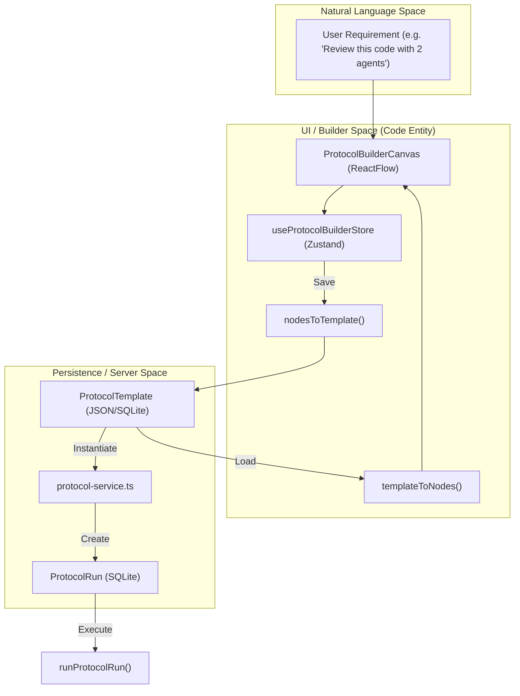
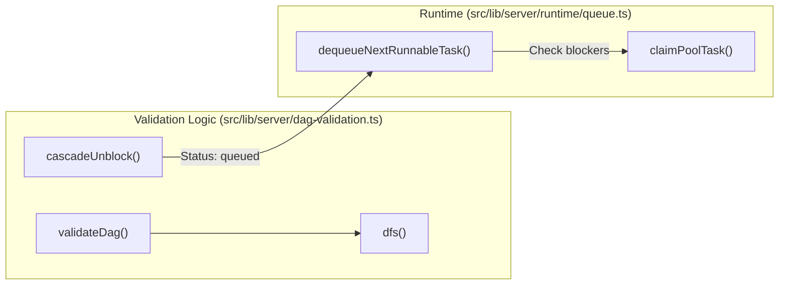

<!-- source: DeepWiki mcp.deepwiki.com · repo swarmclawai/swarmclaw · page 13 Protocols · fetched 2026-10-26 -->

# Protocols

<details>
<summary>Relevant source files</summary>

The following files were used as context for generating this wiki page:

- [src/app/api/.well-known/agent-card/route.ts](src/app/api/.well-known/agent-card/route.ts)
- [src/app/api/a2a/route.ts](src/app/api/a2a/route.ts)
- [src/app/api/a2a/tasks/[taskId]/status/route.ts](src/app/api/a2a/tasks/[taskId]/status/route.ts)
- [src/app/api/tasks/claim/route.test.ts](src/app/api/tasks/claim/route.test.ts)
- [src/app/api/tasks/claim/route.ts](src/app/api/tasks/claim/route.ts)
- [src/app/protocols/builder/[templateId]/page.tsx](src/app/protocols/builder/[templateId]/page.tsx)
- [src/app/protocols/page.tsx](src/app/protocols/page.tsx)
- [src/features/protocols/builder/utils/nodes-to-template.test.ts](src/features/protocols/builder/utils/nodes-to-template.test.ts)
- [src/features/protocols/builder/utils/nodes-to-template.ts](src/features/protocols/builder/utils/nodes-to-template.ts)
- [src/features/protocols/builder/utils/template-to-nodes.test.ts](src/features/protocols/builder/utils/template-to-nodes.test.ts)
- [src/features/protocols/builder/utils/template-to-nodes.ts](src/features/protocols/builder/utils/template-to-nodes.ts)
- [src/lib/server/dag-validation.ts](src/lib/server/dag-validation.ts)
- [src/lib/server/protocols/protocol-service.test.ts](src/lib/server/protocols/protocol-service.test.ts)
- [src/lib/server/protocols/protocol-service.ts](src/lib/server/protocols/protocol-service.ts)
- [src/lib/server/runtime/queue.test.ts](src/lib/server/runtime/queue.test.ts)

</details>


The Protocols system in SwarmClaw is a visual, DAG-based multi-agent workflow engine. It allows users to define complex, structured interactions between multiple agents that go beyond simple chat turns. Protocols are defined as **Templates** (the blueprints) and executed as **Runs** (the active instances).

Protocols bridge the gap between autonomous agent behavior and deterministic business logic by providing a structured sequence of steps, branching logic, and parallel execution paths.

### Relationship to Other Systems

Protocols interact with several core SwarmClaw subsystems:
*   **Agents**: Protocols assign specific roles to agents (e.g., facilitator, participant) to execute steps [src/app/protocols/page.tsx:146-158]().
*   **Tasks**: A protocol run can be linked to a `BoardTask`, and completing a task can trigger or "wake" a protocol [src/lib/server/protocols/protocol-service.ts:38-47]().
*   **Chatrooms**: Every protocol run generates a transcript, often stored as a hidden chatroom, to maintain the conversation history of the run [src/lib/server/protocols/protocol-service.test.ts:5-13]().
*   **Missions**: Protocols can serve as the operational logic for long-running missions.

---

## Protocol Builder UI

The **Protocol Builder** is a visual editor built on **ReactFlow**. it allows technical users to drag and drop nodes to define the logic of a `ProtocolTemplate`.

### Node Types
The builder supports several specialized node types that map to `ProtocolStepKind` [src/features/protocols/builder/utils/template-to-nodes.ts:5-27]():
*   **Phase**: Standard agent turns (e.g., `present`, `summarize`, `decide`, `collect_independent_inputs`) [src/features/protocols/builder/utils/template-to-nodes.ts:9-25]().
*   **Branch**: Conditional logic that routes the flow based on agent decisions or step outputs [src/features/protocols/builder/utils/template-to-nodes.test.ts:28-30]().
*   **Loop**: Repeats a sequence of steps until a condition is met [src/features/protocols/builder/utils/template-to-nodes.test.ts:32-34]().
*   **Parallel & Join**: Executes multiple steps concurrently and synchronizes them at a join point [src/features/protocols/builder/utils/template-to-nodes.test.ts:36-42]().
*   **Swarm**: Defines a "swarm claim" step where multiple agents can compete for or collaborate on work items [src/features/protocols/builder/utils/template-to-nodes.ts:19-20]().
*   **Subflow**: Invokes another protocol template as a step within the current one [src/features/protocols/builder/utils/template-to-nodes.ts:17-18]().

### Data Synchronization
The builder uses a specialized Zustand store (`useProtocolBuilderStore`) to manage the DAG state [src/app/protocols/builder/[templateId]/page.tsx:6-11](). It includes utilities to convert between the visual ReactFlow graph and the underlying JSON template format:
*   `templateToNodes`: Converts a `ProtocolTemplate` into ReactFlow nodes and edges [src/features/protocols/builder/utils/template-to-nodes.ts:78-99]().
*   `nodesToTemplate`: Serializes the visual graph back into a valid `ProtocolTemplate` definition [src/features/protocols/builder/utils/nodes-to-template.ts:5-9]().

For more details on the visual editor, see **[Protocol Builder UI](#13.1)**.

---

## Protocol Runtime

The **Protocol Runtime** is the execution engine responsible for advancing a `ProtocolRun` through its defined steps. It handles the lifecycle of the run, from initialization to completion or failure.

### Execution Lifecycle
A protocol run progresses through various statuses: `waiting`, `running`, `paused`, `completed`, or `failed` [src/app/protocols/page.tsx:44-51](). The runtime manages these transitions via `performProtocolRunAction`, which supports actions like `start`, `pause`, `resume`, `retry`, and `cancel` [src/lib/server/protocols/protocol-service.ts:38-47]().

### Step Processing
The engine processes each step based on its `kind`. For standard phases, it invokes `executeAgentTurn`, which coordinates the LLM interaction and handles tool events or citations [src/lib/server/protocols/protocol-service.test.ts:53-70]().

### Key Runtime Components
| Component | Responsibility |
| :--- | :--- |
| **DAG Scheduler** | Determines the next step(s) to execute based on the template's edge definitions. |
| **Swarm Manager** | Handles `swarm_claim` logic, managing work item claims and timeouts [src/lib/server/protocols/protocol-service.ts:50-54](). |
| **A2A Delegate** | Facilitates agent-to-agent delegation across different SwarmClaw instances if required by the step [src/lib/server/protocols/protocol-service.ts:9-16](). |

For details on the execution engine and step processors, see **[Protocol Runtime](#13.2)**.

---

## Data Structures

### Protocol Template
The blueprint for a workflow.
```typescript
// Simplified from src/types
interface ProtocolTemplate {
  id: string;
  name: string;
  description: string;
  steps: ProtocolStepDefinition[];
  entryStepId: string;
  singleAgentAllowed: boolean;
}
```
Sources: [src/app/protocols/page.tsx:23-30](), [src/features/protocols/builder/utils/nodes-to-template.ts:5-9]()

### Protocol Run
A live instance of a template.
```typescript
// Simplified from src/app/protocols/page.tsx
interface ProtocolRun {
  id: string;
  templateId: string;
  status: 'waiting' | 'running' | 'paused' | 'completed' | 'failed' | 'cancelled' | 'archived';
  currentStepId: string | null;
  summary?: string;
  artifacts: ProtocolArtifact[];
}
```
Sources: [src/app/protocols/page.tsx:32-39](), [src/lib/server/protocols/protocol-service.test.ts:72-82]()

---

## Logic Flow: Template to Execution

The following diagram illustrates how a natural language requirement is transformed into a running protocol.

**Protocol Transformation Flow**

Sources: [src/app/protocols/builder/[templateId]/page.tsx:6-11](), [src/features/protocols/builder/utils/nodes-to-template.ts:5-9](), [src/lib/server/protocols/protocol-service.ts:38-47]()

---

## Dependency Management

Protocols often involve task dependencies. The system uses a Directed Acyclic Graph (DAG) validator to ensure that protocol steps and linked tasks do not create infinite loops.

**Task Dependency Validation**

Sources: [src/lib/server/dag-validation.ts:13-17](), [src/lib/server/runtime/queue.test.ts:54-63](), [src/app/api/tasks/claim/route.ts:5-15]()

*   `validateDag`: Uses Depth-First Search (DFS) to prevent cycles when adding task dependencies [src/lib/server/dag-validation.ts:13-25]().
*   `cascadeUnblock`: Automatically queues tasks once their blockers in a protocol or task-chain are completed [src/lib/server/dag-validation.ts:84-95]().
*   `dequeueNextRunnableTask`: The task queue worker that respects these DAG constraints, skipping blocked tasks until their dependencies are met [src/lib/server/runtime/queue.test.ts:89-98]().

---

