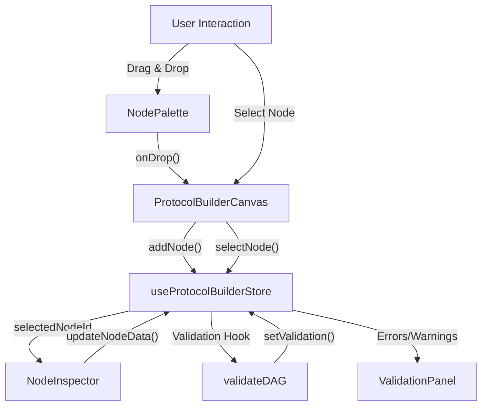
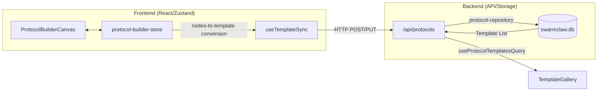

<!-- source: DeepWiki mcp.deepwiki.com · repo swarmclawai/swarmclaw · page 13.1 Protocol Builder UI · fetched 2026-10-26 -->

# Protocol Builder UI

Relevant source files

The following files were used as context for generating this wiki page:

- [src/components/protocols/builder/edge-editor.tsx](src/components/protocols/builder/edge-editor.tsx)
- [src/components/protocols/builder/edge-types/branch-edge.tsx](src/components/protocols/builder/edge-types/branch-edge.tsx)
- [src/components/protocols/builder/edge-types/default-edge.tsx](src/components/protocols/builder/edge-types/default-edge.tsx)
- [src/components/protocols/builder/edge-types/index.ts](src/components/protocols/builder/edge-types/index.ts)
- [src/components/protocols/builder/edge-types/loop-edge.tsx](src/components/protocols/builder/edge-types/loop-edge.tsx)
- [src/components/protocols/builder/node-types/branch-node.tsx](src/components/protocols/builder/node-types/branch-node.tsx)
- [src/components/protocols/builder/node-types/complete-node.tsx](src/components/protocols/builder/node-types/complete-node.tsx)
- [src/components/protocols/builder/node-types/for-each-node.tsx](src/components/protocols/builder/node-types/for-each-node.tsx)
- [src/components/protocols/builder/node-types/join-node.tsx](src/components/protocols/builder/node-types/join-node.tsx)
- [src/components/protocols/builder/node-types/loop-node.tsx](src/components/protocols/builder/node-types/loop-node.tsx)
- [src/components/protocols/builder/node-types/parallel-node.tsx](src/components/protocols/builder/node-types/parallel-node.tsx)
- [src/components/protocols/builder/node-types/phase-node.tsx](src/components/protocols/builder/node-types/phase-node.tsx)
- [src/components/protocols/builder/node-types/subflow-node.tsx](src/components/protocols/builder/node-types/subflow-node.tsx)
- [src/components/protocols/builder/node-types/swarm-node.tsx](src/components/protocols/builder/node-types/swarm-node.tsx)
- [src/components/protocols/builder/protocol-builder-canvas.tsx](src/components/protocols/builder/protocol-builder-canvas.tsx)
- [src/components/protocols/builder/template-gallery.tsx](src/components/protocols/builder/template-gallery.tsx)
- [src/features/protocols/builder/hooks/index.ts](src/features/protocols/builder/hooks/index.ts)
- [src/features/protocols/builder/hooks/use-canvas-validation.ts](src/features/protocols/builder/hooks/use-canvas-validation.ts)
- [src/features/protocols/builder/hooks/use-template-sync.ts](src/features/protocols/builder/hooks/use-template-sync.ts)
- [src/features/protocols/builder/protocol-builder-store.ts](src/features/protocols/builder/protocol-builder-store.ts)
- [src/features/protocols/builder/validators/dag-validator.test.ts](src/features/protocols/builder/validators/dag-validator.test.ts)
- [src/features/protocols/builder/validators/dag-validator.ts](src/features/protocols/builder/validators/dag-validator.ts)

The Protocol Builder UI is a visual Integrated Development Environment (IDE) for designing multi-agent workflows. It allows users to construct Directed Acyclic Graphs (DAGs) representing complex operational protocols, which are then compiled into `ProtocolTemplate` entities for execution by the [Protocol Runtime](13.2). The builder is built on top of **ReactFlow** and utilizes a centralized **Zustand** store for state management, undo/redo history, and real-time validation.

## Architecture & Data Flow

The builder bridges the gap between a visual graph representation and the structured JSON format required by the backend.

### Protocol Builder Store
The `useProtocolBuilderStore` [src/features/protocols/builder/protocol-builder-store.ts:108-110]() manages the entire state of the canvas. It tracks `nodes` (of type `BuilderNode`), `edges` (of type `BuilderEdge`), selection states, and the `undoStack`/`redoStack` [src/features/protocols/builder/protocol-builder-store.ts:56-67]().

**Key Store Actions:**
- `updateNodeData`: Updates specific properties (e.g., instructions, agentId) within a node's `data` object [src/features/protocols/builder/protocol-builder-store.ts:122-130]().
- `pushUndo`: Captures a snapshot of current nodes and edges before destructive operations [src/features/protocols/builder/protocol-builder-store.ts:191-198]().
- `loadTemplate`: Hydrates the store from a `ProtocolTemplate`, converting backend steps into visual nodes [src/features/protocols/builder/protocol-builder-store.ts:171-183]().

### Visual to Code Mapping
The following diagram illustrates how visual interactions in the `ProtocolBuilderCanvas` map to code entities and state changes.

**Interaction Flow: Canvas to Store**

Sources: [src/components/protocols/builder/protocol-builder-canvas.tsx:112-131](), [src/features/protocols/builder/protocol-builder-store.ts:116-130](), [src/components/protocols/builder/protocol-builder-canvas.tsx:179-180]()

## Visual Node Types

The builder supports specialized node types that map to `ProtocolStepKind` [src/features/protocols/builder/protocol-builder-store.ts:8](). Each node is implemented as a custom ReactFlow component in `src/components/protocols/builder/node-types/`.

| Node Type | Implementation | Description | Visual Characteristics |
| :--- | :--- | :--- | :--- |
| **Phase** | `PhaseNode` | A standard execution step (agent turn). | Standard blue border. |
| **Branch** | `BranchNode` | Logic gate for conditional paths. | Diamond shape with multiple Right handles [src/components/protocols/builder/node-types/branch-node.tsx:11-34](). |
| **Parallel** | `ParallelNode` | Spawns multiple concurrent branches. | Pink border; dynamic Bottom handles per branch [src/components/protocols/builder/node-types/parallel-node.tsx:20-28](). |
| **Swarm** | `SwarmNode` | Multi-agent collaborative task. | Green border; displays eligible agent count [src/components/protocols/builder/node-types/swarm-node.tsx:9-17](). |
| **Subflow** | `SubflowNode` | Invokes another protocol template. | Violet border; displays target `templateId` [src/components/protocols/builder/node-types/subflow-node.tsx:9-19](). |
| **For-Each** | `ForEachNode` | Iterates over a list of items. | Sky blue border; defines `itemAlias` [src/components/protocols/builder/node-types/for-each-node.tsx:9-16](). |
| **Join** | `JoinNode` | Synchronizes parallel branches. | Convergent handles. |
| **Complete** | `CompleteNode` | Finalizes the protocol run. | Terminal node; no outgoing handles. |

Sources: [src/components/protocols/builder/protocol-builder-canvas.tsx:26-36](), [src/components/protocols/builder/node-types/branch-node.tsx:5-35](), [src/components/protocols/builder/node-types/parallel-node.tsx:5-31]()

## Edge Types & Connection Logic

Edges define the control flow between nodes. The builder supports three primary edge types:

1.  **DefaultEdge**: Standard blue/gray line for linear progression [src/components/protocols/builder/edge-types/default-edge.tsx:4-18]().
2.  **BranchEdge**: Amber-colored edge with a label indicating the specific `branchCaseId` it represents [src/components/protocols/builder/edge-types/branch-edge.tsx:4-33]().
3.  **LoopEdge**: Teal dashed line indicating a return to a previous node in the graph [src/components/protocols/builder/edge-types/loop-edge.tsx:4-19]().

Edges are created via the `onConnect` callback, which defaults to a `default` edge type [src/components/protocols/builder/protocol-builder-canvas.tsx:72-86](). Users can modify edge properties using the `EdgeEditor`.

## DAG Validation

The `validateDAG` utility ensures the protocol is logically sound before it can be saved or executed [src/features/protocols/builder/validators/dag-validator.ts]().

**Validation Rules:**
- **Orphan Detection**: Identifies nodes not connected to any edge [src/features/protocols/builder/validators/dag-validator.test.ts:77-85]().
- **Unreachability**: Checks if a node is reachable from the entry node (the first node in the array) [src/features/protocols/builder/validators/dag-validator.test.ts:86-98]().
- **Dead Ends**: Warns if a non-complete node has no outgoing edges [src/features/protocols/builder/validators/dag-validator.test.ts:100-108]().
- **Branch Completeness**: Ensures every defined `branchCase` in a Branch node has a corresponding outgoing edge [src/features/protocols/builder/validators/dag-validator.test.ts:117-150]().

The results are stored in `validationErrors` and `validationWarnings` in the Zustand store and displayed in the `ValidationPanel` [src/features/protocols/builder/protocol-builder-store.ts:64-65]().

## UI Components

### NodePalette
A sidebar component containing draggable node templates. It uses HTML5 Drag and Drop to pass `ProtocolStepKind` and labels to the canvas [src/components/protocols/builder/protocol-builder-canvas.tsx:112-129]().

### NodeInspector
A context-aware sidebar that appears when a node is selected. It allows editing:
- `label` and `instructions` [src/features/protocols/builder/protocol-builder-store.ts:7-9]().
- `agentId` for phase/swarm nodes [src/features/protocols/builder/protocol-builder-store.ts:12-13]().
- `branchCases` for branch nodes [src/features/protocols/builder/protocol-builder-store.ts:20]().

### TemplateGallery
Displays available `ProtocolTemplate` entities, categorized into "Built-in" and "Custom" [src/components/protocols/builder/template-gallery.tsx:14-15](). Clicking a template routes the user to the builder with that template loaded [src/components/protocols/builder/template-gallery.tsx:20]().

## System Integration Diagram

This diagram shows how the Protocol Builder interacts with the broader SwarmClaw system.

Sources: [src/features/protocols/builder/hooks/use-template-sync.ts](), [src/components/protocols/builder/template-gallery.tsx:10-12](), [src/features/protocols/builder/protocol-builder-store.ts:171-183]()

## Key Utilities

- **`template-to-nodes`**: Converts the flat array of steps in a `ProtocolTemplate` into the `nodes` and `edges` structure required by ReactFlow [src/features/protocols/builder/utils/template-to-nodes.ts]().
- **`nodes-to-template`**: Performs the inverse operation, serializing the visual graph back into a valid `ProtocolTemplate` for persistence.
- **`getReachableNodes`**: A graph traversal helper used by the validator to determine connectivity from the entry point [src/features/protocols/builder/validators/dag-validator.test.ts:38-57]().

Sources: [src/features/protocols/builder/protocol-builder-store.ts:1-106](), [src/components/protocols/builder/protocol-builder-canvas.tsx:1-185](), [src/features/protocols/builder/validators/dag-validator.test.ts:1-151]()

---

