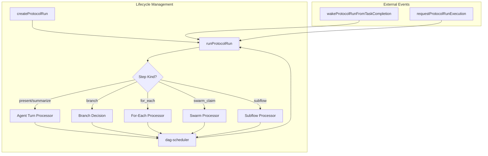

<!-- source: DeepWiki mcp.deepwiki.com · repo swarmclawai/swarmclaw · page 13.2 Protocol Runtime · fetched 2026-10-26 -->

# Protocol Runtime

Relevant source files

The following files were used as context for generating this wiki page:

- [src/app/api/.well-known/agent-card/route.ts](src/app/api/.well-known/agent-card/route.ts)
- [src/app/api/a2a/route.ts](src/app/api/a2a/route.ts)
- [src/app/api/a2a/tasks/[taskId]/status/route.ts](src/app/api/a2a/tasks/[taskId]/status/route.ts)
- [src/app/api/tasks/claim/route.test.ts](src/app/api/tasks/claim/route.test.ts)
- [src/app/api/tasks/claim/route.ts](src/app/api/tasks/claim/route.ts)
- [src/components/protocols/builder/run-overlay.tsx](src/components/protocols/builder/run-overlay.tsx)
- [src/features/protocols/builder/hooks/use-run-overlay.ts](src/features/protocols/builder/hooks/use-run-overlay.ts)
- [src/features/protocols/builder/utils/nodes-to-template.test.ts](src/features/protocols/builder/utils/nodes-to-template.test.ts)
- [src/features/protocols/builder/utils/nodes-to-template.ts](src/features/protocols/builder/utils/nodes-to-template.ts)
- [src/features/protocols/builder/utils/template-to-nodes.test.ts](src/features/protocols/builder/utils/template-to-nodes.test.ts)
- [src/features/protocols/builder/utils/template-to-nodes.ts](src/features/protocols/builder/utils/template-to-nodes.ts)
- [src/lib/server/dag-validation.ts](src/lib/server/dag-validation.ts)
- [src/lib/server/protocols/protocol-service.ts](src/lib/server/protocols/protocol-service.ts)
- [src/lib/server/runtime/queue.test.ts](src/lib/server/runtime/queue.test.ts)

The Protocol Runtime is the execution engine responsible for orchestrating multi-agent workflows defined as Directed Acyclic Graphs (DAGs). It manages the lifecycle of **Protocol Runs**, transitioning through steps, handling agent turns, managing parallel execution branches, and processing complex control flow structures like loops and swarms.

## Protocol Run Lifecycle

A Protocol Run follows a state-machine transition model managed by the `protocol-run-lifecycle` module. It transitions from initialization through execution to final archival or failure.

### Key Lifecycle Actions
The runtime supports several core actions via `performProtocolRunAction` [src/lib/server/protocols/protocol-service.ts:44-44]():

*   **Start**: Initializes the run from a `ProtocolTemplate` using `createProtocolRun` [src/lib/server/protocols/protocol-service.ts:42-42]().
*   **Pause/Resume**: Suspends execution at the current step or resumes a previously paused run.
*   **Retry/Skip**: Allows manual intervention to re-run a failed step or bypass a problematic node in the DAG.
*   **Cancel**: Immediately halts all in-flight agent turns and marks the run as cancelled.
*   **Archive**: Moves completed or failed runs to long-term storage.

### Execution Flow
The primary entry point for execution is `runProtocolRun` [src/lib/server/protocols/protocol-service.ts:43-43](). The engine evaluates the `currentStepId` and invokes the corresponding **Step Processor** based on the step's `kind`.

**Sources:** [src/lib/server/protocols/protocol-service.ts:38-47]()

## Step Processors

Step processors handle the logic specific to each node type in the protocol DAG.

### Agent Turn & Phase Processors
For standard steps (e.g., `present`, `decide`, `summarize`), the runtime executes an agent turn. The results are captured in the `ProtocolAgentTurnResult` interface [src/lib/server/protocols/protocol-service.ts:13-13](). These steps often have a `turnLimit` and `completionCriteria` [src/features/protocols/builder/utils/nodes-to-template.test.ts:71-72]().

### Branch Decision
The `branch` processor evaluates conditions to select the next path. It uses `branchCases` (mapping labels to `nextStepId`) or falls back to a `defaultNextStepId` [src/features/protocols/builder/utils/template-to-nodes.ts:118-150]().

### For-Each, Swarm, and Subflow
*   **For-Each**: Iterates over a collection of items, spawning parallel or serial executions of a sub-segment of the protocol [src/features/protocols/builder/utils/template-to-nodes.ts:15-16]().
*   **Swarm**: Implements a "claim" pattern where multiple agents can compete for or collaborate on work items. Managed via `claimSwarmWorkItem` and `syncSwarmClaimCompletion` [src/lib/server/protocols/protocol-service.ts:51-52]().
*   **Subflow**: Recursively executes another protocol template as a single step within the parent protocol [src/features/protocols/builder/utils/template-to-nodes.ts:17-18]().

**Sources:** [src/lib/server/protocols/protocol-service.ts:50-54](), [src/features/protocols/builder/utils/template-to-nodes.ts:5-27]()

## DAG Scheduler

The `dag-scheduler` ensures that steps are executed in the correct order based on dependencies. It uses a dependency graph where nodes can be `blockedBy` other steps [src/lib/server/dag-validation.ts:9-12]().

### Cycle Detection
Before execution or during template creation, the runtime validates the DAG using `validateDag` [src/lib/server/dag-validation.ts:13-17](). It employs a Depth-First Search (DFS) to ensure no circular dependencies exist [src/lib/server/dag-validation.ts:47-53]().

### Unblocking Logic
When a step completes, `cascadeUnblock` identifies downstream steps that were `blockedBy` the completed node [src/lib/server/dag-validation.ts:84-87](). If all dependencies for a downstream step are met, it is transitioned to a runnable state [src/lib/server/dag-validation.ts:101-117]().

**Sources:** [src/lib/server/dag-validation.ts:1-126]()

## Data Interfaces

The runtime operates on several key TypeScript interfaces that define the state and inputs for protocol execution.

### ProtocolRunDetail
This interface represents the full state of an active or historical protocol run, including its title, status, and current progress.
*   **`currentStepId`**: The ID of the node currently being processed [src/components/protocols/builder/run-overlay.tsx:12-14]().
*   **`stepState`**: A map of step IDs to their individual `runtimeStatus` (e.g., `running`, `completed`, `failed`) [src/features/protocols/builder/hooks/use-run-overlay.ts:25-34]().

### CreateProtocolRunInput
Used when launching a new run, this input specifies the `templateId`, initial `inputData`, and optional configuration for the root agent or session [src/lib/server/protocols/protocol-service.ts:11-11]().

### Step Outputs
Steps can define an `outputKey` [src/features/protocols/builder/utils/nodes-to-template.ts:30-30](). When a step completes, its result is stored in the protocol's global state under this key, making it available as `upstreamResults` for subsequent steps in the DAG [src/lib/server/dag-validation.ts:108-116]().

**Sources:** [src/lib/server/protocols/protocol-service.ts:9-16](), [src/features/protocols/builder/protocol-builder-store.ts]()

## A2A Delegation
The protocol runtime supports cross-instance execution via the `protocol-a2a-delegate` system. Agents can delegate specific steps to remote SwarmClaw instances.
*   **Discovery**: Remote agents are discovered via the `/.well-known/agent-card` endpoint [src/app/api/.well-known/agent-card/route.ts:16-19]().
*   **Task Claiming**: Remote tasks are claimed via the `/api/tasks/claim` endpoint, which prevents double-assignment in pool-mode [src/app/api/tasks/claim/route.ts:5-15]().

**Sources:** [src/app/api/.well-known/agent-card/route.ts:8-15](), [src/app/api/tasks/claim/route.ts:1-20]()

---

