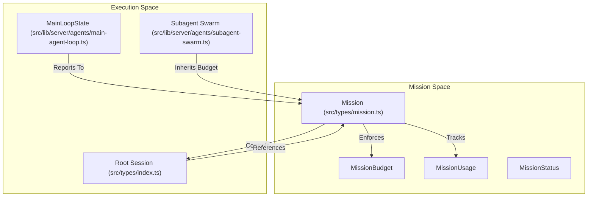
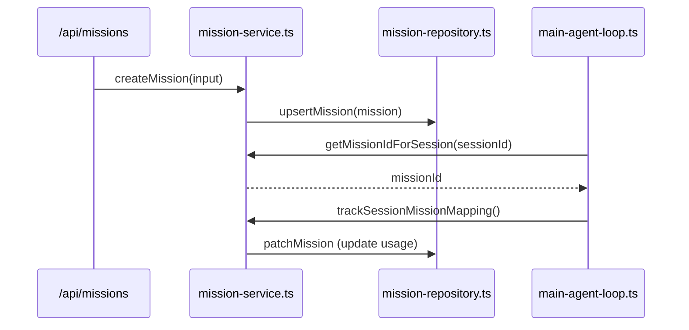

<!-- source: DeepWiki mcp.deepwiki.com · repo swarmclawai/swarmclaw · page 14 Missions · fetched 2026-10-26 -->

# Missions

Relevant source files

The following files were used as context for generating this wiki page:

- [src/app/api/missions/[id]/route.ts](src/app/api/missions/[id]/route.ts)
- [src/app/api/missions/route.ts](src/app/api/missions/route.ts)
- [src/app/api/missions/templates/[id]/instantiate/route.ts](src/app/api/missions/templates/[id]/instantiate/route.ts)
- [src/app/api/missions/templates/route.ts](src/app/api/missions/templates/route.ts)
- [src/app/api/settings/route.ts](src/app/api/settings/route.ts)
- [src/app/missions/page.tsx](src/app/missions/page.tsx)
- [src/app/settings/page.tsx](src/app/settings/page.tsx)
- [src/components/missions/mission-template-gallery.tsx](src/components/missions/mission-template-gallery.tsx)
- [src/components/missions/mission-template-install-dialog.tsx](src/components/missions/mission-template-install-dialog.tsx)
- [src/lib/server/agents/main-agent-loop-advanced.test.ts](src/lib/server/agents/main-agent-loop-advanced.test.ts)
- [src/lib/server/agents/main-agent-loop.ts](src/lib/server/agents/main-agent-loop.ts)
- [src/lib/server/agents/subagent-runtime.ts](src/lib/server/agents/subagent-runtime.ts)
- [src/lib/server/agents/subagent-swarm.test.ts](src/lib/server/agents/subagent-swarm.test.ts)
- [src/lib/server/agents/subagent-swarm.ts](src/lib/server/agents/subagent-swarm.ts)
- [src/lib/server/chat-execution/post-stream-finalization.ts](src/lib/server/chat-execution/post-stream-finalization.ts)
- [src/lib/server/missions/mission-service.ts](src/lib/server/missions/mission-service.ts)
- [src/lib/server/missions/mission-templates.test.ts](src/lib/server/missions/mission-templates.test.ts)
- [src/lib/server/session-tools/search-providers.test.ts](src/lib/server/session-tools/search-providers.test.ts)
- [src/lib/server/session-tools/search-providers.ts](src/lib/server/session-tools/search-providers.ts)
- [src/lib/server/session-tools/subagent.ts](src/lib/server/session-tools/subagent.ts)
- [src/lib/server/storage-normalization.ts](src/lib/server/storage-normalization.ts)
- [src/types/app-settings.ts](src/types/app-settings.ts)
- [src/types/approval.ts](src/types/approval.ts)
- [src/types/mission.ts](src/types/mission.ts)
- [src/views/settings/section-web-search.tsx](src/views/settings/section-web-search.tsx)

Missions are goal-driven, long-running agent activities that provide a governance layer over autonomous sessions. While a standard session might represent a single interaction or task, a **Mission** defines a high-level objective, a set of success criteria, and strict resource budgets (USD, tokens, turns) that apply across all agents and sub-agents participating in that mission [src/types/mission.ts:100-123]().

Missions include automated reporting schedules, milestone tracking, and state transitions that pause or terminate agent activity when budgets are exhausted [src/lib/server/missions/mission-service.ts:161-191]().

### System Relationship

The following diagram illustrates how Missions relate to the core execution entities in SwarmClaw.

**Mission Execution Context**

Sources: [src/types/mission.ts:25-49](), [src/lib/server/agents/main-agent-loop.ts:34-82](), [src/lib/server/missions/mission-service.ts:42-52]()

---

## Mission Service
For details, see [Mission Service](#14.1)

The `mission-service.ts` is the central orchestrator for mission lifecycles. It handles the creation of missions from raw input or pre-defined templates, manages status transitions (e.g., `draft` → `running` → `completed`), and maintains a runtime mapping between active sessions and their parent missions [src/lib/server/missions/mission-service.ts:85-119]().

Key capabilities include:
*   **Budget Enforcement**: Monitoring `MissionUsage` (USD spent, tokens used, turns run) against `MissionBudget` limits [src/types/mission.ts:25-49]().
*   **Milestone Logging**: Automatically appending `MissionMilestone` entries for significant events like budget warnings (`budget_warn`) or sub-goal completion [src/types/mission.ts:12-24]().
*   **Automated Reporting**: Triggering the `mission-scheduler` to generate and deliver periodic progress reports (Markdown, Slack, Discord, etc.) via configured connectors [src/types/mission.ts:61-75]().

**Mission Service Logic Flow**

Sources: [src/lib/server/missions/mission-service.ts:42-52](), [src/lib/server/missions/mission-service.ts:161-191](), [src/lib/server/missions/mission-repository.ts:1-14]()

---

## Mission UI
For details, see [Mission UI](#14.2)

The Missions interface provides a dashboard for monitoring and managing long-running objectives. Users can browse the `MissionTemplateGallery` to instantiate missions from pre-configured blueprints or create custom ones via the `MissionEditSheet` [src/app/missions/page.tsx:8-13]().

The UI components include:
*   **Mission Dashboard**: Displays active missions with real-time progress bars for budget consumption (USD, Turns, Wallclock) [src/app/missions/page.tsx:60-80]().
*   **Template Installation**: The `MissionTemplateInstallDialog` allows users to override defaults (e.g., changing the goal or tightening the budget) before launching a mission [src/components/missions/mission-template-install-dialog.tsx:51-81]().
*   **Control Center**: Actions to manually pause, resume, or force-generate a report for a specific mission [src/app/missions/page.tsx:127-189]().

### Data Entities in UI
| Component | Code Entity | Purpose |
| :--- | :--- | :--- |
| `MissionCard` | `Mission` | Summarizes status, turns, and cost [src/app/missions/page.tsx:88-117](). |
| `BudgetBar` | `MissionBudget` | Visualizes resource consumption [src/app/missions/page.tsx:60-80](). |
| `InstallDialog` | `MissionTemplate` | Form for instantiating new missions [src/components/missions/mission-template-install-dialog.tsx:137-181](). |

Sources: [src/app/missions/page.tsx:19-27](), [src/components/missions/mission-template-install-dialog.tsx:10-24](), [src/types/mission.ts:143-152]()

---

