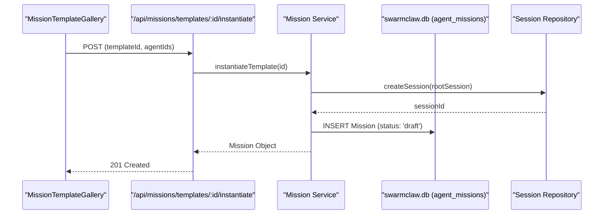
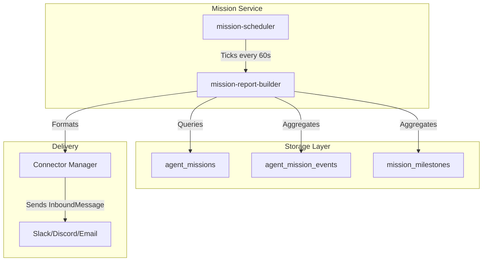

<!-- source: DeepWiki mcp.deepwiki.com · repo swarmclawai/swarmclaw · page 14.1 Mission Service · fetched 2026-10-26 -->

# Mission Service

Relevant source files

The following files were used as context for generating this wiki page:

- [.eslint-baseline.json](.eslint-baseline.json)
- [README.md](README.md)
- [package-lock.json](package-lock.json)
- [package.json](package.json)
- [src/app/api/missions/[id]/route.ts](src/app/api/missions/[id]/route.ts)
- [src/app/api/missions/route.ts](src/app/api/missions/route.ts)
- [src/app/api/missions/templates/[id]/instantiate/route.ts](src/app/api/missions/templates/[id]/instantiate/route.ts)
- [src/app/api/missions/templates/route.ts](src/app/api/missions/templates/route.ts)
- [src/app/missions/page.tsx](src/app/missions/page.tsx)
- [src/cli/index.js](src/cli/index.js)
- [src/cli/spec.js](src/cli/spec.js)
- [src/components/missions/mission-template-gallery.tsx](src/components/missions/mission-template-gallery.tsx)
- [src/components/missions/mission-template-install-dialog.tsx](src/components/missions/mission-template-install-dialog.tsx)
- [src/lib/server/agents/subagent-runtime.ts](src/lib/server/agents/subagent-runtime.ts)
- [src/lib/server/agents/subagent-swarm.test.ts](src/lib/server/agents/subagent-swarm.test.ts)
- [src/lib/server/agents/subagent-swarm.ts](src/lib/server/agents/subagent-swarm.ts)
- [src/lib/server/missions/mission-service.ts](src/lib/server/missions/mission-service.ts)
- [src/lib/server/missions/mission-templates.test.ts](src/lib/server/missions/mission-templates.test.ts)
- [src/lib/server/missions/mission-templates.ts](src/lib/server/missions/mission-templates.ts)
- [src/lib/server/session-tools/subagent.ts](src/lib/server/session-tools/subagent.ts)
- [src/lib/server/storage-normalization.ts](src/lib/server/storage-normalization.ts)
- [src/lib/server/storage.ts](src/lib/server/storage.ts)
- [src/types/index.ts](src/types/index.ts)
- [src/types/mission.ts](src/types/mission.ts)

The Mission Service provides a framework for goal-driven, long-running agent activities. Unlike standard chat sessions, Missions include explicit success criteria, strict budget enforcement (USD, tokens, turns, and time), automated milestone tracking, and scheduled reporting.

## Overview and Core Entities

Missions are managed via the `Mission` interface and persisted in the `agent_missions` collection within the primary SQLite database [src/lib/server/storage.ts:182-182](). A mission is tied to a `rootSessionId` which serves as the orchestration hub for the agents assigned to that mission [src/types/mission.ts:105-105]().

### Mission Budget
The `MissionBudget` interface defines the guardrails for autonomous execution [src/types/mission.ts:25-38]():
*   `maxUsd`: Hard limit on financial spend.
*   `maxTokens`: Limit on total LLM token consumption.
*   `maxTurns`: Limit on the number of execution loops/steps.
*   `maxWallclockSec`: Time limit from mission start.
*   `maxParallelBranches`: Cap on concurrent sub-agents spawned via `spawn_subagent` [src/lib/server/agents/subagent-swarm.ts:130-132]().

### Mission Milestones
The system automatically records `MissionMilestone` entries to track progress [src/types/mission.ts:51-59](). Milestone types include `started`, `budget_warn`, `budget_hit`, `check_in`, `subgoal_done`, and `report_sent` [src/types/mission.ts:12-23]().

## Mission Lifecycle Management

Missions are created and updated through the `mission-service`.

| Function | Role | Source |
| :--- | :--- | :--- |
| `createMission` | Initializes a mission record, creates a root session, and attaches agents. | `src/lib/server/missions/mission-service.ts` |
| `updateMission` | Modifies goal, criteria, or budget constraints. | `src/lib/server/missions/mission-service.ts` |
| `instantiateTemplate` | Creates a mission from `BUILT_IN_MISSION_TEMPLATES`. | `src/lib/server/missions/mission-templates.ts` |

### Data Flow: Mission Creation
The following diagram illustrates the transition from a Template to a live Mission.

**Mission Initialization Flow**

Sources: [src/types/mission.ts:100-123](), [src/lib/server/storage.ts:182-182](), [src/lib/server/missions/mission-templates.ts:28-28]()

## Budget Enforcement and Hooks

The `mission-budget-hook` is responsible for real-time monitoring of resource consumption. It intercepts session usage updates and compares them against the `MissionBudget` [src/types/mission.ts:25-38]().

*   **Warning Thresholds**: By default, warnings are triggered at 50%, 80%, and 95% of the budget (`DEFAULT_MISSION_WARN_FRACTIONS`) [src/types/mission.ts:125-125]().
*   **Exhaustion Transitions**: When a hard limit is reached, the mission status transitions to `budget_exhausted` [src/types/mission.ts:8-8]().
*   **Parallelism Control**: The `maxParallelBranches` property in the budget is used by `_clampSwarmConcurrency` to restrict the scale of `spawn_subagent` calls, preventing accidental recursive "explosions" [src/lib/server/agents/subagent-swarm.ts:134-140]().

## Automated Reporting

Missions support automated status updates through the `mission-scheduler` and `mission-report-builder`.

### Report Generation Loop
1.  **Scheduler**: A background tick (managed by `mission-scheduler`) checks `MissionReportSchedule` for active missions [src/types/mission.ts:61-66]().
2.  **Builder**: If `intervalSec` has elapsed, the `mission-report-builder` aggregates recent `MissionMilestone` entries and `MissionEvent` records [src/types/mission.ts:90-98]().
3.  **LLM Summarization**: An agent is invoked to transform the raw event log into a structured report (Markdown, Slack, or Discord format) [src/types/mission.ts:10-10]().
4.  **Delivery**: The report is sent via the `reportConnectorIds` [src/types/mission.ts:112-112]().

**Mission Reporting Architecture**

Sources: [src/types/mission.ts:76-88](), [src/lib/server/storage.ts:182-184](), [src/lib/server/missions/mission-service.ts]()

## REST API Endpoints

The Mission Service is exposed via `/api/missions` [src/cli/index.js:207-220]().

| Method | Endpoint | Description |
| :--- | :--- | :--- |
| `GET` | `/api/missions` | List all missions [src/cli/index.js:208-208](). |
| `POST` | `/api/missions` | Create a new mission [src/cli/index.js:210-210](). |
| `GET` | `/api/missions/:id` | Get mission details, usage, and milestones [src/cli/index.js:209-209](). |
| `PUT` | `/api/missions/:id` | Update mission config or budget [src/cli/index.js:211-211](). |
| `POST` | `/api/missions/:id/pause` | Pause mission heartbeats and activity [src/cli/index.js:215-215](). |
| `GET` | `/api/missions/templates` | List available mission templates [src/cli/index.js:222-222](). |

Sources: [src/cli/index.js:207-225](), [src/cli/spec.js:154-172]()

---

